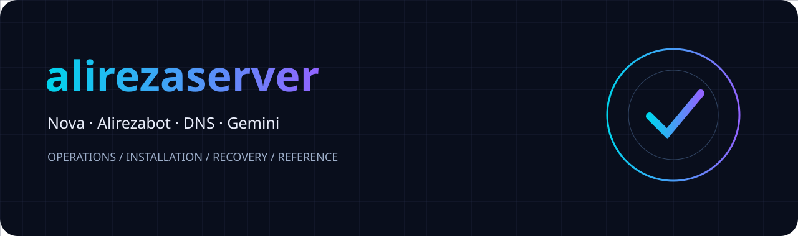
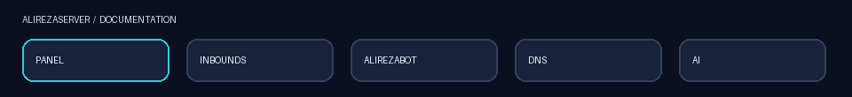
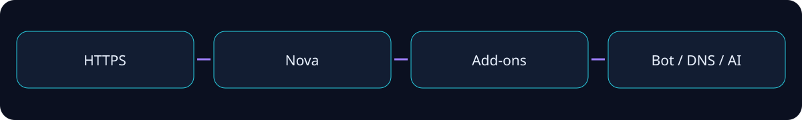
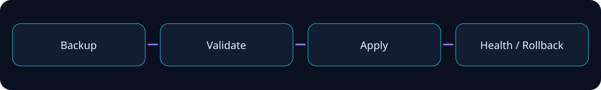

<div align="center">



# 🚀 alirezaserver

### راهنمای نصب، مدیریت، فروش و نگهداری

**نوا · اینباندها · Alirezabot · AdGuard · alirezadns · Gemini**



[شروع سریع](#شروع-سریع) · [امکانات](#امکانات) · [پورتها](#پورتها) · [عیبیابی](#عیبیابی) · [مرجع فنی](#مرجع-فنی)

</div>

> این فایل مستندات است و هیچ سرویس یا کانفیگی را تغییر نمی‌دهد. تصاویر موشن صرفاً معرفی بخش‌ها هستند؛ نشانگر وضعیت واقعی نصب یا سرویس نیستند.

## شروع سریع

### 📦 انتشار در مخزن

1. از مخزن و نصب موجود پشتیبان بگیرید.
2. ZIP بیرونی بستهٔ انتشار را استخراج کنید.
3. همهٔ فایل‌های بیرونی بستهٔ انتشار را در ریشهٔ مخزن قرار دهید.
4. فایل داخلی `source-code.zip` را برای انتشار از طریق وب GitHub استخراج نکنید.
5. برای این راهنما، `README.md` و پوشهٔ `assets` را کنار هم در ریشه قرار دهید.
6. پوشهٔ `assets` موجود را حذف نکنید؛ فقط فایل‌های هم‌نام این بسته را اضافه یا جایگزین کنید.
7. نسخهٔ نصب‌شونده متعلق به `install.sh` منتشرشده است؛ جایگزینی README به‌تنهایی پنل را ارتقا نمی‌دهد.

### ⚡ نصب تک‌خطی

پس از انتشار فایل‌های معتبر در مخزن خودتان:

```bash
curl -fL --connect-timeout 15 --max-time 180 https://raw.githubusercontent.com/alirezachatgpt97-coder/alirezaserver/main/install.sh -o install.sh && sudo bash install.sh
```

برای نصب موجود، ابتدا backup را از منوی `alireza` بگیرید و خارج از VPS نگهداری کنید. فایل دانلودشده را پیش از اجرای root بررسی کنید. اجرای نصاب از مخزن، همان نسخه‌ای را دریافت می‌کند که واقعاً در شاخهٔ `main` قرار داده‌اید.

### 🖥️ ورود به مدیریت ترمینال

```bash
sudo alireza
```

منوی انگلیسی برای اطلاعات پنل، مدیریت رمز، TLS، وضعیت سرویس‌ها، پشتیبان و عیب‌یابی استفاده می‌شود. رمزهای هش‌شده قابل بازیابی نیستند؛ در صورت فراموشی رمز جدید تعیین کنید. خروجی حاوی اطلاعات ورود را عمومی نکنید.

## امکانات

| بخش | کاربرد | نکتهٔ عملی |
|---|---|---|
| 📊 داشبورد نوا | وضعیت و مدیریت پنل | مقادیر زنده از backend می‌آیند |
| 🔌 اینباند | تنظیم و مدیریت ورودی‌ها | گزینه‌ها به پروتکل و نسخهٔ هسته وابسته‌اند |
| 👤 کاربران | دسترسی، سهمیه و اشتراک | مالکیت حساب‌ها را رعایت کنید |
| 🧑‍💼 نمایندگان | مدیریت مجاز مشتریان | سهمیهٔ reseller با نقش‌های مدیریتی یکی نیست |
| 🤖 Alirezabot | فروش و تحویل خدمات | توکن، کیف پول و سفارش اطلاعات حساس‌اند |
| 🛒 پلن نمایندگی | فروش حساب نماینده توسط مالک | داخل پنل وب ربات اصلی مدیریت می‌شود |
| 🧩 دسترسی گروهی | افزودن اینباند به حساب‌های انتخابی | پیش‌نمایش و تأیید پیش از اعمال |
| 🛡️ AdGuard | مدیریت DNS موجود | رابط و دادهٔ AdGuard مستقل باقی می‌مانند |
| 🌐 alirezadns | نصب روی سرور مقصد | SSH و اقدام صریح لازم است |
| ✨ AI | مشاوره با Gemini | کلید API کاربر لازم است |
| 🔐 TLS | اتصال رمزگذاری‌شده | صدور و تمدید باید واقعاً موفق شوند |
| 🔄 Update Guard | بررسی سازگاری نوا | هر نسخهٔ آینده الزاماً سازگار نیست |
| 💾 پشتیبان | حفاظت از داده و بازگشت | فایل پشتیبان محرمانه است |

## معماری



ورودی HTTPS، سرویس نوا و افزونه‌ها نقش‌های متفاوت دارند. باز شدن یک صفحهٔ داخلی به‌تنهایی سلامت پورت عمومی یا اتصال پروتکل را ثابت نمی‌کند. موفقیت DNS نیز به‌معنی سلامت Xray نیست. هر مسیر را جداگانه آزمایش کنید.

## پورتها

| مسیر | پورت متداول | عمومی؟ | توضیح |
|---|---|---|---|
| پنل و ورودی front | TCP 443 | بله | مطابق تنظیم واقعی نصب |
| HTTP / HTTP-01 | TCP 80 | در صورت نیاز | مسیر اعتبارسنجی CA باید قابل دسترسی باشد |
| Nova agent | 127.0.0.1:8088 | خیر | API داخلی را عمومی نکنید |
| Xray API | 127.0.0.1:10085 | خیر | کنترل داخلی هسته |
| AdGuard DNS | TCP/UDP 53 | وابسته به تنظیم | محدودیت و دسترسی resolver را بررسی کنید |
| ربات PHP | سوکت محلی | خیر | پشت مسیر پنل مدیریت‌شده |
| SSH مقصد DNS | پورت SSH انتخابی | مقصد | لزوماً 22 نیست |
| OpenVPN و سایر پروتکل‌ها | انتخابی | وابسته به سرویس | TCP و UDP را اشتباه نگیرید |

این جدول فهرست پورت‌های فعال سرور شما نیست. مقدار واقعی را از تنظیمات پنل و `ss` بخوانید؛ سرویس‌های نصب‌شدهٔ دیگر ممکن است پورت‌های دیگری داشته باشند.

## 🔐 TLS و دامنه

| حالت | نیاز | بررسی موفقیت |
|---|---|---|
| دامنه / HTTP-01 | DNS صحیح و ورودی عمومی 80 | SAN، تاریخ و زنجیرهٔ معتبر |
| دامنه / Cloudflare DNS-01 | توکن محدود به zone و مجوز DNS لازم | رکورد challenge و صدور واقعی |
| IP عمومی | پشتیبانی CA و نصاب از IP certificate | SAN از نوع IP و تمدید کوتاه‌مدت |
| خودامضا | رمزگذاری بدون اعتماد عمومی | هشدار مرورگر طبیعی است |

- برای Cloudflare از Full (strict) همراه گواهی مبدأ معتبر استفاده کنید.
- حالت Flexible جایگزین TLS معتبر مبدأ نیست.
- پروکسی Cloudflare مسیر همهٔ پروتکل‌های TCP/UDP را عبور نمی‌دهد.
- دامنهٔ پنل و نشانی اتصال کلاینت الزاماً یک مسیر ندارند.
- نام دامنه، SNI، Host، port و transport باید با تنظیم سمت سرور سازگار باشند.
- رمز خصوصی، token DNS و فایل backup را در issue یا تصویر منتشر نکنید.
- نصب بدون دامنه به‌تنهایی تضمین صدور گواهی مورد اعتماد IP نیست؛ نتیجهٔ واقعی CA را بررسی کنید.

## 🔌 اینباندها و اتصال کاربران

1. پروتکل موردنیاز را از فهرست واقعی پنل انتخاب کنید.
2. پورت آزاد و TCP/UDP صحیح را تعیین کنید.
3. تنظیم transport و security را مطابق همان پروتکل کامل کنید.
4. در TLS نام‌ها و فایل‌های گواهی باید قابل خواندن برای هویت واقعی سرویس باشند.
5. در REALITY از تنظیم سازگار سرور و کلاینت استفاده کنید؛ TLS و REALITY را با هم خلط نکنید.
6. حساب را به اینباند مجاز متصل کنید.
7. لینک اشتراک تازه را در کلاینت update کنید.
8. اتصال واقعی را از شبکهٔ موردنظر آزمایش کنید.

پینگ IP، تست اتصال TLS و تأخیر یک کانفیگ VPN سه آزمایش متفاوت‌اند. سالم بودن IP سرور، درست بودن UUID، پورت، transport، DNS یا مسیر اپراتور را ثابت نمی‌کند. هیچ README یا تنظیم عمومی تضمین دسترسی از همهٔ شبکه‌ها نمی‌دهد.

### 🧩 دسترسی گروهی اینباند — راهنمای rc.16

این قابلیت به نسخهٔ دارای پیاده‌سازی گروهی نیاز دارد؛ کپی این README آن را به نسخه‌های قدیمی اضافه نمی‌کند.

| مرحله | اقدام | نتیجه |
|---|---|---|
| 1 | با حساب مالک وارد پنل وب ربات شوید | عملیات گروهی در محدودهٔ مالک |
| 2 | نوع حساب را انتخاب کنید | کاربران VPN یا نمایندگان واقعی |
| 3 | جست‌وجو و انتخاب حساب‌ها | صفحه، انتخاب چندگانه یا نتایج جست‌وجو |
| 4 | اینباندهای فعال را انتخاب کنید | چند اینباند در یک عملیات |
| 5 | پیش‌نمایش بگیرید | تغییر پیشنهادی و موارد بدون تغییر |
| 6 | تأیید آگاهانه کنید | ثبت و اجرای عملیات واقعی |
| 7 | نتیجه را بررسی کنید | موفق، خطا، در انتظار، بدون تغییر |
| 8 | اشتراک کلاینت را تازه کنید | دریافت مسیرهای جدید مجاز |

- حالت اصلی افزودن دسترسی است؛ جایگزینی کورکورانهٔ فهرست قبلی نیست.
- کاربران با دسترسی نامحدود اینباند نباید ناخواسته محدود شوند.
- تغییر هم‌زمان مجوزها می‌تواند باعث توقف همان مورد برای بازبینی شود.
- برای نمایندهٔ دارای مشتری، سازگاری مجوز مشتریان نیز بررسی می‌شود.
- توقف عملیات به معنی برگشت خودکار موارد تمام‌شده نیست.
- بازگشت فقط برای موارد قابل تأیید و بدون تعارض اجرا می‌شود.
- خطای اعمال runtime را با موفقیت نوشتن دیتابیس یکی ندانید.
- سقف ایمنی هر عملیات، محدودیت تعداد کل کاربران پنل نیست.

## 🤖 Alirezabot و پنل وب میرزا

### راه‌اندازی

1. از BotFather توکن اختصاصی بگیرید.
2. ربات را از بخش Alirezabot پنل راه‌اندازی کنید.
3. وضعیت و نتیجهٔ واقعی نصب را ببینید؛ نمایش صفحه به‌تنهایی تأیید نصب کامل نیست.
4. اطلاعات ورود اولیه را امن ذخیره کنید.
5. در پنل وب ربات، اتصال پنل و محصولات را بررسی کنید.
6. یک سفارش آزمایشی کنترل‌شده انجام دهید.

### 🛒 فروش پلن نمایندگی

مالک در همان پنل وب اصلی میرزا وارد «فروش پنل نمایندگی» می‌شود و پلن، قیمت، حجم، حداقل/حداکثر حجم دلخواه، تعداد کاربران، اینباندهای مجاز و دسترسی‌ها را تنظیم می‌کند. عنوان دکمه ممکن است با ترجمه یا نسخهٔ پنل متفاوت باشد.

| فیلد | مفهوم | کنترل پیشنهادی |
|---|---|---|
| نام پلن | عنوانی که مشتری می‌بیند | واضح و بدون وعدهٔ نامعتبر |
| قیمت ثابت | هزینهٔ پلن با حجم مشخص | واحد پول را یکسان کنید |
| قیمت هر GB | مبنای حجم سفارشی | گردکردن مبلغ را بررسی کنید |
| حداقل حجم | کمترین حجم قابل خرید | مثبت و متناسب با قیمت |
| حداکثر حجم | بیشترین حجم قابل خرید | کمتر از حداقل نباشد |
| تعداد کاربران | محدودیت مجاز حساب | با امکانات واقعی نوا سازگار |
| نقش | reseller یا نقش مدیریتی | برای سهمیهٔ حجمی reseller |
| مجوزها | سطح اختیار حساب | اصل کمترین دسترسی |
| اینباند | مسیرهای مجاز | فقط سرویس‌های فعال و مجاز |

حساب‌های reseller، manager و admin1 معادل نیستند. نقش مدیریتی گسترده را با عنوان پلن حجمی نفروشید. قابلیت فروش نمایندگی مختص مالک است؛ نمایندگان نباید از مسیر فروش مشتری، نمایندهٔ دیگری با اختیار بیشتر ایجاد کنند.

### 👤 مدیریت پنل من در تلگرام

در نسخهٔ دارای این امکانات، مشتری اطلاعات حساب، سهمیهٔ واقعی و مسیر مدیریت رمز را از ربات پیگیری می‌کند. رمز هش‌شده از دیتابیس قابل استخراج نیست؛ اگر رمز فعلی قابل بازیابی نباشد باید مسیر تغییر رمز استفاده شود. تصویر یا خروجی اطلاعات ورود را به افراد دیگر ارسال نکنید.

### 🧑‍💼 ربات اختصاصی نماینده

نمایندهٔ مجاز می‌تواند امکانات فروش مشتری خودش را در محدودهٔ سهمیه و دسترسی واقعی حساب استفاده کند. توکن ربات باید اختصاصی باشد. اطلاعات سفارش، کیف پول و مشتریان بین نمایندگان باید جدا بمانند. مسیر نصب و منابع مصرفی هر instance به نسخهٔ نصب‌شده وابسته است؛ تعداد ربات‌های بیشتر رایگان از نظر RAM/DB نیست.

### 💳 سفارش و پرداخت

- پیش از تحویل، وضعیت پرداخت واقعی را بررسی کنید.
- پاسخ دیرهنگام شبکه نباید با خرید جدید جایگزین شود؛ ابتدا سفارش قبلی را پیگیری کنید.
- موجودی کیف پول، فاکتور و تحویل حساب سه وضعیت مرتبط ولی جدا هستند.
- بازپرداخت را از مسیر مدیریتی همان سفارش انجام دهید.
- سفارش تحویل‌شده را بدون بررسی حساب مقصد refund نکنید.
- خطای SQL را با حذف دیتابیس یا نصب مجدد VPS درمان نکنید.

## 🛡️ AdGuard

این راهنما تغییری در رابط یا عملکرد AdGuard نمی‌دهد. وضعیت resolver، listener و upstream را از خود سرویس بررسی کنید. پاسخ گرفتن DNS محلی سلامت دسترسی عمومی یا رمزگذاری DoH/DoT را ثابت نمی‌کند. resolver باز بدون سیاست دسترسی می‌تواند مورد سوءاستفاده قرار گیرد؛ دسترسی مطلوب خودتان را از تنظیم واقعی سرویس تعیین کنید.

## 🌐 نصب مقصد alirezadns

| مرحله | اطلاعات | اقدام |
|---|---|---|
| مقصد | IP/دامنه و SSH port | صحت نشانی را بررسی کنید |
| احراز هویت | کلید یا روش پشتیبانی‌شده | اطلاعات محرمانه را وارد فرم مجاز کنید |
| بررسی | اتصال و پیش‌نیازها | نتیجهٔ واقعی را بخوانید |
| نصب | تأیید صریح کاربر | روی مقصد اجرا می‌شود |
| نتیجه | وضعیت و لینک مقصد | از شبکهٔ خودتان باز کنید |

سرور مقصد از سرور اصلی متفاوت است. دسترسی root، تنظیمات DNS و پورت‌های سرور اصلی را برای نصب مقصد کورکورانه تغییر ندهید. در قطع ارتباط، وضعیت عملیات قبلی را بررسی کنید و از اجرای هم‌زمان چند نصب روی یک مقصد خودداری کنید.

## ✨ Gemini AI

کلید را در تنظیمات مجاز پنل وارد کنید؛ نیازی به ارسال آن در چت پشتیبانی نیست. دستیار نقش مشاور دارد و نباید به‌طور خودکار دستور مدل را روی سرور اجرا کند. مدل قابل استفاده به دسترسی حساب API و نسخهٔ اتصال بستگی دارد؛ نام مدل قابل انتخاب را در تنظیمات واقعی ببینید.

| وضعیت | بررسی |
|---|---|
| کلید وجود ندارد | کلید را از بخش مجاز وارد کنید |
| خطای احراز هویت | اعتبار و مجوز کلید |
| سهمیه تمام شده | وضعیت حساب و rate limit |
| قطع شبکه | DNS و دسترسی خروجی سرور به API |
| پاسخ نامعتبر | لاگ پاک‌سازی‌شده و تلاش مجدد کنترل‌شده |

رمزها، UUID کاربران، توکن‌ها، private key و backup را در پیام AI قرار ندهید. قبل از ارسال لاگ، اطلاعات شخصی و شناسه‌های حساس را حذف کنید.

## 🔄 ارتقا و بازگشت



```bash
sudo bash install.sh --backup
sudo bash install.sh --update-status
sudo bash install.sh --update
sudo bash install.sh --check
```

این فرمان‌ها به فایل نصاب همان انتشار نیاز دارند. اگر `install.sh` در پوشهٔ فعلی نیست، ابتدا فایل معتبر را دریافت کنید. `--rollback` افزونه را با بازگردانی کل سیستم یا دیتابیس یکسان ندانید؛ توضیح دقیق نصاب و منوی همان نسخه ملاک است.

| مورد حفاظت | اقدام پیش از ارتقا | بررسی پس از ارتقا |
|---|---|---|
| برند و منو | نسخهٔ فعلی و backup | نام‌ها و مسیرهای مجاز |
| کاربران | snapshot سازگار دیتابیس | تعداد و یک حساب نمونه |
| نمایندگان | سهمیه و دسترسی نمونه | ورود و محدودیت‌ها |
| ربات | dump سازگار و کلیدها | ورود، پلن، سفارش نمونه |
| TLS | گواهی و private key امن | SAN، expiry و handshake |
| AdGuard | backup تنظیم/داده | پاسخ DNS بدون تغییر ناخواسته |
| اینباند | backup تنظیم و نگاشت | اتصال واقعی با کلاینت |
| AI | کلید و تنظیمات امن | پاسخ مجاز بدون افشای کلید |

نصب آخرین نسخهٔ نوا فقط پس از بررسی سازگاری انجام می‌شود. هیچ محافظی سازگاری با همهٔ نسخه‌های آینده را تضمین نمی‌کند. در شکست بررسی، نسخهٔ سالم قبلی باید مبنای بازگشت باشد، نه حذف داده‌ها.

## 💾 پشتیبان

پشتیبان کامل تنها فایل تنظیمات نمایشی نیست. دیتابیس ربات، دادهٔ افزونه، کلید رمزگشایی، تنظیمات نوا، گواهی‌ها و اطلاعات ضروری سرویس‌ها باید مطابق ابزار پشتیبان نسخهٔ شما پوشش داده شوند. بدون کلید، دادهٔ رمز‌شده ممکن است قابل بازیابی نباشد. بازیابی را ابتدا در محیط جداگانه امتحان کنید.

## ⚙️ منابع و بهینه‌سازی

| مصرف | شامل چه چیزهایی است؟ | نحوهٔ تفسیر |
|---|---|---|
| پایهٔ پنل | کنترلر و فرایندهای ضروری | فقط بخشی از کل مصرف |
| سرویس‌های جانبی | PHP، MariaDB، DNS و غیره | با نصب اختیاری افزایش می‌یابد |
| هسته‌های پروتکل | Xray و سرویس‌های انتخابی | به پروتکل و تنظیم وابسته |
| زیر بار | اتصال هم‌زمان، ترافیک و logging | با مصرف idle یکی نیست |

هدف VPS ضعیف، تضمین اجرای هر تعداد کاربر و همهٔ سرویس‌ها روی ۱ GB نیست. این ویرایش فقط مستندات است؛ ادعای benchmark جدید ندارد. ظرفیت را با workload واقعی خودتان اندازه بگیرید. فایل‌های SVG/GIF این راهنما در مسیر اجرای پنل وارد نمی‌شوند.

## عیبیابی

### 🩺 جمع‌آوری وضعیت بدون تغییر تنظیمات

```bash
sudo systemctl status nova-agent.service xray.service --no-pager -l
sudo ss -lntup
sudo journalctl -u xray.service -n 60 --no-pager
sudo journalctl -u nova-agent.service -n 60 --no-pager
node -v
php -v
```

`php: command not found` پیش از نصب اختیاری ربات الزاماً خطای پنل نیست. خروجی `ss` یا لاگ ممکن است اطلاعات حساس داشته باشد؛ قبل از انتشار پاک‌سازی کنید.

| نشانه | علت‌های قابل بررسی | اقدام مناسب |
|---|---|---|
| ECONNREFUSED روی 443 | listener وجود ندارد یا سرویس متوقف است | وضعیت هسته، پورت و آخرین خطا |
| permission denied روی config | مالکیت یا عبور از پوشه ناسازگار است | هویت واقعی سرویس و مجوز فایل |
| permission denied روی log | پوشه/فایل برای هویت سرویس writable نیست | بررسی مالکیت؛ از chmod 777 خودداری کنید |
| permission denied روی PEM | مسیر گواهی قابل خواندن نیست | بررسی certificate/key و پوشه‌های والد |
| صفحه باز می‌شود، VPN نه | مسیر web و data متفاوت‌اند | پورت، transport و تنظیم کلاینت |
| با VPN باز می‌شود، مستقیم نه | مسیر ISP/DNS/TLS یا مسدودسازی | تست از چند شبکه؛ تضمین رفع با یک گزینه ممکن نیست |
| Cloudflare روشن، UDP قطع | پروکسی عمومی مناسب این مسیر نیست | معماری endpoint را بررسی کنید |
| خطای SQL پلن | migration، schema یا query | backup و بررسی خطای دقیق؛ دیتابیس را پاک نکنید |
| آپدیت رد می‌شود | شبکه یا بررسی سازگاری | update-status و لاگ مرحله |
| لینک جدید دیده نمی‌شود | cache اشتراک یا مجوز | update subscription و بررسی مجوز واقعی |

هشدار deprecated transport به‌تنهایی علت توقف نیست؛ خطای نهایی startup را بخوانید. تغییر هویت Xray به root یا بازکردن همهٔ فایل‌ها راه‌حل عمومی مجوز نیست.

## 🧪 آزمون و حدود اطمینان

راهنما جای تست نصب واقعی، Telegram، صدور CA، اینترنت اپراتور و آزمون طولانی‌مدت را نمی‌گیرد. گزارش اعتبارسنجی داخل همان بستهٔ انتشار مرجع نتیجهٔ آزمون آن نسخه است. این فایل نه رفع باگ جدید ادعا می‌کند و نه تست‌های پیشین را تکرار کرده است.

## 📚 مجوز و منابع

[مخزن alirezaserver](https://github.com/alirezachatgpt97-coder/alirezaserver) · [نوا](https://github.com/IRNova/Nova-Server)

مجوزها را از `LICENSE` و `SOURCES.md` همان انتشار بخوانید. افزودن این مستندات مجوز وابستگی‌ها را تغییر نمی‌دهد. موشن و SVG این بسته برای معرفی مستندات ساخته شده‌اند و تصویر واقعی داشبورد نیستند.

## مرجع فنی

ضمیمهٔ زیر برای توسعه‌دهنده و بررسی‌کنندهٔ انتشار است؛ کدهای آن دستور نصب دستی نیستند. برای رسیدن به حجم درخواستی، به‌جای تکرار متن، فایل‌ها و قطعه‌کدهای واقعیِ قابل پیگیری آورده شده‌اند. هر مدخل مسیر، fingerprint، تعداد خطوط و excerpt شماره‌گذاری‌شده دارد.

**مبنای قابل بررسی ضمیمه:** سورس محلی `rc14-work`؛ این بخش ادعای استخراج سورس rc.16 نیست. بخش دسترسی گروهی بالاتر بر مبنای شرح تحویل rc.16 نوشته شده است. همیشه فایل‌های واقعی همان بستهٔ نصب‌شده را ملاک قرار دهید.

قطعه‌ها برای خواندن‌اند؛ کپی مستقل یک تابع بدون وابستگی‌های همان انتشار پشتیبانی نمی‌شود. داده‌های embedded و payloadهای حجیم از مرجع حذف شده‌اند.

<details>
<summary>📄 مرجع ai-ui.js — 30 خط سورس</summary>

### `ai-ui.js`

| مشخصه | مقدار |
|---|---|
| مسیر سورس | `addon/ai-ui.js` |
| مبنا | snapshot محلی rc.14 |
| خطوط کل | 30 |
| خطوط قابل نمایش این گزیده | 21 |
| SHA-256 | `2ee8ca502b85034607c00e6bad4119d7f5cb36196a4cf7b0592e6bc970c9b7dd` |

شمارهٔ سمت چپ، خط اصلی فایل است؛ هنگام استفادهٔ توسعه‌ای شماره‌ها را وارد کد نکنید. گزیده ممکن است در میانهٔ تابع تمام شود و مستقل قابل اجرا نیست.

```javascript
00001  /* SPDX-License-Identifier: GPL-3.0-or-later */
00002  (()=>{'use strict';const $=s=>document.querySelector(s),base=new URL('../api/ai/',location.href).pathname;
00003  const theme=new URLSearchParams(location.search).get('theme');if(['dark','light'].includes(theme)){document.documentElement.dataset.theme=theme;document.dispatchEvent(new Event('alireza-theme'));}
00004  let lang=initialLanguage(),current=null,busy=false,controller=null,cfg={},lastPrompt='',lastModel='',paint=0,historyOffset=0;
00005  function initialLanguage(){try{if(parent!==window)return parent.document.documentElement.lang==='fa'||parent.document.documentElement.dir==='rtl'?'fa':'en';}catch{}const requested=new URLSearchParams(location.search).get('lang');if(['fa','en'].includes(requested))return requested;try{return localStorage.getItem('alireza-lang')==='en'?'en':'fa';}catch{return 'fa';}}
00008  const t=k=>strings[lang][k]||k,msg=code=>errors[code]?.[lang==='fa'?0:1]||code||t('unknown');
00009  const el=(tag,text,cls)=>{const x=document.createElement(tag);if(text!==undefined)x.textContent=text;if(cls)x.className=cls;return x;};
00010  function notice(s=''){$('#notice').hidden=!s;$('#notice').textContent=s;}
00011  async function api(path='',method='GET',data){const r=await fetch(base+path,{method,credentials:'same-origin',cache:'no-store',headers:data?{'content-type':'application/json'}:{},body:data?JSON.stringify(data):undefined});const j=await r.json();if(!r.ok)throw Error(msg(j.code||j.error));return j;}
00013  function textContent(container,text){container.replaceChildren();const segments=text.split(/(```[\s\S]*?```)/g);for(const segment of segments){if(segment.startsWith('```')&&segment.endsWith('```')){const code=el('code',segment.slice(3,-3).replace(/^[^\n]*\n/,'')),pre=el('pre');pre.append(code);container.append(pre);}else{const p=el('span',segment);p.dir='auto';container.append(p);}}}
00016  async function load(id){if(busy)return;try{const c=await api('chats/'+id);current=id;historyOffset=c.offset||0;$('#older').hidden=!historyOffset;$('#title').textContent=c.title;$('#messages').replaceChildren();c.messages.forEach(m=>bubble(m.role,m.text));lastPrompt=c.messages.findLast(m=>m.role==='user')?.text||'';notice();}catch(e){notice(e.message);}}
00017  function newChat(){if(busy)return;current=null;historyOffset=0;$('#older').hidden=true;lastPrompt='';$('#title').textContent='AI';$('#messages').replaceChildren();notice();}
00018  function setBusy(value){busy=value;$('#send').disabled=value;$('#retry').disabled=value||!lastPrompt;$('#new').disabled=value;$('#stop').hidden=!value;translate();}
00019  async function send(retry=false){if(busy)return;const text=retry?lastPrompt:$('#prompt').value.trim();if(!text)return;notice();lastPrompt=text;lastModel=$('#model').value||cfg.model;controller=new AbortController();setBusy(true);if(!retry)bubble('user',text);else{const last=$('#messages').lastElementChild;if(last?.classList.contains('model'))last.remove();}const output=bubble('model','');let answer='';
00021  textContent(output,answer);$('#prompt').value='';await history();}catch(e){notice(e.name==='AbortError'?msg('AI_STOPPED'):e.message);}finally{if(paint){cancelAnimationFrame(paint);paint=0;}textContent(output,answer);setBusy(false);controller=null;}}
00022  $('#older').onclick=async()=>{if(busy||!current||!historyOffset)return;try{const c=await api('chats/'+current+'/before/'+historyOffset);for(const m of c.messages.slice().reverse()){const content=bubble(m.role,m.text);$('#messages').insertBefore(content.parentElement,$('#messages').firstElementChild);}historyOffset=c.offset;$('#older').hidden=!historyOffset;}catch(e){notice(e.message);}};
00025  $('#configform').onsubmit=async e=>{e.preventDefault();$('#saveconfig').disabled=true;try{cfg=await api('settings','PUT',{apiKey:$('#key').value,model:$('#model').value,maxOutputTokens:+$('#tokens').value,requestsPerMinute:+$('#rpm').value});$('#key').value='';$('#configmessage').textContent=t('saved');translate();}catch(e){$('#configmessage').textContent=e.message;}finally{$('#saveconfig').disabled=false;}};
00026  $('#deletekey').onclick=async()=>{if(!confirm(t('confirm')))return;try{cfg=await api('settings','PUT',{deleteKey:true});$('#key').value='';translate();}catch(e){$('#configmessage').textContent=e.message;}};
00027  $('#summary').onclick=async()=>{try{const summary=await api('summary');const text=JSON.stringify(summary,null,2);if(confirm(t('summaryConfirm')+'\n\n'+text))$('#prompt').value+='\n'+text;}catch(e){notice(e.message);}};
00028  try{if(parent!==window)new MutationObserver(()=>{const next=initialLanguage();if(next!==lang){lang=next;translate();history().catch(e=>notice(e.message));}}).observe(parent.document.documentElement,{attributes:true,attributeFilter:['lang','dir']});}catch{}
00030  })();
```

</details>

<details>
<summary>📄 مرجع ai.mjs — 72 خط سورس</summary>

### `ai.mjs`

| مشخصه | مقدار |
|---|---|
| مسیر سورس | `addon/ai.mjs` |
| مبنا | snapshot محلی rc.14 |
| خطوط کل | 72 |
| خطوط قابل نمایش این گزیده | 66 |
| SHA-256 | `7eaad319a8d05d80fb8e32a911cf5256c1fe4bbf24d7ba573d49c782c50810e5` |

شمارهٔ سمت چپ، خط اصلی فایل است؛ هنگام استفادهٔ توسعه‌ای شماره‌ها را وارد کد نکنید. گزیده ممکن است در میانهٔ تابع تمام شود و مستقل قابل اجرا نیست.

```javascript
00001  // SPDX-License-Identifier: GPL-3.0-or-later
00002  // Advisor only. No subprocesses, tool execution, log collection or panel-data access.
00003  import {DatabaseSync} from 'node:sqlite';
00004  import {mkdirSync,chmodSync} from 'node:fs';
00005  import {randomBytes} from 'node:crypto';
00006  import {seal,unseal} from './vault.mjs';
00007  const root=process.env.ALIREZA_ROOT||'/var/lib/alirezaserver';
00008  const endpoint='https://generativelanguage.googleapis.com/v1beta/';
00009  const error=(code,status=400)=>Object.assign(Error(code),{status,code});
00010  let db,modelCache,modelsPending,modelEpoch=0;
00011  const active=new Map(),budgets=new Map();
00012  function store(){if(db)return db;mkdirSync(root,{recursive:true,mode:0o700});db=new DatabaseSync(root+'/ai.db');db.exec(`PRAGMA journal_mode=WAL; PRAGMA busy_timeout=5000;
00013  CREATE TABLE IF NOT EXISTS settings(k TEXT PRIMARY KEY,v TEXT NOT NULL);
00014  CREATE TABLE IF NOT EXISTS chats(id TEXT PRIMARY KEY,owner TEXT NOT NULL,title TEXT NOT NULL,messages TEXT NOT NULL,updated INTEGER NOT NULL);
00015  CREATE INDEX IF NOT EXISTS chats_owner ON chats(owner,updated);
00016  CREATE TABLE IF NOT EXISTS messages(chat_id TEXT NOT NULL,seq INTEGER NOT NULL,role TEXT NOT NULL,data TEXT NOT NULL,PRIMARY KEY(chat_id,seq));`);db.exec(`BEGIN IMMEDIATE;
00017  INSERT OR IGNORE INTO messages(chat_id,seq,role,data) SELECT chats.id,CAST(j.key AS INTEGER),json_extract(j.value,'$.role'),j.value FROM chats,json_each(chats.messages) AS j WHERE chats.messages!='[]';
00018  UPDATE chats SET messages='[]' WHERE messages!='[]'; COMMIT;`);
00019  chmodSync(root+'/ai.db',0o600);return db;}
00020  export function identity(auth){if(!auth||!['owner','admin','reseller','manager','admin1'].includes(auth.role))throw error('AI_FORBIDDEN',403);if(auth.role==='owner')return 'owner:'+String(auth.id||'primary');if(!auth.id)throw error('AI_IDENTITY_MISSING',403);return auth.role+':'+String(auth.id);}
00021  function value(k,otherwise){const row=store().prepare('SELECT v FROM settings WHERE k=?').get(k);return row?JSON.parse(row.v):otherwise;}
00022  function set(k,v){store().prepare('INSERT INTO settings VALUES(?,?) ON CONFLICT(k) DO UPDATE SET v=excluded.v').run(k,JSON.stringify(v));}
00023  function key(){const s=value('key',null);if(!s)throw error('AI_KEY_MISSING',409);return unseal(s,'gemini-key').key;}
00024  export function settings(auth){identity(auth);return{hasKey:!!value('key',null),model:value('model',''),maxOutputTokens:value('tokens',2048),requestsPerMinute:value('rpm',6),canManage:auth.role==='owner'};}
00025  export function configure(auth,input){
00026   identity(auth);if(auth.role!=='owner')throw error('AI_FORBIDDEN',403);
00027   if(!input||typeof input!=='object'||Array.isArray(input))throw error('AI_INVALID_SETTINGS');
00028   const changes=[];let changedKey=false;
00029   if(input.deleteKey&&input.apiKey)throw error('AI_INVALID_SETTINGS');
00030   if(input.apiKey){const k=String(input.apiKey).trim();if(k.length<16||k.length>512||!/^[-_A-Za-z0-9]+$/.test(k))throw error('AI_INVALID_KEY');changes.push(['key',seal({key:k},'gemini-key')]);changedKey=true;}
00031   if(input.model!==undefined){if(typeof input.model!=='string'||(input.model&&!/^models\/[A-Za-z0-9._-]+$/.test(input.model)))throw error('AI_INVALID_MODEL');changes.push(['model',input.model]);}
00032   for(const [field,k,min,max]of[['maxOutputTokens','tokens',128,32768],['requestsPerMinute','rpm',1,120]])if(input[field]!==undefined){const n=Number(input[field]);if(!Number.isInteger(n)||n<min||n>max)throw error('AI_INVALID_LIMIT');changes.push([k,n]);}
00033   const d=store();d.exec('BEGIN IMMEDIATE');try{if(input.deleteKey){d.prepare('DELETE FROM settings WHERE k=?').run('key');changedKey=true;}for(const [k,v]of changes)set(k,v);d.exec('COMMIT');}catch(e){d.exec('ROLLBACK');throw e;}
00034   if(changedKey){modelEpoch++;modelCache=null;modelsPending=null;for(const c of active.values())c.abort();}
00035   return settings(auth);
00036  }
00038  async function boundedJSON(r){let text='',size=0;for await(const b of r.body){size+=b.length;if(size>2*1024*1024){await r.body.cancel().catch(()=>{});throw error('AI_INVALID_RESPONSE',502);}text+=Buffer.from(b).toString();}try{return JSON.parse(text);}catch{throw error('AI_INVALID_RESPONSE',502);}}
00039  export async function models(auth){identity(auth);if(modelCache&&Date.now()-modelCache.at<300000)return modelCache.items;if(modelsPending)return modelsPending;
00041  export function chats(auth){return store().prepare('SELECT id,title,updated FROM chats WHERE owner=? ORDER BY updated DESC').all(identity(auth));}
00043  export function remove(auth,id){const owner=identity(auth);chat(auth,id);if(active.has(owner))throw error('AI_BUSY',409);store().exec('BEGIN IMMEDIATE');try{store().prepare('DELETE FROM messages WHERE chat_id=?').run(id);store().prepare('DELETE FROM chats WHERE id=? AND owner=?').run(id,owner);store().exec('COMMIT');}catch(e){store().exec('ROLLBACK');throw e;}return{ok:true};}
00045  export function sanitizedSummary(s){return{service:'OpenVPN',servers:s.servers?.map(x=>({transport:x.proto,status:x.status,enabled:x.enabled})),accounts:s.users?.length||0,activeSessions:s.sessions?.length||0,adguard:s.adguard};}
00046  export function stop(auth){const c=active.get(identity(auth));c?.abort();return{ok:true};}
00047  function saveChat(id,owner,title,messages,offset=0){const d=store();d.exec('BEGIN IMMEDIATE');try{d.prepare('INSERT INTO chats VALUES(?,?,?,?,?) ON CONFLICT(id) DO UPDATE SET updated=excluded.updated').run(id,owner,title,'[]',Date.now());
00048   const old=d.prepare('SELECT seq,data FROM messages WHERE chat_id=? AND seq>=?').all(id,offset);const oldBySeq=new Map(old.map(r=>[r.seq,r.data]));const put=d.prepare('INSERT INTO messages VALUES(?,?,?,?) ON CONFLICT(chat_id,seq) DO UPDATE SET role=excluded.role,data=excluded.data');
00049   for(let i=0;i<messages.length;i++){const m=messages[i],seq=offset+i,text=JSON.stringify(m);if(oldBySeq.get(seq)!==text)put.run(id,seq,m.role,text);}
00050   d.prepare('DELETE FROM messages WHERE chat_id=? AND seq>=?').run(id,offset+messages.length);d.exec('COMMIT');}catch(e){d.exec('ROLLBACK');throw e;}}
00051  export async function generate(auth,input,res){const owner=identity(auth);key();if(active.has(owner))throw error('AI_BUSY',409);
00052  const text=redact(input.text||'').trim();if(!text||text.length>16000)throw error('AI_MESSAGE_SIZE');
00053  const cfg=settings(auth);const bucket=budgets.get(owner),now=Date.now();if(bucket&&now-bucket.at<60000&&bucket.n>=cfg.requestsPerMinute)throw error('AI_LOCAL_LIMIT',429);
00054  if(!bucket||now-bucket.at>=60000){if(budgets.size>1024)budgets.delete(budgets.keys().next().value);budgets.set(owner,{at:now,n:1});}else bucket.n++;
00055  const previous=input.chatId?chat(auth,input.chatId):null;let messages=previous?.messages||[];
00056  if(input.retry&&messages.at(-1)?.role==='model')messages=messages.slice(0,-1);
00057  if(input.retry&&messages.at(-1)?.role==='user')messages=messages.slice(0,-1);
00058  const model=input.model||cfg.model;if(!model)throw error('AI_MODEL_REQUIRED',409);
00059  const controller=new AbortController();active.set(owner,controller);const timer=setTimeout(()=>controller.abort(),120000);timer.unref();const abort=()=>controller.abort();res.on('close',abort);
00060  const id=previous?.id||randomBytes(12).toString('hex'),title=previous?.title||text.slice(0,80);let answer='',started=false,usage=null,reason=null;
00061  const event=async(type,data)=>{if(res.destroyed)return;const frame='event: '+type+'\ndata: '+JSON.stringify(data)+'\n\n';if(!res.write(frame))await new Promise(resolve=>{const done=()=>{res.off('drain',done);res.off('close',done);resolve();};res.once('drain',done);res.once('close',done);});};
00062  try{const available=await models(auth);const selected=available.find(m=>m.name===model);if(!selected)throw error('AI_MODEL_UNAVAILABLE',409);
00063  messages=[...messages,{role:'user',text}];const contents=[];let length=0;for(const m of messages.slice(-40).reverse()){if(length+m.text.length>48000)break;length+=m.text.length;contents.unshift({role:m.role,parts:[{text:redact(m.text)}]});}while(contents[0]?.role==='model')contents.shift();
00065  if(!String(r.headers.get('content-type')).includes('text/event-stream')){await r.body.cancel();throw error('AI_INVALID_RESPONSE',502);}
00066  res.writeHead(200,{'content-type':'text/event-stream; charset=utf-8','cache-control':'no-store','x-accel-buffering':'no','x-content-type-options':'nosniff'});started=true;await event('chat',{id,title});saveChat(id,owner,title,messages,previous?.offset||0);
00067  let pending='',total=0;const decoder=new TextDecoder();
00069  if(pending.trim())throw error('AI_INVALID_RESPONSE',502);if(!answer)throw error(reason==='SAFETY'||reason==='BLOCKLIST'?'AI_BLOCKED':'AI_EMPTY_RESPONSE',502);
00070  saveChat(id,owner,title,[...messages,{role:'model',text:answer,finishReason:reason}],previous?.offset||0);await event('done',{id,usage,finishReason:reason});
00071  }catch(e){const code=controller.signal.aborted?'AI_STOPPED':e.code||'AI_PROVIDER_ERROR';if(answer)saveChat(id,owner,title,[...messages,{role:'model',text:answer,incomplete:true}],previous?.offset||0);if(started)await event('error',{code});else throw error(code,e.status||502);
00072  }finally{clearTimeout(timer);res.off('close',abort);active.delete(owner);if(started&&!res.writableEnded)res.end();}}
```

</details>

<details>
<summary>📄 مرجع alireza-cli.sh — 2 خط سورس</summary>

### `alireza-cli.sh`

| مشخصه | مقدار |
|---|---|
| مسیر سورس | `addon/alireza-cli.sh` |
| مبنا | snapshot محلی rc.14 |
| خطوط کل | 2 |
| خطوط قابل نمایش این گزیده | 2 |
| SHA-256 | `3f86695f412e4ef32b1c40065e321b0dc5f8d67d0566d29297b2e323e1e072a9` |

شمارهٔ سمت چپ، خط اصلی فایل است؛ هنگام استفادهٔ توسعه‌ای شماره‌ها را وارد کد نکنید. گزیده ممکن است در میانهٔ تابع تمام شود و مستقل قابل اجرا نیست.

```bash
00001  #!/bin/sh
00002  exec /usr/bin/python3 /opt/alirezaserver/alireza.py "$@"
```

</details>

<details>
<summary>📄 مرجع alireza.py — 164 خط سورس</summary>

### `alireza.py`

| مشخصه | مقدار |
|---|---|
| مسیر سورس | `addon/alireza.py` |
| مبنا | snapshot محلی rc.14 |
| خطوط کل | 164 |
| خطوط قابل نمایش این گزیده | 163 |
| SHA-256 | `c92532e75c0fde460a0ce206a1497a437531e676df82dd24e5ed46d61fdf4104` |

شمارهٔ سمت چپ، خط اصلی فایل است؛ هنگام استفادهٔ توسعه‌ای شماره‌ها را وارد کد نکنید. گزیده ممکن است در میانهٔ تابع تمام شود و مستقل قابل اجرا نیست.

```python
00001  #!/usr/bin/env python3
00002  """On-demand English root terminal manager. No resident process or password argv."""
00003  import argparse,datetime,getpass,json,os,pathlib,secrets,shutil,socket,ssl,subprocess,sys,urllib.request
00004  APP=pathlib.Path('/opt/alirezaserver')
00005  UNITS={'panel':'nova-agent.service','xray':'xray.service','bot':'alirezabot-php.service','telegram':'alirezabot-poller.service','dns':'AdGuardHome.service'}
00006  def run(args,**kw):return subprocess.run([str(x) for x in args],check=True,**kw)
00007  def bot(operation,**data):return json.loads(run(['python3',APP/'bot-manager.py'],input=json.dumps({'operation':operation,**data}),capture_output=True,text=True).stdout)
00008  def tls_call(value,capture=False):
00009   return run(['node',APP/'tls-control.mjs'],input=json.dumps(value),capture_output=capture,text=True)
00010  def panels():
00011   p=run(['nova-access'],capture_output=True,text=True);print(p.stdout,end='')
00012   for line in p.stdout.splitlines():
00013    if line.startswith('Panel URL: '):
00014     url=line.split(': ',1)[1].rstrip('/')+'/'
00015     for name,tail in [('Bot','bot/web/panel/'),('AI','ai/'),('AdGuard','dns/'),('Remote DNS','alirezadns/')]:print(f'{name:12} {url}alireza/{tail}')
00016   print('\nInternal sections use the main panel session. OpenVPN is under Inbounds.')
00017   print('Hashed panel passwords cannot be recovered. Choose Password reset for a new one.')
00018  def openvpn():
00019   if not sys.stdin.isatty():raise RuntimeError('Credential display requires an interactive terminal.')
00020   def query(v):return json.loads(run(['node',APP/'terminal-accounts.mjs'],input=json.dumps(v),capture_output=True,text=True).stdout)
00021   accounts=query({'operation':'list'})
00022   for n,a in enumerate(accounts,1):print(f"{n:2}. {a['username']} / {'enabled' if a['enabled'] else 'disabled'}")
00023   if not accounts:print('No OpenVPN accounts configured.');return
00024   selected=input('Account number (Enter to return): ').strip()
00025   if not selected:return
00026   if not selected.isdigit() or not 1<=int(selected)<=len(accounts):raise RuntimeError('Invalid account number.')
00027   if input('Display the selected password on this terminal? [y/N] ').lower()!='y':return
00028   c=query({'operation':'credentials','id':accounts[int(selected)-1]['id']});print('Username: '+c['username'])
00029   print('Password: '+c['password'] if not c.get('needsPassword') else 'Legacy account: set a new password in Inbounds; no recoverable password exists.')
00030  def password(target):
00031   if not sys.stdin.isatty():raise RuntimeError('Password reset requires an interactive SSH terminal.')
00032   choice=input('Choose your own password? [y/N] ').strip().lower()
00033   value=getpass.getpass('New password (12-128 characters): ') if choice=='y' else secrets.token_urlsafe(18)
00034   if not 12<=len(value)<=128:raise RuntimeError('Password length must be 12-128 characters.')
00035   if choice=='y' and value!=getpass.getpass('Repeat new password: '):raise RuntimeError('Passwords do not match.')
00036   if target=='panel':run(['nova-passwd','-'],input=value+'\n',text=True);name='Owner (native Nova sign-in)'
00037   elif target=='bot':name=bot('reset-password',password=value)['username']
00038   else:raise RuntimeError('Choose panel or bot. AdGuard uses the existing panel session.')
00039   print('Username: '+name+'\nNew password: '+value+'\nSave it securely now. It will not be shown again.')
00040  def tls_setup():
00041   if not sys.stdin.isatty():raise RuntimeError('TLS setup requires an interactive terminal.')
00042   print('\nTLS SETUP\n1. Trusted public IP certificate (short-lived, automatic renewal)\n2. Domain / HTTP-01 (public port 80 must reach this server)\n3. Domain / Cloudflare DNS-01 (no inbound port 80 validation)')
00043   mode=input('Mode [1/2/3]: ').strip()
00044   if mode not in ['1','2','3']:return
00045   host=input('Public IP address: ' if mode=='1' else 'Domain name: ').strip();email=input('ACME email (optional): ').strip()
00046   data={'operation':'issue','host':host,'email':email,'method':'cloudflare' if mode=='3' else 'letsencrypt'}
00047   if mode=='3':
00048    print('Use Cloudflare Full (strict), not Flexible. Token requires Zone DNS Edit and Zone Read for this zone.')
00049    data['token']=getpass.getpass('Cloudflare API token (empty = keep connected token): ').strip()
00050    data['proxied']=input('Enable Cloudflare proxy for this domain? [y/N] ').lower()=='y'
00051   print('Issuance can take several minutes. Existing native certificate snapshots/rollback remain active.')
00052   if input('Request and activate this certificate now? [y/N] ').lower()=='y':tls_call(data)
00053  def network():
00054   s=json.loads(tls_call({'operation':'status'},capture=True).stdout);host=s.get('host','').strip('[]')
00055   print('\nCONNECTIVITY / TLS CHECK\nHost: '+host+'\nNative TLS state: '+str(s.get('tls'))+'\nCertificate: '+json.dumps(s.get('cert',{})))
00056   if not host:print('No host configured.');return
00057   try:
00058    addresses=sorted({v[4][0] for v in socket.getaddrinfo(host,None,type=socket.SOCK_STREAM)});print('System DNS A/AAAA: '+', '.join(addresses))
00059   except OSError as e:print('DNS FAILED: '+str(e))
00060   front=443
00061   try:
00062    for line in pathlib.Path('/etc/nova/agent.env').read_text().splitlines():
00063     if line.startswith('NOVA_FRONT_PORT='):front=int(line.split('=',1)[1])
00064   except (OSError,ValueError):pass
00065   for address,port in [('127.0.0.1',front),(host,front)]:
00066    try:
00067     with socket.create_connection((address,port),timeout=7):print(f'TCP {address}:{port}: reachable')
00068    except OSError as e:print(f'TCP {address}:{port}: FAILED ({e})')
00069   h='['+host+']' if ':' in host else host
00070   try:
00071    request=urllib.request.Request('https://'+h+(':'+str(front) if front!=443 else '/') ,method='HEAD')
00072    with urllib.request.urlopen(request,timeout=10,context=ssl.create_default_context()) as response:print('Public HTTPS with CA verification: HTTP '+str(response.status))
00073   except Exception as e:print('Public HTTPS result: '+str(e))
00074   print('This checks from the VPS, not your ISP. IP blocking, routing, ISP DNS and Cloudflare WAF need a client-side comparison. No firewall/DNS settings were changed.')
00075  def repair():
00076   run(['python3',APP/'xray-access.py'])
00077   if pathlib.Path('/opt/alirezabot/.alirezaserver-managed').exists():print(json.dumps(bot('repair-web')))
00078   run(['systemctl','reset-failed','xray.service']);run(['systemctl','restart','xray.service']);run(['bash',APP/'check.sh'])
00079  def support():
00080   print('ALIREZASERVER READ-ONLY SUPPORT REPORT')
00081   try:network()
00082   except Exception as e:print('Network diagnostic unavailable: '+str(e))
00083   perform('status');perform('ports')
00084   failure=pathlib.Path('/var/lib/alirezaserver/tls-last-failure.json')
00085   if failure.exists():
00086    data=json.loads(failure.read_text());print('Last TLS failure: '+json.dumps(data))
00087   # Validate as the service identity, not root: root can hide permission bugs.
00088   result=subprocess.run(['systemctl','show','xray.service','-p','User','--value'],capture_output=True,text=True)
00089   user=result.stdout.strip() or 'root'
00090   command=['/usr/local/bin/xray','run','-test','-config','/usr/local/etc/xray/config.json']
00091   if user!='root':command=['runuser','-u',user,'--',*command]
00092   try:
00093    checked=subprocess.run(command,capture_output=True,text=True,timeout=20)
00094    print('Xray config / certificates / runtime identity: '+('PASS' if checked.returncode==0 else 'FAIL'))
00095    if checked.returncode:print('Inspect locally with: sudo journalctl -u xray.service -n 30 --no-pager')
00096   except (OSError,subprocess.SubprocessError) as e:print('Xray check unavailable: '+str(e))
00097   print('No UUIDs, API tokens or certificate keys included. This is not an external client handshake test.')
00098  def perform(command,target=None):
00099   if command in ['panel','panels']:panels()
00100   elif command=='openvpn':openvpn()
00101   elif command=='ports':run(['ss','-lntup'])
00102   elif command=='status':run(['systemctl','show',*UNITS.values(),'-p','Id,ActiveState,SubState,Result','--no-pager'])
00103   elif command=='password':password(target)
00104   elif command=='tls':tls_setup()
00105   elif command=='tls-status':print(tls_call({'operation':'status'},capture=True).stdout)
00106   elif command=='network':network()
00107   elif command=='support':support()
00108   elif command in ['start','stop','restart']:
00109    if target not in UNITS:raise RuntimeError('Allowed services: '+', '.join(UNITS))
00110    if target=='bot':print(json.dumps(bot(command)))
00111    else:run(['systemctl',command,UNITS[target]])
00112   elif command=='doctor':run(['bash',APP/'install-diagnostics.sh']);run(['bash',APP/'check.sh'])
00113   elif command=='repair':repair()
00114   elif command=='backup':run(['python3',APP/'backup.py'])
00115   elif command=='update':run(['python3',APP/'update.py','--retry'])
00116   elif command=='logs':
00117    if target not in [None,*UNITS]:raise RuntimeError('Unknown service.')
00118    run(['journalctl','-u',UNITS.get(target,'nova-agent.service'),'-n','60','--no-pager'])
00119   else:raise RuntimeError('Unknown command.')
00120  def service_summary():
00121   values={k:'unknown' for k in UNITS}
00122   try:
00123    result=subprocess.run(['systemctl','show',*UNITS.values(),'-p','Id,ActiveState,LoadState','--no-pager'],capture_output=True,text=True,timeout=5)
00124    reverse={v:k for k,v in UNITS.items()}
00125    for block in result.stdout.split('\n\n'):
00126     row=dict(line.split('=',1) for line in block.splitlines() if '=' in line)
00127     if row.get('Id') in reverse:values[reverse[row['Id']]]='not installed' if row.get('LoadState')=='not-found' else row.get('ActiveState','unknown')
00128   except (OSError,subprocess.SubprocessError):pass
00129   return values
00130  def menu():
00132   color=sys.stdout.isatty() and 'NO_COLOR' not in os.environ
00133   def c(value,code):return '\033['+code+'m'+value+'\033[0m' if color else value
00134   while True:
00135    width=max(44,min(76,shutil.get_terminal_size((76,24)).columns-2));line='='*width
00136    print('\n'+c(line,'36'));print(c('  ALIREZA  /  SERVER CONTROL','1;36'));print('  rc.7  |  '+datetime.datetime.now().strftime('%Y-%m-%d %H:%M:%S'));print(c(line,'36'))
00137    states=service_summary()
00138    for names in [('panel','xray','dns'),('bot','telegram')]:
00139     print('  '+'  |  '.join(name.upper()+': '+c(states[name],'32' if states[name]=='active' else '31' if states[name]=='failed' else '2') for name in names))
00140    options=[]
00141    for title,items in groups:
00142     print('\n  '+c(title,'1;34'))
00143     for item in items:
00144      options.append(item);print(f'  {len(options):02}. {item[0]}')
00145    print('\n  00. Exit\n'+c('-'*width,'36'))
00146    choice=input('  Select an option: ').strip()
00147    if choice in ['0','00']:return
00148    if not choice.isdigit() or not 1<=int(choice)<=len(options):print('Invalid selection.');continue
00149    label,cmd,target=options[int(choice)-1]
00150    if cmd in ['repair','update','restart'] and input(label+' now? Connections may be interrupted. [y/N] ').lower()!='y':continue
00151    try:perform(cmd,target)
00152    except (RuntimeError,subprocess.SubprocessError,OSError) as e:print(c('Operation failed: '+str(e),'31'))
00153    input('\nPress Enter to return...')
00154  def main():
00155   parser=argparse.ArgumentParser(description='alireza - English server control; passwords are reset, never recovered')
00156   parser.add_argument('command',nargs='?',choices=['openvpn','ports','status','panel','panels','password','tls','tls-status','network','support','start','stop','restart','doctor','repair','backup','update','logs']);parser.add_argument('target',nargs='?');a=parser.parse_args()
00157   if os.geteuid()!=0:raise RuntimeError('Run with sudo alireza.')
00158   if a.command:perform(a.command,a.target)
00159   elif sys.stdin.isatty():menu()
00160   else:parser.print_help()
00161  if __name__=='__main__':
00162   try:main()
00163   except (RuntimeError,OSError,subprocess.SubprocessError) as e:print('alireza: '+str(e),file=sys.stderr);sys.exit(1)
00164   except (KeyboardInterrupt,EOFError):print();sys.exit(130)
```

</details>

<details>
<summary>📄 مرجع alirezadns-brand.js — 6 خط سورس</summary>

### `alirezadns-brand.js`

| مشخصه | مقدار |
|---|---|
| مسیر سورس | `addon/alirezadns-brand.js` |
| مبنا | snapshot محلی rc.14 |
| خطوط کل | 6 |
| خطوط قابل نمایش این گزیده | 5 |
| SHA-256 | `d5cee738708e5e1be1fbe55cbfed41e29245985821858d2da57cba46791b0f60` |

شمارهٔ سمت چپ، خط اصلی فایل است؛ هنگام استفادهٔ توسعه‌ای شماره‌ها را وارد کد نکنید. گزیده ممکن است در میانهٔ تابع تمام شود و مستقل قابل اجرا نیست.

```javascript
00001  // Display branding only; upstream protocol identifiers, user values and notices remain intact.
00002  (()=>{'use strict';const rename=s=>s.replace(/Hyper\s*DNS|Hyper\s*RAIN/gi,'alirezadns');let queued=false;
00003   const observer=new MutationObserver(()=>{if(!queued){queued=true;requestAnimationFrame(()=>{queued=false;apply();});}});
00005   if(document.readyState==='loading')document.addEventListener('DOMContentLoaded',apply,{once:true});else apply();
00006  })();
```

</details>

<details>
<summary>📄 مرجع alirezadns-remote.py — 226 خط سورس</summary>

### `alirezadns-remote.py`

| مشخصه | مقدار |
|---|---|
| مسیر سورس | `addon/alirezadns-remote.py` |
| مبنا | snapshot محلی rc.14 |
| خطوط کل | 226 |
| خطوط قابل نمایش این گزیده | 220 |
| SHA-256 | `d4b402bbee95ca38a5608538b7156fdc07e908852b3e0f1782afd99a21631e91` |

شمارهٔ سمت چپ، خط اصلی فایل است؛ هنگام استفادهٔ توسعه‌ای شماره‌ها را وارد کد نکنید. گزیده ممکن است در میانهٔ تابع تمام شود و مستقل قابل اجرا نیست.

```python
00001  #!/usr/bin/python3
00002  """Remote-node installer/updater. Original HyperDNS binary and data stay separate."""
00003  import base64, contextlib, fcntl, hashlib, http.client, ipaddress, json, os, pathlib, platform, re, secrets, shutil, socket, struct, subprocess, sys, tempfile, time, urllib.request
00004  APP=pathlib.Path('/opt/hyperdns')
00005  AGENT=pathlib.Path('/opt/alirezadns-agent')
00006  BACKUPS=pathlib.Path('/var/backups/alirezadns')
00007  META=AGENT/'node.json'
00008  PENDING=AGENT/'pending.json'
00009  VERSION='v2.2.0-beta.1'
00010  PIN={'amd64':'17d9015200115878a375f74c56cff2c6b9e22e682a7ceab61104f55d54c7f6bf','arm64':'ca19bfb5b144838ef3d28b5d29074534084ee54713594d297a076e23cc551e98'}
00011  PORTS=[53,80,443,8080,853,8443,5222,5223,2099,8393]
00012  def run(args,timeout=180):
00013      return subprocess.run(args,check=True,stdout=subprocess.PIPE,stderr=subprocess.PIPE,text=True,timeout=timeout).stdout
00014  def save(path,data):
00015      path.parent.mkdir(parents=True,exist_ok=True,mode=0o700)
00016      temp=path.with_suffix('.new')
00017      with open(temp,'w') as stream:
00018          os.chmod(temp,0o600);json.dump(data,stream);stream.flush();os.fsync(stream.fileno())
00019      os.replace(temp,path)
00020      if os.name=='posix':
00021          fd=os.open(path.parent,os.O_RDONLY)
00022          try:os.fsync(fd)
00023          finally:os.close(fd)
00024  def read(path):return json.loads(path.read_text())
00025  class HTTPSOnly(urllib.request.HTTPRedirectHandler):
00026      def redirect_request(self,req,fp,code,msg,headers,url):
00027          if not url.startswith('https://'):raise RuntimeError('Unencrypted release redirect refused')
00028          return super().redirect_request(req,fp,code,msg,headers,url)
00029  def fetch(url,limit=96*1024*1024):
00030      if not url.startswith('https://'):raise RuntimeError('HTTPS required')
00031      with urllib.request.build_opener(HTTPSOnly).open(urllib.request.Request(url,headers={'User-Agent':'alirezadns/0.5'}),timeout=45) as r:
00032          data=r.read(limit+1)
00033          if len(data)>limit:raise RuntimeError('Download too large')
00034          return data
00035  def binary(version,arch,expected=None):
00036      if not re.fullmatch(r'v\d+\.\d+\.\d+(?:-[A-Za-z0-9.]+)?',version):raise RuntimeError('Invalid version')
00037      base='https://github.com/IzumiRain/HyperDNS/releases/download/'+version+'/'
00038      name='hyperdns-linux-'+arch
00039      if expected is None:
00040          lines=fetch(base+'checksums.txt',65536).decode().splitlines()
00041          hashes=[x.split()[0] for x in lines if len(x.split())==2 and x.split()[1].lstrip('*')==name]
00042          if len(hashes)!=1:raise RuntimeError('Missing unique release checksum')
00043          expected=hashes[0]
00044      data=fetch(base+name)
00045      if hashlib.sha256(data).hexdigest()!=expected:raise RuntimeError('Binary checksum mismatch')
00046      # Stop incompatible releases before replacing the daemon: these are the UI
00047      # contracts used by the integration, not a claim about future compatibility.
00048      for marker in [b'const ADMIN_BASE = (function () {',b'hyperdns_token',b'/api/auth/login',b'/api/config']:
00049          if marker not in data:raise RuntimeError('Upstream UI changed; current version retained')
00050      return data
00051  def dns_probe(host):
00052      ident=secrets.token_bytes(2);question=ident+b'\x01\x00\x00\x01\x00\x00\x00\x00\x00\x00'+b'\x07invalid\x00\x00\x01\x00\x01'
00053      with socket.socket(socket.AF_INET,socket.SOCK_DGRAM) as s:
00054          s.settimeout(8);s.sendto(question,(host,53));reply=s.recv(4096)
00055          if reply[:2]!=ident or len(reply)<12 or not(reply[2]&128):raise RuntimeError('UDP DNS check failed')
00056      with socket.create_connection((host,53),8) as s:
00057          s.sendall(struct.pack('!H',len(question))+question);f=s.makefile('rb');size=f.read(2)
00058          if len(size)!=2:raise RuntimeError('TCP DNS header missing')
00059          reply=f.read(struct.unpack('!H',size)[0])
00060          if reply[:2]!=ident or len(reply)<12 or not(reply[2]&128):raise RuntimeError('TCP DNS check failed')
00061  def health(meta):
00062      run(['systemctl','is-active','--quiet','hyperdns.service'])
00063      # Read the daemon's root-only control socket; path/port rotation must not
00064      # turn an otherwise healthy update into a false failure.
00065      conn=http.client.HTTPConnection('localhost',timeout=10)
00066      conn.sock=socket.socket(socket.AF_UNIX,socket.SOCK_STREAM);conn.sock.settimeout(10);conn.sock.connect('/run/hyperdns/control.sock')
00067      try:
00068          conn.request('GET','/v1/settings',headers={'X-HyperDNS-Control-Version':'v1'});response=conn.getresponse()
00069          if response.status!=200:raise RuntimeError('Control settings unavailable')
00070          settings=json.loads(response.read(131072))
00071      finally:conn.close()
00072      meta['adminPath']=settings['admin_path'];meta['port']=settings['web_port']
00073      base='https://'+meta['domain']+':'+str(meta['port'])+'/'+meta['adminPath']
00074      for path,marker in [('/dash/login',b'/api/auth/login'),('/js/app.js',b'const ADMIN_BASE = (function () {')]:
00075          if marker not in fetch(base+path,8*1024*1024):raise RuntimeError('Remote panel contract check failed')
00076      dns_probe(meta['bindIP'])
00077  def wait_health(meta,attempts=20):
00078      for _ in range(attempts):
00079          try:health(meta);return
00080          except Exception:time.sleep(3)
00081      raise RuntimeError('Panel HTTPS or DNS health check failed; inspect journalctl -u hyperdns')
00082  def recover():
00083      if not PENDING.exists():return
00084      journal=read(PENDING);backup=pathlib.Path(journal['backup']).resolve()
00085      if backup.parent!=BACKUPS.resolve() or not (backup/'hyperdns').is_file():raise RuntimeError('Invalid recovery snapshot')
00086      stage=APP.with_name('alirezadns-restored')
00087      if stage.exists():shutil.rmtree(stage)
00088      shutil.copytree(backup,stage,symlinks=True)
00089      if APP.exists():shutil.rmtree(APP)
00090      os.replace(stage,APP);save(META,journal['previous']);PENDING.unlink()
00091  def update():
00092      if PENDING.exists():
00093          run(['systemctl','stop','hyperdns.service']);recover();run(['systemctl','start','hyperdns.service']);wait_health(read(META))
00094      meta=read(META)
00095      release=json.loads(fetch('https://api.github.com/repos/IzumiRain/HyperDNS/releases/latest',2*1024*1024));version=release['tag_name']
00096      if version==meta['version']:return
00097      if not re.fullmatch(r'v2\.\d+\.\d+(?:-[A-Za-z0-9.]+)?',version):raise RuntimeError('New major version requires integration review')
00098      if tuple(map(int,re.findall(r'\d+',version)[:3]))<tuple(map(int,re.findall(r'\d+',meta['version'])[:3])):raise RuntimeError('Downgrade refused')
00099      status=AGENT/'update-status.json'
00100      if status.exists() and read(status).get('rejected')==version:return
00101      data=binary(version,meta['arch']);health(meta)
00102      if APP.is_symlink():raise RuntimeError('Custom installation path refused')
00103      size=sum(p.stat().st_size for p in APP.rglob('*') if p.is_file())
00104      if shutil.disk_usage(APP).free<size*3+len(data)+64*1024*1024:raise RuntimeError('Not enough space for backup')
00105      BACKUPS.mkdir(parents=True,exist_ok=True,mode=0o700)
00106      backup=BACKUPS/str(time.time_ns());stopped=False
00107      try:
00108          run(['systemctl','stop','hyperdns.service']);stopped=True
00109          shutil.copytree(APP,backup,symlinks=True)
00110          save(PENDING,{'backup':str(backup),'previous':meta})
00111          target=APP/'hyperdns.new';target.write_bytes(data);os.chmod(target,0o755);os.replace(target,APP/'hyperdns')
00112          run(['systemctl','start','hyperdns.service']);stopped=False
00113          wait_health(meta);meta['version']=version;save(META,meta);PENDING.unlink()
00114          save(status,{'ok':True,'version':version,'at':int(time.time())})
00115          for old in sorted(BACKUPS.iterdir())[:-2]:
00116              if old.is_dir():shutil.rmtree(old)
00117      except Exception:
00118          if PENDING.exists():
00119              run(['systemctl','stop','hyperdns.service']);recover();run(['systemctl','start','hyperdns.service']);wait_health(read(META))
00120          elif stopped:run(['systemctl','start','hyperdns.service'])
00121          save(status,{'ok':False,'rejected':version,'at':int(time.time())});raise
00122  def progress(stage):print(json.dumps({'progress':stage}),flush=True)
00123  def preflight(cfg):
00124      if pathlib.Path('/opt/nova-node-agent').exists() or pathlib.Path('/var/lib/alirezaserver').exists():raise RuntimeError('Main panel server is not a valid destination')
00125      if not pathlib.Path('/run/systemd/system').is_dir():raise RuntimeError('systemd required')
00126      if not re.search(r'^ID=(?:"?)(?:ubuntu|debian)(?:"?)$',pathlib.Path('/etc/os-release').read_text(),re.M):raise RuntimeError('Ubuntu/Debian required')
00127      if platform.machine() not in ['x86_64','aarch64']:raise RuntimeError('amd64/arm64 required')
00128      if cfg['host'] not in socket.gethostbyname_ex(cfg['domain'])[2]:raise RuntimeError('Domain A record must point directly to destination')
00129      if META.exists():
00130          meta=read(META)
00131          if meta['domain']!=cfg['domain']:raise RuntimeError('Existing node has a different domain')
00132          return {'managed':True,'version':meta['version'],'ports':'managed installation; settings retained'}
00133      if APP.exists() or pathlib.Path('/etc/systemd/system/hyperdns.service').exists():raise RuntimeError('Independent HyperDNS installation will not be overwritten')
00134      for port in PORTS:
00135          for kind in ([socket.SOCK_STREAM,socket.SOCK_DGRAM] if port==53 else [socket.SOCK_STREAM]):
00136              with socket.socket(socket.AF_INET,kind) as sock:
00137                  try:sock.bind(('0.0.0.0',port))
00138                  except OSError:raise RuntimeError('Destination port '+str(port)+' is occupied; no service was stopped')
00139      if shutil.disk_usage('/opt').free<512*1024*1024:raise RuntimeError('At least 512 MiB free disk is required')
00140      return {'managed':False,'ports':'available','architecture':platform.machine()}
00141  def install(cfg):
00142      progress('preflight')
00143      preflight(cfg)
00144      if pathlib.Path('/opt/nova-node-agent').exists() or pathlib.Path('/var/lib/alirezaserver').exists():raise RuntimeError('Refusing to install on the main panel server')
00145      if META.exists():
00146          meta=read(META)
00147          if cfg['domain']!=meta['domain']:raise RuntimeError('Existing managed node has a different domain')
00148          progress('existing-installation');run(['systemctl','start','hyperdns.service']);wait_health(meta,120);save(META,meta)
00149          run(['systemctl','enable','--now','alirezadns-update.timer']);return meta
00150      if APP.exists() or pathlib.Path('/etc/systemd/system/hyperdns.service').exists():raise RuntimeError('Existing independent HyperDNS installation was not overwritten')
00151      if not pathlib.Path('/run/systemd/system').is_dir():raise RuntimeError('systemd required')
00152      osinfo=pathlib.Path('/etc/os-release').read_text()
00153      if not re.search(r'^ID=(?:"?)(?:ubuntu|debian)(?:"?)$',osinfo,re.M):raise RuntimeError('Remote installation supports Ubuntu/Debian')
00154      ip=str(ipaddress.IPv4Address(cfg['host']));domain=cfg['domain']
00155      if not re.fullmatch(r'(?=.{1,253}$)[a-z0-9](?:[a-z0-9.-]*[a-z0-9])?',domain) or '.' not in domain:raise RuntimeError('Invalid domain')
00156      if ip not in socket.gethostbyname_ex(domain)[2]:raise RuntimeError('Domain A record must point directly to the destination IP')
00157      bind=socket.socket(socket.AF_INET,socket.SOCK_DGRAM);bind.connect(('1.1.1.1',53));bindIP=bind.getsockname()[0];bind.close()
00158      for port in PORTS:
00159          for kind in ([socket.SOCK_STREAM,socket.SOCK_DGRAM] if port==53 else [socket.SOCK_STREAM]):
00160              with socket.socket(socket.AF_INET,kind) as s:
00161                  try:s.bind((bindIP,port))
00162                  except OSError:raise RuntimeError('Destination port '+str(port)+' is occupied; no service was stopped')
00163      arch={'x86_64':'amd64','aarch64':'arm64'}.get(platform.machine())
00164      if not arch:raise RuntimeError('amd64/arm64 required')
00165      progress('download');data=binary(VERSION,arch,PIN[arch])
00166      progress('packages');run(['apt-get','-o','DPkg::Lock::Timeout=300','update'],600)
00167      run(['apt-get','-o','DPkg::Lock::Timeout=300','install','-y','ca-certificates','iptables'],600)
00168      progress('configuration');APP.mkdir(mode=0o700);(APP/'certs').mkdir(mode=0o700)
00169      (APP/'hyperdns').write_bytes(data);os.chmod(APP/'hyperdns',0o755)
00170      password=secrets.token_urlsafe(24)
00172      AGENT.mkdir(parents=True,exist_ok=True,mode=0o700)
00173      shutil.copy2(__file__,AGENT/'agent.py')
00174      unit='''[Unit]
00175  Description=alirezadns remote DNS engine
00176  After=network-online.target alirezadns-firewall.service
00177  Wants=network-online.target
00178  Requires=alirezadns-firewall.service
00179  [Service]
00180  Type=simple
00181  WorkingDirectory=/opt/hyperdns
00182  RuntimeDirectory=hyperdns
00183  RuntimeDirectoryMode=0700
00184  ExecStartPre=/usr/bin/python3 /opt/alirezadns-agent/agent.py --recover
00185  ExecStart=/opt/hyperdns/hyperdns -daemon -db /opt/hyperdns/data.db -key /opt/hyperdns/master.key -config /opt/hyperdns/config.json
00186  Restart=on-failure
00187  RestartSec=5
00188  UMask=0077
00189  [Install]
00190  WantedBy=multi-user.target
00191  '''
00192      pathlib.Path('/etc/systemd/system/hyperdns.service').write_text(unit)
00193      firewall='''#!/bin/sh
00194  set -eu
00195  iptables -N ALIREZADNS 2>/dev/null || true
00196  iptables -F ALIREZADNS
00197  iptables -A ALIREZADNS -p tcp -m multiport --dports 53,80,443,8080,853,8443,5222,5223,2099,8393 -j ACCEPT
00198  iptables -A ALIREZADNS -p udp --dport 53 -j ACCEPT
00199  iptables -C INPUT -j ALIREZADNS 2>/dev/null || iptables -I INPUT 1 -j ALIREZADNS
00200  '''
00201      (AGENT/'firewall.sh').write_text(firewall);os.chmod(AGENT/'firewall.sh',0o700)
00202      pathlib.Path('/etc/systemd/system/alirezadns-firewall.service').write_text('[Unit]\nDescription=alirezadns remote ports\nAfter=network-online.target ufw.service\n[Service]\nType=oneshot\nRemainAfterExit=yes\nExecStart=/bin/sh /opt/alirezadns-agent/firewall.sh\n')
00203      pathlib.Path('/etc/systemd/system/alirezadns-update.service').write_text('[Unit]\nDescription=alirezadns verified update\nAfter=network-online.target\n[Service]\nType=oneshot\nExecStart=/usr/bin/python3 /opt/alirezadns-agent/agent.py --update\nExecStopPost=/usr/bin/python3 /opt/alirezadns-agent/agent.py --recover-start\nTimeoutStartSec=20min\nUMask=0077\n')
00204      pathlib.Path('/etc/systemd/system/alirezadns-update.timer').write_text('[Unit]\nDescription=Check alirezadns engine releases\n[Timer]\nOnCalendar=*-*-* 01,07,13,19:00:00\nRandomizedDelaySec=20min\nPersistent=true\n[Install]\nWantedBy=timers.target\n')
00205      meta={'host':ip,'bindIP':bindIP,'domain':domain,'adminPath':'','arch':arch,'version':VERSION,'username':'admin','password':password,'port':8080}
00206      save(META,meta)
00207      progress('service-start');run(['systemctl','daemon-reload']);run(['systemctl','enable','--now','hyperdns.service'])
00208      progress('https-dns-health');wait_health(meta,120);save(META,meta)
00209      run(['systemctl','enable','--now','alirezadns-update.timer']);return meta
00210  def main():
00211      if os.geteuid()!=0:raise RuntimeError('Root required')
00212      with open('/run/alirezadns.lock','w') as lock:
00213          try:fcntl.flock(lock,fcntl.LOCK_EX|fcntl.LOCK_NB)
00214          except BlockingIOError:
00215              if '--recover' in sys.argv:return
00216              raise RuntimeError('Another remote operation is running')
00217          if '--recover-start' in sys.argv:
00218              if PENDING.exists():run(['systemctl','stop','hyperdns.service']);recover();run(['systemctl','start','hyperdns.service']);wait_health(read(META))
00219          elif '--recover' in sys.argv:recover()
00220          elif '--update' in sys.argv:update()
00221          elif '--preflight' in sys.argv:print(json.dumps({'ok':True,'checks':preflight(json.load(sys.stdin))}))
```

</details>

<details>
<summary>📄 مرجع alirezadns-ssh.py — 58 خط سورس</summary>

### `alirezadns-ssh.py`

| مشخصه | مقدار |
|---|---|
| مسیر سورس | `addon/alirezadns-ssh.py` |
| مبنا | snapshot محلی rc.14 |
| خطوط کل | 58 |
| خطوط قابل نمایش این گزیده | 58 |
| SHA-256 | `225801dade6408d973f9df75cc10dce411b45068a08f984ce2fb84eb3ff16897` |

شمارهٔ سمت چپ، خط اصلی فایل است؛ هنگام استفادهٔ توسعه‌ای شماره‌ها را وارد کد نکنید. گزیده ممکن است در میانهٔ تابع تمام شود و مستقل قابل اجرا نیست.

```python
00001  #!/usr/bin/python3
00002  """One-shot SSH installer. Secrets arrive over stdin and are never persisted."""
00003  import base64, hashlib, io, ipaddress, json, pathlib, re, secrets, socket, sys, time
00004  import paramiko
00005  def main():
00006      cfg=json.loads(sys.stdin.read(131073));host=str(ipaddress.IPv4Address(cfg['host']))
00007      if not ipaddress.ip_address(host).is_global:raise RuntimeError('A public destination IPv4 is required')
00008      port=int(cfg.get('sshPort',22))
00009      if not 1<=port<=65535:raise RuntimeError('Invalid SSH port')
00010      sock=socket.create_connection((host,port),20);transport=paramiko.Transport(sock)
00011      try:
00012          transport.start_client(timeout=20)
00013          key=transport.get_remote_server_key();fingerprint='SHA256:'+base64.b64encode(hashlib.sha256(key.asbytes()).digest()).decode().rstrip('=')
00014          if cfg['action']=='probe':print(json.dumps({'ok':True,'fingerprint':fingerprint,'type':key.get_name()}));return
00015          if not secrets.compare_digest(fingerprint,cfg.get('fingerprint','')):raise RuntimeError('SSH host fingerprint changed; installation refused')
00016          if cfg.get('privateKey'):
00017              parsed=None
00018              for kind in [paramiko.Ed25519Key,paramiko.ECDSAKey,paramiko.RSAKey]:
00019                  try:parsed=kind.from_private_key(io.StringIO(cfg['privateKey']),password=cfg.get('passphrase') or None);break
00020                  except (paramiko.SSHException,ValueError):pass
00021              if parsed is None:raise RuntimeError('Private key could not be read')
00022              transport.auth_publickey(cfg.get('username','root'),parsed)
00023          else:transport.auth_password(cfg.get('username','root'),cfg.get('password',''))
00024          session=transport.open_session(timeout=20);session.settimeout(20);session.exec_command('id -u' if cfg.get('username','root')=='root' else 'sudo -n id -u');uid=session.makefile('rb').read(32).strip()
00025          if uid!=b'0':raise RuntimeError('Root access or passwordless sudo is required')
00026          session.close()
00027          sftp=paramiko.SFTPClient.from_transport(transport);temp='/tmp/alirezadns-'+secrets.token_hex(16);sftp.mkdir(temp,0o700)
00028          try:
00029              script=pathlib.Path(__file__).with_name('alirezadns-remote.py').read_bytes()
00030              with sftp.file(temp+'/agent.py','wb') as out:out.write(script)
00031              sftp.chmod(temp+'/agent.py',0o600)
00032              session=transport.open_session(timeout=20);session.exec_command(('' if cfg.get('username','root')=='root' else 'sudo -n ')+'python3 '+temp+'/agent.py --'+('preflight' if cfg['action']=='preflight' else 'install'))
00033              session.sendall(json.dumps({k:cfg.get(k,'') for k in ['host','domain','email']}).encode());session.shutdown_write()
00034              output=bytearray();pending=bytearray();deadline=time.monotonic()+1800
00035              while not session.exit_status_ready() or session.recv_ready() or session.recv_stderr_ready():
00036                  if time.monotonic()>deadline:raise RuntimeError('Remote installation timed out; reconnect to resume')
00037                  if session.recv_ready():
00038                      chunk=session.recv(65536);output.extend(chunk);pending.extend(chunk)
00039                      while b'\n' in pending:
00040                          line,_,rest=pending.partition(b'\n');pending=bytearray(rest)
00041                          try:
00042                              event=json.loads(line)
00043                              if event.get('progress'):print(json.dumps({'progress':event['progress']}),flush=True)
00044                          except (ValueError,UnicodeDecodeError):pass
00045                  if session.recv_stderr_ready():session.recv_stderr(65536) # never expose credentials from upstream logs
00046                  if len(output)>1048576:raise RuntimeError('Unexpected installation output')
00047                  time.sleep(.05)
00048              code=session.recv_exit_status();result=json.loads(output.decode().strip().splitlines()[-1])
00049              if code or not result.get('ok'):raise RuntimeError(result.get('error','Remote installation failed'))
00050              print(json.dumps(result))
00051          finally:
00052              with __import__('contextlib').suppress(Exception):sftp.remove(temp+'/agent.py');sftp.rmdir(temp)
00053              sftp.close()
00054      finally:transport.close();sock.close()
00055  if __name__=='__main__':
00056      try:main()
00057      except paramiko.AuthenticationException:print(json.dumps({'ok':False,'error':'SSH authentication failed'}));sys.exit(1)
00058      except Exception as e:print(json.dumps({'ok':False,'error':str(e)[:400]}));sys.exit(1)
```

</details>

<details>
<summary>📄 مرجع alirezadns-ui.js — 23 خط سورس</summary>

### `alirezadns-ui.js`

| مشخصه | مقدار |
|---|---|
| مسیر سورس | `addon/alirezadns-ui.js` |
| مبنا | snapshot محلی rc.14 |
| خطوط کل | 23 |
| خطوط قابل نمایش این گزیده | 17 |
| SHA-256 | `ae35fd183b48cc6efc48802bc13e66b70a4c1faf069631652f22d0dd00b37d75` |

شمارهٔ سمت چپ، خط اصلی فایل است؛ هنگام استفادهٔ توسعه‌ای شماره‌ها را وارد کد نکنید. گزیده ممکن است در میانهٔ تابع تمام شود و مستقل قابل اجرا نیست.

```javascript
00001  /* SPDX-License-Identifier: GPL-3.0-or-later */
00002  (()=>{'use strict';const $=s=>document.querySelector(s),form=$('#install'),base=new URL('../api/alirezadns',location.href).pathname;
00003  let lang=(()=>{try{if(parent!==window)return parent.document.documentElement.lang==='fa'||parent.document.documentElement.dir==='rtl'?'fa':'en';}catch{}return localStorage.getItem('alireza-lang')==='en'?'en':'fa';})(),proof=null,checked=false,busy=false,pending=false,lastState='',state={nodes:[],jobs:[]};
00005  const t=k=>strings[lang][k]||k,el=(tag,text)=>{const x=document.createElement(tag);if(text!==undefined)x.textContent=text;return x;};
00006  function say(s=''){$('#message').hidden=!s;$('#message').textContent=s;}
00007  function translate(){document.documentElement.lang=lang;document.documentElement.dir=lang==='fa'?'rtl':'ltr';document.querySelectorAll('[data-t]').forEach(x=>x.textContent=t(x.dataset.t));$('#lang').textContent=lang==='fa'?'English':'فارسی';render();}
00008  async function api(path='',method='GET',data){const r=await fetch(base+path,{method,cache:'no-store',headers:data?{'content-type':'application/json'}:{},body:data?JSON.stringify(data):undefined});let j;try{j=await r.json();}catch{throw Error('Invalid server response');}if(!r.ok)throw Error(j.error||'Request failed');return j;}
00009  const values=()=>Object.fromEntries(new FormData(form));
00010  function controls(){$('#preflight').disabled=!proof||!$('#confirm').checked||busy;$('#deploy').disabled=!checked||!proof||!$('#confirm').checked||busy;$('#probe').disabled=busy;}
00011  form.addEventListener('input',e=>{if(e.target.id!=='confirm'){proof=null;checked=false;$('#confirm').checked=false;$('#confirmRow').hidden=true;$('#fingerprint').hidden=true;}controls();});
00012  $('#probe').onclick=async()=>{busy=true;controls();say(t('working'));try{proof=await api('/probe','POST',values());$('#fingerprint').textContent=proof.host+' · '+proof.type+' · '+proof.fingerprint;$('#fingerprint').hidden=false;$('#confirmRow').hidden=false;$('#confirm').checked=false;checked=false;say(t('proofReady'));}catch(e){proof=null;say(e.message);}finally{busy=false;controls();}};
00013  $('#preflight').onclick=async()=>{if(!proof||!$('#confirm').checked)return;busy=true;controls();say(t('working'));try{await api('/preflight','POST',{...values(),probeToken:proof.token});checked=true;$('#step2').classList.add('active');say(t('preflightReady'));}catch(e){checked=false;say(e.message);}finally{busy=false;controls();}};
00015  $('#close').onclick=()=>{$('#viewer').hidden=true;$('#panel').src='about:blank';};$('#dismiss').onclick=()=>{$('#detailBody').replaceChildren();$('#details').close();};$('#details').addEventListener('close',()=>$('#detailBody').replaceChildren());
00020  async function refresh(){if(pending)return;pending=true;try{const result=await api(),sig=JSON.stringify(result);if(sig!==lastState){state=result;lastState=sig;render();}}catch(e){say(e.message);}finally{pending=false;}}
00021  try{if(parent!==window)new MutationObserver(()=>{const host=parent.document.documentElement,next=host.lang==='fa'||host.dir==='rtl'?'fa':'en';if(next!==lang){lang=next;translate();render();}}).observe(parent.document.documentElement,{attributes:true,attributeFilter:['lang','dir']});}catch{}
00022  $('#lang').onclick=()=>{lang=lang==='fa'?'en':'fa';localStorage.setItem('alireza-lang',lang);translate();};$('#refresh').onclick=refresh;translate();refresh();setInterval(()=>{if(!document.hidden&&$('#viewer').hidden)refresh();},5000);
00023  })();
```

</details>

<details>
<summary>📄 مرجع alirezadns.mjs — 98 خط سورس</summary>

### `alirezadns.mjs`

| مشخصه | مقدار |
|---|---|
| مسیر سورس | `addon/alirezadns.mjs` |
| مبنا | snapshot محلی rc.14 |
| خطوط کل | 98 |
| خطوط قابل نمایش این گزیده | 96 |
| SHA-256 | `a70e56db52d5cfd63e3b505c6d44441d157d0bd372efd237e858a0d917de44c9` |

شمارهٔ سمت چپ، خط اصلی فایل است؛ هنگام استفادهٔ توسعه‌ای شماره‌ها را وارد کد نکنید. گزیده ممکن است در میانهٔ تابع تمام شود و مستقل قابل اجرا نیست.

```javascript
00001  // SPDX-License-Identifier: GPL-3.0-or-later
00002  import{readFileSync,writeFileSync,mkdirSync,renameSync}from'node:fs';
00003  import{randomBytes}from'node:crypto';import{spawn}from'node:child_process';import{isIP}from'node:net';import https from'node:https';import{fileURLToPath}from'node:url';
00004  import{resolve4}from'node:dns/promises';
00005  import{seal,unseal}from'./vault.mjs';
00006  const root=process.env.ALIREZA_ROOT||'/var/lib/alirezaserver',file=root+'/alirezadns.json',jobs=new Map();
00007  const journal=root+'/alirezadns-jobs.json';
00008  function persistJobs(){mkdirSync(root,{recursive:true,mode:0o700});writeFileSync(journal+'.new',JSON.stringify([...jobs.values()].slice(-100)),{mode:0o600});renameSync(journal+'.new',journal);}
00009  try{for(const j of JSON.parse(readFileSync(journal,'utf8'))){if(j.status==='installing'){j.status='interrupted';j.error='Panel restarted; check destination health or reconnect to resume.';}jobs.set(j.id,j);}}catch(e){if(e.code!=='ENOENT')throw e;}
00010  const fail=(s,status=400)=>{throw Object.assign(Error(s),{status});};
00011  function records(){try{return JSON.parse(readFileSync(file,'utf8'));}catch(e){if(e.code==='ENOENT')return [];throw e;}}
00012  function save(rows){mkdirSync(root,{recursive:true,mode:0o700});writeFileSync(file+'.new',JSON.stringify(rows),{mode:0o600});renameSync(file+'.new',file);}
00013  export function validate(input){
00014   const host=String(input.host||'').trim(),domain=String(input.domain||'').trim().toLowerCase(),sshPort=Number(input.sshPort||22);
00015   if((isIP(host)!==4&&!/^(?=.{1,253}$)(?:[a-z0-9](?:[a-z0-9-]*[a-z0-9])?\.)+[a-z]{2,63}$/i.test(host))||/^(127\.|0\.|10\.|192\.168\.|169\.254\.|172\.(1[6-9]|2\d|3[01])\.)/.test(host))fail('IP عمومی سرور مقصد را وارد کنید.');
00016   if(!Number.isInteger(sshPort)||sshPort<1||sshPort>65535)fail('پورت SSH نامعتبر است.');
00017   if(input.action!=='probe'&&(!/^(?=.{1,253}$)(?:[a-z0-9](?:[a-z0-9-]*[a-z0-9])?\.)+[a-z]{2,63}$/.test(domain)))fail('دامنه معتبر متصل به سرور مقصد لازم است.');
00018   if(String(input.password||'').length>4096||String(input.privateKey||'').length>32768||String(input.email||'').length>254)fail('اطلاعات بیش از حد طولانی است.');
00019   const username=String(input.username||'root');if(!/^[a-z_][a-z0-9_-]{0,31}$/.test(username))fail('Invalid SSH username');
00020   if(String(input.passphrase||'').length>4096)fail('Passphrase too long');
00021   return {...input,host,domain,sshPort,username};
00022  }
00023  let activeWorkers=0;
00024  export function worker(cfg,onProgress=()=>{}){if(activeWorkers>=3)return Promise.reject(Object.assign(Error("SSH operations are busy; retry shortly."),{status:429}));activeWorkers++;return new Promise((resolve,reject)=>{
00025   const p=spawn(process.env.ALIREZA_PYTHON||'python3',[fileURLToPath(new URL('alirezadns-ssh.py',import.meta.url))],{stdio:['pipe','pipe','pipe'],windowsHide:true});let out='';
00026   const timer=setTimeout(()=>{p.kill();reject(Error('زمان عملیات تمام شد؛ دوباره برای ادامه نصب متصل شوید.'));},1900000);timer.unref();
00027   let pending='';p.stdout.on('data',b=>{out+=b;pending+=b;let i;while((i=pending.indexOf('\n'))>=0){const line=pending.slice(0,i);pending=pending.slice(i+1);try{const event=JSON.parse(line);if(event.progress)onProgress(event.progress);}catch{}}if(out.length>1048576)p.kill();});p.stderr.on('data',()=>{});
00028   p.on('error',e=>{clearTimeout(timer);reject(e);});p.on('close',code=>{clearTimeout(timer);try{const r=JSON.parse(out.trim().split(/\r?\n/).at(-1));if(code||!r.ok)reject(Error(r.error||'نصب مقصد ناموفق بود.'));else resolve(r);}catch{reject(Error('پاسخ معتبر از نصب‌کننده SSH دریافت نشد؛ پیش‌نیاز python3-paramiko را بررسی کنید.'));}});
00029   p.stdin.on('error',()=>{});p.stdin.end(JSON.stringify(cfg));
00030  }).finally(()=>activeWorkers--);}
00031  const probes=new Map();
00032  export async function probe(input){
00033   if([...jobs.values()].filter(j=>j.status==='installing').length>=3)fail('Finish current installations first',429);
00034   const cfg=validate({...input,action:'probe'}),sourceHost=cfg.host;
00035   if(isIP(cfg.host)!==4){const ips=await resolve4(cfg.host);cfg.host=ips[0];validate({...cfg,action:'probe'});}
00036   const r=await worker(cfg),token=randomBytes(24).toString('hex');if(probes.size>32)probes.delete(probes.keys().next().value);
00037   probes.set(token,{host:cfg.host,sourceHost,sshPort:cfg.sshPort,username:cfg.username,fingerprint:r.fingerprint,at:Date.now()});return{...r,host:cfg.host,token};
00038  }
00039  function verified(input,action){const cfg=validate({...input,action}),proof=probes.get(cfg.probeToken);if(!proof||Date.now()-proof.at>300000||proof.sourceHost!==cfg.host||proof.sshPort!==cfg.sshPort||proof.username!==cfg.username)fail('Review and confirm the SSH fingerprint again.');cfg.host=proof.host;cfg.fingerprint=proof.fingerprint;return{cfg,proof};}
00040  export async function preflight(input){const{cfg,proof}=verified(input,'preflight');const result=await worker(cfg);proof.preflight=cfg.domain;return result;}
00041  export function install(input){
00042   const{cfg,proof}=verified(input,'install');if(proof.preflight!==cfg.domain)fail('Check authentication and prerequisites before installation.');
00043   if(!cfg.password&&!cfg.privateKey)fail('رمز root یا کلید خصوصی SSH لازم است.');
00044   if([...jobs.values()].filter(j=>j.status==='installing').length>=3||[...jobs.values()].some(j=>j.host===cfg.host&&j.status==='installing'))fail('نصب دیگری در حال اجراست.',409);
00045   probes.delete(cfg.probeToken);cfg.fingerprint=proof.fingerprint;
00046   const existing=records().find(r=>r.host===cfg.host),id=existing?.id||randomBytes(6).toString('hex');
00047   const job={id,host:cfg.host,domain:cfg.domain,status:'installing',started:Date.now()};jobs.set(id,job);persistJobs();
00049  }
00050  export function list(){return {nodes:records().map(({sealed,...r})=>r),jobs:[...jobs.values()]};}
00051  export function node(id){if(!/^[a-f0-9]{12}$/.test(id))fail('Invalid node');const n=records().find(r=>r.id===id);if(!n)fail('Node not found',404);return n;}
00052  export function credentials(id){const n=node(id);return unseal(n.sealed,'alirezadns:'+id);}
00053  export function reconnect(id,input){const n=node(id),v=validate({...input,host:n.host});if(!/^[a-f0-9]{16}$/.test(input.adminPath))fail('مسیر مدیریت باید ۱۶ حرف hexadecimal باشد.');const port=Number(input.port||8080);if(!Number.isInteger(port)||port<1||port>65535)fail('پورت نامعتبر');save(records().map(r=>r.id===id?{...r,domain:v.domain,port,adminPath:input.adminPath}:r));return {ok:true};}
00054  const healthPending=new Map();
00055  export function health(id){if(healthPending.has(id))return healthPending.get(id);const n=node(id);const task=new Promise(resolve=>{
00057   }).finally(()=>healthPending.delete(id));healthPending.set(id,task);return task;}
00058  export function rewrite(text,type,mount,n){
00059   const admin='/'+n.adminPath,origin='https://'+n.domain+':'+n.port;
00060   if(type.includes('text/html')){
00061    text=text.replace(/\b(src|href|action)=(['"])\/(?!\/)([^'"]*)\2/g,(_,a,q,p)=>a+'='+q+mount+'/'+p+q);
00062    text=text.replace(new RegExp('([\'\"])'+admin+'(?=[/\'\"])','g'),(_,q)=>q+mount+admin);
00063    text=text.replace('</head>',`<script src="${mount}/__brand.js"></script></head>`);
00064   }
00065   if(type.includes('javascript')||type.includes('text/html')){
00066    text=text.replaceAll('hyperdns_token','alirezadns_token_'+n.id);
00067    text=text.replace(/const ADMIN_BASE = \(function \(\) \{[\s\S]*?\}\)\(\);/,`const ADMIN_BASE = ${JSON.stringify(mount)} + '/' + window.location.pathname.slice(${mount.length+1}).split('/')[0];`);
00068    text=text.replace("var BASE = m ? '/' + m[1] : ADMIN_BASE;",'var BASE = ADMIN_BASE;');
00069    text=text.replace('`${window.location.origin}/${newPath}/dash/login`','`${window.location.origin}'+mount+'/${newPath}/dash/login`');
00070    text=text.replaceAll('currentConfig?.subscription_origin || window.location.origin','currentConfig?.subscription_origin || '+JSON.stringify(origin));
00071   }
00072   return text;
00073  }
00074  export function proxy(req,res,n,path,mount){
00075   if(path==='__brand.js'){res.writeHead(200,{'content-type':'text/javascript; charset=utf-8','cache-control':'no-store'});res.end(readFileSync(new URL('alirezadns-brand.js',import.meta.url)));return;}
00076   if(!path){res.writeHead(302,{location:mount+'/'+n.adminPath+'/dash/login','cache-control':'no-store'});res.end();return;}
00077   const headers={host:n.domain+':'+n.port,'accept-encoding':'identity'};
00078   for(const key of ['content-type','content-length','accept','authorization','x-api-key','user-agent','last-event-id'])if(req.headers[key])headers[key]=req.headers[key];
00079   if(req.headers.origin)headers.origin='https://'+headers.host;
00080   const remote=https.request({hostname:n.domain,servername:n.domain,port:n.port,lookup:(_host,options,cb)=>cb(null,options?.all?[{address:n.host,family:4}]:n.host,4),path:'/'+path,method:req.method,headers,timeout:120000},response=>{
00081    const out={...response.headers,'cache-control':'no-store','x-frame-options':'SAMEORIGIN','referrer-policy':'no-referrer'};
00082    delete out['set-cookie'];delete out['strict-transport-security'];delete out.etag;delete out['content-length'];
00083    if(out['content-security-policy'])out['content-security-policy']=out['content-security-policy'].replace(/frame-ancestors[^;]*/g,"frame-ancestors 'self'");
00084    if(out.location){try{const u=new URL(out.location,'https://'+n.domain+':'+n.port);if(u.hostname===n.domain)out.location=mount+u.pathname+u.search+u.hash;else throw Error();}catch{res.writeHead(502);res.end('Unexpected redirect');response.resume();return;}}
00085    const type=String(out['content-type']||'');
00086    if(req.method==='POST'&&path.split('?')[0]===n.adminPath+'/api/settings/regenerate-admin-path'&&response.statusCode===200){
00087     let chunks=[],size=0;response.on('data',b=>{size+=b.length;if(size>131072)remote.destroy(Error('Unexpected settings response'));else chunks.push(b);});
00088     response.on('end',()=>{if(res.writableEnded||res.destroyed)return;try{const data=Buffer.concat(chunks);const value=JSON.parse(data);if(!/^[a-f0-9]{16}$/.test(value.admin_path))throw Error('Invalid admin path');save(records().map(r=>r.id===n.id?{...r,adminPath:value.admin_path}:r));res.writeHead(200,out);res.end(data);}catch{res.writeHead(502);res.end('Reconnect using the new admin path');}});
00089    }else
00090    if(/text\/html|javascript/.test(type)){
00091     let chunks=[],size=0;response.on('data',b=>{size+=b.length;if(size>10*1024*1024)remote.destroy(Error('Page too large'));else chunks.push(b);});
00092     response.on('end',()=>{if(res.writableEnded||res.destroyed)return;try{const result=rewrite(Buffer.concat(chunks).toString('utf8'),type,mount,n);res.writeHead(response.statusCode||502,out);res.end(result);}catch{res.writeHead(502);res.end('Incompatible remote panel');}});
00093    }else{res.writeHead(response.statusCode||502,out);response.pipe(res);}
00094    response.on('error',()=>res.destroy());
00095   });
00096   remote.on('timeout',()=>remote.destroy(Error('Remote timeout')));remote.on('error',()=>{if(!res.headersSent){res.writeHead(502,{'content-type':'text/plain; charset=utf-8'});res.end('اتصال امن به alirezadns برقرار نشد؛ دامنه، گواهی و پورت مقصد را بررسی کنید.');}else res.destroy();});
00097   req.on('aborted',()=>remote.destroy());res.on('close',()=>remote.destroy());req.pipe(remote);
00098  }
```

</details>

<details>
<summary>📄 مرجع auth.py — 56 خط سورس</summary>

### `auth.py`

| مشخصه | مقدار |
|---|---|
| مسیر سورس | `addon/auth.py` |
| مبنا | snapshot محلی rc.14 |
| خطوط کل | 56 |
| خطوط قابل نمایش این گزیده | 56 |
| SHA-256 | `8fd1d5e2fd0138aca837582ba5b426fdd702a4bc65b627dfb7d2247c0c11537a` |

شمارهٔ سمت چپ، خط اصلی فایل است؛ هنگام استفادهٔ توسعه‌ای شماره‌ها را وارد کد نکنید. گزیده ممکن است در میانهٔ تابع تمام شود و مستقل قابل اجرا نیست.

```python
00001  #!/usr/bin/python3
00002  # SPDX-License-Identifier: GPL-3.0-or-later
00003  """OpenVPN hooks. No credentials are passed in command-line arguments or logs."""
00004  import hashlib, hmac, json, os, re, sqlite3, sys, time
00005  
00006  def main():
00007      action, sid = sys.argv[1:3]
00008      if not re.fullmatch(r'[a-f0-9]{12}', sid): return 1
00009      db = sqlite3.connect(os.environ.get('ALIREZA_DB', '/var/lib/alirezaserver/addon.db'), timeout=10)
00010      db.row_factory = sqlite3.Row
00011      db.execute('PRAGMA busy_timeout=10000')
00012      name = os.environ.get('common_name', '')
00013      now = int(time.time())
00014      if action == 'auth':
00015          with open(sys.argv[3], 'r', encoding='utf-8') as f:
00016              raw = f.read(1024)
00017          lines = raw.splitlines()
00018          if len(lines) != 2: return 1
00019          name, password = lines
00020      if not re.fullmatch(r'[a-zA-Z0-9_.@-]{1,64}', name): return 1
00021      peer = os.environ.get('trusted_ip', '') + ':' + os.environ.get('trusted_port', '')
00022      if action == 'disconnect':
00023          db.execute('BEGIN IMMEDIATE')
00024          old = db.execute('SELECT * FROM sessions WHERE sid=? AND name=? AND peer=?', (sid,name,peer)).fetchone()
00025          if old and not old['ended']:
00026              rx, tx = max(0,int(os.environ.get('bytes_received','0'))), max(0,int(os.environ.get('bytes_sent','0')))
00027              delta = max(0,rx-old['rx']) + max(0,tx-old['tx'])
00028              db.execute('UPDATE users SET used=used+? WHERE username=?', (delta,name))
00029              db.execute('UPDATE sessions SET rx=?,tx=?,ended=?,seen=? WHERE sid=? AND name=? AND peer=?', (rx,tx,now,now,sid,name,peer))
00030          db.commit()
00031          return 0
00032      row = db.execute('SELECT * FROM users WHERE username=?', (name,)).fetchone()
00033      server = db.execute('SELECT data FROM servers WHERE id=?', (sid,)).fetchone()
00034      if not row or not server or not json.loads(server['data'])['enabled']: return 1
00035      if not row['enabled'] or sid not in json.loads(row['serverIds']): return 1
00036      if row['expiry'] and row['expiry'] <= now: return 1
00037      if row['quota'] and row['used'] >= row['quota']: return 1
00038      if action == 'auth':
00039          if len(password) > 128: return 1
00040          actual = hashlib.scrypt(password.encode('utf-8'), salt=bytes.fromhex(row['salt']), n=16384, r=8, p=1, dklen=32)
00041          return 0 if hmac.compare_digest(actual.hex(), row['hash']) else 1
00042      if action != 'connect': return 1
00043      # Serialize the final device-limit decision: parallel handshakes cannot overbook.
00044      db.execute('BEGIN IMMEDIATE')
00045      row = db.execute('SELECT * FROM users WHERE username=?', (name,)).fetchone()
00046      if not row or not row['enabled'] or (row['expiry'] and row['expiry']<=now) or (row['quota'] and row['used']>=row['quota']):
00047          db.rollback(); return 1
00048      count = db.execute('SELECT count(*) FROM sessions WHERE name=? AND ended=0 AND NOT (sid=? AND peer=?)', (name,sid,peer)).fetchone()[0]
00049      if count >= row['devices']: db.rollback(); return 1
00050      db.execute('INSERT INTO sessions(sid,name,peer,connected,rx,tx,seen,ended) VALUES(?,?,?,?,0,0,?,0) ON CONFLICT(sid,name,peer) DO UPDATE SET connected=excluded.connected,rx=0,tx=0,seen=excluded.seen,ended=0', (sid,name,peer,now,now))
00051      db.commit()
00052      return 0
00053  
00054  if __name__ == '__main__':
00055      try: sys.exit(main())
00056      except Exception: sys.exit(1)
```

</details>

<details>
<summary>📄 مرجع backend.mjs — 251 خط سورس</summary>

### `backend.mjs`

| مشخصه | مقدار |
|---|---|
| مسیر سورس | `addon/backend.mjs` |
| مبنا | snapshot محلی rc.14 |
| خطوط کل | 251 |
| خطوط قابل نمایش این گزیده | 220 |
| SHA-256 | `22ee5df1a917d7737b902016d3ead8f0d0ebbc5c614ced2bb5d569a2bd2c61a5` |

شمارهٔ سمت چپ، خط اصلی فایل است؛ هنگام استفادهٔ توسعه‌ای شماره‌ها را وارد کد نکنید. گزیده ممکن است در میانهٔ تابع تمام شود و مستقل قابل اجرا نیست.

```javascript
00001  // SPDX-License-Identifier: GPL-3.0-or-later
00002  import { DatabaseSync } from 'node:sqlite';
00003  import { readFileSync, writeFileSync, mkdirSync, renameSync, existsSync, rmSync, chmodSync } from 'node:fs';
00004  import { execFile } from 'node:child_process';
00005  import { promisify } from 'node:util';
00006  import { randomBytes, scrypt } from 'node:crypto';
00007  import { createConnection, createServer } from 'node:net';
00008  import { createSocket } from 'node:dgram';
00009  import { id, fail, validateServer, validateUser, serverConfig, clientConfig, parseStatus } from './model.mjs';
00010  import {seal,unseal,newToken,tokenHash} from './vault.mjs';
00011  const exec=promisify(execFile), hash=promisify(scrypt);
00012  export const ROOT=process.env.ALIREZA_ROOT||'/var/lib/alirezaserver';
00013  let db;
00014  export function database() {
00015    if(db) return db;
00016    mkdirSync(ROOT,{recursive:true,mode:0o700});
00017    db=new DatabaseSync(`${ROOT}/addon.db`); db.exec('PRAGMA journal_mode=WAL; PRAGMA busy_timeout=10000;');
00018    db.exec(`CREATE TABLE IF NOT EXISTS servers(id TEXT PRIMARY KEY,data TEXT NOT NULL);
00019      CREATE TABLE IF NOT EXISTS users(id TEXT PRIMARY KEY,username TEXT UNIQUE NOT NULL,hash TEXT NOT NULL,salt TEXT NOT NULL,
00020      serverIds TEXT NOT NULL,enabled INTEGER NOT NULL,expiry INTEGER NOT NULL,quota INTEGER NOT NULL,used INTEGER NOT NULL DEFAULT 0,devices INTEGER NOT NULL);
00021      CREATE TABLE IF NOT EXISTS sessions(sid TEXT,name TEXT,peer TEXT,connected INTEGER,rx INTEGER,tx INTEGER,seen INTEGER,ended INTEGER,
00022      PRIMARY KEY(sid,name,peer));
00023      CREATE TABLE IF NOT EXISTS shares(uid TEXT PRIMARY KEY,token_hash TEXT UNIQUE,sealed TEXT NOT NULL);`);
00024    chmodSync(`${ROOT}/addon.db`,0o600); return db;
00025  }
00026  export function servers() { return database().prepare('SELECT data FROM servers ORDER BY id').all().map(r=>JSON.parse(r.data)); }
00027  function server(sid) { const s=servers().find(s=>s.id===id(sid)); if(!s) fail('OpenVPN server not found',404); return s; }
00028  const unit=sid=>`alireza-openvpn@${id(sid)}.service`;
00029  export async function run(cmd,args,options={}) {
00030    try {return (await exec(cmd,args,{timeout:30000,maxBuffer:1024*1024,env:{...process.env,PATH:'/usr/local/sbin:/usr/local/bin:/usr/sbin:/usr/bin:/sbin:/bin'},...options})).stdout;}
00031    catch(e){throw Object.assign(new Error(`${cmd}: ${String(e.stderr||e.message).slice(0,700)}`),{status:500});}
00032  }
00033  export function atomic(path,text,mode=0o600) { if(existsSync(path)&&readFileSync(path,'utf8')===text)return false;const tmp=path+'.new';writeFileSync(tmp,text,{mode});chmodSync(tmp,mode);renameSync(tmp,path); }
00034  function saveServer(s) { database().prepare('INSERT INTO servers VALUES(?,?) ON CONFLICT(id) DO UPDATE SET data=excluded.data').run(s.id,JSON.stringify(s)); }
00035  function firewallFile() { atomic(`${ROOT}/firewall.json`,JSON.stringify(servers())); }
00036  async function firewall() { firewallFile(); await run('/opt/alirezaserver/firewall.py',[]); }
00037  async function portFree(s) {
00038    await new Promise((resolve,reject)=>{
00039      const sock=s.proto==='udp'?createSocket('udp4'):createServer();
00040      sock.once('error',()=>reject(Object.assign(new Error('This port is already occupied; the existing service was not changed.'),{status:409})));
00041      if(s.proto==='udp') sock.bind(s.port,'0.0.0.0',()=>sock.close(resolve)); else sock.listen(s.port,'0.0.0.0',()=>sock.close(resolve));
00042    });
00043  }
00044  function ipv4(v){return v.split('.').reduce((n,p)=>(n*256+Number(p))>>>0,0);}
00045  export function overlap(a,b){const[aa,ap]=a.split('/'),[bb,bp]=b.split('/');if(!aa||!bb||ap===undefined||bp===undefined)return false;const p=Math.min(+ap,+bp);if(!p)return false;const mask=(0xffffffff<<(32-p))>>>0;return (ipv4(aa)&mask)===(ipv4(bb)&mask);}
00046  export function freeSubnet(routes,existing){
00047    const occupied=[...routes.map(r=>r.dst).filter(Boolean),...existing.map(s=>s.subnet)];
00048    const candidates=[];for(let n=10;n<250;n++)candidates.push(`10.231.${n}.0/24`,`172.27.${n}.0/24`,`192.168.${n}.0/24`);
00049    const result=candidates.find(net=>!occupied.some(other=>overlap(net,other)));
00050    if(!result)fail('No non-overlapping private /24 subnet found. Review the server routes.',409);return result;
00051  }
00052  export async function serverDefaults(){
00053    const list=servers(),routes=JSON.parse(await run('ip',['-j','-4','route','show','table','all']));
00054    const subnet=freeSubnet(routes,list);let port=1194;
00055    for(;port<1300;port++){
00056      if(list.some(s=>s.port===port&&s.proto==='udp'))continue;
00057      try{await portFree({port,proto:'udp'});break;}catch{}
00058    }
00059    if(port===1300)fail('No free UDP port in the suggested range; choose a free port manually.',409);
00060    return{subnet,dns:subnet.replace('.0/24','.1'),port};
00061  }
00062  async function subnetFree(s,previous) {
00063    for(const other of servers()) if(other.id!==s.id&&overlap(s.subnet,other.subnet)) fail('Subnet overlaps another OpenVPN server');
00064    const routes=JSON.parse(await run('ip',['-j','-4','route','show','table','all']));
00065    for(const r of routes) if(r.dst?.includes('/')&&r.dst!=='0.0.0.0/0'&&!(previous&&r.dev===`az${s.id.slice(0,8)}`)&&overlap(s.subnet,r.dst)) fail(`Subnet overlaps existing route ${r.dst}; choose another /24`);
00066  }
00067  async function certificates(s) {
00068    const dir=`${ROOT}/openvpn/${s.id}`; mkdirSync(dir,{recursive:true,mode:0o700});
00069    if(!existsSync(`${dir}/tls-crypt.key`)) {
00070      await run('openvpn',['--genkey','secret',`${dir}/tls-crypt.key.new`]);
00071      chmodSync(`${dir}/tls-crypt.key.new`,0o600);renameSync(`${dir}/tls-crypt.key.new`,`${dir}/tls-crypt.key`);
00072    }
00073    if(existsSync(`${dir}/server.crt`)&&existsSync(`${dir}/server.key`)&&existsSync(`${dir}/ca.crt`)) return;
00074    if(existsSync(`${dir}/ca.key`)!==existsSync(`${dir}/ca.crt`))fail('The existing CA is incomplete. Restore its backup before repairing this server; existing client trust was preserved.',409);
00075    if(!existsSync(`${dir}/ca.crt`)){
00076      await run('openssl',['ecparam','-name','prime256v1','-genkey','-noout','-out',`${dir}/ca.key`]);
00077      await run('openssl',['req','-x509','-new','-sha256','-days','3650','-key',`${dir}/ca.key`,'-subj',`/CN=alirezaserver-${s.id}-CA`,'-addext','basicConstraints=critical,CA:TRUE','-addext','keyUsage=critical,keyCertSign,cRLSign','-out',`${dir}/ca.crt`]);
00078    }
00079    await run('openssl',['ecparam','-name','prime256v1','-genkey','-noout','-out',`${dir}/server.key`]);
00080    await run('openssl',['req','-new','-key',`${dir}/server.key`,'-subj',`/CN=alirezaserver-${s.id}`,'-out',`${dir}/server.csr`]);
00081    atomic(`${dir}/server.ext`,'basicConstraints=critical,CA:FALSE\nkeyUsage=critical,digitalSignature\nextendedKeyUsage=serverAuth\n');
00082    await run('openssl',['x509','-req','-in',`${dir}/server.csr`,'-CA',`${dir}/ca.crt`,'-CAkey',`${dir}/ca.key`,'-CAcreateserial','-days','825','-sha256','-extfile',`${dir}/server.ext`,'-out',`${dir}/server.crt`]);
00083    for(const f of ['ca.key','server.key','tls-crypt.key']) chmodSync(`${dir}/${f}`,0o600);
00084  }
00085  export async function save(input,sid) {
00086    const previous=sid?server(sid):null;
00087    const s={...validateServer(input),id:previous?.id||randomBytes(6).toString('hex')};
00088    if(servers().some(o=>o.id!==s.id&&o.port===s.port&&o.proto===s.proto)) fail('Another OpenVPN server uses this port');
00089    await subnetFree(s,previous);
00090    if(!previous||previous.port!==s.port||previous.proto!==s.proto||!previous.enabled) await portFree(s);
00091    await certificates(s);
00092    const path=`${ROOT}/openvpn/${s.id}/server.conf`, old=existsSync(path)?readFileSync(path,'utf8'):null;
00093    try {
00094      atomic(path,serverConfig(s,ROOT)); saveServer(s); await firewall();
00095      if(s.enabled) {await run('systemctl',['enable',unit(s.id)]);await run('systemctl',['restart',unit(s.id)]);await ready(s);}
00096      else await run('systemctl',['disable','--now',unit(s.id)]);
00097      if(!s.enabled) database().prepare('UPDATE sessions SET ended=? WHERE sid=?').run(Math.floor(Date.now()/1000),s.id);
00098      return s;
00099    } catch(error) {
00100      try {
00101        if(previous){saveServer(previous);atomic(path,old||serverConfig(previous,ROOT));await firewall();await run('systemctl',[previous.enabled?'enable':'disable',unit(s.id)]);await run('systemctl',[previous.enabled?'restart':'stop',unit(s.id)]);}
00102        else{await run('systemctl',['disable','--now',unit(s.id)]).catch(()=>{});database().prepare('DELETE FROM servers WHERE id=?').run(s.id);await firewall();}
00103      }catch(rollback){error.message+='; rollback needs attention: '+rollback.message;}
00104      throw error;
00105    }
00106  }
00107  export function refreshConfigs(){
00108    for(const s of servers()){
00109      const path=`${ROOT}/openvpn/${id(s.id)}/server.conf`;
00110      mkdirSync(`${ROOT}/openvpn/${s.id}`,{recursive:true,mode:0o700});
00111      if(existsSync(path)&&!existsSync(path+'.before-0.3'))atomic(path+'.before-0.3',readFileSync(path,'utf8'));
00112      atomic(path,serverConfig(s,ROOT));
00113    }
00114    firewallFile();
00115  }
00116  export async function ready(s) {
00117    for(let n=0;n<12;n++) {
00118      await new Promise(r=>setTimeout(r,500));
00119      try{const out=await management(s.id,'state');if(out.includes('CONNECTED,SUCCESS'))return;}catch{}
00120    }
00121    const logs=await run('journalctl',['-u',unit(s.id),'-n','12','--no-pager']).catch(()=> '');
00122    fail('OpenVPN did not become ready. '+logs.slice(-1600),500);
00123  }
00124  export async function removeServer(sid) {
00125    server(sid);statusStamps.delete(sid);
00126    if(database().prepare('SELECT serverIds FROM users').all().some(r=>JSON.parse(r.serverIds).includes(sid))) fail('Remove this server from its users before deleting it');
00127    await run('systemctl',['disable','--now',unit(sid)]);database().prepare('DELETE FROM servers WHERE id=?').run(sid);
00128    database().prepare('DELETE FROM sessions WHERE sid=?').run(sid);await firewall();
00129    // Retain certificates for recovery; deletion never touches Nova files.
00130  }
00131  export function users() { return database().prepare('SELECT id,username,serverIds,enabled,expiry,quota,used,devices FROM users ORDER BY username').all().map(r=>({...r,serverIds:JSON.parse(r.serverIds)})); }
00132  export async function saveUser(input,uid) {
00133    const previous=uid?database().prepare('SELECT * FROM users WHERE id=?').get(id(uid)):null;
00134    if(uid&&!previous) fail('User not found',404);
00135    const u=validateUser(input,servers());
00136    if(previous&&previous.username!==u.username) fail('Username is immutable; create a new account to rename it');
00137    if(!previous&&!u.password) fail('Password is required');
00138    const salt=u.password?randomBytes(16).toString('hex'):previous.salt;
00139    const digest=u.password?(await hash(u.password,Buffer.from(salt,'hex'),32,{N:16384,r:8,p:1})).toString('hex'):previous.hash;
00140    const key=previous?.id||randomBytes(6).toString('hex');
00141    const d=database();d.exec('BEGIN IMMEDIATE');
00142    try {d.prepare(`INSERT INTO users(id,username,hash,salt,serverIds,enabled,expiry,quota,used,devices) VALUES(?,?,?,?,?,?,?,?,?,?)
00143      ON CONFLICT(id) DO UPDATE SET hash=excluded.hash,salt=excluded.salt,serverIds=excluded.serverIds,enabled=excluded.enabled,expiry=excluded.expiry,quota=excluded.quota,devices=excluded.devices`).run(key,u.username,digest,salt,JSON.stringify(u.serverIds),+u.enabled,u.expiry,u.quota,previous?.used||0,u.devices);
00144      if(u.password){const row=d.prepare('SELECT * FROM shares WHERE uid=?').get(key);const token=row?unseal(row.sealed,key).token:newToken();d.prepare('INSERT INTO shares VALUES(?,?,?) ON CONFLICT(uid) DO UPDATE SET token_hash=excluded.token_hash,sealed=excluded.sealed').run(key,token?tokenHash(token):null,seal({token,password:u.password},key));}
00145      d.exec('COMMIT');
00146    }catch(e){d.exec('ROLLBACK');if(String(e).includes('UNIQUE'))fail('Username already exists');throw e;}
00147    if(previous) await disconnect(u.username);
00148    return {id:key};
00149  }
00150  export async function removeUser(uid){const u=users().find(u=>u.id===id(uid));if(!u)fail('User not found',404);database().prepare('UPDATE users SET enabled=0 WHERE id=?').run(uid);await disconnect(u.username);database().prepare('DELETE FROM shares WHERE uid=?').run(uid);database().prepare('DELETE FROM users WHERE id=?').run(uid);database().prepare('DELETE FROM sessions WHERE name=?').run(u.username);}
00151  export function shareInfo(uid){id(uid);if(!users().some(u=>u.id===uid))fail('User not found',404);const row=database().prepare('SELECT * FROM shares WHERE uid=?').get(uid);if(!row)return{needsPassword:true};const value=unseal(row.sealed,uid);return{token:value.token,needsPassword:false};}
00153  export function subscription(token){
00154    if(!/^[A-Za-z0-9_-]{43}$/.test(token))fail('Subscription unavailable',404);
00155    const row=database().prepare('SELECT * FROM shares WHERE token_hash=?').get(tokenHash(token));
00156    const u=row&&database().prepare('SELECT username,enabled,expiry,quota,used,devices,serverIds,id FROM users WHERE id=?').get(row.uid);
00157    if(!u||!u.enabled||(u.expiry&&u.expiry<=Date.now()/1000)||(u.quota&&u.used>=u.quota))fail('Subscription unavailable or account inactive',404);
00158    const value=unseal(row.sealed,u.id),allowed=JSON.parse(u.serverIds);return{username:u.username,password:value.password,used:u.used,quota:u.quota,expiry:u.expiry,devices:u.devices,servers:servers().filter(s=>s.enabled&&allowed.includes(s.id)).map(s=>({id:s.id,name:s.name,host:s.host,port:s.port,proto:s.proto}))};
00159  }
00160  export function subscriptionProfile(token,sid){const data=subscription(token);if(!data.servers.some(s=>s.id===sid))fail('Profile not available to this account',404);return profile(sid);}
00161  export async function resetUsage(uid) {const u=users().find(u=>u.id===id(uid));if(!u)fail('User not found',404);await collect();database().prepare('UPDATE users SET used=0 WHERE id=?').run(uid);}
00162  const managementQueues=new Map();
00163  export function management(sid,command) {
00164    id(sid);
00165    const current=(managementQueues.get(sid)||Promise.resolve()).catch(()=>{}).then(()=>managementReply(`${ROOT}/openvpn/${sid}/management.sock`,command));
00166    managementQueues.set(sid,current);
00167    const cleanup=()=>{if(managementQueues.get(sid)===current)managementQueues.delete(sid);};
00168    current.then(cleanup,cleanup);return current;
00169  }
00170  export function managementReply(address,command) {
00171    if(/[\r\n]/.test(command))return Promise.reject(new Error('Invalid management command'));
00172    return new Promise((resolve,reject)=>{
00173      const sock=createConnection(address);let data='',sent=false,done=false;
00174      const finish=(error)=>{if(done)return;done=true;clearTimeout(timer);sock.destroy();error?reject(error):resolve(data);};
00175      const timer=setTimeout(()=>finish(new Error('OpenVPN management timeout')),5000);
00176      sock.on('data',b=>{
00177        data+=b.toString();if(data.length>1024*1024){finish(new Error('Management reply too large'));return;}
00178        if(!sent){const line=data.indexOf('\n');if(line<0)return;
00179          if(!data.slice(0,line).startsWith('>INFO:')){finish(new Error('Unexpected management greeting'));return;}
00180          sent=true;data=data.slice(line+1);sock.write(command+'\n');
00181        }
00182        // Wait for the protocol terminator. Sending quit alongside state could
00183        // close the management session before its buffered answer was delivered.
00184        if(/(?:^|\n)ERROR:[^\n]*\n/.test(data)){finish(new Error(data.trim()));return;}
00185        if(/(?:^|\n)(?:END\r?|SUCCESS:[^\n]*)\n/.test(data))finish();
00186      });
00187      sock.on('error',finish);sock.on('end',()=>{if(!done)finish(new Error('Incomplete management response'));});
00188    });
00189  }
00190  async function disconnect(username) {
00191    const failures=[];
00192    for(const s of servers().filter(s=>s.enabled)) {
00193      if(!existsSync(`${ROOT}/openvpn/${s.id}/management.sock`))continue;
00194      try{await management(s.id,'kill '+username);}catch(e){failures.push(s.name);}
00195    }
00196    if(failures.length)fail('Account updated but disconnect failed on: '+failures.join(', '),503);
00197  }
00198  const statusStamps=new Map();
00199  let collecting=null,collectAt=0;
00200  export function collect() {
00201    if(collecting)return collecting;
00202    if(Date.now()-collectAt<1000)return Promise.resolve();
00203    collecting=collectOnce().finally(()=>{collecting=null;collectAt=Date.now();});return collecting;
00204  }
00205  async function collectOnce() {
00206    try {
00207      const d=database(); const now=Math.floor(Date.now()/1000);
00208      for(const s of servers()) {
00209        let parsed;
00210        try {parsed=parseStatus(readFileSync(`${ROOT}/openvpn/${s.id}/status.log`,'utf8'));}catch{continue;}
00211        if(!parsed.stamp||now-parsed.stamp>30||statusStamps.get(s.id)>=parsed.stamp)continue;
00212        d.exec('BEGIN IMMEDIATE');
00213        try {
00214          for(const c of parsed.clients) {
00215            const old=d.prepare('SELECT * FROM sessions WHERE sid=? AND name=? AND peer=?').get(s.id,c.name,c.remote);
00216            if(old?.ended>=parsed.stamp)continue;
00217            // A newly connected peer may reuse the same address/port while the
00218            // status file still describes its previous session. Wait for a fresh
00219            // status timestamp so that session's bytes are never billed twice.
00220            if(old&&!old.ended&&parsed.stamp<=old.connected)continue;
00221            const same=old && !old.ended && Math.abs(old.connected-c.connected)<=3;
```

</details>

<details>
<summary>📄 مرجع backup.py — 49 خط سورس</summary>

### `backup.py`

| مشخصه | مقدار |
|---|---|
| مسیر سورس | `addon/backup.py` |
| مبنا | snapshot محلی rc.14 |
| خطوط کل | 49 |
| خطوط قابل نمایش این گزیده | 48 |
| SHA-256 | `b43e49fc4cafdc5b5502beaa0e8424a2d87103d56df47924888519fa2c8a8dcc` |

شمارهٔ سمت چپ، خط اصلی فایل است؛ هنگام استفادهٔ توسعه‌ای شماره‌ها را وارد کد نکنید. گزیده ممکن است در میانهٔ تابع تمام شود و مستقل قابل اجرا نیست.

```python
00001  #!/usr/bin/python3
00002  # Consistent SQLite snapshot plus add-on configuration, certificates and data.
00003  # Run alongside Nova's own backup; this archive deliberately does not replace it.
00004  import subprocess, datetime, os, pathlib, sqlite3, tarfile, tempfile
00005  if os.geteuid()!=0:raise SystemExit('Run as root.')
00006  out=pathlib.Path('/var/backups/alirezaserver');out.mkdir(parents=True,exist_ok=True,mode=0o700)
00007  stamp=datetime.datetime.now(datetime.timezone.utc).strftime('%Y%m%dT%H%M%S.%fZ')
00008  target=out/('alirezaserver-'+stamp+'.tar.gz')
00009  with tempfile.TemporaryDirectory(prefix='alirezaserver-backup-') as temp:
00010      snapshots=[]
00011      botdump=None
00012      if pathlib.Path('/opt/alirezabot/.alirezaserver-managed').exists():
00013          botdump=pathlib.Path(temp)/'alirezabot.sql'
00014          with botdump.open('wb') as outdb:
00015              result=subprocess.run(['mariadb-dump','--protocol=socket','-u','root','--single-transaction','--routines','--triggers','--events','--databases','alirezabot'],stdout=outdb,stderr=subprocess.PIPE,timeout=180)
00016          if result.returncode:raise RuntimeError('alirezabot database backup failed; archive not accepted')
00017  
00018      snap=pathlib.Path(temp)/'addon.db'
00019      with sqlite3.connect('/var/lib/alirezaserver/addon.db',timeout=30) as source:
00020          with sqlite3.connect(snap) as dest:source.backup(dest)
00021      ai=pathlib.Path('/var/lib/alirezaserver/ai.db')
00022      if ai.exists():
00023          ai_snapshot=pathlib.Path(temp)/'ai.db'
00024          with sqlite3.connect(ai,timeout=30) as src:
00025              with sqlite3.connect(ai_snapshot) as dst:src.backup(dst)
00026          snapshots.append(ai_snapshot)
00027      shop=pathlib.Path('/var/lib/alirezaserver/shop.db')
00028      if shop.exists():
00029          shop_snapshot=pathlib.Path(temp)/'shop.db'
00030          with sqlite3.connect(shop,timeout=30) as src:
00031              with sqlite3.connect(shop_snapshot) as dst:src.backup(dst)
00032          snapshots.append(shop_snapshot)
00033      def filter_entry(entry):
00034          if any(entry.name=='var/lib/alirezaserver/'+n+s for n in ['addon.db','ai.db','shop.db'] for s in ['', '-wal','-shm']):return None
00035          if entry.name.endswith('/management.sock') or entry.name.endswith('/openvpn.pid'):return None
00036          return entry
00037      with tarfile.open(target,'w:gz') as tar:
00039              if pathlib.Path('/'+name).exists():tar.add('/'+name,arcname=name,filter=filter_entry)
00040          for name in ['alireza-cert-renew.service','alireza-cert-renew.timer','alireza-update.service','alireza-update.timer','alireza-update-recover.service']:
00041              path=pathlib.Path('/etc/systemd/system')/name
00042              if path.exists():tar.add(path,arcname='etc/systemd/system/'+name)
00043          for pattern in ['alirezabot-*.service','alirezabot-*.timer','alireza-hashem-*.service','alireza-hashem-*.timer']:
00044              for unit in pathlib.Path('/etc/systemd/system').glob(pattern):tar.add(unit,arcname='etc/systemd/system/'+unit.name)
00045          if botdump:tar.add(botdump,arcname='database/alirezabot.sql')
00046          tar.add(snap,arcname='var/lib/alirezaserver/addon.db')
00047          for snapshot in snapshots:tar.add(snapshot,arcname='var/lib/alirezaserver/'+snapshot.name)
00048  os.chmod(target,0o600)
00049  print(target)
```

</details>

<details>
<summary>📄 مرجع bot-bridge.mjs — 42 خط سورس</summary>

### `bot-bridge.mjs`

| مشخصه | مقدار |
|---|---|
| مسیر سورس | `addon/bot-bridge.mjs` |
| مبنا | snapshot محلی rc.14 |
| خطوط کل | 42 |
| خطوط قابل نمایش این گزیده | 38 |
| SHA-256 | `d9ff97e9a54e5ab07ea1fb52c741c4f4d13068f650453aef369554e68a33ad3b` |

شمارهٔ سمت چپ، خط اصلی فایل است؛ هنگام استفادهٔ توسعه‌ای شماره‌ها را وارد کد نکنید. گزیده ممکن است در میانهٔ تابع تمام شود و مستقل قابل اجرا نیست.

```javascript
00001  // SPDX-License-Identifier: GPL-3.0-or-later
00002  // Narrow 3x-ui compatibility surface for Mirza. Existing Nova accounts are never adopted.
00003  import {randomBytes,randomUUID} from 'node:crypto';
00004  import {readFileSync,writeFileSync,mkdirSync,renameSync} from 'node:fs';
00005  const root=process.env.ALIREZA_ROOT||'/var/lib/alirezaserver';
00006  const fail=(message,status=400)=>Object.assign(Error(message),{status});
00007  export function createBridge(native,{load,save}={}){
00008   load ||=()=>{try{return JSON.parse(readFileSync(root+'/bot-users.json'));}catch(e){if(e.code==='ENOENT')return {};throw e;}};
00009   save ||=v=>{mkdirSync(root,{recursive:true,mode:0o700});writeFileSync(root+'/bot-users.json.tmp',JSON.stringify(v),{mode:0o600});renameSync(root+'/bot-users.json.tmp',root+'/bot-users.json');};
00010   let queue=Promise.resolve();
00011   const serial=f=>{const p=queue.then(f);queue=p.catch(()=>{});return p;};
00012   const answer=obj=>({success:true,msg:'',obj});
00013   async function users(){return(await native('/admin/network-settings.json')).users||[];}
00014   async function lookup(name){const all=load(),entry=all[name]||Object.values(all).find(v=>v.uuid===name),u=entry&&(await users()).find(u=>u.id===entry.id);if(!entry||!u)throw fail('BOT_ACCOUNT_NOT_FOUND',404);return{entry,u,all};}
00015   async function connection(u,entry){const links=await native('/admin/user-links?id='+encodeURIComponent(u.id));return{client:client(u,entry),inboundIds:u.inboundIds||[],configs:(links.links||[]).map(l=>l.uri).filter(Boolean),subscriptionUrl:links.subUrl};}
00016   const expiry=u=>u.expiry?Date.parse(u.expiry):0;
00017   const client=(u,entry)=>({id:u.uuid,email:entry.name,enable:u.enabled!==false,totalGB:Number(u.quotaBytes)||0,expiryTime:expiry(u),limitIp:Number(u.ipLimit)||0,subId:entry.subId,comment:u.note||'',geoExits:u.geoExits===true});
00019   async function perform(route,method,data){
00020    if(route==='/panel/api/inbounds/list'&&method==='GET'){const r=await native('/admin/inbounds');return answer(r.inbounds.map(i=>({id:i.id,remark:i.remark,port:i.port,protocol:i.protocol,enable:i.enabled!==false})));}
00021    if(route==='/panel/api/server/status'&&method==='GET'){await native('/admin/whoami');return answer({appStats:{version:'alirezaserver'},capabilities:{onHold:false,trafficDirections:false}});}
00022    if(route==='/panel/api/clients/add'&&method==='POST'){
00023     const c=data.client||{},name=String(c.email||'');if(!/^[A-Za-z0-9_.@-]{1,128}$/.test(name))throw fail('INVALID_USERNAME');if(c.subId&&!/^[a-f0-9]{16,64}$/.test(c.subId))throw fail('INVALID_SUBSCRIPTION_ID');const all=load(),existing=(await users()).find(u=>(u.name||u.email)===name);if(existing&&!all[name])throw fail('USERNAME_EXISTS',409);
00025     const id=existing?.id||all[name]?.id||'bot-'+randomBytes(8).toString('hex'),user=shape(c,existing||{id,uuid:randomUUID(),name,email:name,enabled:true,inboundIds:ids||null,quotaBytes:0,ipLimit:0});
00026     const result=await native('/admin/users.json','POST',{action:existing?'update':'add',user});all[name]={...all[name],id,name,uuid:user.uuid,subId:all[name]?.subId||c.subId||randomBytes(24).toString('hex')};save(all);if(result.apply?.ok===false)throw fail('NOVA_CORE_APPLY_FAILED',502);
00027     const connected=await connection(user,all[name]);all[name].subUrl=connected.subscriptionUrl;save(all);if(!connected.configs.length)throw fail('NOVA_NO_ACTIVE_CONNECTION_LINKS: enable an inbound and retry this account',409);return answer(connected);
00028    }
00029    let m=route.match(/^\/panel\/api\/clients\/(get|update|del|resetTraffic|traffic)\/([^/]+)$/);const attach=route.match(/^\/panel\/api\/clients\/([^/]+)\/attach$/);if(attach){m=[attach[0],'attach',attach[1]];if(Array.isArray(data))data={inboundIds:data};}if(!m)throw fail('BOT_ROUTE_NOT_SUPPORTED',404);
00030    const op=m[1],name=decodeURIComponent(m[2]),{entry,u,all}=await lookup(name);
00031    if(op==='get'&&method==='GET')return answer(await connection(u,entry));
00032    if(op==='traffic'&&method==='GET'){const r=await native('/admin/usage-data'),used=r.usage?.[u.id];if(used===undefined)throw fail('NOVA_TRAFFIC_NOT_AVAILABLE',503);const total=Number(used);if(!Number.isFinite(total))throw fail('NOVA_TRAFFIC_NOT_AVAILABLE',503);return answer({up:0,down:total,lastOnline:Number(r.lastActive?.[u.id]||0),trafficDirectionUnavailable:true});}
00033    if(method!=='POST')throw fail('METHOD_NOT_ALLOWED',405);
00034    if(op==='del'){const applied=await native('/admin/users.json','POST',{action:'delete',user:{id:u.id}});delete all[entry.name];save(all);if(applied.apply?.ok===false)throw fail('NOVA_CORE_APPLY_FAILED',502);return answer(null);}
00035    if(op==='resetTraffic'){const result=await native('/admin/users.json','POST',{action:'bulk',op:'reset',ids:[u.id]});if(result.apply?.ok===false)throw fail('NOVA_CORE_APPLY_FAILED',502);return answer(null);}
00036    if(op==='update'||op==='attach'){
00039    }throw fail('BOT_ROUTE_NOT_SUPPORTED',404);
00040   }
00041   return{request:(route,method='GET',data={})=>serial(()=>perform(route,method,data)),async subscription(token){if(!/^[a-f0-9]{16,64}$/.test(token))return null;const entry=Object.values(load()).find(v=>v.subId===token);if(!entry)return null;const u=(await users()).find(u=>u.id===entry.id);if(!u||u.enabled===false)return null;return(await connection(u,entry)).subscriptionUrl||null;}};
00042  }
```

</details>

<details>
<summary>📄 مرجع bot-job.mjs — 12 خط سورس</summary>

### `bot-job.mjs`

| مشخصه | مقدار |
|---|---|
| مسیر سورس | `addon/bot-job.mjs` |
| مبنا | snapshot محلی rc.14 |
| خطوط کل | 12 |
| خطوط قابل نمایش این گزیده | 10 |
| SHA-256 | `5f9458bd0b4d25be940a25d5ddc5aabc556fac8bfcbb520526e36c2da1e3ee37` |

شمارهٔ سمت چپ، خط اصلی فایل است؛ هنگام استفادهٔ توسعه‌ای شماره‌ها را وارد کد نکنید. گزیده ممکن است در میانهٔ تابع تمام شود و مستقل قابل اجرا نیست.

```javascript
00001  // SPDX-License-Identifier: GPL-3.0-or-later
00002  // Bounded, owner-only job state. Secrets stay encrypted and out of progress data.
00003  import fs from 'node:fs';import path from 'node:path';import {randomBytes} from 'node:crypto';import {seal,unseal} from './vault.mjs';
00004  const root=process.env.ALIREZA_ROOT||'/var/lib/alirezaserver',file=path.join(root,'bot-job.json'),resultFile=path.join(root,'bot-job-result.json');let active=false;
00005  function write(file,value){fs.mkdirSync(root,{recursive:true,mode:0o700});const tmp=file+'.tmp';fs.writeFileSync(tmp,JSON.stringify(value),{mode:0o600});fs.renameSync(tmp,file);}
00007  export function jobBusy(){return active;}
00008  export function launch(task){if(active)throw Object.assign(Error('BOT_BUSY'),{status:409});const id=randomBytes(16).toString('hex');fs.rmSync(resultFile,{force:true});write(file,{id,state:'running',stage:'validate',step:0,total:8,startedAt:Date.now()});active=true;
00009   // Do not tie the operation to an HTTP socket or Cloudflare request timeout.
00011  export function takeResult(){try{const value=unseal(JSON.parse(fs.readFileSync(resultFile)),'bot-install-result');fs.rmSync(resultFile,{force:true});if(value.expires<Date.now())return {};return {username:value.username,password:value.password};}catch(e){if(e.code==='ENOENT')return {};throw e;}}
00012  export function clearResult(){fs.rmSync(resultFile,{force:true});}
```

</details>

<details>
<summary>📄 مرجع bot-manager.py — 291 خط سورس</summary>

### `bot-manager.py`

| مشخصه | مقدار |
|---|---|
| مسیر سورس | `addon/bot-manager.py` |
| مبنا | snapshot محلی rc.14 |
| خطوط کل | 291 |
| خطوط قابل نمایش این گزیده | 220 |
| SHA-256 | `6df46f73d131408d671ebe668cb5d953bed81808db1b36a4e7c5574768f62db1` |

شمارهٔ سمت چپ، خط اصلی فایل است؛ هنگام استفادهٔ توسعه‌ای شماره‌ها را وارد کد نکنید. گزیده ممکن است در میانهٔ تابع تمام شود و مستقل قابل اجرا نیست.

```python
00001  #!/usr/bin/env python3
00002  # SPDX-License-Identifier: GPL-3.0-or-later
00003  """Install the independently licensed Mirza application in its own service account.
00004  No shell interpolation, no shared PHP pool, no root bot worker, no DB deletion.
00005  """
00006  import signal,time,fcntl,base64,hashlib,json,os,pathlib,pwd,secrets,shutil,subprocess,sys,tarfile,tempfile
00007  APP=pathlib.Path('/opt/alirezabot'); STATE=pathlib.Path('/var/lib/alirezabot'); HERE=pathlib.Path(__file__).resolve().parent
00008  UNITS=['alirezabot-php.service','alirezabot-poller.service','alirezabot-maintenance.timer']
00009  PROGRESS=None
00010  def phase(stage,step):
00011      if not PROGRESS:return
00012      root=pathlib.Path(os.environ.get('ALIREZA_ROOT','/var/lib/alirezaserver'));root.mkdir(parents=True,exist_ok=True,mode=0o700)
00013      target=root/'bot-phase.json';tmp=target.with_suffix('.tmp')
00014      with os.fdopen(os.open(tmp,os.O_WRONLY|os.O_CREAT|os.O_TRUNC,0o600),'w') as f:json.dump({'id':PROGRESS,'stage':stage,'step':step},f)
00015      tmp.replace(target)
00016  
00017  def run(args,data=None,timeout=180):
00018      with subprocess.Popen(args,stdin=subprocess.PIPE,stdout=subprocess.PIPE,stderr=subprocess.PIPE,text=True,start_new_session=True) as child:
00019          try:out,_=child.communicate(data,timeout=timeout)
00020          except subprocess.TimeoutExpired:
00021              try:os.killpg(child.pid,signal.SIGTERM)
00022              except ProcessLookupError:pass
00023              try:child.communicate(timeout=5)
00024              except subprocess.TimeoutExpired:
00025                  try:os.killpg(child.pid,signal.SIGKILL)
00026                  except ProcessLookupError:pass
00027                  child.communicate()
00028              raise RuntimeError('COMMAND_TIMEOUT:'+pathlib.Path(args[0]).name)
00029          if child.returncode:raise RuntimeError('COMMAND_FAILED:'+pathlib.Path(args[0]).name)
00030          return out
00031  
00032  def status():
00033      output=subprocess.run(['systemctl','show','--property=Id,ActiveState',*UNITS],capture_output=True,text=True,timeout=10).stdout
00034      active={u:'unknown' for u in UNITS}
00035      for block in output.split('\n\n'):
00036          values=dict(line.split('=',1) for line in block.splitlines() if '=' in line)
00037          if values.get('Id') in active:active[values['Id']]=values.get('ActiveState','unknown')
00038      inbox={'failed':0,'uncertain':0,'processing':0}
00039      for p in (STATE/'inbox').glob('*.json'):
00040          try:kind=json.loads(p.read_text()).get('status');inbox[kind]=inbox.get(kind,0)+1
00041          except (OSError,ValueError):inbox['uncertain']+=1
00042      try:telegram=json.loads((STATE/'telegram-health.json').read_text())
00043      except (FileNotFoundError,ValueError):telegram={}
00044      telegram={k:telegram[k] for k in ['connected','lastPoll','errorCode'] if k in telegram}
00045      telegram['connected']=telegram.get('connected') is True and time.time()-telegram.get('lastPoll',0)<90 and active.get('alirezabot-poller.service')=='active'
00046      metrics={'users':None,'invoices':None}
00047      if (APP/'config.php').exists():
00048          try:
00049              script="chdir('/opt/alirezabot');require 'config.php';echo json_encode(['users'=>(int)$pdo->query('SELECT COUNT(*) FROM user')->fetchColumn(),'invoices'=>(int)$pdo->query('SELECT COUNT(*) FROM invoice')->fetchColumn()]);"
00050              metrics=json.loads(run(['php','-r',script],timeout=5))
00051          except (RuntimeError,ValueError,OSError):pass
00052      return {'metrics':metrics,'telegram':telegram,'inbox':inbox,'installed':(APP/'config.php').exists(),'services':active,'running':all(v=='active' for v in active.values())}
00053  def phpvalue(v):return "'"+str(v).replace('\\','\\\\').replace("'","\\'")+"'"
00054  def php_fpm():
00055      php_version=run(['php','-r','echo PHP_MAJOR_VERSION.".".PHP_MINOR_VERSION;'],timeout=15).strip()
00056      fpm=pathlib.Path('/usr/sbin')/('php-fpm'+php_version)
00057      if not fpm.is_file():raise RuntimeError('BOT_MATCHING_PHP_FPM_MISSING')
00058      return fpm
00059  def install(v):
00060      global PROGRESS
00061      PROGRESS=v.get('jobId') if isinstance(v.get('jobId'),str) and len(v['jobId'])==32 and all(c in '0123456789abcdef' for c in v['jobId']) else None
00062      phase('dependencies',1)
00063      if os.geteuid()!=0:raise RuntimeError('ROOT_REQUIRED')
00064      if (APP/'config.php').exists() and not(APP/'.alirezaserver-managed').exists():raise RuntimeError('EXISTING_BOT_DIRECTORY_CONFLICT')
00065      old_fpm={p.name for d in ['/lib/systemd/system','/usr/lib/systemd/system','/etc/systemd/system'] for p in pathlib.Path(d).glob('php*-fpm.service')}
00066      extensions_ok=False
00067      if shutil.which('php'):
00068          extensions_ok=subprocess.run(['php','-r',"exit(count(array_diff(['pdo_mysql','curl','mbstring','zip','gd','dom','bcmath'],get_loaded_extensions()))?1:0);"],capture_output=True,timeout=15).returncode==0
00069      if not extensions_ok or not shutil.which('php') or not any(pathlib.Path('/usr/sbin').glob('php-fpm*')) or not shutil.which('mariadb') or not shutil.which('logrotate'):
00070          run(['apt-get','update'],timeout=180);run(['apt-get','install','-y','php-cli','php-fpm','php-mysql','php-curl','php-mbstring','php-zip','php-gd','php-xml','php-bcmath','mariadb-server','logrotate'],timeout=600)
00071      if int(run(['php','-r','echo PHP_VERSION_ID;'],timeout=15).strip())<80200:raise RuntimeError('BOT_REQUIRES_PHP_82_OR_NEWER')
00072      run(['python3',str(HERE/'runtime-upgrade.py'),'--php'],timeout=1000)
00073      fpm=php_fpm()
00074      # Disable only distribution PHP pools newly introduced by this installation.
00075      for d in ['/lib/systemd/system','/usr/lib/systemd/system']:
00076          for unit in pathlib.Path(d).glob('php*-fpm.service'):
00077              if unit.name not in old_fpm:run(['systemctl','disable','--now',unit.name],timeout=30)
00078      run(['systemctl','start','mariadb'],timeout=30)
00079      try:pwd.getpwnam('alirezabot')
00080      except KeyError:run(['useradd','--system','--home-dir',str(STATE),'--shell','/usr/sbin/nologin','alirezabot'])
00081      STATE.mkdir(mode=0o750,parents=True,exist_ok=True); APP.mkdir(mode=0o750,parents=True,exist_ok=True)
00082      phase('application',2)
00083      payload=base64.b64decode((HERE/'alirezabot-source.tar.b64').read_bytes(),validate=False)
00084      manifest=json.loads((HERE/'reference-versions.json').read_text())
00085      if hashlib.sha256(payload).hexdigest()!=manifest['bot']['packagedSHA256']:raise RuntimeError('BOT_PAYLOAD_CHECKSUM')
00086      with tempfile.TemporaryDirectory() as temp:
00087          arc=pathlib.Path(temp)/'bot.tgz';arc.write_bytes(payload)
00088          with tarfile.open(arc) as tar:
00089              for m in tar.getmembers():
00090                  if m.name.startswith('/') or '..' in pathlib.PurePosixPath(m.name).parts or not(m.isfile() or m.isdir()):raise RuntimeError('UNSAFE_BOT_ARCHIVE')
00091              members=[m for m in tar.getmembers() if not (m.name.startswith('storage/') and (APP/m.name).exists())]
00092              tar.extractall(APP,members=members,filter='data')
00093      # Preserve existing application settings and database; only integration credentials change.
00094      phase('database',3)
00095      dbpass=v['dbPassword']
00096      if not dbpass.isalnum() or len(dbpass)<32:raise RuntimeError('INVALID_DB_SECRET')
00097      if not(APP/'.alirezaserver-managed').exists():
00098          if run(['mariadb','--protocol=socket','-u','root','-N','-e',"SHOW DATABASES LIKE 'alirezabot'"]).strip():raise RuntimeError('EXISTING_BOT_DATABASE_CONFLICT')
00099          (APP/'.alirezaserver-managed').write_text('alirezaserver managed Mirza installation\n')
00100          os.chmod(APP/'.alirezaserver-managed',0o600)
00101      sql="CREATE DATABASE IF NOT EXISTS alirezabot CHARACTER SET utf8mb4 COLLATE utf8mb4_unicode_ci; CREATE USER IF NOT EXISTS 'alirezabot'@'localhost' IDENTIFIED BY '"+dbpass+"'; GRANT ALL ON alirezabot.* TO 'alirezabot'@'localhost';"
00102      run(['mariadb','--protocol=socket','-u','root'],sql)
00103      config='''<?php
00104  $request_exec_timeout = 30000;
00105  $dbhost='localhost';$dbname='alirezabot';$usernamedb='alirezabot';
00106  $passworddb=DBPASSWORD;
00107  $pdo=new PDO('mysql:host=localhost;dbname=alirezabot;charset=utf8mb4',$usernamedb,$passworddb,[PDO::ATTR_ERRMODE=>PDO::ERRMODE_EXCEPTION,PDO::ATTR_DEFAULT_FETCH_MODE=>PDO::FETCH_ASSOC,PDO::ATTR_EMULATE_PREPARES=>false]);
00108  $APIKEY=BOTTOKEN;$adminnumber=ADMINID;$domainhosts=DOMAIN;$usernamebot=BOTNAME;
00109  '''
00110      for k,value in {'DBPASSWORD':dbpass,'BOTTOKEN':v['token'],'ADMINID':v['adminId'],'DOMAIN':v['domain'],'BOTNAME':v['username']}.items():config=config.replace(k,phpvalue(value))
00111      (APP/'config.php').write_text(config);os.chmod(APP/'config.php',0o640)
00112      # Existing DBs are snapshotted/repaired before bootstrap can alter them.
00113      from bot_schema import repair_schema,verify_schema
00114      repair_schema(APP,STATE,already_locked=True,allow_missing=True)
00115      run(['php','-r',"chdir('/opt/alirezabot');require 'db/bootstrap.php';"],timeout=120)
00116      verify_schema(APP)
00117      if v.get('resetWebPassword'):
00118          script="require '/opt/alirezabot/config.php';$v=json_decode(stream_get_contents(STDIN),true);$q=$pdo->prepare('UPDATE admin SET username=?,password=?,rule=? WHERE id_admin=?');$q->execute(['admin',password_hash($v['password'],PASSWORD_DEFAULT),'administrator',$v['id']]);"
00119          run(['php','-r',script],json.dumps({'password':v['webPassword'],'id':v['adminId']}))
00120      # Register the local panel with real schema defaults and retain existing plans.
00121      phase('local-panel',4)
00122      if v.get('bridgeURL'):sync_local(v)
00123      shutil.chown(APP,user='alirezabot',group='alirezabot');shutil.chown(STATE,user='alirezabot',group='alirezabot')
00124      for path in APP.rglob('*'):
00125          if path.is_symlink():raise RuntimeError('BOT_SYMLINK_REFUSED')
00126          shutil.chown(path,user='alirezabot',group='alirezabot')
00127          if path.is_file():os.chmod(path,0o640)
00128          elif path.is_dir():os.chmod(path,0o750)
00129      phase('php-runtime',5)
00130      config='''[global]
00131  pid=/run/alirezabot/php.pid
00132  error_log=syslog
00133  daemonize=no
00134  [alirezabot]
00135  user=alirezabot
00136  group=alirezabot
00137  listen=/run/alirezabot/php.sock
00138  listen.mode=0660
00139  listen.owner=root
00140  listen.group=root
00141  pm=ondemand
00142  pm.max_children=3
00143  pm.process_idle_timeout=10s
00144  pm.max_requests=300
00145  clear_env=yes
00146  catch_workers_output=yes
00147  security.limit_extensions=.php
00148  php_admin_flag[display_errors]=off
00149  php_admin_flag[log_errors]=on
00150  php_admin_value[error_log]=syslog
00151  php_admin_value[memory_limit]=192M
00152  php_admin_value[session.save_path]=/var/lib/alirezabot
00153  php_admin_value[opcache.enable]=1
00154  php_admin_value[opcache.memory_consumption]=32
00155  '''
00156      (APP/'php-fpm.conf').write_text(config)
00157      common='''After=network-online.target mariadb.service
00158  [Service]
00159  Restart=on-failure
00160  RestartSec=5
00161  NoNewPrivileges=true
00162  PrivateTmp=true
00163  ProtectSystem=strict
00164  ProtectHome=true
00165  ReadWritePaths=/opt/alirezabot /var/lib/alirezabot
00166  UMask=0027
00167  StandardOutput=journal
00168  StandardError=journal
00169  LogRateLimitIntervalSec=30s
00170  LogRateLimitBurst=200
00171  '''
00172      web='[Unit]\nDescription=alirezabot dedicated PHP FastCGI\n'+common+'RuntimeDirectory=alirezabot\nExecStart='+str(fpm)+' --nodaemonize --fpm-config /opt/alirezabot/php-fpm.conf\n[Install]\nWantedBy=multi-user.target\n'
00173      poll='[Unit]\nDescription=alirezabot Telegram polling\n'+common+'User=alirezabot\nGroup=alirezabot\nWorkingDirectory=/opt/alirezabot\nExecStart=/usr/bin/php /opt/alirezabot/poll.php\n[Install]\nWantedBy=multi-user.target\n'
00174      for name,content in zip(UNITS,[web,poll]):pathlib.Path('/etc/systemd/system',name).write_text(content)
00175      maintenance='[Unit]\nDescription=alirezabot scheduled tasks\n'+common+'Type=oneshot\nUser=alirezabot\nGroup=alirezabot\nWorkingDirectory=/opt/alirezabot\nExecStart=/usr/bin/php /opt/alirezabot/cronbot/run.php\n'
00176      pathlib.Path('/etc/systemd/system/alirezabot-maintenance.service').write_text(maintenance)
00177      pathlib.Path('/etc/systemd/system/alirezabot-maintenance.timer').write_text('[Unit]\nDescription=alirezabot minute dispatcher\n[Timer]\nOnCalendar=*-*-* *:*:00\nPersistent=true\nRandomizedDelaySec=5\nUnit=alirezabot-maintenance.service\n[Install]\nWantedBy=timers.target\n')
00178      pathlib.Path('/etc/logrotate.d').mkdir(parents=True,exist_ok=True)
00179      pathlib.Path('/etc/logrotate.d/alirezabot').write_text('/opt/alirezabot/error_log /opt/alirezabot/panel/error_log /opt/alirezabot/cronbot/error_log /opt/alirezabot/storage/log.txt /opt/alirezabot/*.log /opt/alirezabot/log/*.log /opt/alirezabot/storage/logs/*.log {\n weekly\n rotate 4\n size 5M\n missingok\n notifempty\n compress\n delaycompress\n copytruncate\n su alirezabot alirezabot\n}\n')
00180      run([str(fpm),'--test','--fpm-config',str(APP/'php-fpm.conf')],timeout=15)
00181      phase('services',6)
00182      run(['systemctl','daemon-reload']);run(['systemctl','enable','--now',*UNITS],timeout=30);run(['systemctl','restart',*UNITS],timeout=30)
00183      phase('health',7)
00184      repair_web()
00185      result=status()
00186      if not result['running']:raise RuntimeError('BOT_SERVICES_NOT_READY')
00187      phase('complete',8)
00188      return result
00190  def upgrade_ui():
00191      if not (APP/'.alirezaserver-managed').exists():return {'installed':False}
00192      data=base64.b64decode((HERE/'alirezabot-source.tar.b64').read_bytes())
00193      manifest=json.loads((HERE/'reference-versions.json').read_text())
00194      if hashlib.sha256(data).hexdigest()!=manifest['bot']['packagedSHA256']:raise RuntimeError('BOT_PAYLOAD_CHECKSUM')
00195      import io
00196      backup=STATE/('ui-backup-'+time.strftime('%Y%m%dT%H%M%SZ')+'.tar.gz')
00197      changes=[]
00198      with tarfile.open(fileobj=io.BytesIO(data),mode='r:gz') as tar:
00199          for name in UI_FILES:
00200              member=tar.getmember(name)
00201              if not member.isfile():raise RuntimeError('UNSAFE_BOT_ARCHIVE')
00202              path=APP/name
00203              for ancestor in [path,*path.parents]:
00204                  if ancestor==APP.parent:break
00205                  if ancestor.is_symlink():raise RuntimeError('BOT_SYMLINK_REFUSED')
00206              content=tar.extractfile(member).read()
00207              if not path.exists() or path.read_bytes()!=content:changes.append((path,content))
00208      if not changes:return {'changed':False}
00209      STATE.mkdir(parents=True,exist_ok=True,mode=0o750)
00210      with tarfile.open(backup,'w:gz') as old:
00211          for path,_ in changes:
00212              if path.exists():old.add(path,arcname=path.relative_to(APP).as_posix())
00213      backup.chmod(0o600)
00214      for path,content in changes:
00215          path.parent.mkdir(parents=True,exist_ok=True)
00216          temp=path.with_name(path.name+'.rc6-new');temp.write_bytes(content);temp.chmod(0o640);shutil.chown(temp,user='alirezabot',group='alirezabot');os.replace(temp,path)
00217      return {'changed':True,'backup':str(backup)}
00218  
00219  def repair_web():
00220      if not (APP/'.alirezaserver-managed').exists():return {'installed':False}
00221      conf=APP/'php-fpm.conf'
```

</details>

<details>
<summary>📄 مرجع bot-poller.php — 55 خط سورس</summary>

### `bot-poller.php`

| مشخصه | مقدار |
|---|---|
| مسیر سورس | `addon/bot-poller.php` |
| مبنا | snapshot محلی rc.14 |
| خطوط کل | 55 |
| خطوط قابل نمایش این گزیده | 54 |
| SHA-256 | `19a7e8814939b49ac2e6e5b8f568170f4c87891b47052aad282c27669f5b4823` |

شمارهٔ سمت چپ، خط اصلی فایل است؛ هنگام استفادهٔ توسعه‌ای شماره‌ها را وارد کد نکنید. گزیده ممکن است در میانهٔ تابع تمام شود و مستقل قابل اجرا نیست.

```php
00001  <?php
00002  // SPDX-License-Identifier: AGPL-3.0-or-later
00003  // alirezabot managed polling adapter for the Mirza application. Original bot
00004  // handlers and independent web interface retain their upstream authors/licenses.
00005  declare(strict_types=1);
00006  chdir(__DIR__);
00007  require_once __DIR__.'/config.php';
00008  define('BOT_STATE',getenv('ALIREZABOT_STATE')?:'/var/lib/alirezabot');
00009  function privateWrite(string $path,array $value):void {
00010   $tmp=$path.'.tmp';$data=json_encode($value,JSON_UNESCAPED_UNICODE|JSON_THROW_ON_ERROR);
00011   if(file_put_contents($tmp,$data,LOCK_EX)===false)throw new RuntimeException('Private state write failed');
00012   chmod($tmp,0600);if(!rename($tmp,$path))throw new RuntimeException('Private state commit failed');
00013  }
00014  function stateRead(string $path):array {$b=@file_get_contents($path);if($b===false)return[];$v=json_decode($b,true);if(!is_array($v))throw new RuntimeException('Private state is corrupt');return $v;}
00015  function runHandler(array $update):bool {
00016   $workerLock=fopen(BOT_STATE.'/worker.lock','c');$wait=microtime(true)+180;if(!$workerLock)return false;while(!flock($workerLock,LOCK_EX|LOCK_NB)){if(microtime(true)>$wait)return false;usleep(100000);}
00017   $proc=proc_open([PHP_BINARY,__DIR__.'/index.php'],[0=>['pipe','r'],1=>['file','/dev/null','a'],2=>['file','/dev/null','a']],$pipes,__DIR__);
00018   if(!is_resource($proc))return false;
00019   $payload=json_encode($update,JSON_UNESCAPED_UNICODE|JSON_THROW_ON_ERROR);$pos=0;$deadline=microtime(true)+180;stream_set_blocking($pipes[0],false);
00020   while($pos<strlen($payload)&&microtime(true)<$deadline){$n=@fwrite($pipes[0],substr($payload,$pos));if($n===false)break;if($n===0){usleep(100000);continue;}$pos+=$n;}
00021   fclose($pipes[0]);$exit=-1;
00022   do {$status=proc_get_status($proc);if(!$status['running']){$exit=$status['exitcode'];break;}if(microtime(true)>$deadline){proc_terminate($proc);usleep(300000);$status=proc_get_status($proc);if($status['running'])proc_terminate($proc,9);break;}usleep(100000);}while(true);
00023   $closed=proc_close($proc);return $pos===strlen($payload)&&($exit>=0?$exit:$closed)===0;
00024  }
00025  function removeOldDedupe(int $id):void {
00026   $path=__DIR__.'/storage/cache/recent_updates.json';$h=@fopen($path,'c+');if(!$h)return;
00027   try{if(flock($h,LOCK_EX)){$v=json_decode(stream_get_contents($h),true);if(is_array($v)){unset($v[(string)$id]);rewind($h);ftruncate($h,0);fwrite($h,json_encode($v,JSON_THROW_ON_ERROR));fflush($h);}flock($h,LOCK_UN);}}finally{fclose($h);}
00028  }
00029  function apiRequest(string $method,array $query=[]):?array {
00030   global $APIKEY;$ch=curl_init('https://api.telegram.org/bot'.$APIKEY.'/'.$method);
00031   curl_setopt_array($ch,[CURLOPT_POST=>true,CURLOPT_POSTFIELDS=>http_build_query($query),CURLOPT_RETURNTRANSFER=>true,CURLOPT_SSL_VERIFYPEER=>true,CURLOPT_SSL_VERIFYHOST=>2,CURLOPT_CONNECTTIMEOUT=>10,CURLOPT_TIMEOUT=>40]);
00032   $raw=curl_exec($ch);curl_close($ch);if(!is_string($raw))return null;$v=json_decode($raw,true);return is_array($v)?$v:null;
00033  }
00034  if(!is_dir(BOT_STATE.'/inbox')&&!mkdir(BOT_STATE.'/inbox',0700,true))throw new RuntimeException('Inbox unavailable');
00035  if(($argv[1]??'')==='--retry-failed'){
00036   $attempted=0;$success=0;
00038   echo json_encode(['attempted'=>$attempted,'succeeded'=>$success]);exit(0);
00039  }
00040  $lock=fopen(BOT_STATE.'/poller.lock','c');if(!$lock||!flock($lock,LOCK_EX|LOCK_NB))exit(0);
00041  if(empty($APIKEY)||$APIKEY==='{API_KEY}')exit(1);
00042  apiRequest('deleteWebhook',['drop_pending_updates'=>'false']);
00043  $offset=(int)trim((string)@file_get_contents(BOT_STATE.'/telegram-offset'));
00044  $commit=function(int $next)use(&$offset):void{$temp=BOT_STATE.'/telegram-offset.tmp';if(file_put_contents($temp,(string)$next,LOCK_EX)===false)throw new RuntimeException('Offset write failed');chmod($temp,0600);if(!rename($temp,BOT_STATE.'/telegram-offset'))throw new RuntimeException('Offset commit failed');$offset=$next;};
00045  $backoff=2;$consecutiveFailures=0;$healthAt=0;$lastOK=(int)(stateRead(BOT_STATE.'/telegram-health.json')['lastPoll']??0);
00046  while(true){
00047   $response=apiRequest('getUpdates',['offset'=>$offset,'timeout'=>25,'limit'=>100]);
00048   if(!$response||!($response['ok']??false)||!is_array($response['result']??null)){privateWrite(BOT_STATE.'/telegram-health.json',['connected'=>false,'lastPoll'=>$lastOK,'errorCode'=>(int)($response['error_code']??0)]);$retry=(int)($response['parameters']['retry_after']??$backoff);sleep(max(2,min(60,$retry)));$backoff=min(30,$backoff*2);continue;}
00049   $backoff=2;$lastOK=time();if(time()-$healthAt>=5){privateWrite(BOT_STATE.'/telegram-health.json',['connected'=>true,'lastPoll'=>$lastOK,'errorCode'=>0]);$healthAt=time();}$updates=$response['result'];usort($updates,fn($a,$b)=>(int)($a['update_id']??0)<=>(int)($b['update_id']??0));
00050   foreach($updates as $update){$id=$update['update_id']??null;if(!is_int($id)||$id<0)throw new RuntimeException('Invalid update envelope');if($id<$offset)continue;$path=BOT_STATE.'/inbox/'.$id.'.json';$old=stateRead($path);
00051    if($old){if(($old['status']??'')==='processing'){$old['status']='uncertain';privateWrite($path,$old);}if(($old['status']??'')==='done'){$commit($id+1);unlink($path);}else $commit($id+1);continue;}
00052    $entry=['status'=>'processing','received'=>time(),'attempts'=>1,'update'=>$update];privateWrite($path,$entry);
00053    if(runHandler($update)){$entry['status']='done';privateWrite($path,$entry);$commit($id+1);unlink($path);$consecutiveFailures=0;}else{$entry['status']='failed';privateWrite($path,$entry);$commit($id+1);fwrite(STDERR,"alirezabot: handler failed; restricted inbox retained for operator review.\n");$consecutiveFailures++;if($consecutiveFailures>=3){sleep(60);$consecutiveFailures=0;}}
00054   }
00055  }
```

</details>

<details>
<summary>📄 مرجع bot-product-schema.php — 40 خط سورس</summary>

### `bot-product-schema.php`

| مشخصه | مقدار |
|---|---|
| مسیر سورس | `addon/bot-product-schema.php` |
| مبنا | snapshot محلی rc.14 |
| خطوط کل | 40 |
| خطوط قابل نمایش این گزیده | 40 |
| SHA-256 | `0e44240be61c7c572bc8380f5a0b6da424d9db0b2912ac5626deea38715fa773` |

شمارهٔ سمت چپ، خط اصلی فایل است؛ هنگام استفادهٔ توسعه‌ای شماره‌ها را وارد کد نکنید. گزیده ممکن است در میانهٔ تابع تمام شود و مستقل قابل اجرا نیست.

```php
00001  <?php
00002  // SPDX-License-Identifier: AGPL-3.0-or-later
00003  // Additive repair for the web product editor. Existing plan values/types are retained; invalid NULL status gets the normal active default.
00004  return static function (PDO $pdo, $schema = null): void {
00005      $lock = 'alirezabot.product-schema.v1';
00006      $stmt = $pdo->prepare('SELECT GET_LOCK(?, 15)');
00007      $stmt->execute([$lock]);
00008      if ((int) $stmt->fetchColumn() !== 1) {
00009          throw new RuntimeException('BOT_PRODUCT_SCHEMA_BUSY');
00010      }
00011      try {
00012          $table = $pdo->query("SELECT COUNT(*) FROM information_schema.TABLES WHERE TABLE_SCHEMA=DATABASE() AND TABLE_NAME='product'")->fetchColumn();
00013          if (!$table) {
00014              throw new RuntimeException('BOT_PRODUCT_TABLE_MISSING');
00015          }
00016          $read = $pdo->query("SELECT COLUMN_NAME, COLUMN_DEFAULT FROM information_schema.COLUMNS WHERE TABLE_SCHEMA=DATABASE() AND TABLE_NAME='product'");
00017          $columns = [];
00018          foreach ($read->fetchAll(PDO::FETCH_ASSOC) as $column) $columns[strtolower($column['COLUMN_NAME'])] = $column;
00019          // Additive opt-in: old plans remain disabled.
00020          if (!isset($columns['geo_exits'])) {
00021              $pdo->exec('ALTER TABLE `product` ADD COLUMN `geo_exits` TINYINT UNSIGNED NOT NULL DEFAULT 0');
00022          }
00023          // Zero is the existing UI's unlimited/default IP count. Never UPDATE old columns.
00024          if (!isset($columns['limitip'])) {
00025              $pdo->exec('ALTER TABLE `product` ADD COLUMN `limitip` INT UNSIGNED NOT NULL DEFAULT 0');
00026          }
00027          // The initial CREATE definition also omitted this column, while bot queries use it.
00028          if (!isset($columns['status_product'])) {
00029              $pdo->exec("ALTER TABLE `product` ADD COLUMN `status_product` VARCHAR(20) NOT NULL DEFAULT 'active'");
00030          } elseif ($columns['status_product']['COLUMN_DEFAULT'] === null || strtoupper((string)$columns['status_product']['COLUMN_DEFAULT']) === 'NULL') {
00031              // The older upgrade path added VARCHAR(20) without a SQL DEFAULT.
00032              // NULL plans otherwise disappear from miniapp's != 'disable' queries.
00033              $pdo->exec("ALTER TABLE `product` ALTER COLUMN `status_product` SET DEFAULT 'active'");
00034              $pdo->exec("UPDATE `product` SET `status_product`='active' WHERE `status_product` IS NULL");
00035          }
00036      } finally {
00037          $stmt = $pdo->prepare('SELECT RELEASE_LOCK(?)');
00038          $stmt->execute([$lock]);
00039      }
00040  };
```

</details>

<details>
<summary>📄 مرجع bot-schema-tool.php — 56 خط سورس</summary>

### `bot-schema-tool.php`

| مشخصه | مقدار |
|---|---|
| مسیر سورس | `addon/bot-schema-tool.php` |
| مبنا | snapshot محلی rc.14 |
| خطوط کل | 56 |
| خطوط قابل نمایش این گزیده | 56 |
| SHA-256 | `311285b95063d7a100a9f12e4234acf9d7ee9cc543cd02c1eadeb03da3d5033e` |

شمارهٔ سمت چپ، خط اصلی فایل است؛ هنگام استفادهٔ توسعه‌ای شماره‌ها را وارد کد نکنید. گزیده ممکن است در میانهٔ تابع تمام شود و مستقل قابل اجرا نیست.

```php
00001  <?php
00002  // SPDX-License-Identifier: AGPL-3.0-or-later
00003  // Local root-side helper; credentials are loaded locally, never passed in argv.
00004  ini_set('display_errors', '0');
00005  $op = $argv[1] ?? '';
00006  $app = $argv[2] ?? '';
00007  $destination = $argv[3] ?? '';
00008  try {
00009      chdir($app);
00010      ob_start();
00011      require $app . '/config.php';
00012      ob_end_clean();
00013      if (!isset($pdo) || !$pdo instanceof PDO) throw new RuntimeException('BOT_DATABASE_UNAVAILABLE');
00014      $pdo->setAttribute(PDO::ATTR_ERRMODE, PDO::ERRMODE_EXCEPTION);
00015      if ($op === 'check') {
00016          $stmt = $pdo->query("SELECT COLUMN_NAME FROM information_schema.COLUMNS WHERE TABLE_SCHEMA=DATABASE() AND TABLE_NAME='product'");
00017          $columns = array_map('strtolower', $stmt->fetchAll(PDO::FETCH_COLUMN));
00018          if (!$columns) throw new RuntimeException('BOT_PRODUCT_TABLE_MISSING');
00019          $default = $pdo->query("SELECT COLUMN_DEFAULT FROM information_schema.COLUMNS WHERE TABLE_SCHEMA=DATABASE() AND TABLE_NAME='product' AND COLUMN_NAME='status_product'")->fetchColumn();
00020          echo json_encode(['geo_exits'=>in_array('geo_exits',$columns,true),'limitip'=>in_array('limitip',$columns,true),'status_product'=>in_array('status_product',$columns,true),'statusDefault'=>is_string($default) && strtoupper($default) !== 'NULL']);
00021      } elseif ($op === 'backup') {
00022          $create = $pdo->query('SHOW CREATE TABLE `product`')->fetch(PDO::FETCH_NUM)[1];
00023          $f = fopen($destination, 'x');
00024          if (!$f) throw new RuntimeException('BOT_BACKUP_FAILED');
00025          try {
00026              fwrite($f, json_encode(['schema'=>$create], JSON_THROW_ON_ERROR) . "\n");
00027              // Stream the snapshot, avoiding an unbounded array on a 1 GiB VPS.
00028              $buffered = $pdo->getAttribute(PDO::MYSQL_ATTR_USE_BUFFERED_QUERY);
00029              $pdo->setAttribute(PDO::MYSQL_ATTR_USE_BUFFERED_QUERY, false);
00030              try {
00031                  $pdo->exec('SET TRANSACTION ISOLATION LEVEL REPEATABLE READ');
00032                  $pdo->beginTransaction();
00033                  $stmt = $pdo->query('SELECT * FROM `product` ORDER BY `id`');
00034                  while ($row = $stmt->fetch(PDO::FETCH_ASSOC)) {
00035                      if (fwrite($f, json_encode($row, JSON_THROW_ON_ERROR) . "\n") === false) throw new RuntimeException('BOT_BACKUP_WRITE_FAILED');
00036                  }
00037                  $stmt->closeCursor();
00038                  $pdo->commit();
00039              } finally {
00040                  if ($pdo->inTransaction()) $pdo->rollBack();
00041                  $pdo->setAttribute(PDO::MYSQL_ATTR_USE_BUFFERED_QUERY, $buffered);
00042              }
00043              if (!fflush($f)) throw new RuntimeException('BOT_BACKUP_WRITE_FAILED');
00044          } finally { fclose($f); }
00045          echo json_encode(['backup'=>true]);
00046      } elseif ($op === 'migrate') {
00047          $migration = require $destination;
00048          $migration($pdo);
00049          echo json_encode(['migrated'=>true]);
00050      } else throw new RuntimeException('BOT_INVALID_OPERATION');
00051  } catch (Throwable $e) {
00052      while (ob_get_level()) ob_end_clean();
00053      $code = $e instanceof PDOException ? 'BOT_DATABASE_ERROR_' . preg_replace('/[^A-Z0-9]/','',(string)$e->getCode()) : (preg_match('/^BOT_[A-Z_]+$/', $e->getMessage()) ? $e->getMessage() : 'BOT_SCHEMA_REPAIR_FAILED');
00054      fwrite(STDERR, $code . "\n");
00055      exit(1);
00056  }
```

</details>

<details>
<summary>📄 مرجع bot-ui.js — 15 خط سورس</summary>

### `bot-ui.js`

| مشخصه | مقدار |
|---|---|
| مسیر سورس | `addon/bot-ui.js` |
| مبنا | snapshot محلی rc.14 |
| خطوط کل | 15 |
| خطوط قابل نمایش این گزیده | 10 |
| SHA-256 | `d332a0c5245b61433d3cceaa391b758acf18deffcc2813f1c0450fcd0d09c7e0` |

شمارهٔ سمت چپ، خط اصلی فایل است؛ هنگام استفادهٔ توسعه‌ای شماره‌ها را وارد کد نکنید. گزیده ممکن است در میانهٔ تابع تمام شود و مستقل قابل اجرا نیست.

```javascript
00001  /* SPDX-License-Identifier: GPL-3.0-or-later */
00002  (()=>{'use strict';const base=(window.__NOVA_BASE__||'')+'/alireza/',fa=()=>document.documentElement.lang==='fa'||document.documentElement.dir==='rtl',tr=(f,e)=>fa()?f:e;
00003   const esc=s=>String(s??'').replace(/[&<>"']/g,c=>({'&':'&amp;','<':'&lt;','>':'&gt;','"':'&quot;',"'":'&#39;'}[c]));
00004   async function api(path,method='GET',data){const r=await fetch(base+'api/bot/'+path,{method,credentials:'same-origin',headers:data?{'content-type':'application/json'}:{},body:data?JSON.stringify(data):undefined});const j=await r.json();if(!r.ok)throw Error(j.error||'BOT_FAILED');return j;}
00007   function schedule(){clearTimeout(timer);if(root.isConnected)timer=setTimeout(refresh,document.hidden?5000:1800);}
00008   function showCredentials(result){if(!result.password)return;root.querySelector('[data-credentials]').hidden=false;root.querySelector('[data-username]').value=result.username||'admin';root.querySelector('[data-password]').value=result.password;}
00009   root.querySelector('[data-login-result]').onclick=async()=>{try{showCredentials(await api('install-result','POST',{}));root.querySelector('[data-login-result]').hidden=true;}catch(e){error.textContent=e.message;}};
00010   function lock(v){busy=v;root.querySelectorAll('button').forEach(b=>b.disabled=v);}
00014   dispatchEvent(new Event('alireza-modules-ready'));
00015  })();
```

</details>

<details>
<summary>📄 مرجع bot.mjs — 20 خط سورس</summary>

### `bot.mjs`

| مشخصه | مقدار |
|---|---|
| مسیر سورس | `addon/bot.mjs` |
| مبنا | snapshot محلی rc.14 |
| خطوط کل | 20 |
| خطوط قابل نمایش این گزیده | 16 |
| SHA-256 | `43397b0ea8700f85adf9ed04f9096d2b93da6e91b097c877d855e0970feab04c` |

شمارهٔ سمت چپ، خط اصلی فایل است؛ هنگام استفادهٔ توسعه‌ای شماره‌ها را وارد کد نکنید. گزیده ممکن است در میانهٔ تابع تمام شود و مستقل قابل اجرا نیست.

```javascript
00001  import * as jobs from './bot-job.mjs';
00002  // SPDX-License-Identifier: GPL-3.0-or-later
00003  import {readFileSync,writeFileSync,mkdirSync,renameSync} from 'node:fs';
00004  import {randomBytes} from 'node:crypto';import {spawn} from 'node:child_process';import {fileURLToPath} from 'node:url';import {seal,unseal} from './vault.mjs';
00005  const root=process.env.ALIREZA_ROOT||'/var/lib/alirezaserver',file=root+'/bot.json';let running=false;let statusPending,statusCache,statusTime=0;
00006  const fail=(code,status=400)=>Object.assign(Error(code),{code,status});
00007  function read(){try{return unseal(JSON.parse(readFileSync(file)), 'alirezabot');}catch(e){if(e.code==='ENOENT')return null;throw e;}}
00008  function save(v){mkdirSync(root,{recursive:true,mode:0o700});writeFileSync(file+'.tmp',JSON.stringify(seal(v,'alirezabot')),{mode:0o600});renameSync(file+'.tmp',file);}
00010  export async function status(){const c=read();if(!statusCache||Date.now()-statusTime>1500){statusPending||=call('status').then(v=>{statusCache=v;statusTime=Date.now();return v;}).finally(()=>{statusPending=null;});await statusPending;}return{...statusCache,configured:!!c,username:c?.username||'',adminId:c?.adminId||'',domain:c?.domain||'',busy:running||jobs.jobBusy(),job:jobs.jobStatus()};}
00011  export function bridgeSecret(){return read()?.bridgeToken||'';}
00012  export async function syncLocal(context={},execute=call){const c=read();if(!c?.installed)return{installed:false};if(running)throw fail('BOT_BUSY',409);running=true;try{const result=await execute('sync-local',{...context,bridgeToken:c.bridgeToken});c.domain=context.botDomain||c.domain;save(c);return result;}finally{running=false;statusTime=0;}}
00016  export function startInstall(v,context={}){if(running||jobs.jobBusy())throw fail('BOT_BUSY',409);return jobs.launch(id=>install(v,{...context,jobId:id}));}
00017  export const installResult=jobs.takeResult;
00018  export async function action(v){if(jobs.jobBusy())throw fail('BOT_BUSY',409);if(v.action==='password')jobs.clearResult();if(!['start','stop','restart','uninstall','retry-failed','repair-web','password'].includes(v.action))throw fail('BOT_INVALID_ACTION');if(running)throw fail('BOT_BUSY',409);running=true;try{return await call(v.action==='password'?'reset-password':v.action);}finally{running=false;statusTime=0;}}
00019  
00020  export function isMainToken(token){return read()?.token===token;}
```

</details>

<details>
<summary>📄 مرجع bot_schema.py — 70 خط سورس</summary>

### `bot_schema.py`

| مشخصه | مقدار |
|---|---|
| مسیر سورس | `addon/bot_schema.py` |
| مبنا | snapshot محلی rc.14 |
| خطوط کل | 70 |
| خطوط قابل نمایش این گزیده | 70 |
| SHA-256 | `76b4cec1f48cb14d903102a5e5afda94dd40287e90a8188cc7b88b4fabb7d57e` |

شمارهٔ سمت چپ، خط اصلی فایل است؛ هنگام استفادهٔ توسعه‌ای شماره‌ها را وارد کد نکنید. گزیده ممکن است در میانهٔ تابع تمام شود و مستقل قابل اجرا نیست.

```python
00001  # SPDX-License-Identifier: AGPL-3.0-or-later
00002  """Product-schema repair only. Called under the existing bot operation lock.
00003  No package installation, service restart or changes to credentials/config files.
00004  """
00005  import contextlib,datetime,fcntl,hashlib,json,os,pathlib,secrets,subprocess
00006  HERE=pathlib.Path(__file__).resolve().parent
00007  NAME='013_alirezaserver_product_schema.php'
00008  
00009  def safe_path(p):
00010      if not p.is_absolute():raise RuntimeError('BOT_ABSOLUTE_PATH_REQUIRED')
00011      if any(part.is_symlink() for part in [p,*p.parents]):raise RuntimeError('BOT_SYMLINK_REFUSED')
00012  
00013  def command(app,operation,destination=''):
00014      result=subprocess.run(['php','-d','display_errors=0',str(HERE/'bot-schema-tool.php'),operation,str(app),str(destination)],capture_output=True,text=True,timeout=180)
00015      if result.returncode:
00016          error=result.stderr.strip()
00017          raise RuntimeError(error if error.startswith('BOT_') and len(error)<120 else 'BOT_SCHEMA_COMMAND_FAILED')
00018      return json.loads(result.stdout)
00019  
00020  def verify_schema(app):
00021      result=command(app,'check')
00022      if not all(result.values()):raise RuntimeError('BOT_SCHEMA_VERIFICATION_FAILED')
00023      return result
00024  
00025  @contextlib.contextmanager
00026  def operation_lock(state,already_locked):
00027      if already_locked:
00028          yield
00029          return
00030      state.mkdir(parents=True,exist_ok=True,mode=0o750)
00031      with os.fdopen(os.open(state/'.operation.lock',os.O_WRONLY|os.O_CREAT|os.O_NOFOLLOW,0o600),'a') as lock:
00032          try:fcntl.flock(lock,fcntl.LOCK_EX|fcntl.LOCK_NB)
00033          except BlockingIOError:raise RuntimeError('BOT_BUSY_RETRY_AFTER_INSTALL_FINISHES')
00034          yield
00035  
00036  def repair_schema(app,state,root=None,*,already_locked=False,allow_missing=False):
00037      if os.geteuid()!=0:raise RuntimeError('ROOT_REQUIRED')
00038      app=pathlib.Path(app);state=pathlib.Path(state);root=pathlib.Path(root or os.environ.get('ALIREZA_ROOT','/var/lib/alirezaserver'))
00039      for p in [app,state,root]:safe_path(p)
00040      if not(app/'.alirezaserver-managed').is_file():raise RuntimeError('MANAGED_BOT_NOT_FOUND')
00041      for p in [app/'config.php',app/'db/bootstrap.php',app/'db/migrations',app/'panel/product.php']:
00042          safe_path(p)
00043          if not p.exists():raise RuntimeError('BOT_APPLICATION_INCOMPLETE')
00044      with operation_lock(state,already_locked):
00045          try:before=command(app,'check')
00046          except RuntimeError as error:
00047              if allow_missing and str(error)=='BOT_PRODUCT_TABLE_MISSING':return {'fresh':True}
00048              raise
00049          source=(HERE/'bot-product-schema.php').read_bytes();target=app/'db/migrations'/NAME;safe_path(target)
00050          if all(before.values()) and target.is_file() and target.read_bytes()==source:return {'changed':False,'schemaReady':True}
00051          backup=root/'backups'/('bot-plans-'+datetime.datetime.now(datetime.timezone.utc).strftime('%Y%m%dT%H%M%SZ')+'-'+secrets.token_hex(4))
00052          safe_path(backup);backup.mkdir(parents=True,mode=0o700);os.chmod(backup,0o700)
00053          command(app,'backup',backup/'product.jsonl');os.chmod(backup/'product.jsonl',0o600)
00054          previous=target.read_bytes() if target.exists() else None
00055          if previous is not None:
00056              (backup/NAME).write_bytes(previous);os.chmod(backup/NAME,0o600)
00057          (backup/'metadata.json').write_text(json.dumps({'columnsBefore':before,'previousMigration':previous is not None,'repairSHA256':hashlib.sha256(source).hexdigest()}));os.chmod(backup/'metadata.json',0o600)
00058          st=(app/'db/bootstrap.php').stat();temp=target.with_name(NAME+'.'+secrets.token_hex(4)+'.tmp')
00059          try:
00060              with temp.open('xb') as f:f.write(source)
00061              os.chown(temp,st.st_uid,st.st_gid);os.chmod(temp,0o640);os.replace(temp,target)
00062              command(app,'migrate',target)
00063              verify_schema(app)
00064          except Exception:
00065              if previous is None:target.unlink(missing_ok=True)
00066              else:
00067                  target.write_bytes(previous);os.chown(target,st.st_uid,st.st_gid);os.chmod(target,0o640)
00068              raise
00069          finally:temp.unlink(missing_ok=True)
00070          return {'changed':True,'schemaReady':True,'backup':str(backup)}
```

</details>

<details>
<summary>📄 مرجع brand.js — 43 خط سورس</summary>

### `brand.js`

| مشخصه | مقدار |
|---|---|
| مسیر سورس | `addon/brand.js` |
| مبنا | snapshot محلی rc.14 |
| خطوط کل | 43 |
| خطوط قابل نمایش این گزیده | 38 |
| SHA-256 | `8888580ce8d0841be20805ec38bec365ab9de6d7d5682953649902df89c8d5b7` |

شمارهٔ سمت چپ، خط اصلی فایل است؛ هنگام استفادهٔ توسعه‌ای شماره‌ها را وارد کد نکنید. گزیده ممکن است در میانهٔ تابع تمام شود و مستقل قابل اجرا نیست.

```javascript
00001  /* SPDX-License-Identifier: GPL-3.0-or-later */
00002  (()=>{'use strict';
00003    const base=window.__NOVA_BASE__||'', prefix=base+'/alireza/';
00004    const logo='<svg viewBox="0 0 64 64" aria-label="alirezaserver"><defs><linearGradient id="alireza-gradient" x2="1" y2="1"><stop stop-color="#a78bfa"/><stop offset="1" stop-color="#6366f1"/></linearGradient></defs><path fill="url(#alireza-gradient)" d="M25 6h14l22 52H45l-4-11H23l-4 11H3L25 6zm3 29h9l-4.5-13L28 35z"/></svg>';
00006    const fa=()=>document.documentElement.lang==='fa'||document.documentElement.dir==='rtl';
00007    let overlay;
00008    function open(kind){
00009      if(kind==='ai'){location.assign(prefix+'ai/?lang='+(fa()?'fa':'en')+'&theme='+(document.documentElement.dataset.theme==='light'||(document.documentElement.dataset.theme!=='dark'&&matchMedia('(prefers-color-scheme: light)').matches)?'light':'dark'));return;}
00010      if(!overlay){overlay=document.createElement('section');overlay.className='az-overlay';overlay.innerHTML='<div class="az-toolbar"><button type="button"></button><strong></strong><span>alirezaserver</span></div><iframe title="Service"></iframe>';document.body.append(overlay);overlay.querySelector('button').onclick=()=>{overlay.hidden=true;overlay.querySelector('iframe').src='about:blank';};}
00011      overlay.querySelector('button').textContent=fa()?'← بازگشت به پنل':'← Back to panel';overlay.querySelector('strong').textContent=kind==='dns'?'AdGuard Home · DNS':kind==='alirezadns'?'alirezadns':kind==='ai'?'AI':'OpenVPN';
00012      overlay.querySelector('iframe').src=prefix+kind+'/';overlay.hidden=false;overlay.querySelector('button').focus();
00013    }
00014    let owner=false,aiAllowed=false,salesAllowed=false,authPending=false;
00016    function apply(){
00017      observer.disconnect();
00018      document.title=document.title.replace(/Nova\s*Server|\bNova\b|نوا\s*سرور|نوا/gi,'alirezaserver');
00019      const walker=document.createTreeWalker(document.body,NodeFilter.SHOW_TEXT,{acceptNode(node){return node.parentElement?.closest('script,style,textarea,pre,code,[contenteditable],.az-overlay')?NodeFilter.FILTER_REJECT:NodeFilter.FILTER_ACCEPT;}});
00020      let node;while((node=walker.nextNode())){const text=node.nodeValue.replace(/Nova\s*Server|\bNova\b|نوا\s*سرور|نوا/gi,'alirezaserver');if(text!==node.nodeValue)node.nodeValue=text;}
00021      document.querySelectorAll('.brand .mark:not([data-az-mark]),.gate .mark:not([data-az-mark]),.gate-mark:not([data-az-mark])').forEach(el=>{el.innerHTML=logo;el.dataset.azMark='1';});
00022      document.querySelectorAll('svg[viewBox="0 0 1254 1254"]').forEach(el=>{if(!el.closest('pre,code')){const span=document.createElement('span');span.style.cssText='display:inline-flex;width:100%;height:100%';span.innerHTML=logo;el.replaceWith(span);}});
00023      const icon=document.querySelector('link[rel="icon"]');if(icon&&!icon.dataset.azMark){icon.href='data:image/svg+xml,'+encodeURIComponent(logo);icon.dataset.azMark='1';}
00024      document.querySelectorAll('.social a').forEach(a=>{a.removeAttribute('href');a.removeAttribute('target');a.removeAttribute('onclick');a.setAttribute('aria-disabled','true');a.tabIndex=-1;});
00025      const nav=document.querySelector('.side-nav');
00027      if(nav&&owner&&!nav.querySelector('[data-az-kind=hosts]')&&typeof window.alirezaHosts==='function'){const b=document.createElement('button');b.type='button';b.className='nav-item az-nav';b.dataset.azKind='hosts';b.textContent=fa()?'میزبان‌ها':'Hosts';b.onclick=()=>window.alirezaHosts();nav.append(b);}
00030      const hostsButton=nav?.querySelector('[data-az-kind=hosts]');if(hostsButton){const label=fa()?'میزبان‌ها':'Hosts';if(hostsButton.textContent!==label)hostsButton.textContent=label;}
00031      document.querySelectorAll('.az-nav').forEach(b=>{if(b.dataset.azKind==='sales'?!salesAllowed:b.dataset.azKind==='ai'?!aiAllowed:!owner)b.remove();});
00032      if(!nav){document.querySelectorAll('.az-nav').forEach(el=>el.remove());if(overlay&&!overlay.hidden){overlay.hidden=true;overlay.querySelector('iframe').src='about:blank';}}
00033      observer.observe(document.body,{childList:true,subtree:true,characterData:true,attributes:true,attributeFilter:['href']});
00034    }
00035    let queued=false;
00036    function schedule(){if(!queued){queued=true;requestAnimationFrame(()=>{queued=false;apply();});}}
00037    const observer=new MutationObserver(schedule);apply();checkOwner();addEventListener('alireza-modules-ready',schedule);
00038    document.addEventListener('click',event=>{if(event.target.closest('.social a')){event.preventDefault();event.stopImmediatePropagation();}},true);
00039    // Recheck after login/logout; no background network polling.
00040    document.addEventListener('submit',()=>setTimeout(checkOwner,1000),true);
00041    document.addEventListener('click',event=>{if(event.target.closest('button[type="submit"],#gate-submit,#logout,[data-action="logout"]'))setTimeout(checkOwner,1000);},true);
00042    let hadNav=!!document.querySelector('.side-nav');new MutationObserver(()=>{const has=!!document.querySelector('.side-nav');if(has!==hadNav){hadNav=has;checkOwner();}}).observe(document.body,{childList:true,subtree:true});
00043  })();
```

</details>

<details>
<summary>📄 مرجع check-dns.mjs — 15 خط سورس</summary>

### `check-dns.mjs`

| مشخصه | مقدار |
|---|---|
| مسیر سورس | `addon/check-dns.mjs` |
| مبنا | snapshot محلی rc.14 |
| خطوط کل | 15 |
| خطوط قابل نمایش این گزیده | 14 |
| SHA-256 | `937b0eb65e80d2549d02f37c2ec919040344c0dbf3223092b2b6362eb223db6b` |

شمارهٔ سمت چپ، خط اصلی فایل است؛ هنگام استفادهٔ توسعه‌ای شماره‌ها را وارد کد نکنید. گزیده ممکن است در میانهٔ تابع تمام شود و مستقل قابل اجرا نیست.

```javascript
00001  // SPDX-License-Identifier: GPL-3.0-or-later
00002  // Verify a temporary, uniquely named AdGuard rewrite over both DNS transports.
00003  // The caller creates/removes that record using the authenticated AdGuard API.
00004  import {randomBytes} from 'node:crypto';
00005  import {createSocket} from 'node:dgram';
00006  import {createConnection} from 'node:net';
00007  export async function checkDNS(domain,port=53){
00008  const header=Buffer.alloc(12);randomBytes(2).copy(header);header.writeUInt16BE(0x0100,2);header.writeUInt16BE(1,4);
00009  const labels=Buffer.from(domain.split('.').flatMap(label=>[label.length,...Buffer.from(label)]).concat([0,0,1,0,1]));
00010  const packet=Buffer.concat([header,labels]);
00011  function validate(b){if(b.length<12||b.readUInt16BE(0)!==packet.readUInt16BE(0)||!(b[2]&128)||(b[3]&15)!==0||!b.readUInt16BE(6)||!b.includes(Buffer.from([192,0,2,53])))throw Error('DNS rewrite did not resolve to the expected test address');return b[3]&15;}
00012  async function udp(){return new Promise((resolve,reject)=>{const s=createSocket('udp4');const timer=setTimeout(()=>{s.close();reject(Error('UDP DNS did not respond'));},15000);s.on('error',e=>{clearTimeout(timer);s.close();reject(e);});s.once('message',b=>{clearTimeout(timer);s.close();try{resolve(validate(b));}catch(e){reject(e);}});s.send(packet,port,'127.0.0.1');});}
00014  await Promise.all([udp(),tcp()]);console.log('DNS port '+port+': actual UDP + TCP resolution PASS (local test record, no Internet dependency)');
00015  }
```

</details>

<details>
<summary>📄 مرجع check.sh — 8 خط سورس</summary>

### `check.sh`

| مشخصه | مقدار |
|---|---|
| مسیر سورس | `addon/check.sh` |
| مبنا | snapshot محلی rc.14 |
| خطوط کل | 8 |
| خطوط قابل نمایش این گزیده | 8 |
| SHA-256 | `be60ceb4d7de99f48e32af99717e1834d3a8a20c1b8f2ea46505ee1bd13281d0` |

شمارهٔ سمت چپ، خط اصلی فایل است؛ هنگام استفادهٔ توسعه‌ای شماره‌ها را وارد کد نکنید. گزیده ممکن است در میانهٔ تابع تمام شود و مستقل قابل اجرا نیست.

```bash
00001  #!/usr/bin/env bash
00002  set -euo pipefail
00003  systemctl is-active --quiet nova-agent.service
00004  systemctl is-active --quiet AdGuardHome.service
00005  systemctl is-active --quiet alireza-firewall.service
00006  curl -fsS --max-time 8 http://127.0.0.1:18085/control/status | python3 -c 'import json,sys;s=json.load(sys.stdin);print("AdGuard configured DNS port:",s.get("dns_port"),"running:",s.get("running"))'
00007  node /opt/alirezaserver/verify-install.mjs
00008  printf 'Local service checks passed. External reachability and VPN client traffic require a client test.\n'
```

</details>

<details>
<summary>📄 مرجع compat-check.mjs — 43 خط سورس</summary>

### `compat-check.mjs`

| مشخصه | مقدار |
|---|---|
| مسیر سورس | `addon/compat-check.mjs` |
| مبنا | snapshot محلی rc.14 |
| خطوط کل | 43 |
| خطوط قابل نمایش این گزیده | 42 |
| SHA-256 | `aca42028d52d97e12480c8db106c5cac3317de4b4fc2d1c67f61fb35736c71e3` |

شمارهٔ سمت چپ، خط اصلی فایل است؛ هنگام استفادهٔ توسعه‌ای شماره‌ها را وارد کد نکنید. گزیده ممکن است در میانهٔ تابع تمام شود و مستقل قابل اجرا نیست.

```javascript
00001  import {selectProfile,approveCandidate} from './compat-profile.mjs';
00002  // Fail closed when an upstream release removes the integration contracts.
00003  import{createHash}from'node:crypto';
00004  import{readFileSync,existsSync,readdirSync}from'node:fs';import{resolve,join}from'node:path';import{pathToFileURL}from'node:url';import{spawnSync}from'node:child_process';
00005  const dir=resolve(process.argv[2]||'/opt/nova-node-agent'),pkg=JSON.parse(readFileSync(join(dir,'package.json'),'utf8'));
00006  const probe=process.argv.includes('--probe-official');if(probe)process.env.ALIREZA_COMPAT_PROBE=dir;
00007  if(pkg.name!=='nova-node-agent'||!/^\d+\.\d+\.\d+$/.test(pkg.version))throw Error('Unrecognized Nova package');
00008  const engine=String(pkg.engines?.node||''),minimum=engine.match(/^>=\s*(\d+)(?:\.(\d+))?(?:\.(\d+))?$/);
00009  const current=process.versions.node.split('.').map(Number),required=minimum?.slice(1).map(v=>Number(v||0));
00010  const firstDifference=required?.findIndex((v,i)=>v!==current[i]);
00011  if(!minimum||(firstDifference>=0&&required[firstDifference]>current[firstDifference]))throw Error('This release needs a different Node runtime; current panel retained');
00012  for(const file of ['bin/nova-agent.mjs','src/server.mjs','src/auth.mjs','src/kv/sqlite.mjs','src/web/panel.html'])if(!existsSync(join(dir,file)))throw Error('Missing integration file: '+file);
00013  const hostContracts=selectProfile(dir).files;for(const[file,digest]of Object.entries(hostContracts))if(createHash('sha256').update(readFileSync(join(dir,file))).digest('hex')!==digest)throw Error('Host renderer changed; manual compatibility review required: '+file);
00014  const panel=readFileSync(join(dir,'src/web/panel.html'),'utf8');
00015  for(const token of ['side-nav','social','__NOVA_BASE__','Vazirmatn','data-theme="light"','--bg:','--shadow-card:','function viewTunnel(','function viewInbounds(','function openInboundModal(','function openModal(','INB_PRESETS=[','INB_PRESET_NAME=','#inb-add','function awgSection(','function nodeSelectField(','function applyInbResult('])if(!panel.includes(token))throw Error('Panel contract changed: '+token);
00016  process.env.ALIREZA_NOVA_DIR=dir;await import('./host-hooks.mjs');
00017  const auth=await import(pathToFileURL(join(dir,'src/auth.mjs'))),server=await import(pathToFileURL(join(dir,'src/server.mjs')));
00018  for(const name of ['makeSession','resolveSession','readAuthCookie'])if(typeof auth[name]!=='function')throw Error('Authentication contract changed: '+name);
00019  const inbounds=await import(pathToFileURL(join(dir,'src/xray/inbounds.mjs')));
00020  for(const name of ['normalizeProfile','applyProfile','normalizeInbound'])if(typeof inbounds[name]!=='function')throw Error('Inbound profile contract changed: '+name);
00021  const profile=inbounds.normalizeProfile({name:'compat',address:'compat.invalid',port:24443,sni:'sni.invalid',hostHeader:'host.invalid',path:'/compat',serviceName:'compat'});
00022  for(const k of ['name','address','port','sni','hostHeader','path','serviceName'])if(!profile[k])throw Error('Host profile field contract changed: '+k);
00023  if(typeof server.createServer!=='function')throw Error('HTTP server contract changed');
00024  process.env.ALIREZA_NOVA_PANEL=join(dir,'src/web/panel.html');const theme=await import('./theme.mjs');theme.fontCSS();theme.themeCSS();
00025  function syntax(path){for(const entry of readdirSync(path,{withFileTypes:true})){if(entry.name==='node_modules')continue;const file=join(path,entry.name);if(entry.isDirectory())syntax(file);else if(file.endsWith('.mjs')){const r=spawnSync(process.execPath,['--check',file],{timeout:15000,encoding:'utf8'});if(r.status!==0)throw Error('Syntax check failed: '+file);}}}
00026  syntax(join(dir,'src'));syntax(join(dir,'bin'));console.log('Nova '+pkg.version+': integration contracts, themes and JavaScript syntax PASS');
00027  // Exercise the identity contract with ephemeral in-memory KV and loopback HTTP.
00028  // No account/database/service on the installed panel is modified.
00029  const {openKv}=await import(pathToFileURL(join(dir,'src/kv/sqlite.mjs'))),kv=openKv(':memory:');
00030  try{
00031   await kv.put('network-settings.json',JSON.stringify({panelPath:'compat',host:'localhost'}));
00032   await auth.setPassword(kv,'compatibility-test-in-memory-only');
00033   const session=await auth.makeSession(kv,{userAgent:'alireza-compat'}),http=await import('node:http'),native=server.createServer(kv);
00034   await new Promise(r=>native.listen(0,'127.0.0.1',r));
00036   finally{await new Promise(r=>native.close(r));}
00037  }finally{kv.close();}
00038  console.log('Native owner identity contract: PASS');
00039  
00040  // Always test behavior, including reviewed profiles, before activating a new release.
00041  const smoke=spawnSync(process.execPath,[new URL('./compat-smoke.mjs',import.meta.url).pathname,dir],{encoding:'utf8',timeout:60000,env:process.env,maxBuffer:2*1024*1024});
00042  if(smoke.status!==0)throw Error('NOVA_BEHAVIOR_CONTRACT_FAILED: '+(smoke.stderr||smoke.stdout||'probe terminated').slice(-2500));
00043  console.log(smoke.stdout.trim());if(probe){approveCandidate(dir);console.log('Candidate compatibility receipt saved; exact file/adapter hashes bound.');}
```

</details>

<details>
<summary>📄 مرجع compat-profile.mjs — 14 خط سورس</summary>

### `compat-profile.mjs`

| مشخصه | مقدار |
|---|---|
| مسیر سورس | `addon/compat-profile.mjs` |
| مبنا | snapshot محلی rc.14 |
| خطوط کل | 14 |
| خطوط قابل نمایش این گزیده | 11 |
| SHA-256 | `17d5132d61a8d687da0b99b37ffef3305e961a0998f6a14ab2085eb8b24c51eb` |

شمارهٔ سمت چپ، خط اصلی فایل است؛ هنگام استفادهٔ توسعه‌ای شماره‌ها را وارد کد نکنید. گزیده ممکن است در میانهٔ تابع تمام شود و مستقل قابل اجرا نیست.

```javascript
00001  // SPDX-License-Identifier: GPL-3.0-or-later
00002  // Exact reviewed profiles or a local receipt issued only after isolated contract tests.
00003  import fs from 'node:fs';import path from 'node:path';import {createHash} from 'node:crypto';
00004  const manifest=()=>JSON.parse(fs.readFileSync(new URL('./compat-profiles.json',import.meta.url)));
00007  export function selectProfile(dir){dir=path.resolve(dir);const actual=candidateProfile(dir),matches=p=>p.version===actual.version&&Object.entries(actual.files).every(([name,digest])=>p.files?.[name]===digest);
00008   for(const profile of manifest().profiles)if(matches(profile))return profile;
00009   // This capability exists only in the updater's preflight child. It never writes a receipt.
00010   if(process.env.ALIREZA_COMPAT_PROBE===dir)return{...actual,provisional:true};
00011   try{const receipt=JSON.parse(fs.readFileSync(path.join(dir,'.alireza-compat.json')));if(receipt.schema===1&&receipt.adapter===adapterFingerprint()&&matches(receipt))return receipt;}catch(e){if(e.code!=='ENOENT'&&!(e instanceof SyntaxError))throw e;}
00012   throw Error('NOVA_COMPATIBILITY_REVIEW_REQUIRED: candidate needs isolated compatibility tests; installed panel retained');
00013  }
```

</details>

<details>
<summary>📄 مرجع compat-smoke.mjs — 23 خط سورس</summary>

### `compat-smoke.mjs`

| مشخصه | مقدار |
|---|---|
| مسیر سورس | `addon/compat-smoke.mjs` |
| مبنا | snapshot محلی rc.14 |
| خطوط کل | 23 |
| خطوط قابل نمایش این گزیده | 22 |
| SHA-256 | `ef9fbe091a6addea6885a15cc694ef8ae10ed1d8873b53e233cf541a1555c87a` |

شمارهٔ سمت چپ، خط اصلی فایل است؛ هنگام استفادهٔ توسعه‌ای شماره‌ها را وارد کد نکنید. گزیده ممکن است در میانهٔ تابع تمام شود و مستقل قابل اجرا نیست.

```javascript
00001  // SPDX-License-Identifier: GPL-3.0-or-later
00002  // Candidate behavior test in a temporary DB/config tree. No live services or credentials.
00003  import fs from 'node:fs';import os from 'node:os';import path from 'node:path';import {pathToFileURL} from 'node:url';import assert from 'node:assert/strict';
00004  const dir=path.resolve(process.argv[2]),root=fs.mkdtempSync(path.join(os.tmpdir(),'alireza-compat-'));
00005  Object.assign(process.env,{ALIREZA_NOVA_DIR:dir,ALIREZA_ROOT:root,NOVA_DB:root+'/nova.db',NOVA_NO_EXEC:'1',NOVA_XRAY_CONFIG:root+'/xray/config.json',NOVA_SINGBOX_CONFIG:root+'/sing/config.json',NOVA_CERT_PEM:root+'/origin.pem',NOVA_CERT_KEY:root+'/origin.key'});
00006  let kv,server;
00007  try{
00008   await import('./host-hooks.mjs');
00009   const sqlite=await import(pathToFileURL(dir+'/src/kv/sqlite.mjs')),native=await import(pathToFileURL(dir+'/src/server.mjs')),auth=await import(pathToFileURL(dir+'/src/auth.mjs'));
00010   kv=sqlite.openKv(process.env.NOVA_DB);await auth.setPassword(kv,'ephemeral-compatibility-only');await native.putSettings(kv,{...await native.getSettings(kv),host:'8.8.8.8',insecure:true,panelPath:'compat',inbounds:[{id:'compat-sale',tag:'compat-sale',protocol:'vless',port:8443,network:'ws',security:'tls',enabled:true,allUsers:true}]});
00011   server=native.createServer(kv,{managerOpts:{exec:false}});await new Promise(r=>server.listen(0,'127.0.0.1',r));
00012   const {nativeClient}=await import('./native-client.mjs'),{createBridge}=await import('./bot-bridge.mjs'),api=nativeClient(server.address().port,'/compat'),bridge=createBridge(api);
00013   const identity=await api('/admin/whoami');assert.equal(identity.role,'owner');
00015   await bridge.request('/panel/api/clients/update/compat-on','POST',{client:{totalGB:123456}});assert.equal((await bridge.request('/panel/api/clients/get/compat-on')).obj.client.geoExits,true);
00016   await bridge.request('/panel/api/clients/del/compat-off','POST',{});assert.ok(!(await native.getSettings(kv)).users.find(u=>u.name==='compat-off'));
00017   const profileModule=await import(pathToFileURL(dir+'/src/xray/inbounds.mjs'));const p=profileModule.normalizeProfile({address:'origin.example',port:443,sni:'tls.example',hostHeader:'host.example',path:'/ws'});assert.equal(p.sni,'tls.example');assert.equal(p.hostHeader,'host.example');
00018   // The commerce layer must keep real native quota and scoped sessions after updates.
00019   await api('/admin/admins','POST',{name:'compat-reseller',password:'ephemeral-reseller-password',role:'reseller',caps:['users.view','users.create','inbounds.view'],mode:'volume',quotaBytes:10737418240,maxUsers:3,custExpireDays:30,inboundIds:['compat-sale'],allowGeo:false});
00020   const seller=(await api('/admin/admins')).admins.find(a=>a.name==='compat-reseller');assert.ok(seller?.id);assert.equal(seller.quotaBytes,10737418240);assert.equal(seller.mode,'volume');
00021   const {scopedNative}=await import('./shop-native.mjs'),scoped=scopedNative(seller.id,server.address().port,'/compat');const who=await scoped('/admin/whoami');assert.equal(who.id,seller.id);assert.equal(who.selling.mode,'volume');assert.equal(who.selling.remainingBytes,10737418240);assert.ok(!who.caps.includes('node.config'));assert.ok(Array.isArray((await scoped('/admin/users.json')).users));
00022   console.log('Isolated candidate behavior PASS: native owner, bot create/update/delete, per-user country exits, subscriptions, runtime config, host profile and scoped reseller quota');
00023  }finally{if(server){server.closeAllConnections();await new Promise(r=>server.close(r));}kv?.close();fs.rmSync(root,{recursive:true,force:true});}
```

</details>

<details>
<summary>📄 مرجع console.css — 5 خط سورس</summary>

### `console.css`

| مشخصه | مقدار |
|---|---|
| مسیر سورس | `addon/console.css` |
| مبنا | snapshot محلی rc.14 |
| خطوط کل | 5 |
| خطوط قابل نمایش این گزیده | 2 |
| SHA-256 | `75af59a3d2f7663dc6f8ae971b42d8ca561ba49d5434ca79959cd427386781dd` |

شمارهٔ سمت چپ، خط اصلی فایل است؛ هنگام استفادهٔ توسعه‌ای شماره‌ها را وارد کد نکنید. گزیده ممکن است در میانهٔ تابع تمام شود و مستقل قابل اجرا نیست.

```css
00001  /* Only AI and remote DNS documents load this sheet. Native panel and AdGuard do not. */
00003  /* Sales, AI and destination installer studio. Loaded only by these documents. */
```

</details>

<details>
<summary>📄 مرجع dns-readonly.mjs — 9 خط سورس</summary>

### `dns-readonly.mjs`

| مشخصه | مقدار |
|---|---|
| مسیر سورس | `addon/dns-readonly.mjs` |
| مبنا | snapshot محلی rc.14 |
| خطوط کل | 9 |
| خطوط قابل نمایش این گزیده | 8 |
| SHA-256 | `a9625771e0f2350533de523b19eb881a34ee694fc06bdb43122c18ba4907c63a` |

شمارهٔ سمت چپ، خط اصلی فایل است؛ هنگام استفادهٔ توسعه‌ای شماره‌ها را وارد کد نکنید. گزیده ممکن است در میانهٔ تابع تمام شود و مستقل قابل اجرا نیست.

```javascript
00001  // DNS listener probe only; never adds rewrites or changes AdGuard settings.
00002  import {randomBytes} from 'node:crypto';import {createSocket} from 'node:dgram';import {createConnection} from 'node:net';
00003  export async function dnsResponds(port=53,address='127.0.0.1'){
00004   const ident=randomBytes(2),question=Buffer.concat([ident,Buffer.from('01000001000000000000','hex'),Buffer.from([7]),Buffer.from('invalid'),Buffer.from('0000010001','hex')]);
00005   const valid=b=>{if(b.length<12||!b.subarray(0,2).equals(ident)||!(b[2]&128))throw Error('Invalid DNS packet');return{rcode:b[3]&15};};
00006   const udp=()=>new Promise((resolve,reject)=>{const s=createSocket('udp4');let done=false;const finish=(e,b)=>{if(done)return;done=true;clearTimeout(timer);s.close();if(e)reject(e);else try{resolve(valid(b));}catch(e){reject(e);}};const timer=setTimeout(()=>finish(Error('UDP DNS timeout')),5000);s.on('error',e=>finish(e));s.once('message',b=>finish(null,b));s.send(question,port,address);});
00008   return{udp:await udp(),tcp:await tcp()};
00009  }
```

</details>

<details>
<summary>📄 مرجع dns-repair.py — 47 خط سورس</summary>

### `dns-repair.py`

| مشخصه | مقدار |
|---|---|
| مسیر سورس | `addon/dns-repair.py` |
| مبنا | snapshot محلی rc.14 |
| خطوط کل | 47 |
| خطوط قابل نمایش این گزیده | 47 |
| SHA-256 | `9758260493588ea4b7bb2a6fe9e6c3282851050e9dde9e41b4c54c03a0d680a1` |

شمارهٔ سمت چپ، خط اصلی فایل است؛ هنگام استفادهٔ توسعه‌ای شماره‌ها را وارد کد نکنید. گزیده ممکن است در میانهٔ تابع تمام شود و مستقل قابل اجرا نیست.

```python
00001  #!/usr/bin/python3
00002  # SPDX-License-Identifier: GPL-3.0-or-later
00003  """Migrate only the known 0.2 defaults through AdGuard's own API.
00004  Preserve filters, rewrites, custom access lists and custom upstream servers.
00005  """
00006  import json, os, pathlib, urllib.request
00007  LEGACY_CLIENTS=['127.0.0.0/8','10.0.0.0/8','172.16.0.0/12','192.168.0.0/16','::1','fc00::/7']
00008  LEGACY_UPSTREAMS=['https://dns.cloudflare.com/dns-query','https://dns.quad9.net/dns-query']
00009  ROOT=pathlib.Path(os.environ.get('ALIREZA_ROOT','/var/lib/alirezaserver'))
00010  BASE=os.environ.get('ALIREZA_ADGUARD_API','http://127.0.0.1:18085/control/')
00011  def api(route,data=None):
00012      payload=None if data is None else json.dumps(data).encode()
00013      req=urllib.request.Request(BASE+route,data=payload,headers={'Content-Type':'application/json'})
00014      with urllib.request.urlopen(req,timeout=15) as response:
00015          raw=response.read();return json.loads(raw) if raw.strip() else None
00016  def planned_changes(access,dns):
00017      new_access=None;new_dns={}
00018      if set(access.get('allowed_clients') or [])==set(LEGACY_CLIENTS):
00019          new_access={key:access.get(key) or [] for key in ['allowed_clients','disallowed_clients','blocked_hosts']}
00020          new_access['allowed_clients']=[]
00021      if dns.get('upstream_dns')==LEGACY_UPSTREAMS and not dns.get('upstream_dns_file'):
00022          new_dns['upstream_dns']=['1.1.1.1','9.9.9.9']
00023      return new_access,new_dns
00024  def main():
00025      status=api('status')
00026      if status.get('dns_port')!=53 and not os.environ.get('ALIREZA_DNS_TEST'):
00027          raise RuntimeError('AdGuard must listen on DNS port 53; its stored configuration uses another port.')
00028      access=api('access/list');dns=api('dns_info')
00029      new_access,new_dns=planned_changes(access,dns)
00030      ROOT.mkdir(parents=True,exist_ok=True)
00031      before=ROOT/'dns-settings-before-0.3.json'
00032      if (new_access is not None or new_dns) and not before.exists():
00033          with open(before,'x',encoding='utf-8') as f:json.dump({'access':access,'dns':dns},f,indent=2)
00034          os.chmod(before,0o600)
00035      changed_access=False
00036      try:
00037          if new_access is not None:api('access/set',new_access);changed_access=True
00038          if new_dns:api('dns_config',new_dns)
00039      except Exception:
00040          if changed_access:
00041              try:api('access/set',{k:access.get(k) or [] for k in ['allowed_clients','disallowed_clients','blocked_hosts']})
00042              except Exception:pass
00043          raise
00044      if new_access is not None:print('DNS access: migrated old private-only default to public clients; rate limiting and block lists retained.')
00045      if new_dns:print('DNS upstreams: replaced the old default DoH-only pair with standard resolvers; custom settings retained.')
00046      print('AdGuard DNS configuration checked; custom filters, rewrites and accounts preserved.')
00047  if __name__=='__main__':main()
```

</details>

<details>
<summary>📄 مرجع endpoint-identity.mjs — 27 خط سورس</summary>

### `endpoint-identity.mjs`

| مشخصه | مقدار |
|---|---|
| مسیر سورس | `addon/endpoint-identity.mjs` |
| مبنا | snapshot محلی rc.14 |
| خطوط کل | 27 |
| خطوط قابل نمایش این گزیده | 27 |
| SHA-256 | `e42a8f3e7d8f7f2021dd359d41a73e99c61db9541e0c619eb6c2b323ae8ce0f9` |

شمارهٔ سمت چپ، خط اصلی فایل است؛ هنگام استفادهٔ توسعه‌ای شماره‌ها را وارد کد نکنید. گزیده ممکن است در میانهٔ تابع تمام شود و مستقل قابل اجرا نیست.

```javascript
00001  // SPDX-License-Identifier: GPL-3.0-or-later
00002  // The dial address and the certificate identity are separate. Never weaken TLS.
00003  import {isIP} from 'node:net';
00004  const bare=v=>String(v||'').replace(/^\[|\]$/g,'').toLowerCase();
00005  export function endpointIdentity(i,h={},o={}){
00006   h||={};const host=bare(o.host),origin=bare(o.directHost);
00007   if(!host||isIP(host)||!origin||host===origin||i.nodeId&&i.nodeId!=='local'||i.pubAddr||i.sni||h.address||h.server||h.sni||h.overrideSniFromAddress||h.keepSniBlank||h.security&& !['same','tls'].includes(h.security))return null;
00008   if(!['vless','vmess','trojan'].includes(i.protocol)||i.security!=='tls')return null;
00009   const stream=i.raw?.streamSettings;
00010   if(stream?.tlsSettings?.serverName)return null;
00011   const certs=stream?.tlsSettings?.certificates||[];
00012   if(certs.some(c=>c.certificate?.length||c.certificateFile&&c.certificateFile!==(process.env.NOVA_CERT_PEM||'/etc/nova/origin.pem')))return null;
00013   const proxied=o.proxiedNames instanceof Set?o.proxiedNames.has(host):Array.isArray(o.proxiedNames)&&o.proxiedNames.includes(host);
00014   return {host,origin,cdn:!!proxied&&(!h.hostHeader||bare(h.hostHeader)===host)&&(!i.host||bare(i.host)===host)&&i.network==='ws'&&[443,2053,2083,2087,2096,8443].includes(Number(h.port||i.port))};
00015  }
00016  export function fixProxy(p,identity){
00017   if(!identity||bare(p.server)!==identity.origin||p.sni&&bare(p.sni)!==identity.origin)return p;
00018   return {...p,sni:identity.host,...(identity.cdn?{server:identity.host,wsHost:!p.wsHost||bare(p.wsHost)===identity.origin?identity.host:p.wsHost}:{})};
00019  }
00020  export function fixLink(line,identity){
00021   if(!identity)return line;
00022   if(line.startsWith('vmess://')){const v=JSON.parse(Buffer.from(line.slice(8),'base64'));if(bare(v.add)!==identity.origin||v.sni&&bare(v.sni)!==identity.origin)return line;v.sni=identity.host;if(identity.cdn){v.add=identity.host;if(!v.host||bare(v.host)===identity.origin)v.host=identity.host;}return 'vmess://'+Buffer.from(JSON.stringify(v)).toString('base64');}
00023   let u;try{u=new URL(line);}catch{return line;}
00024   if(!['vless:','trojan:'].includes(u.protocol)||bare(u.hostname)!==identity.origin||u.searchParams.get('security')!=='tls')return line;
00025   const sni=u.searchParams.get('sni');if(sni&&bare(sni)!==identity.origin)return line;
00026   u.searchParams.set('sni',identity.host);if(identity.cdn){u.hostname=identity.host;if(!u.searchParams.has('host')||bare(u.searchParams.get('host'))===identity.origin)u.searchParams.set('host',identity.host);}return u.toString();
00027  }
```

</details>

<details>
<summary>📄 مرجع extension.css — 2 خط سورس</summary>

### `extension.css`

| مشخصه | مقدار |
|---|---|
| مسیر سورس | `addon/extension.css` |
| مبنا | snapshot محلی rc.14 |
| خطوط کل | 2 |
| خطوط قابل نمایش این گزیده | 1 |
| SHA-256 | `002dc4856f9aaa8ca42aeb5ae080668cc0704220f46539a27a0dc7b84b1da718` |

شمارهٔ سمت چپ، خط اصلی فایل است؛ هنگام استفادهٔ توسعه‌ای شماره‌ها را وارد کد نکنید. گزیده ممکن است در میانهٔ تابع تمام شود و مستقل قابل اجرا نیست.

```css
00001  /* Scoped to extension documents; never injected into Nova or AdGuard. */
```

</details>

<details>
<summary>📄 مرجع fastcgi.mjs — 29 خط سورس</summary>

### `fastcgi.mjs`

| مشخصه | مقدار |
|---|---|
| مسیر سورس | `addon/fastcgi.mjs` |
| مبنا | snapshot محلی rc.14 |
| خطوط کل | 29 |
| خطوط قابل نمایش این گزیده | 24 |
| SHA-256 | `6663d8e832176a0c4cfc078ddb619fbc80f67d2c68e5c411a35929774977c049` |

شمارهٔ سمت چپ، خط اصلی فایل است؛ هنگام استفادهٔ توسعه‌ای شماره‌ها را وارد کد نکنید. گزیده ممکن است در میانهٔ تابع تمام شود و مستقل قابل اجرا نیست.

```javascript
00001  // SPDX-License-Identifier: GPL-3.0-or-later
00002  // Dedicated PHP-FPM transport. No PHP development HTTP server or public FPM port.
00003  import net from 'node:net';
00004  import {readFile,stat} from 'node:fs/promises';
00005  import path from 'node:path';
00006  const types={'.css':'text/css','.js':'text/javascript','.svg':'image/svg+xml','.png':'image/png','.jpg':'image/jpeg','.jpeg':'image/jpeg','.webp':'image/webp','.woff2':'font/woff2','.woff':'font/woff','.ttf':'font/ttf','.ico':'image/x-icon','.json':'application/json'};
00007  export function record(type,body=Buffer.alloc(0)){const h=Buffer.alloc(8);h[0]=1;h[1]=type;h.writeUInt16BE(1,2);h.writeUInt16BE(body.length,4);return Buffer.concat([h,body]);}
00008  function size(n){if(n<128)return Buffer.from([n]);const b=Buffer.alloc(4);b.writeUInt32BE((n|0x80000000)>>>0);return b;}
00009  export function parameters(env){return Buffer.concat(Object.entries(env).map(([k,v])=>{const a=Buffer.from(k),b=Buffer.from(String(v));return Buffer.concat([size(a.length),size(b.length),a,b]);}));}
00011  export async function phpProxy(req,res,tail,prefix,{root='/opt/alirezabot',socket='/run/alirezabot/php.sock'}={}){
00012   let relative=publicPath(tail);if(relative?.startsWith('app/')&&!path.extname(relative))relative='app/index.php';if(/^sub\/[a-fA-F0-9]{32,64}$/.test(relative||''))relative='sub/index.php';if(!relative){res.writeHead(404);res.end();return;}
00013   const file=path.join(root,relative);let info;try{info=await stat(file);}catch{res.writeHead(404);res.end();return;}if(!info.isFile()){res.writeHead(404);res.end();return;}
00015   let input=Buffer.alloc(0);const limit=16*1024*1024;
00016   if(Number(req.headers['content-length']||0)>limit){res.writeHead(413);res.end();return;}
00017   // PHP requires the actual body length, including for HTTP chunked uploads.
00018   // Buffer only this bounded request; never accumulate response bodies.
00019   const pieces=[];let requested=0;for await(const b of req){requested+=b.length;if(requested>limit){res.writeHead(413);res.end();return;}pieces.push(b);}input=Buffer.concat(pieces,requested);
00021   for(const [k,v]of Object.entries(req.headers))if(!['cookie','proxy','connection','transfer-encoding','content-length','content-type'].includes(k)&&!k.startsWith('x-forwarded-'))env['HTTP_'+k.toUpperCase().replaceAll('-','_')]=String(v);
00022   env.HTTP_COOKIE=String(req.headers.cookie||'').split(';').map(v=>v.trim()).filter(v=>/^(PHPSESSID|XSRF-TOKEN)=/.test(v)).join('; ');
00023   if(['127.0.0.1','::1','::ffff:127.0.0.1'].includes(req.socket.remoteAddress)){const address=String(req.headers['x-forwarded-for']||'').split(',').at(-1).trim();if(net.isIP(address))env.REMOTE_ADDR=address;}
00026   c.on('data',b=>{pending=Buffer.concat([pending,b]);while(pending.length>=8){const len=pending.readUInt16BE(4),padding=pending[6];if(pending.length<8+len+padding)break;const type=pending[1],data=pending.subarray(8,8+len);pending=pending.subarray(8+len+padding);if(type===6)output(data);if(type===3){if(!sent)failure();else finish();return;}}});
00027   c.on('connect',()=>{const begin=Buffer.from([0,1,0,0,0,0,0,0]);c.write(record(1,begin));const p=parameters(env);for(let i=0;i<p.length;i+=65535)c.write(record(4,p.subarray(i,i+65535)));c.write(record(4));for(let i=0;i<input.length;i+=65535)c.write(record(5,input.subarray(i,i+65535)));c.write(record(5));input=Buffer.alloc(0);});
00028   });
00029  }
```

</details>

<details>
<summary>📄 مرجع firewall.py — 55 خط سورس</summary>

### `firewall.py`

| مشخصه | مقدار |
|---|---|
| مسیر سورس | `addon/firewall.py` |
| مبنا | snapshot محلی rc.14 |
| خطوط کل | 55 |
| خطوط قابل نمایش این گزیده | 55 |
| SHA-256 | `3abb9d4b1413044b7fbd9714db48c246a131d26349d8bf06d809f9d10799a82d` |

شمارهٔ سمت چپ، خط اصلی فایل است؛ هنگام استفادهٔ توسعه‌ای شماره‌ها را وارد کد نکنید. گزیده ممکن است در میانهٔ تابع تمام شود و مستقل قابل اجرا نیست.

```python
00001  #!/usr/bin/python3
00002  # SPDX-License-Identifier: GPL-3.0-or-later
00003  """Own chains only. Never flush a system/UFW/Nova chain or change its policy."""
00004  import fcntl, ipaddress, json, os, re, subprocess, sys
00005  ROOT='/var/lib/alirezaserver'
00006  def cmd(args,ok=True):
00007      p=subprocess.run(args,stdout=subprocess.PIPE,stderr=subprocess.PIPE,text=True,timeout=20)
00008      if ok and p.returncode: raise RuntimeError(' '.join(args[:4])+': '+p.stderr[:500])
00009      return p
00010  def ipt(table,*args,ok=True): return cmd(['iptables','-w','10','-t',table,*args],ok)
00011  def hook(table,parent,chain):
00012      ipt(table,'-N',chain,ok=False)
00013      if ipt(table,'-C',parent,'-j',chain,ok=False).returncode: ipt(table,'-I',parent,'1','-j',chain)
00014      ipt(table,'-F',chain)
00015  def main():
00016      os.makedirs('/run/alirezaserver',exist_ok=True)
00017      with open('/run/alirezaserver/firewall.lock','w') as lock:
00018          fcntl.flock(lock,fcntl.LOCK_EX)
00019          chains=[('filter','INPUT','ALIREZA_IN'),('filter','FORWARD','ALIREZA_FWD'),('nat','POSTROUTING','ALIREZA_NAT'),('nat','PREROUTING','ALIREZA_DNS')]
00020          if '--remove' in sys.argv:
00021              for table,parent,chain in chains:
00022                  while not ipt(table,'-C',parent,'-j',chain,ok=False).returncode: ipt(table,'-D',parent,'-j',chain)
00023                  ipt(table,'-F',chain,ok=False);ipt(table,'-X',chain,ok=False)
00024              return
00025          settings=json.load(open(ROOT+'/install.json'))
00026          servers=json.load(open(ROOT+'/firewall.json'))
00027          default=json.loads(cmd(['ip','-j','-4','route','get','1.1.1.1']).stdout)
00028          if not default or not re.fullmatch(r'[A-Za-z0-9_.:-]{1,15}',default[0].get('dev','')): raise RuntimeError('No usable IPv4 default interface')
00029          wan=default[0]['dev']
00030          for table,parent,chain in chains:hook(table,parent,chain)
00031          for proto in ['udp','tcp']:ipt('filter','-A','ALIREZA_IN','-p',proto,'--dport','53','-j','ACCEPT')
00032          # The AdGuard HTTP service stays loopback-only and is never opened here.
00033          for s in servers:
00034              if not s['enabled']:continue
00035              if not re.fullmatch(r'[a-f0-9]{12}',s['id']):raise RuntimeError('Invalid server ID')
00036              network=ipaddress.ip_network(s['subnet'],strict=True)
00037              if network.version!=4 or network.prefixlen!=24 or not network.is_private:raise RuntimeError('Invalid subnet')
00038              proto=s['proto'];port=int(s['port'])
00039              if proto not in ['udp','tcp'] or not 1024<=port<=65535:raise RuntimeError('Invalid OpenVPN port')
00040              dev='az'+s['id'][:8];net=str(network)
00041              ipt('filter','-A','ALIREZA_IN','-p',proto,'--dport',str(port),'-j','ACCEPT')
00042              for p in ['udp','tcp']:
00043                  ipt('filter','-A','ALIREZA_IN','-i',dev,'-s',net,'-p',p,'--dport','53','-j','ACCEPT')
00044                  gateway=str(network.network_address+1)
00045                  if s['dns']==gateway:
00046                      ipt('nat','-A','ALIREZA_DNS','-i',dev,'-d',gateway,'-p',p,'--dport','53','-j','DNAT','--to-destination',settings['dns_address']+':53')
00047              ipt('filter','-A','ALIREZA_IN','-i',dev,'-j','DROP')
00048              ipt('filter','-A','ALIREZA_FWD','-i',dev,'-s',net,'-o',wan,'-j','ACCEPT')
00049              ipt('filter','-A','ALIREZA_FWD','-i',wan,'-o',dev,'-d',net,'-m','conntrack','--ctstate','ESTABLISHED,RELATED','-j','ACCEPT')
00050              ipt('filter','-A','ALIREZA_FWD','-i',dev,'-j','DROP')
00051              ipt('nat','-A','ALIREZA_NAT','-s',net,'-o',wan,'-j','MASQUERADE')
00052          if any(s['enabled'] for s in servers):cmd(['sysctl','-w','net.ipv4.ip_forward=1'])
00053  if __name__=='__main__':
00054      try:main()
00055      except Exception as e:print(str(e),file=sys.stderr);sys.exit(1)
```

</details>

<details>
<summary>📄 مرجع hashem-inbounds.mjs — 30 خط سورس</summary>

### `hashem-inbounds.mjs`

| مشخصه | مقدار |
|---|---|
| مسیر سورس | `addon/hashem-inbounds.mjs` |
| مبنا | snapshot محلی rc.14 |
| خطوط کل | 30 |
| خطوط قابل نمایش این گزیده | 30 |
| SHA-256 | `46bcc6111b5486d82da3eec2f5a5d765a243b7952da58ea231c8347c70a29b1f` |

شمارهٔ سمت چپ، خط اصلی فایل است؛ هنگام استفادهٔ توسعه‌ای شماره‌ها را وارد کد نکنید. گزیده ممکن است در میانهٔ تابع تمام شود و مستقل قابل اجرا نیست.

```javascript
00001  // SPDX-License-Identifier: GPL-3.0-or-later
00002  // Explicit native inbound provisioning; never edits an existing listener/account.
00003  import{randomBytes}from'node:crypto';
00004  let busy=false;
00005  const fail=(code,status=400)=>Object.assign(Error(code),{status,code});
00006  export async function createMatching(native,v){
00007   if(v.confirm!==true)throw fail('HASHEM_CONFIRM_REQUIRED');
00008   if(busy)throw fail('HASHEM_INBOUND_BUSY',409);
00009   const ports=[...new Set(String(v.ports||'').split(/[\s,]+/).map(Number))],host=String(v.host||'').trim(),path=String(v.path||'/@alirezaserver').trim(),nodeId=String(v.nodeId||'local');
00010   if(!ports.length||ports.length>32||ports.some(p=>!Number.isInteger(p)||p<1||p>65535))throw fail('HASHEM_INVALID_INBOUND_PORTS');
00011   if(!host||host.length>253||/[\s/@?#]/.test(host)||!/^\/[\x21-\x7e]{0,255}$/.test(path)||nodeId!=='local')throw fail('HASHEM_INVALID_INBOUND_SETTINGS');
00012   busy=true;const batch='Hashem-'+randomBytes(12).toString('hex')+'-',created=[];
00013   try{
00014    const current=(await native('/admin/inbounds')).inbounds||[];
00015    for(const port of ports)if(current.some(i=>(i.nodeId||'local')===nodeId&&Number(i.port)===port))throw fail('HASHEM_INBOUND_PORT_CONFLICT:'+port,409);
00016    for(const port of ports){const inbound={protocol:'vless',network:'ws',security:'none',port,listen:'0.0.0.0',path,remark:batch+port,nodeId,enabled:true,allUsers:false,userIds:[],profiles:[{name:'Hashem',address:host,port,path}]};
00017     const result=await native('/admin/inbounds','POST',{action:'add',inbound});
00018     const row=result.inbounds?.find(i=>i.remark===inbound.remark);if(row)created.push(row.id);
00019     if(result.apply?.ok===false)throw fail('HASHEM_NATIVE_CORE_REJECTED',502);
00020     if(!row)throw fail('HASHEM_NATIVE_CREATE_UNCONFIRMED',502);
00021    }
00022    return{ok:true,ids:created,ports,requiresUserAssignment:true};
00023   }catch(e){
00024    // A timed-out native request may have committed before its response was lost.
00025    // Recover only this unpredictable batch's IDs, then delete just those records.
00026    try{const rows=(await native('/admin/inbounds')).inbounds||[];for(const i of rows)if(i.remark?.startsWith(batch)&&!created.includes(i.id))created.push(i.id);}catch{e=fail('HASHEM_CREATE_STATE_UNCERTAIN_INSPECT_INBOUNDS',502);}
00027    let failed=0;for(const id of created.reverse())try{const r=await native('/admin/inbounds','POST',{action:'delete',id});if(r.apply?.ok===false)failed++;}catch{failed++;}
00028    if(failed)throw fail('HASHEM_INBOUND_ROLLBACK_INCOMPLETE_INSPECT_INBOUNDS',502);throw e;
00029   }finally{busy=false;}
00030  }
```

</details>

<details>
<summary>📄 مرجع hashem-manager.py — 446 خط سورس</summary>

### `hashem-manager.py`

| مشخصه | مقدار |
|---|---|
| مسیر سورس | `addon/hashem-manager.py` |
| مبنا | snapshot محلی rc.14 |
| خطوط کل | 446 |
| خطوط قابل نمایش این گزیده | 220 |
| SHA-256 | `0bf1c7fd1d6e51072c2b5c12d52fd902bd752e93e41ba2b426566a68741e2321` |

شمارهٔ سمت چپ، خط اصلی فایل است؛ هنگام استفادهٔ توسعه‌ای شماره‌ها را وارد کد نکنید. گزیده ممکن است در میانهٔ تابع تمام شود و مستقل قابل اجرا نیست.

```python
00001  #!/usr/bin/env python3
00002  # SPDX-License-Identifier: GPL-3.0-or-later
00003  """Hashem adapter: private paths, fixed downloads, argument arrays, owned-service guard."""
00004  import shlex,fcntl,gzip,io,base64,hashlib,ipaddress,json,os,pathlib,re,shutil,signal,subprocess,sys,tarfile,tempfile,time,urllib.request
00005  HERE=pathlib.Path(__file__).resolve().parent; ROOT=pathlib.Path('/var/lib/alirezaserver/hashem'); APP=pathlib.Path('/opt/alirezaserver-hashem'); CFG=pathlib.Path('/etc/alirezaserver-hashem')
00006  UNITS=['alireza-hashem-'+n for n in ['frps','frpc','frps-wss','backhaul-server','backhaul-client','az-hashem-gre','hashem-watchdog','carrier']]
00007  SYSTEMD=pathlib.Path('/etc/systemd/system')
00008  MARKER='# alirezaserver-hashem-managed\n'
00009  UNIT_FILES=[n+'.service' for n in UNITS]+['alireza-hashem-hashem-watchdog.timer']
00010  def run(args,timeout=60):
00011   r=subprocess.run(args,capture_output=True,text=True,timeout=timeout)
00012   if r.returncode:raise RuntimeError('HASHEM_COMMAND_FAILED:'+pathlib.Path(args[0]).name)
00013   return r.stdout
00014  
00015  def config(v):
00016   role=v.get('role');engine=v.get('engine','gre');transport=v.get('transport','tcp');carrier=v.get('carrier','direct')
00017   if role not in ['iran','foreign'] or engine not in ['gre','backhaul','gre-backhaul']:raise RuntimeError('INVALID_TUNNEL_ROLE_OR_ENGINE')
00018   for k in ['localPub','remotePub']:
00019    try:ip=ipaddress.ip_address(v.get(k,''))
00020    except ValueError:raise RuntimeError('INVALID_'+k)
00021    if ip.version!=4 or ip.is_loopback or ip.is_multicast or ip.is_unspecified:raise RuntimeError('IPV4_REQUIRED_'+k)
00022   if v['localPub']==v['remotePub']:raise RuntimeError('TUNNEL_ENDPOINTS_MUST_DIFFER')
00023   allowed=['tcp','kcp','quic','websocket','wss'] if engine=='gre' else ['tcp','tcpmux','ws','wss','wsmux','wssmux']
00024   if transport not in allowed or not (carrier in ['direct','auto'] or re.fullmatch(r'(fou|wss):([1-9][0-9]{0,4})',carrier)):raise RuntimeError('INVALID_TRANSPORT_OR_CARRIER')
00025   port=int(v.get('port',3080));ports=sorted(set(int(str(p).strip()) for p in (v.get('ports',[]) if isinstance(v.get('ports'),list) else str(v.get('ports','')).split(',')) if str(p).strip()))
00026   if not 1<=port<65535 or not ports or any(p<1 or p>65535 for p in ports):raise RuntimeError('INVALID_PORTS')
00027   token=str(v.get('token',''))
00028   if not re.fullmatch(r'[A-Za-z0-9_-]{24,128}',token):raise RuntimeError('INVALID_TUNNEL_TOKEN')
00029   if engine=='backhaul' and carrier!='direct':raise RuntimeError('CARRIER_REQUIRES_GRE_ENGINE')
00030   if ':' in carrier and int(carrier.split(':')[1])>65535:raise RuntimeError('INVALID_CARRIER_PORT')
00031   return dict(wssInsecure=v.get('wssInsecure') is True,role=role,engine=engine,transport=transport,carrier=carrier,localPub=str(v['localPub']),remotePub=str(v['remotePub']),port=port,ports=ports,token=token,replace=v.get('replace') is True)
00032  def args_for(v):
00033   c=config(v);name='setup-'+('' if c['engine']=='gre' else c['engine']+'-')+c['role'];args=[name,'--local-pub',c['localPub'],'--remote-pub',c['remotePub'],'--frp-port' if c['engine']=='gre' else '--port',str(c['port']),'--token',c['token']]
00034   if c['engine']=='gre' or c['role']=='iran':args+=['--ports',','.join(map(str,c['ports']))]
00035   if c['engine']=='gre':args+=['--frp-transport',c['transport']]
00036   elif c['engine']!='gre':args+=['--transport',c['transport']]
00037   if c['replace']:args+=['--force']
00038   return args
00039  
00040  def managed_script():
00041   src=(HERE/'hashem-source.sh').read_text();manifest=json.loads((HERE/'reference-versions.json').read_text())
00042   if hashlib.sha256(src.encode()).hexdigest()!=manifest['hashem']['sha256']:raise RuntimeError('HASHEM_SOURCE_CHECKSUM')
00044   for a,b in replacements.items():src=src.replace(a,b)
00045   src=re.sub(r'(?m)^ExecStart=', 'LogRateLimitIntervalSec=30s\nLogRateLimitBurst=200\nExecStart=',src)
00046   src=src.replace('/alireza-hashem-alireza-hashem-','/alireza-hashem-')
00047   # Existing Nova supplies the complete web surface; never install a second web listener.
00048   overrides='''\n# alirezaserver managed embedding: core downloads are verified by the Python adapter.
00049  systemctl(){
00050   local a out=()
00051   for a in "$@"; do
00052   case "$a" in frps*|frpc*|backhaul-server*|backhaul-client*|az-hashem-gre*|hashem-watchdog*|gre-panel*) out+=("alireza-hashem-$a");; *) out+=("$a");; esac
00053   done
00054   command systemctl "${out[@]}"
00055  }
00056  # Never rewrite UFW policy or retire a separate Hashem installation.
00057  ufw(){ return 0; }
00058  carrier_init_kernel(){
00059   modprobe ip_gre >/dev/null 2>&1 || true
00060   local mode="${TARGET:-$(carrier_get_active)}" p ports=()
00061   [[ "$(carrier_get_mode)" != auto ]] || mode=auto
00062   case "$mode" in direct) return 0;; fou:*) ports=("${mode#fou:}");; wss:*) ports=(29998);; auto) ports=(443 55555 29998);; *) return 1;; esac
00063   modprobe fou >/dev/null 2>&1 || return 1
00064   mkdir -p "$PANEL_CONFIG_DIR"
00065   for p in "${ports[@]}"; do
00066    if ! ip fou show 2>/dev/null | grep -Eq "^port $p([[:space:]]|$)"; then
00067     ip fou add port "$p" ipproto 47 || return 1
00068     : > "$PANEL_CONFIG_DIR/.owned-fou-$p"
00069    elif [[ ! -f "$PANEL_CONFIG_DIR/.owned-fou-$p" ]]; then
00070     echo 'Foreign FoU port conflict' >&2; return 1
00071    fi
00072    iptables -C INPUT -p udp --dport "$p" -j ACCEPT >/dev/null 2>&1 || iptables -I INPUT 1 -p udp --dport "$p" -j ACCEPT
00073   done
00074  }
00075  purge_legacy_obfuscation(){ return 0; }
00076  iptables(){
00077   local a op="" chain="" args=("$@") scoped=()
00078   for a in "$@"; do case "$a" in -A|-I|-C|-D) op="$a";; INPUT|OUTPUT|POSTROUTING) chain="$a";; esac; done
00079   [[ -n "$op" && -n "$chain" ]] || return 0
00080   # Only our tagged rules can be queried/deleted. MSS never applies globally.
00081   scoped=("${args[@]}" -m comment --comment alirezaserver-hashem)
00082   [[ "$chain" != POSTROUTING ]] || scoped+=(-o "$TUNNEL_NAME")
00083   command iptables "${scoped[@]}"
00084  }
00085  install_panel(){ return 0; }
00086  install_panel_smart(){ return 0; }
00087  tune_apply(){ return 0; }
00088  
00089  get_latest_frp_version(){ FRP_VERSION=0.71.0; }
00090  install_frp_binaries(){ test -x "${INSTALL_DIR}/frps" && test -x "${INSTALL_DIR}/frpc"; }
00091  install_backhaul_binaries(){ test -x "${INSTALL_DIR}/backhaul"; }
00092  '''
00093   marker='if [[ $# -gt 0 ]]; then\n    case "$1" in'
00094   if src.count(marker)!=1:raise RuntimeError('HASHEM_CLI_CONTRACT_CHANGED')
00095   src=src.replace('sysctl -w net.ipv4.ip_forward=1 >/dev/null 2>&1','true # No global IP forwarding change; FRP/Backhaul use local sockets')
00096   src=src.replace('TOKEN="$2"; shift 2', 'TOKEN="${ALIREZA_HASHEM_TOKEN:-$2}"; shift 2')
00097   src=src.replace('local SPECIFIC_IF="${2:-}"','local SPECIFIC_IF="$TUNNEL_NAME"')
00098   return src.replace(marker,overrides+'\n'+marker)
00099  
00100  def guard():
00101   for name in UNIT_FILES:
00102    p=SYSTEMD/name
00103    if p.exists() and not p.read_text().startswith(MARKER):raise RuntimeError('EXISTING_SERVICE_CONFLICT:'+name)
00104  
00105  def install():
00106   guard();(APP/'bin').mkdir(parents=True,exist_ok=True);ROOT.mkdir(parents=True,exist_ok=True,mode=0o700);CFG.mkdir(parents=True,exist_ok=True,mode=0o700)
00107   script=APP/'bin/hashem.sh';script.write_text(managed_script());script.chmod(0o700)
00108   binary=APP/'bin/hashem'
00109   if not binary.exists():binary.symlink_to(script)
00110   run(['bash','-n',str(script)])
00111   lock=json.loads((HERE/'tunnel-downloads.json').read_text());arch=os.uname().machine;arch={'x86_64':'amd64','aarch64':'arm64'}.get(arch)
00112   if not arch:raise RuntimeError('UNSUPPORTED_ARCHITECTURE')
00113   for entry in lock[arch]:
00114    if all((APP/'bin'/b).exists() and hashlib.sha256((APP/'bin'/b).read_bytes()).hexdigest()==entry['binarySHA256'][b] for b in entry['binaries']):continue
00115    with tempfile.TemporaryDirectory() as t:
00116     archive=pathlib.Path(t)/'core.tgz';req=urllib.request.Request(entry['url'],headers={'User-Agent':'alirezaserver'})
00117     with urllib.request.urlopen(req,timeout=90) as response,archive.open('wb') as out:
00118      total=0
00119      while True:
00120       chunk=response.read(262144)
00121       if not chunk:break
00122       total+=len(chunk)
00123       if total>100*1024*1024:raise RuntimeError('CORE_ARCHIVE_TOO_LARGE')
00124       out.write(chunk)
00125     if hashlib.sha256(archive.read_bytes()).hexdigest()!=entry['sha256']:raise RuntimeError('CORE_CHECKSUM_MISMATCH')
00126     with tarfile.open(archive) as tar:
00127      for binary in entry['binaries']:
00128       matches=[m for m in tar.getmembers() if m.isfile() and pathlib.PurePosixPath(m.name).name==binary]
00129       if len(matches)!=1:raise RuntimeError('CORE_ARCHIVE_INVALID')
00130       dst=APP/'bin'/binary;temp=dst.with_suffix('.partial')
00131       with tar.extractfile(matches[0]) as a,temp.open('wb') as b:shutil.copyfileobj(a,b)
00132       if hashlib.sha256(temp.read_bytes()).hexdigest()!=entry['binarySHA256'][binary]:raise RuntimeError('CORE_BINARY_CHECKSUM')
00133       temp.chmod(0o700);temp.replace(dst)
00134   corelock=json.loads((HERE/'hashem-core-build.json').read_text())
00135   corepath=APP/'bin/gre-panel'
00136   if not corepath.exists() or hashlib.sha256(corepath.read_bytes()).hexdigest()!=corelock[arch]['sha256']:
00137    packed=base64.b64decode((HERE/('hashem-core-'+arch+'.b64')).read_bytes())
00138    if hashlib.sha256(packed).hexdigest()!=corelock[arch]['compressedSHA256']:raise RuntimeError('CARRIER_PAYLOAD_CHECKSUM')
00139    with gzip.GzipFile(fileobj=io.BytesIO(packed)) as stream:core=stream.read(corelock[arch]['bytes']+1)
00140    if len(core)!=corelock[arch]['bytes'] or hashlib.sha256(core).hexdigest()!=corelock[arch]['sha256']:raise RuntimeError('CARRIER_CORE_CHECKSUM')
00141    (APP/'bin/gre-panel').write_bytes(core);(APP/'bin/gre-panel').chmod(0o700)
00142   adapter=APP/'adapter';adapter.mkdir(parents=True,exist_ok=True,mode=0o700)
00143   for name in ['hashem-manager.py','hashem-source.sh','reference-versions.json','tunnel-downloads.json','hashem-core-build.json','COPYING.Hashem']:
00144    source=HERE/name;target=adapter/name
00145    if source.resolve()!=target.resolve():shutil.copyfile(source,target);target.chmod(0o600)
00146   return status()
00147  def read_json(p):
00148   try:return json.loads(p.read_text())
00149   except FileNotFoundError:return {}
00150  def interface_status():
00151   try:
00152    result=subprocess.run(['ip','-j','-s','link','show','dev','az-hashem-gre'],capture_output=True,text=True,timeout=5)
00153    data=json.loads(result.stdout or '[]')
00154    if not data:return None
00155    value=data[0];stats=value.get('stats64',value.get('stats',{}));return {'name':'az-hashem-gre','up':'UP' in value.get('flags',[]),'mtu':value.get('mtu'),'rx':stats.get('rx',{}),'tx':stats.get('tx',{})}
00156   except (OSError,ValueError,subprocess.TimeoutExpired):return None
00157  def status():
00158   services={};pids={}
00159   owned=[name for name in UNITS if (SYSTEMD/(name+'.service')).exists() and (SYSTEMD/(name+'.service')).read_text().startswith(MARKER)]
00160   if owned:
00161    result=subprocess.run(['systemctl','show','--no-pager','--property=Id,ActiveState,MainPID',*owned],capture_output=True,text=True,timeout=10)
00162    for block in result.stdout.split('\n\n'):
00163     values=dict(line.split('=',1) for line in block.splitlines() if '=' in line);name=values.get('Id','').removesuffix('.service')
00164     if name in owned:services[name]=values.get('ActiveState','unknown');pids[name]=int(values.get('MainPID','0'))
00165    for name in owned:services.setdefault(name,'unknown')
00166   carrier=read_json(CFG/'state/carrier.json');watchdog=read_json(CFG/'state/watchdog.json');wssfile=CFG/'state/wss-status.json';wss=read_json(wssfile)
00167   if wss:
00168    wss['stale']=not wssfile.exists() or time.time()-wssfile.stat().st_mtime>10 or services.get('alireza-hashem-carrier')!='active'
00169    if wss['stale']:wss['running']=False;wss['connected']=False
00171  def firewall_rules():
00172   rules={}
00173   for table in ['filter','nat','mangle']:
00174    try:text=run(['iptables-save','-t',table],10)
00175    except (RuntimeError,FileNotFoundError):continue
00176    entries=[];positions={}
00177    for line in text.splitlines():
00178     if not line.startswith('-A '):continue
00179     chain=shlex.split(line)[1];positions[chain]=positions.get(chain,0)+1
00180     if '--comment alirezaserver-hashem' in line.replace('"',''):entries.append({'rule':line,'position':positions[chain]})
00181    rules[table]=entries
00182   return rules
00183  def restore_firewall(saved):
00184   current=firewall_rules()
00185   for table in sorted(set(current)|set(saved)):
00186    for line in current.get(table,[]):
00187     args=shlex.split(line['rule'] if isinstance(line,dict) else line);args[0]='-D';subprocess.run(['iptables','-t',table,*args],capture_output=True,timeout=10)
00188    for line in saved.get(table,[]):
00189     args=shlex.split(line['rule'] if isinstance(line,dict) else line)
00190     if isinstance(line,dict):args[0]='-I';args.insert(2,str(line['position']))
00191     run(['iptables','-t',table,*args],10)
00192  def snapshot():
00193   dest=ROOT/'snapshots'/str(time.time_ns());dest.mkdir(parents=True,mode=0o700)
00194   if CFG.exists():shutil.copytree(CFG,dest/'config')
00195   for name in UNIT_FILES:
00196    p=SYSTEMD/name
00197    if p.exists() and p.read_text().startswith(MARKER):shutil.copy2(p,dest/p.name)
00198   (dest/'timer-active.json').write_text(json.dumps({n:subprocess.run(['systemctl','is-active',n],capture_output=True,text=True,timeout=5).stdout.strip() for n in UNIT_FILES if n.endswith('.timer') and (SYSTEMD/n).exists()}))
00199   if (ROOT/'last-config.json').exists():shutil.copy2(ROOT/'last-config.json',dest/'last-config.json')
00200   (dest/'enabled.json').write_text(json.dumps({n:subprocess.run(['systemctl','is-enabled',n],capture_output=True,text=True,timeout=5).stdout.strip() for n in UNIT_FILES if (SYSTEMD/n).exists()}))
00201   (dest/'firewall.json').write_text(json.dumps(firewall_rules()))
00202   (dest/'active.json').write_text(json.dumps(status()['services']))
00203   for old in sorted(p for p in (ROOT/'snapshots').iterdir() if p.is_dir() and not p.is_symlink() and re.fullmatch(r'\d{10,30}',p.name))[:-10]:shutil.rmtree(old)
00204   return dest
00205  def cleanup_fou(keep=None):
00206   keep=keep or set()
00207   for p in (CFG/'state').glob('.owned-fou-*'):
00208    number=p.name.removeprefix('.owned-fou-')
00209    if number.isdigit() and p.name not in keep:
00210     subprocess.run(['ip','fou','del','port',number],capture_output=True,timeout=10);p.unlink()
00211  def restore(dest):
00212   cleanup_fou({p.name for p in (dest/'config/state').glob('.owned-fou-*')})
00213   newgre=(SYSTEMD/'alireza-hashem-az-hashem-gre.service').exists() and not(dest/'alireza-hashem-az-hashem-gre.service').exists()
00214   for name in UNIT_FILES:
00215    p=SYSTEMD/name;backup=dest/p.name
00216    if p.exists() and p.read_text().startswith(MARKER):subprocess.run(['systemctl','disable','--now',name],capture_output=True,timeout=30);p.unlink()
00217    if backup.exists():shutil.copy2(backup,p)
00218   if newgre:subprocess.run(['ip','link','delete','az-hashem-gre'],capture_output=True,timeout=10)
00219   restore_firewall(read_json(dest/'firewall.json'))
00220   if (dest/'config').exists():
00221    if CFG.exists():shutil.rmtree(CFG)
00222    shutil.copytree(dest/'config',CFG)
```

</details>

<details>
<summary>📄 مرجع hashem-ssh.py — 71 خط سورس</summary>

### `hashem-ssh.py`

| مشخصه | مقدار |
|---|---|
| مسیر سورس | `addon/hashem-ssh.py` |
| مبنا | snapshot محلی rc.14 |
| خطوط کل | 71 |
| خطوط قابل نمایش این گزیده | 71 |
| SHA-256 | `704e6cfdfa31b52e8b67f31c820f0e31ace68e19ae18dac013778a1b41d1bc01` |

شمارهٔ سمت چپ، خط اصلی فایل است؛ هنگام استفادهٔ توسعه‌ای شماره‌ها را وارد کد نکنید. گزیده ممکن است در میانهٔ تابع تمام شود و مستقل قابل اجرا نیست.

```python
00001  #!/usr/bin/env python3
00002  # SPDX-License-Identifier: GPL-3.0-or-later
00003  import base64,hashlib,io,ipaddress,json,pathlib,re,secrets,socket,sys,time
00004  import paramiko
00005  HERE=pathlib.Path(__file__).resolve().parent
00006  
00007  def main(v):
00008   host=str(v['host']).strip().encode('idna').decode()
00009   if not re.fullmatch(r'[A-Za-z0-9.-]{1,253}',host) or '..' in host:raise RuntimeError('INVALID_SSH_HOST')
00010   address=ipaddress.IPv4Address(socket.gethostbyname(host))
00011   if address.is_loopback or address.is_unspecified or address.is_multicast:raise RuntimeError('REMOTE_UNICAST_IPV4_REQUIRED')
00012   port=int(v.get('sshPort',22));user=str(v.get('username','root'))
00013   if not 1<=port<=65535 or not re.fullmatch(r'[a-z_][a-z0-9_-]{0,31}',user):raise RuntimeError('INVALID_SSH_SETTINGS')
00014   sock=socket.create_connection((str(address),port),15);t=paramiko.Transport(sock)
00015   try:
00016    t.start_client(timeout=15);key=t.get_remote_server_key();fp='SHA256:'+base64.b64encode(hashlib.sha256(key.asbytes()).digest()).decode().rstrip('=')
00017    if v.get('operation')=='probe':return {'fingerprint':fp,'type':key.get_name(),'host':host,'sshPort':port}
00018    if not secrets.compare_digest(fp,str(v.get('fingerprint',''))):raise RuntimeError('SSH_FINGERPRINT_CHANGED')
00019    if v.get('privateKey'):
00020     parsed=None
00021     for kind in [paramiko.Ed25519Key,paramiko.ECDSAKey,paramiko.RSAKey]:
00022      try:parsed=kind.from_private_key(io.StringIO(v['privateKey']),password=v.get('passphrase') or None);break
00023      except (paramiko.SSHException,ValueError):pass
00024     if parsed is None:raise RuntimeError('SSH_KEY_INVALID')
00025     t.auth_publickey(user,parsed)
00026    else:t.auth_password(user,v.get('password',''))
00027    sudo='' if user=='root' else 'sudo -n '
00028    def command(cmd,data=None,timeout=900):
00029     channel=t.open_session(timeout=15);channel.exec_command(sudo+cmd)
00030     if data is not None:channel.sendall(json.dumps(data).encode())
00031     channel.shutdown_write();out=bytearray();deadline=time.monotonic()+timeout
00032     while not channel.exit_status_ready() or channel.recv_ready() or channel.recv_stderr_ready():
00033      if time.monotonic()>deadline:channel.close();raise RuntimeError('REMOTE_OPERATION_TIMEOUT')
00034      if channel.recv_ready():out.extend(channel.recv(65536))
00035      if channel.recv_stderr_ready():channel.recv_stderr(65536)
00036      if len(out)>1048576:channel.close();raise RuntimeError('REMOTE_RESPONSE_TOO_LARGE')
00037      time.sleep(.03)
00038     code=channel.recv_exit_status();channel.close()
00039     if code:
00040      try:failure=json.loads(out.decode()).get('error','')
00041      except (ValueError,UnicodeError):failure=''
00042      if re.fullmatch(r'[A-Z][A-Z0-9_]*(?::[0-9]+)?',failure):raise RuntimeError('REMOTE_'+failure)
00043      raise RuntimeError('REMOTE_COMMAND_FAILED')
00044     return out.decode()
00045    if command('id -u',timeout=15).strip()!='0':raise RuntimeError('ROOT_OR_PASSWORDLESS_SUDO_REQUIRED')
00046    if v.get('operation')=='peer-ports':
00047     result=json.loads(command('python3 /opt/alirezaserver-hashem/adapter/hashem-manager.py',{'operation':'ports','ports':v.get('ports',[])}))
00048     if result.get('error'):raise RuntimeError(result['error'])
00049     return result
00050    arch=command('uname -m',timeout=15).strip();arch={'x86_64':'amd64','aarch64':'arm64'}.get(arch)
00051    if not arch:raise RuntimeError('REMOTE_ARCHITECTURE_NOT_SUPPORTED')
00052    remote='/tmp/alireza-hashem-'+secrets.token_hex(16);sftp=paramiko.SFTPClient.from_transport(t);sftp.mkdir(remote,0o700);files=['hashem-manager.py','hashem-source.sh','reference-versions.json','tunnel-downloads.json','hashem-core-build.json','hashem-core-'+arch+'.b64','COPYING.Hashem']
00053    try:
00054     for name in files:sftp.put(str(HERE/name),remote+'/'+name);sftp.chmod(remote+'/'+name,0o600)
00055     install=json.loads(command('python3 '+remote+'/hashem-manager.py',{'operation':'install'}))
00056     if install.get('error'):raise RuntimeError(install['error'])
00057     c=dict(v['configuration']);c['operation']='setup';result=json.loads(command('python3 '+remote+'/hashem-manager.py',c))
00058     if result.get('error'):raise RuntimeError(result['error'])
00059     return result
00060    finally:
00061     for name in files:
00062      try:sftp.remove(remote+'/'+name)
00063      except OSError:pass
00064     try:sftp.rmdir(remote)
00065     except OSError:pass
00066     sftp.close()
00067   finally:t.close();sock.close()
00068  if __name__=='__main__':
00069   try:print(json.dumps(main(json.loads(sys.stdin.read(131073)))))
00070   except paramiko.AuthenticationException:print(json.dumps({'error':'SSH_AUTHENTICATION_FAILED'}));sys.exit(1)
00071   except Exception as e:print(json.dumps({'error':str(e) if isinstance(e,RuntimeError) else type(e).__name__}));sys.exit(1)
```

</details>

<details>
<summary>📄 مرجع hashem-ui.js — 14 خط سورس</summary>

### `hashem-ui.js`

| مشخصه | مقدار |
|---|---|
| مسیر سورس | `addon/hashem-ui.js` |
| مبنا | snapshot محلی rc.14 |
| خطوط کل | 14 |
| خطوط قابل نمایش این گزیده | 10 |
| SHA-256 | `dfb53481bf2a9f5d215dc0417aaea5733f977e37e458f55b95a781940b9dd5bb` |

شمارهٔ سمت چپ، خط اصلی فایل است؛ هنگام استفادهٔ توسعه‌ای شماره‌ها را وارد کد نکنید. گزیده ممکن است در میانهٔ تابع تمام شود و مستقل قابل اجرا نیست.

```javascript
00001  /* SPDX-License-Identifier: GPL-3.0-or-later */
00002  (()=>{'use strict';if(typeof viewTunnel!=='function'||typeof openModal!=='function')return;
00003   const base=(window.__NOVA_BASE__||'')+'/alireza/',fa=()=>document.documentElement.lang==='fa'||document.documentElement.dir==='rtl',tr=(f,e)=>fa()?f:e,esc=v=>String(v??'').replace(/[&<>"']/g,c=>({'&':'&amp;','<':'&lt;','>':'&gt;','"':'&quot;',"'":'&#39;'}[c]));
00004   async function api(path,method='GET',data){const r=await fetch(base+'api/hashem/'+path,{method,credentials:'same-origin',cache:'no-store',headers:data?{'content-type':'application/json'}:{},body:data?JSON.stringify(data):undefined});const j=await r.json();if(!r.ok)throw Error(j.error||'HASHEM_FAILED');return j;}
00005   const field=(k,label,value='',type='text')=>`<div class="field"><label for="azh-${k}">${esc(label)}</label><input class="input" name="${k}" id="azh-${k}" type="${type}" value="${esc(value)}" dir="ltr" autocomplete="off"></div>`;
00006   const select=(k,label,values)=>`<div class="field"><label for="azh-${k}">${esc(label)}</label><select class="input" id="azh-${k}" name="${k}" dir="ltr">${values.map(v=>`<option value="${esc(v)}">${esc(v)}</option>`).join('')}</select></div>`;
00009   async function action(operation,extra={}){error.textContent='';try{if(!confirm(tr('این عملیات روی تانل Hashem انجام شود؟','Perform this operation on the Hashem tunnel?')))return;await api('action','POST',{operation,...extra,confirm:true});await refresh();}catch(e){error.textContent=e.message;}}
00012   const original=viewTunnel;viewTunnel=function(...args){return attach(original.apply(this,args));};
00013   const style=document.createElement('style');style.textContent='.az-hashem{padding:22px;margin-block:20px}.az-hashem>.view-head{flex-wrap:wrap}.az-hashem .az-manual-actions{margin-block:12px}.azh-setup textarea{min-height:100px}.azh-setup label{margin-block:8px}.azh-setup [hidden]{display:none!important}';document.head.append(style);
00014  })();
```

</details>

<details>
<summary>📄 مرجع hashem.mjs — 10 خط سورس</summary>

### `hashem.mjs`

| مشخصه | مقدار |
|---|---|
| مسیر سورس | `addon/hashem.mjs` |
| مبنا | snapshot محلی rc.14 |
| خطوط کل | 10 |
| خطوط قابل نمایش این گزیده | 7 |
| SHA-256 | `bbf0676d9e65e607507f6b43f28793380a7d7aafa3b1aad14afeb2f5dde0f44a` |

شمارهٔ سمت چپ، خط اصلی فایل است؛ هنگام استفادهٔ توسعه‌ای شماره‌ها را وارد کد نکنید. گزیده ممکن است در میانهٔ تابع تمام شود و مستقل قابل اجرا نیست.

```javascript
00001  // SPDX-License-Identifier: GPL-3.0-or-later
00002  import {spawn} from 'node:child_process';import {readFileSync,writeFileSync,renameSync,mkdirSync} from 'node:fs';import {randomBytes} from 'node:crypto';import {fileURLToPath} from 'node:url';
00003  const root=process.env.ALIREZA_ROOT||'/var/lib/alirezaserver',file=root+'/hashem-jobs.json';let active=false;let statusPending,statusCache,statusTime=0;
00004  const fail=(code,status=400)=>Object.assign(Error(code),{code,status});
00005  let jobs=[];try{jobs=JSON.parse(readFileSync(file));for(const j of jobs)if(j.status==='running'){j.status='interrupted';j.error='Panel restarted. Inspect service status before retrying.';}}catch(e){jobs=[];if(e.code!=='ENOENT')console.error('Hashem job metadata is unavailable; inspect the restricted state file.');}
00006  function save(){mkdirSync(root,{recursive:true,mode:0o700});writeFileSync(file+'.tmp',JSON.stringify(jobs.slice(0,20)),{mode:0o600});renameSync(file+'.tmp',file);}
00008  export async function status(){if(!statusCache||Date.now()-statusTime>1500){statusPending||=execute('status').then(v=>{statusCache=v;statusTime=Date.now();return v;}).finally(()=>{statusPending=null;});await statusPending;}return{...statusCache,busy:active,jobs:jobs.slice(0,20)};}
```

</details>

<details>
<summary>📄 مرجع host-core.mjs — 29 خط سورس</summary>

### `host-core.mjs`

| مشخصه | مقدار |
|---|---|
| مسیر سورس | `addon/host-core.mjs` |
| مبنا | snapshot محلی rc.14 |
| خطوط کل | 29 |
| خطوط قابل نمایش این گزیده | 18 |
| SHA-256 | `9ecd600a21924dcbec1a2f50bc34bd92d944d151fc34283409e5ceb7426a0767` |

شمارهٔ سمت چپ، خط اصلی فایل است؛ هنگام استفادهٔ توسعه‌ای شماره‌ها را وارد کد نکنید. گزیده ممکن است در میانهٔ تابع تمام شود و مستقل قابل اجرا نیست.

```javascript
00001  import {endpointIdentity,fixProxy,fixLink} from './endpoint-identity.mjs';
00002  // SPDX-License-Identifier: GPL-3.0-or-later
00003  // Host metadata and native subscription render adapters. No parallel user database.
00004  import {randomInt,randomBytes} from 'node:crypto';
00005  function unsafeObject(v){return !!v&&typeof v==='object'&&Object.entries(v).some(([k,value])=>['__proto__','constructor','prototype'].includes(k)||unsafeObject(value));}
00006  const texts=['serverDescription','cipherSuites','verifyPeerCertByName','echConfigList','vlessRoute','mihomoIpVersion'];
00007  const flags=['isDisabled','isHidden','overrideSniFromAddress','keepSniBlank','allowInsecure','mihomoX25519','shuffleHost'];
00008  const arrays=['tags','alpn','pinnedPeerCertSha256','excludeFromSubTypes','nodeGuids'];
00010  function allowed(e,format){return !e.h.isDisabled&&!e.h.excludeFromSubTypes?.includes(format)&&(!e.h.nodeGuids?.length||e.h.nodeGuids.includes(e.i.nodeId||'local'));}
00011  export function routedUUID(id,route){if(!route||!/^[-a-f0-9]{36}$/i.test(id||''))return id;const groups=id.split('-');groups[2]=Number(route).toString(16).padStart(4,'0');return groups.join('-');}
00014  function binding(text,bindings){for(const[token,value]of bindings)if(text.includes(token))return{...value,token};return null;}
00015  function restore(text,b){return b.name?text.replace(b.token,b.name):text.replace(' '+b.token,'').replace(b.token,'');}
00017  function shuffleSelected(values,select){const result=[...values],indices=values.map((v,i)=>select(v)?i:-1).filter(i=>i>=0);for(let n=indices.length-1;n>0;n--){const j=randomInt(n+1);[result[indices[n]],result[indices[j]]]=[result[indices[j]],result[indices[n]]];}return result;}
00022  function parts(line){const out=[];let start=0,depth=0,quote=false,escape=false;for(let i=0;i<line.length;i++){const c=line[i];if(quote){if(escape)escape=false;else if(c==='\\')escape=true;else if(c==='"')quote=false;}else if(c==='"')quote=true;else if(c==='{'||c==='[')depth++;else if(c==='}'||c===']')depth--;else if(c===','&&!depth){out.push(line.slice(start,i));start=i+1;}}out.push(line.slice(start));return out;}
00025  
00026  // Safe shared transport parameters only. Server certificates, Reality private keys,
00027  // account arrays, socket routing marks and server-only flags are never exported.
00029  function safeExtra(v){if(Array.isArray(v))return v.map(safeExtra);if(!v||typeof v!=='object')return v;return Object.fromEntries(Object.entries(v).filter(([k])=>!['privateKey','private_key','keyFile','certificateFile','certificates','clients','accounts'].includes(k)).map(([k,value])=>[k,safeExtra(value)]));}
```

</details>

<details>
<summary>📄 مرجع host-hooks.mjs — 18 خط سورس</summary>

### `host-hooks.mjs`

| مشخصه | مقدار |
|---|---|
| مسیر سورس | `addon/host-hooks.mjs` |
| مبنا | snapshot محلی rc.14 |
| خطوط کل | 18 |
| خطوط قابل نمایش این گزیده | 17 |
| SHA-256 | `fadc8d5ac41e57274cb281539a94abc5d32ee7c170b386c7156818480ad9c51a` |

شمارهٔ سمت چپ، خط اصلی فایل است؛ هنگام استفادهٔ توسعه‌ای شماره‌ها را وارد کد نکنید. گزیده ممکن است در میانهٔ تابع تمام شود و مستقل قابل اجرا نیست.

```javascript
00001  import {selectProfile} from './compat-profile.mjs';
00002  // SPDX-License-Identifier: GPL-3.0-or-later
00003  // Narrow, hash-guarded ESM decorators. Native files on disk remain unchanged.
00004  import{registerHooks}from'node:module';import{readFileSync}from'node:fs';import{createHash}from'node:crypto';import{resolve}from'node:path';import{pathToFileURL,fileURLToPath}from'node:url';
00005  const dir=resolve(process.env.ALIREZA_NOVA_DIR||'/opt/nova-node-agent');const expected=selectProfile(dir).files;const helper=new URL('./host-core.mjs',import.meta.url).href;
00006  const coordinator=new URL('./tls-coordinator.mjs',import.meta.url).href;
00007  const tls=new URL('./tls-core.mjs',import.meta.url).href;
00008  const access=new URL('./xray-access.mjs',import.meta.url).href;
00009  const decorators={
00010   'src/server.mjs':`const __azHealth=certHealth;certHealth=(f,h)=>__azTLS.certificateHealth(__azHealth,f,h);const __azDomainJob=runDomainJob;runDomainJob=(kv,o,p,d)=>__azCoordinator.coordinatedJob(__azDomainJob,kv,o,p,d,{getSettings,resolveXrayOpts:xrayOptsFor,provision:provisionCert,findZone:cfFindZone});`,
00011   'src/cert.mjs':`withPort80Free=action=>action();const __azCert=provisionCert,__azValid=isValidDomain,__azCovers=certCoversDomain;isValidDomain=v=>__azTLS.validIP(String(v))||__azValid(v);certCoversDomain=(c,h)=>__azTLS.covers(__azCovers,c,h);provisionCert=o=>__azTLS.provision(__azCert,o,{writeFileAtomic});`,
00012   'src/xray/manager.mjs':`const __azWriteRuntime=writeJsonAtomic;writeJsonAtomic=(p,v,o)=>__azAccess.writeRuntimeJSON(__azWriteRuntime,p,v,o);`,
00013   'src/xray/inbounds.mjs':`const __azNormalizeProfile=normalizeProfile,__azApplyProfile=applyProfile;normalizeProfile=v=>__az.normalizeHost(__azNormalizeProfile,v);applyProfile=(i,p)=>__azApplyProfile(i,p?.keepSniBlank?{...p,sni:''}:p);`,
00014   'src/subscription.mjs':`const __azLine=inboundLine;inboundLine=(u,i,o)=>__az.inboundURI(__azLine,u,i,o);const __azBuildSub=buildSub;buildSub=(u,o)=>__az.rawSubscription(__azBuildSub,u,o,normalizeInbound);`,
00015   'src/sub-formats.mjs':`const __azEnumerate=enumerateProxies,__azClash=toClash,__azSingbox=toSingbox;enumerateProxies=(u,o)=>__az.enumerate(__azEnumerate,u,o,normalizeInbound);toClash=(p,o)=>__az.clash(__azClash,p,o);toSingbox=(p,o)=>__az.singbox(__azSingbox,p,o);`,
00016   'src/xray-json.mjs':`const __azClient=xrayClientConfig;xrayClientConfig=(p,o)=>__az.xrayConfig(__azClient,p,o);`
00017  };
```

</details>

<details>
<summary>📄 مرجع hosts-ui.js — 35 خط سورس</summary>

### `hosts-ui.js`

| مشخصه | مقدار |
|---|---|
| مسیر سورس | `addon/hosts-ui.js` |
| مبنا | snapshot محلی rc.14 |
| خطوط کل | 35 |
| خطوط قابل نمایش این گزیده | 25 |
| SHA-256 | `785b17437b456d7b69e97e3d9d9e1f971334675611a1d70e2e974c1db1f04a1a` |

شمارهٔ سمت چپ، خط اصلی فایل است؛ هنگام استفادهٔ توسعه‌ای شماره‌ها را وارد کد نکنید. گزیده ممکن است در میانهٔ تابع تمام شود و مستقل قابل اجرا نیست.

```javascript
00001  /* SPDX-License-Identifier: GPL-3.0-or-later */
00002  /* Hosts are native Nova subscription profiles, not a parallel credential store. */
00003  (()=>{'use strict';
00004   const fa=()=>document.documentElement.lang==='fa'||document.documentElement.dir==='rtl',tr=(f,e)=>fa()?f:e;
00005   const esc=v=>String(v??'').replace(/[&<>"']/g,c=>({'&':'&amp;','<':'&lt;','>':'&gt;','"':'&quot;',"'":'&#39;'}[c]));
00006   const supported=i=>['vless','vmess','trojan','shadowsocks','hysteria2'].includes(i.protocol);
00007   const fields=[['name','نام','Name'],['address','نشانی','Address'],['port','پورت','Port'],['sni','SNI','SNI'],['hostHeader','Host header','Host header'],['path','مسیر','Path'],['serviceName','سرویس gRPC','gRPC service']];
00008  
00010   const advancedFlags=[['isDisabled','غیرفعال‌کردن همین میزبان','Disable this host'],['isHidden','پنهان در نمای پیش‌فرض میزبان‌ها','Hide from default hosts overview'],['overrideSniFromAddress','SNI از نشانی میزبان','Use endpoint address as SNI'],['keepSniBlank','عدم بازنویسی SNI پایه','Keep base SNI'],['shuffleHost','درهم‌آمیختن ترتیب میزبان‌های انتخاب‌شده','Shuffle selected hosts']];
00011   const jsonFields=[['muxParams','Multiplexing · Xray'],['sockoptParams','Socket options · Xray'],['finalMask','FinalMask · Xray']];
00014   // Native inline profile forms know only the original seven fields. Preserve
00015   // advanced metadata on ordinary inbound edits and direct profile edits here.
00017  
00018   let pending=false;
00019   const U=window.AlirezaUI;
00020   async function hostAPI(method='GET',value){const r=await fetch((window.__NOVA_BASE__||'')+'/alireza/api/hosts',{method,credentials:'same-origin',cache:'no-store',headers:value?{'content-type':'application/json'}:{},body:value?JSON.stringify(value):undefined});const data=await r.json();if(!r.ok)throw Error(data.error||'HOST_FAILED');return data;}
00021   const gid=()=> 'host-'+[...crypto.getRandomValues(new Uint8Array(16))].map(x=>x.toString(16).padStart(2,'0')).join('');
00022   function collect(rows){const map=new Map();for(const i of rows.filter(supported))for(const[p,index]of(i.profiles||[]).map((p,index)=>[p,index])){const key=p.azHostGroup||i.id+':'+index;if(!map.has(key))map.set(key,{key,records:[]});map.get(key).records.push({inbound:i,index,p});}return [...map.values()];}
00024   function select(){root.querySelectorAll('[data-bulk]').forEach(b=>b.disabled=!selected.size||pending);}
00026   function copyState(){return Object.fromEntries(rows.map(i=>[i.id,structuredClone(i.profiles||[])]));}
00028   function edit(group){const p=group?.records[0]?.p||{},eligible=rows.filter(supported),ids=new Set(group?.records.map(r=>r.inbound.id)||[]),addresses=[...new Set(group?.records.map(r=>r.p.address||'').filter(Boolean)||[])];if(!eligible.length){error.textContent=tr('ابتدا یک اینباند سازگار بسازید','Create a compatible inbound first');return;}
00032   async function refresh(){const id=++generation;error.textContent='';try{const result=await hostAPI();if(id!==generation||!page.isConnected)return;rows=result.inbounds||[];groups=collect(rows);selected.clear();select();draw();}catch(e){error.textContent=e.message;}}
00033   root.querySelector('[data-add]').onclick=()=>edit(null);root.querySelector('[data-refresh]').onclick=refresh;root.querySelector('[data-search]').oninput=draw;root.querySelector('[data-hidden]').onchange=draw;for(const b of root.querySelectorAll('[data-bulk]'))b.onclick=()=>operate(b.dataset.bulk,groups.filter(g=>selected.has(g.key)));await refresh();};
00034   dispatchEvent(new Event('alireza-modules-ready'));
00035  })();
```

</details>

<details>
<summary>📄 مرجع hosts.mjs — 10 خط سورس</summary>

### `hosts.mjs`

| مشخصه | مقدار |
|---|---|
| مسیر سورس | `addon/hosts.mjs` |
| مبنا | snapshot محلی rc.14 |
| خطوط کل | 10 |
| خطوط قابل نمایش این گزیده | 8 |
| SHA-256 | `45730949509bc29dd1b6639e276d36deeb755e2894c7e1e669d870b8b6258b27` |

شمارهٔ سمت چپ، خط اصلی فایل است؛ هنگام استفادهٔ توسعه‌ای شماره‌ها را وارد کد نکنید. گزیده ممکن است در میانهٔ تابع تمام شود و مستقل قابل اجرا نیست.

```javascript
00001  // SPDX-License-Identifier: GPL-3.0-or-later
00002  // Transactional client-only profile updates. No user, inbound listener or daemon changes.
00003  import{DatabaseSync}from'node:sqlite';import{pathToFileURL}from'node:url';
00004  const error=(message,status=400)=>Object.assign(Error(message),{status});
00005  let contracts;
00006  async function normalize(){contracts||=import(pathToFileURL((process.env.ALIREZA_NOVA_DIR||'/opt/nova-node-agent')+'/src/xray/inbounds.mjs'));return(await contracts).normalizeProfile;}
00007  function database(){const db=new DatabaseSync(process.env.NOVA_DB||'/var/lib/nova/nova.db');db.exec('PRAGMA busy_timeout=5000');return db;}
00008  const key='network-settings.json';
```

</details>

<details>
<summary>📄 مرجع inbounds-ui.js — 5 خط سورس</summary>

### `inbounds-ui.js`

| مشخصه | مقدار |
|---|---|
| مسیر سورس | `addon/inbounds-ui.js` |
| مبنا | snapshot محلی rc.14 |
| خطوط کل | 5 |
| خطوط قابل نمایش این گزیده | 4 |
| SHA-256 | `26aec845adb5997a9e19860c087f436dbd834b31a4693f0331e55fa57920aa2c` |

شمارهٔ سمت چپ، خط اصلی فایل است؛ هنگام استفادهٔ توسعه‌ای شماره‌ها را وارد کد نکنید. گزیده ممکن است در میانهٔ تابع تمام شود و مستقل قابل اجرا نیست.

```javascript
00001  /* SPDX-License-Identifier: GPL-3.0-or-later */
00002  (()=>{'use strict';if(typeof viewInbounds!=='function')return;const U=window.AlirezaUI;
00004   const original=viewInbounds;viewInbounds=function(...args){return decorate(original.apply(this,args));};const section=document.querySelector('#inb-add')?.closest('section.view');if(section)decorate(section);
00005  })();
```

</details>

<details>
<summary>📄 مرجع install-diagnostics.sh — 9 خط سورس</summary>

### `install-diagnostics.sh`

| مشخصه | مقدار |
|---|---|
| مسیر سورس | `addon/install-diagnostics.sh` |
| مبنا | snapshot محلی rc.14 |
| خطوط کل | 9 |
| خطوط قابل نمایش این گزیده | 9 |
| SHA-256 | `71cc00c18c23ae421fa707655ba717ae26a0a6e486d5fcc547d2f8df3cfb8b36` |

شمارهٔ سمت چپ، خط اصلی فایل است؛ هنگام استفادهٔ توسعه‌ای شماره‌ها را وارد کد نکنید. گزیده ممکن است در میانهٔ تابع تمام شود و مستقل قابل اجرا نیست.

```bash
00001  #!/usr/bin/env bash
00002  # Read-only: no service restart, firewall change, passwords, tokens or journal contents.
00003  set -u
00004  printf 'alirezaserver installation diagnostics\n'
00005  if [[ -f /var/log/alirezaserver/last-failure.json ]]; then cat /var/log/alirezaserver/last-failure.json; fi
00006  systemctl show xray.service nova-agent.service AdGuardHome.service alireza-firewall.service alireza-update-recover.service -p Id -p ActiveState -p SubState -p Result -p ExecMainCode -p ExecMainStatus --no-pager || true
00007  printf '\nRecent private install logs (read locally; remove secrets before sharing):\n'
00008  find /var/log/alirezaserver -maxdepth 1 -type f -name 'install-*.log*' -printf '%f\n' 2>/dev/null | sort | tail -6
00009  exit 0
```

</details>

<details>
<summary>📄 مرجع manual-core.js — 50 خط سورس</summary>

### `manual-core.js`

| مشخصه | مقدار |
|---|---|
| مسیر سورس | `addon/manual-core.js` |
| مبنا | snapshot محلی rc.14 |
| خطوط کل | 50 |
| خطوط قابل نمایش این گزیده | 43 |
| SHA-256 | `5e8a214ca3feb6756234947074499f3536f88725275abb145befff3733a8a9bd` |

شمارهٔ سمت چپ، خط اصلی فایل است؛ هنگام استفادهٔ توسعه‌ای شماره‌ها را وارد کد نکنید. گزیده ممکن است در میانهٔ تابع تمام شود و مستقل قابل اجرا نیست.

```javascript
00001  /* SPDX-License-Identifier: GPL-3.0-or-later */
00002  (()=>{'use strict';
00003   const protocols=['vless','vmess','trojan','shadowsocks','dokodemo-door'];
00004   const networks=['tcp','ws','grpc','xhttp','httpupgrade','kcp'];
00005   const fail=m=>{throw Error(m);};const list=v=>String(v||'').split(',').map(v=>v.trim()).filter(Boolean);
00006   function build(v,previous={}){
00007    if(!protocols.includes(v.protocol)||!networks.includes(v.network))fail('Unsupported protocol or transport');
00008    const port=Number(v.port);if(!Number.isInteger(port)||port<1||port>65535)fail('Port must be 1–65535');
00009    if(!['none','tls','reality'].includes(v.security))fail('Unsupported security');
00010    if(v.security==='reality'&&!['tcp','xhttp','grpc'].includes(v.network))fail('Reality requires TCP, XHTTP or gRPC');
00011    if(v.security==='reality'&&!['vless','trojan'].includes(v.protocol))fail('Reality requires VLESS or Trojan');
00012    if(v.flow&&!(v.protocol==='vless'&&v.network==='tcp'&&['tls','reality'].includes(v.security)))fail('Vision requires VLESS TCP with TLS or Reality');
00013    const settings=['vless','vmess','trojan','shadowsocks'].includes(v.protocol)?{clients:[]}:['socks','http'].includes(v.protocol)?{auth:'password',accounts:[],udp:!!v.udp}:{};
00014    if(v.protocol==='vless')settings.decryption='none';
00015    if(v.protocol==='shadowsocks'){if(v.security!=='none')fail('Use native Shadowsocks security');settings.method='2022-blake3-aes-128-gcm';settings.password=v.ssPassword;if(!/^[A-Za-z0-9+/]{22}==$/.test(v.ssPassword||''))fail('SS2022 requires a 16-byte base64 key');}
00016    if(v.protocol==='dokodemo-door'){if(!v.target||!Number.isInteger(Number(v.targetPort))||Number(v.targetPort)<1||Number(v.targetPort)>65535)fail('A target host and valid target port are required');Object.assign(settings,{address:v.target,port:Number(v.targetPort),network:v.udp?'tcp,udp':'tcp',followRedirect:false});}
00017    const streamSettings={network:v.network,security:v.security};
00018    const integer=(name,min,max,def)=>{const n=v[name]===undefined||v[name]===''?def:Number(v[name]);if(!Number.isInteger(n)||n<min||n>max)fail(name+' is outside its valid range');return n;};
00020  
00021    if(v.network==='tcp')streamSettings.tcpSettings={acceptProxyProtocol:!!v.proxyProtocol,header:{type:'none'}};
00023    if(v.network==='ws')streamSettings.wsSettings={path:v.path||'/',headers:v.host?{Host:v.host}:{},acceptProxyProtocol:!!v.proxyProtocol,maxEarlyData:integer('maxEarlyData',0,65535,0),earlyDataHeaderName:v.earlyDataHeaderName||'Sec-WebSocket-Protocol'};
00024    if(v.network==='grpc')streamSettings.grpcSettings={serviceName:v.serviceName||'',multiMode:!!v.multiMode,idle_timeout:integer('idleTimeout',0,3600,60),health_check_timeout:integer('healthCheckTimeout',0,3600,20),initial_windows_size:integer('initialWindowsSize',0,2147483647,0)};
00025    if(v.network==='xhttp')streamSettings.xhttpSettings={path:v.path||'/',host:v.host||'',mode:v.xhttpMode||'auto'};
00026    if(v.network==='httpupgrade')streamSettings.httpupgradeSettings={path:v.path||'/',host:v.host||''};
00027    let reality=null;
00028    const object=(text,label)=>{if(!text?.trim())return undefined;let v;try{v=JSON.parse(text);}catch{fail(label+' must be valid JSON');}if(!v||typeof v!=='object'||Array.isArray(v))fail(label+' must be an object');return v;};
00029    if(v.xhttpExtra?.trim()){if(v.network!=='xhttp')fail('XHTTP extra requires XHTTP');streamSettings.xhttpSettings.extra=object(v.xhttpExtra,'XHTTP extra');}
00030    if(v.security==='tls'){
00031     if((!v.certFile?.startsWith('/')||!v.keyFile?.startsWith('/'))&&!previous.raw?.streamSettings?.tlsSettings?.certificates?.length)fail('TLS certificate and key must be absolute server paths');
00033    }
00034    if(v.security==='tls'){if(!['1.2','1.3'].includes(v.minVersion||'1.2')||!['1.2','1.3'].includes(v.maxVersion||'1.3')||Number(v.minVersion||'1.2')>Number(v.maxVersion||'1.3'))fail('Invalid TLS version range');if(v.cipherSuites)streamSettings.tlsSettings.cipherSuites=v.cipherSuites;}
00035    if(v.security==='reality'){
00036     const serverNames=list(v.sni),shortIds=list(v.shortIds);
00037     if(!serverNames.length||!v.dest||!/^[A-Za-z0-9_-]{43}$/.test(v.privateKey||'')||!/^[A-Za-z0-9_-]{43}$/.test(v.publicKey||''))fail('Reality requires SNI, destination and a valid key pair');
00038     if(!shortIds.length||shortIds.some(s=>!/^([a-fA-F0-9]{2}){1,8}$/.test(s)))fail('Short IDs must contain 2–16 hexadecimal digits in pairs');
00039     reality={dest:v.dest,serverNames,privateKey:v.privateKey,publicKey:v.publicKey,shortIds};streamSettings.realitySettings={show:false,dest:v.dest,serverNames,privateKey:v.privateKey,shortIds,maxTimeDiff:integer('maxTimeDiff',0,86400000,0),xver:integer('realityXver',0,2,0),minClientVer:v.minClientVer||'',maxClientVer:v.maxClientVer||''};
00040    }
00042    const raw={listen:v.listen||'0.0.0.0',port,protocol:v.protocol,settings,streamSettings,sniffing:{enabled:!!v.sniffing,destOverride:['http','tls','quic'],routeOnly:!!v.routeOnly}};
00043    if(v.sniffDomainsExcluded)raw.sniffing.domainsExcluded=list(v.sniffDomainsExcluded);if(v.sniffDestOverride){const types=list(v.sniffDestOverride);if(types.some(t=>!['http','tls','quic','fakedns','fakedns+others'].includes(t)))fail('Invalid sniffing protocol');raw.sniffing.destOverride=types;}raw.sniffing.metadataOnly=!!v.metadataOnly;
00046   }
00047   function structuredCopy(v){return JSON.parse(JSON.stringify(v));}
00049   window.AlirezaManualCore={protocols,networks,build,read};
00050  })();
```

</details>

<details>
<summary>📄 مرجع manual-editor.js — 59 خط سورس</summary>

### `manual-editor.js`

| مشخصه | مقدار |
|---|---|
| مسیر سورس | `addon/manual-editor.js` |
| مبنا | snapshot محلی rc.14 |
| خطوط کل | 59 |
| خطوط قابل نمایش این گزیده | 43 |
| SHA-256 | `f80b81bab4d0c41e9e2f99393807b25fdc9bcc99704908b18f3a6ea555df16e0` |

شمارهٔ سمت چپ، خط اصلی فایل است؛ هنگام استفادهٔ توسعه‌ای شماره‌ها را وارد کد نکنید. گزیده ممکن است در میانهٔ تابع تمام شود و مستقل قابل اجرا نیست.

```javascript
00001  /* SPDX-License-Identifier: GPL-3.0-or-later */
00002  (()=>{'use strict';
00003   const core=window.AlirezaManualCore;if(!core)return;
00004   const fa=()=>document.documentElement.lang==='fa'||document.documentElement.dir==='rtl',tr=(f,e)=>fa()?f:e;
00005   const escape=v=>String(v??'').replace(/[&<>"']/g,c=>({'&':'&amp;','<':'&lt;','>':'&gt;','"':'&quot;',"'":'&#39;'}[c]));
00006   window.alirezaManualEditor=function(protocol='vless',initial={}){
00007    if(typeof isOwner!=='function'||!isOwner()||(typeof isPaas==='function'&&isPaas()))return;
00010    const editing=!!initial.id,loaded=editing?core.read(initial):initial;for(const[k,v]of Object.entries(loaded))if(v!==undefined)defaults[k]=v;
00011    const field=(k,type='text')=>`<div class="field"><label for="azm-${k}">${escape(tr(...names[k]))}</label><input class="input ${k==='remark'?'':'ltr'}" id="azm-${k}" name="${k}" type="${type}" value="${escape(defaults[k])}" autocomplete="off" ${k==='remark'?'':'dir="ltr"'}></div>`;
00012    const select=(k,label,values,selected)=>`<div class="field"><label for="azm-${k}">${escape(label)}</label><select class="input ltr" dir="ltr" name="${k}" id="azm-${k}">${values.map(v=>`<option value="${escape(v)}" ${v===selected?'selected':''}>${escape(v)}</option>`).join('')}</select></div>`;
00013    const check=(k,f,e,on=true)=>`<label class="inb-multi-row"><input name="${k}" type="checkbox" ${on?'checked':''}><span>${escape(tr(f,e))}</span></label>`;
00014    const group=(label,html)=>`<div class="prof-sec"><div class="sec-h">${escape(label)}</div><div class="azm-grid">${html}</div></div>`;
00015    const eligible=typeof state!=='undefined'&&Array.isArray(state.settings?.users)?state.settings.users:[];
00017    const modal=openModal({title:editing?tr('ویرایش دستی اینباند','Edit manual inbound'):tr('ساخت دستی اینباند · تنظیمات کامل','Manual inbound · full configuration'),body:form,okLabel:editing?tr('ذخیرهٔ اینباند','Save inbound'):tr('ساخت اینباند','Create inbound'),onOk:async(close,busy)=>{
00020    }});
00021    const f=modal.querySelector('form');
00022    const tabs=document.createElement('div');tabs.className='azm-tabs';tabs.setAttribute('role','tablist');tabs.setAttribute('aria-label',tr('تنظیمات اینباند','Inbound settings'));
00023    const definitions=[['basic','مشخصات','Basic'],['protocol','پروتکل','Protocol'],['stream','انتقال','Transport'],['security','امنیت','Security'],['sniffing','تشخیص ترافیک','Sniffing'],['advanced','پیشرفته','Advanced']];
00024    const panels={};let active='basic';
00026    const groups=[...f.children];f.append(tabs,...Object.values(panels));
00027    // Reference workflow: six tabs, with native Nova controls and native submit/cancel footer.
00028    panels.basic.append(groups[0]);
00029    const transport=groups[1];panels.stream.append(transport);
00030    for(const name of ['security']){const input=f.querySelector('[name='+name+']');panels.security.append(input.closest('.field'));}
00031    for(const section of f.querySelectorAll('[data-azm-security]'))panels.security.append(section);
00032    for(const section of f.querySelectorAll('[data-azm-protocol]'))panels.protocol.append(section);
00033    const extras=groups.find(g=>g.classList.contains('prof-sec')&&g.querySelector('[name=enabled]'));
00034    if(extras){panels.basic.append(extras);for(const name of ['sniffing','routeOnly'])panels.sniffing.append(f.querySelector('[name='+name+']').closest('label'));for(const name of ['proxyProtocol','multiMode'])panels.stream.append(f.querySelector('[name='+name+']').closest('label'));for(const name of ['udp'])panels.protocol.append(f.querySelector('[name='+name+']').closest('label'));}
00035    const userSelect=f.querySelector('[name=userIds]');panels.basic.append(userSelect.closest('.field'));
00036    panels.stream.insertAdjacentHTML('beforeend',group(tr('تنظیمات انتقال','Transport settings'),field('maxEarlyData','number')+field('earlyDataHeaderName')+field('idleTimeout','number')+field('healthCheckTimeout','number')+field('initialWindowsSize','number')));
00038    panels.sniffing.insertAdjacentHTML('beforeend',group(tr('گزینه‌های تشخیص','Sniffing options'),field('sniffDestOverride')+field('sniffDomainsExcluded')+check('metadataOnly','فقط فراداده','Metadata only',false)));
00041    const fallbackList=f.querySelector('[data-fallback-list]');
00043    for(const value of defaults.fallbacks||[])fallbackRow(value);
00045    const protocolHint=document.createElement('p');protocolHint.className='az-manual-note';protocolHint.dataset.azmProtocolHint='';panels.protocol.prepend(protocolHint);
00046    const activate=key=>{active=key;for(const b of tabs.children){const on=b.dataset.azmTab===key;b.classList.toggle('primary',on);b.setAttribute('aria-selected',String(on));b.tabIndex=on?0:-1;}for(const [k,p]of Object.entries(panels))p.hidden=k!==key;};
00048    const errorBox=f.querySelector('#azm-error');errorBox.before(tabs,...Object.values(panels));activate('basic');
00049    f.addEventListener('invalid',event=>{const panel=event.target.closest('[data-azm-panel]');if(panel)activate(panel.dataset.azmPanel);},true);
00051    f.querySelector('[data-azm-reveal]').onclick=()=>{const k=f.querySelector('[name=privateKey]');k.type=k.type==='password'?'text':'password';};
00052    f.querySelector('[data-azm-ss]').onclick=()=>{const bytes=crypto.getRandomValues(new Uint8Array(16));f.elements.ssPassword.value=btoa(String.fromCharCode(...bytes));};
00054    if(f.elements.privateKey.value&&!f.elements.publicKey.value)f.elements.privateKey.onchange();
00056   };
00057   if(typeof openInboundModal==='function'){const original=openInboundModal;openInboundModal=function(inbound,...args){if(inbound?.id&&inbound.raw&&core.protocols.includes(inbound.protocol))return window.alirezaManualEditor(inbound.protocol,inbound);return original.call(this,inbound,...args);};}
00059  })();
```

</details>

<details>
<summary>📄 مرجع manual-native.js — 16 خط سورس</summary>

### `manual-native.js`

| مشخصه | مقدار |
|---|---|
| مسیر سورس | `addon/manual-native.js` |
| مبنا | snapshot محلی rc.14 |
| خطوط کل | 16 |
| خطوط قابل نمایش این گزیده | 12 |
| SHA-256 | `20a23cdbcf0762d667aeefc2f9939bac8f04d62d212e1242d74da5072a4a712b` |

شمارهٔ سمت چپ، خط اصلی فایل است؛ هنگام استفادهٔ توسعه‌ای شماره‌ها را وارد کد نکنید. گزیده ممکن است در میانهٔ تابع تمام شود و مستقل قابل اجرا نیست.

```javascript
00001  /* SPDX-License-Identifier: GPL-3.0-or-later */
00002  (()=>{'use strict';const U=window.AlirezaUI;if(!U)return;
00003   function protocols(){const cloud=typeof isPaas==='function'&&isPaas();return [...new Set(INB_PRESETS.filter(p=>!cloud||p.placement==='front').map(p=>p.base.protocol)),...(!cloud?['openvpn','awg','mieru','mtproto']:[])];}
00004   const labels={vless:'VLESS',vmess:'VMess',trojan:'Trojan',shadowsocks:'Shadowsocks',wireguard:'WireGuard',hysteria2:'Hysteria2',naive:'Naive',tuic:'TUIC',socks:'SOCKS',http:'HTTP','dokodemo-door':'Port forwarding',openvpn:'OpenVPN',awg:'AmneziaWG',mieru:'Mieru',mtproto:'MTProto'};
00007   window.alirezaInboundEditor=function(protocol='vless',section=document.querySelector('#inb-add')?.closest('section')){if(typeof isOwner!=='function'||!isOwner())return;if(!protocols().includes(protocol))return;
00008   if(protocol==='openvpn'){window.AlirezaOpenVPN.attach(section).create();return;}
00009   if(['awg','mieru','mtproto'].includes(protocol)){singleton(protocol,section);return;}
00010   const cloud=typeof isPaas==='function'&&isPaas();
00011   if(!cloud&&window.AlirezaManualCore?.protocols.includes(protocol)&&typeof window.alirezaManualEditor==='function'){window.alirezaManualEditor(protocol);const m=document.querySelector('.scrim:last-of-type .modal');if(m){U.wide(m);picker(m,protocol,section,m.querySelector('[name=protocol]'));}return;}
00014   };
00015   window.AlirezaProtocolPicker=picker;
00016  })();
```

</details>

<details>
<summary>📄 مرجع model.mjs — 84 خط سورس</summary>

### `model.mjs`

| مشخصه | مقدار |
|---|---|
| مسیر سورس | `addon/model.mjs` |
| مبنا | snapshot محلی rc.14 |
| خطوط کل | 84 |
| خطوط قابل نمایش این گزیده | 84 |
| SHA-256 | `432afb97a4c3912b3644cbc400bb4ca58462ace5ad6abb3cdd6d44b02a59200a` |

شمارهٔ سمت چپ، خط اصلی فایل است؛ هنگام استفادهٔ توسعه‌ای شماره‌ها را وارد کد نکنید. گزیده ممکن است در میانهٔ تابع تمام شود و مستقل قابل اجرا نیست.

```javascript
00001  // SPDX-License-Identifier: GPL-3.0-or-later
00002  // OpenVPN profile/configuration conventions adapted from Sir-MmD/vpn-ui,
00003  // web/service/openvpn.go (8044e0ad45c60149439546ea0fd99371a4d3c03d).
00004  // This adapter does not copy or install the other vpn-ui protocol backends.
00005  import { isIP } from 'node:net';
00006  export const CIPHERS = ['AES-256-GCM', 'AES-128-GCM', 'CHACHA20-POLY1305', 'AES-256-CBC', 'AES-128-CBC'];
00007  export function fail(message, status = 400) { throw Object.assign(new Error(message), { status }); }
00008  export function id(value) { if (!/^[a-f0-9]{12}$/.test(String(value))) fail('Invalid ID'); return value; }
00009  export function host(value) {
00010    const s = String(value || '').trim().replace(/^\[|\]$/g, '');
00011    if (!isIP(s) && !/^(?=.{1,253}$)(?:[a-zA-Z0-9](?:[a-zA-Z0-9-]{0,61}[a-zA-Z0-9])?\.)*[a-zA-Z0-9](?:[a-zA-Z0-9-]{0,61}[a-zA-Z0-9])?$/.test(s)) fail('Enter a valid server hostname or IP');
00012    return s;
00013  }
00014  export function integer(v, min, max, name) { const n=Number(v); if (!Number.isSafeInteger(n)||n<min||n>max) fail('Invalid '+name); return n; }
00015  export function subnet(value) {
00016    const s=String(value||''); const m=s.match(/^(10|172|192)\.(\d+)\.(\d+)\.0\/24$/);
00017    if (!m || !isIP(s.split('/')[0]) || (m[1]==='172' && (+m[2]<16||+m[2]>31)) || (m[1]==='192' && +m[2]!==168)) fail('Use a private IPv4 /24 subnet, e.g. 10.231.10.0/24');
00018    return s;
00019  }
00020  export function validateServer(input) {
00021    const name=String(input.name||'').trim(); if (!name || name.length>80 || /[\r\n\x00-\x1f]/.test(name)) fail('Invalid name');
00022    const proto=String(input.proto||'udp'); if (!['udp','tcp'].includes(proto)) fail('Invalid transport');
00023    const dns=String(input.dns||'').trim(); if (isIP(dns)!==4) fail('DNS must be an IPv4 address');
00024    const ciphers=Array.isArray(input.ciphers)?[...new Set(input.ciphers)]:CIPHERS.slice(0,3);
00025    if (!ciphers.length || ciphers.some(c=>!CIPHERS.includes(c))) fail('Unsupported cipher');
00026    return { name, proto, port:integer(input.port,1024,65535,'port'), host:host(input.host), subnet:subnet(input.subnet), dns,
00027      mtu:integer(input.mtu??1500,1280,1500,'MTU'), maxClients:integer(input.maxClients??100,1,1000,'maximum clients'),
00028      ciphers, tlsCrypt:input.tlsCrypt!==false, clientToClient:input.clientToClient===true, enabled:input.enabled!==false };
00029  }
00030  export function validateUser(input, servers) {
00031    const username=String(input.username||'').trim(); if (!/^[a-zA-Z0-9_.@-]{1,64}$/.test(username)) fail('Username: use 1–64 letters, digits, _, ., @ or -');
00032    const password=String(input.password||''); if (password && (password.length<12 || password.length>128 || /[\r\n\0]/.test(password))) fail('Password must contain 12–128 characters');
00033    if (!Array.isArray(input.serverIds)||!input.serverIds.length||input.serverIds.some(v=>!servers.some(s=>s.id===v))) fail('Select at least one OpenVPN server');
00034    const expiry=input.expiry?Date.parse(input.expiry):0; if (!Number.isFinite(expiry)) fail('Invalid expiry');
00035    const quotaGB=Number(input.quotaGB||0); if (!Number.isFinite(quotaGB)||quotaGB<0||quotaGB>1000000) fail('Invalid traffic quota');
00036    return { username,password,serverIds:[...new Set(input.serverIds)], enabled:input.enabled!==false,
00037      expiry:Math.floor(expiry/1000), quota:Math.floor(quotaGB*1e9), devices:integer(input.devices??1,1,64,'device limit') };
00038  }
00039  export function serverConfig(s, root='/var/lib/alirezaserver') {
00040    id(s.id); const dir=`${root}/openvpn/${s.id}`; const cbc=s.ciphers.find(c=>c.endsWith('-CBC'));
00041    return [
00042      `port ${s.port}`,`proto ${s.proto==='tcp'?'tcp-server':'udp'}`,`dev az${s.id.slice(0,8)}`,'dev-type tun','topology subnet',
00043      `server ${s.subnet.split('/')[0]} 255.255.255.0`,
00044      // Block IPv6 on the client without requiring IPv6 on the VPS tunnel device.
00045      // OpenVPN's documented IPv4-only recipe works when host IPv6 is disabled.
00046      'push "ifconfig-ipv6 fd15:53b6:dead::2/64 fd15:53b6:dead::1"',
00047      'push "redirect-gateway def1 ipv6"','push "block-ipv6"','block-ipv6',`push "dhcp-option DNS ${s.dns}"`,
00048      `tun-mtu ${s.mtu}`,`mssfix ${Math.min(1400,s.mtu)}`,`max-clients ${s.maxClients}`,
00049      `ca ${dir}/ca.crt`,`cert ${dir}/server.crt`,`key ${dir}/server.key`,s.tlsCrypt?`tls-crypt ${dir}/tls-crypt.key`:'',
00050      'dh none','tls-version-min 1.2',`data-ciphers ${s.ciphers.join(':')}`,cbc?`data-ciphers-fallback ${cbc}`:'',
00051      'auth SHA256','verify-client-cert none','username-as-common-name','duplicate-cn','script-security 2',
00052      `auth-user-pass-verify "/opt/alirezaserver/auth.py auth ${s.id}" via-file`,
00053      `client-connect "/opt/alirezaserver/auth.py connect ${s.id}"`,
00054      `client-disconnect "/opt/alirezaserver/auth.py disconnect ${s.id}"`,
00055      'keepalive 10 120','persist-key','persist-tun',`status ${dir}/status.log 5`,'status-version 3',
00056      `management ${dir}/management.sock unix`,`writepid ${dir}/openvpn.pid`,'verb 3',
00057      s.proto==='udp'?'explicit-exit-notify 1':'',s.clientToClient?'client-to-client':''
00058    ].filter(Boolean).join('\n')+'\n';
00059  }
00060  export function clientConfig(s, ca, tlsCrypt) {
00061    const cbc=s.ciphers.find(c=>c.endsWith('-CBC'));
00062    return ['client','dev tun',`proto ${s.proto==='tcp'?'tcp-client':'udp'}`,`remote ${host(s.host)} ${s.port}`,
00063      'resolv-retry infinite','nobind','persist-key','persist-tun','remote-cert-tls server','tls-version-min 1.2',
00064      'auth-user-pass','auth-nocache','setenv CLIENT_CERT 0',`setenv FRIENDLY_NAME ${JSON.stringify(s.name)}`,
00065      `data-ciphers ${s.ciphers.join(':')}`,`cipher ${cbc||s.ciphers[0]}`,'auth SHA256','verb 3',
00066      s.proto==='udp'?'explicit-exit-notify 3':'',`<ca>\n${ca.trim()}\n</ca>`,
00067      s.tlsCrypt?`<tls-crypt>\n${tlsCrypt.trim()}\n</tls-crypt>`:''
00068    ].filter(Boolean).join('\n')+'\n';
00069  }
00070  export function parseStatus(text) {
00071    let fields=[],stamp=0; const clients=[];
00072    for (const line of text.split(/\r?\n/)) {
00073      const a=line.split('\t');
00074      if(a[0]==='TIME') stamp=Number(a.at(-1))||0;
00075      if(a[0]==='HEADER'&&a[1]==='CLIENT_LIST') fields=a.slice(2);
00076      if(a[0]==='CLIENT_LIST'&&fields.length) {
00077        const row=Object.fromEntries(fields.map((k,i)=>[k,a[i+1]]));
00078        const name=row['Common Name'], remote=row['Real Address'];
00079        if (!/^[a-zA-Z0-9_.@-]{1,64}$/.test(name||'')||!remote) continue;
00080        clients.push({name,remote,received:Number(row['Bytes Received'])||0,sent:Number(row['Bytes Sent'])||0,connected:Number(row['Connected Since (time_t)'])||0});
00081      }
00082    }
00083    return {stamp,clients};
00084  }
```

</details>

<details>
<summary>📄 مرجع native-client.mjs — 6 خط سورس</summary>

### `native-client.mjs`

| مشخصه | مقدار |
|---|---|
| مسیر سورس | `addon/native-client.mjs` |
| مبنا | snapshot محلی rc.14 |
| خطوط کل | 6 |
| خطوط قابل نمایش این گزیده | 4 |
| SHA-256 | `2a31c65768e3fbb9aff3b650fccd7c81f2e260548c0655b8ca919d7e71c4b185` |

شمارهٔ سمت چپ، خط اصلی فایل است؛ هنگام استفادهٔ توسعه‌ای شماره‌ها را وارد کد نکنید. گزیده ممکن است در میانهٔ تابع تمام شود و مستقل قابل اجرا نیست.

```javascript
00001  // SPDX-License-Identifier: GPL-3.0-or-later
00002  // Internal service identity, never sent to PHP or a browser. Calls the native API.
00003  import http from 'node:http';import {pathToFileURL} from 'node:url';
00004  let kv,auth,cached;
```

</details>

<details>
<summary>📄 مرجع network-ui.js — 2 خط سورس</summary>

### `network-ui.js`

| مشخصه | مقدار |
|---|---|
| مسیر سورس | `addon/network-ui.js` |
| مبنا | snapshot محلی rc.14 |
| خطوط کل | 2 |
| خطوط قابل نمایش این گزیده | 1 |
| SHA-256 | `ca80ec697d524960a47bcc1c4a4060324eae2371a1b400c14268a54e87755be2` |

شمارهٔ سمت چپ، خط اصلی فایل است؛ هنگام استفادهٔ توسعه‌ای شماره‌ها را وارد کد نکنید. گزیده ممکن است در میانهٔ تابع تمام شود و مستقل قابل اجرا نیست.

```javascript
00001  /* SPDX-License-Identifier: GPL-3.0-or-later */
```

</details>

<details>
<summary>📄 مرجع openvpn-inline.js — 57 خط سورس</summary>

### `openvpn-inline.js`

| مشخصه | مقدار |
|---|---|
| مسیر سورس | `addon/openvpn-inline.js` |
| مبنا | snapshot محلی rc.14 |
| خطوط کل | 57 |
| خطوط قابل نمایش این گزیده | 47 |
| SHA-256 | `9b3f4a970ed30046f04174ccb70255201967f4dfb1f5a4801eeeab36258aa98a` |

شمارهٔ سمت چپ، خط اصلی فایل است؛ هنگام استفادهٔ توسعه‌ای شماره‌ها را وارد کد نکنید. گزیده ممکن است در میانهٔ تابع تمام شود و مستقل قابل اجرا نیست.

```javascript
00001  /* SPDX-License-Identifier: GPL-3.0-or-later */
00002  (()=>{'use strict';function attach(section){
00003  
00006   const clipboard=async text=>{if(navigator.clipboard?.writeText)return navigator.clipboard.writeText(text);throw Error('CLIPBOARD_UNAVAILABLE');};
00007  'use strict';
00009  STR.fa.share='لینک اشتراک';STR.en.share='Subscription link';
00010  Object.assign(STR.fa,{unknown:'وضعیت نامشخص',credentials:'مشخصات حساب',showPassword:'نمایش / پنهان‌کردن رمز',copyAccount:'کپی مشخصات',guide:'راهنمای اتصال',guide1:'فایل .ovpn مربوط به سرور مجاز خود را دریافت کنید.',guide2:'فایل را در برنامهٔ OpenVPN Connect یا کلاینت سازگار وارد کنید.',guide3:'با نام کاربری و رمز همین حساب متصل شوید. لینک اشتراک را محرمانه نگه دارید.'});
00011  Object.assign(STR.en,{unknown:'Unknown status',credentials:'Account credentials',showPassword:'Show / hide password',copyAccount:'Copy credentials',guide:'Connection guide',guide1:'Download the .ovpn profile for an assigned server.',guide2:'Import it into OpenVPN Connect or a compatible client.',guide3:'Connect using this account username and password. Keep the subscription link private.'});
00012  let lang=(document.documentElement.lang==='en'?'en':'fa')||'fa', data={servers:[],users:[],sessions:[]},editing=null,busy=false;
00013  const t=k=>STR[lang][k]||k, $=s=>uiRoot.querySelector(s)||dialogs.map(d=>d.matches(s)?d:d.querySelector(s)).find(Boolean), esc=s=>String(s??'').replace(/[&<>"']/g,c=>({'&':'&amp;','<':'&lt;','>':'&gt;','"':'&quot;',"'":'&#39;'}[c]));
00014  const base=(window.__NOVA_BASE__||'')+'/alireza/';
00015  async function api(path,method='GET',body){const r=await fetch(base+'api/'+path,{method,credentials:'same-origin',cache:'no-store',headers:body?{'Content-Type':'application/json'}:{},body:body?JSON.stringify(body):undefined});const text=await r.text();let j;try{j=JSON.parse(text);}catch{throw Error('HTTP '+r.status+': '+text.slice(0,400));}if(!r.ok)throw Error(j.error||r.status);return j;}
00016  function message(text=''){const e=$('#message');e.textContent=text;e.style.display=text?'block':'none';}
00017  function bytes(n){return (Number(n||0)/1e9).toLocaleString('en-US',{maximumFractionDigits:2})+' GB';}
00018  function render(){document.documentElement.lang=lang;document.documentElement.dir=lang==='fa'?'rtl':'ltr';[...uiRoot.querySelectorAll('[data-t]'),...dialogs.flatMap(d=>[...d.querySelectorAll('[data-t]')])].forEach(e=>e.textContent=t(e.dataset.t));$('#lang').textContent=lang==='fa'?'English':'فارسی';
00019    $('#stats').innerHTML=[[t('servers'),data.servers.length],[t('users'),data.users.length],[t('online'),data.sessions.length],[t('traffic'),bytes(data.users.reduce((n,u)=>n+u.used,0))]].map(([k,v])=>'<div class="stat"><span>'+esc(k)+'</span><strong>'+esc(v)+'</strong></div>').join('');
00020    const button=(kind,key,op,label,cls='')=>`<button class="${cls}" data-kind="${kind}" data-key="${key}" data-op="${op}">${esc(t(label))}</button>`;
00023  }
00024  let refreshing=false,lastStatus='';
00025  async function refresh(){if(refreshing)return;refreshing=true;try{const next=await api('status'),signature=JSON.stringify(next);data=next;if(signature!==lastStatus){lastStatus=signature;render();}}catch(e){message(e.message);}finally{refreshing=false;}}
00026  function field(key,value,type='text',extra=''){return `<label>${esc(t(key))}<input name="${key}" type="${type}" value="${esc(value)}" ${extra}></label>`;}
00027  function check(key,value){return `<label class="check"><input type="checkbox" name="${key}" ${value?'checked':''}>${esc(t(key))}</label>`;}
00028  async function edit(kind,key){if(busy)return;if(kind==='users'&&!data.servers.length){message(t('requiredServer'));return;}const old=data[kind].find(x=>x.id===key);editing={kind,key};$('#edit-title').textContent=t(old?'edit':kind==='servers'?'addServer':'addUser');$('#form-error').textContent='';
00029    let suggested={};if(kind==='servers'&&!old){busy=true;try{suggested=await api('server-defaults');}catch(e){message(e.message);}finally{busy=false;}}
00030    if(kind==='servers'){const s=old||{name:'OpenVPN',proto:'udp',port:suggested.port??(1194+data.servers.length),host:location.hostname,subnet:suggested.subnet||`10.231.${10+data.servers.length}.0/24`,dns:suggested.dns||('10.231.'+(10+data.servers.length)+'.1'),mtu:1500,maxClients:100,enabled:true,tlsCrypt:true,clientToClient:false,ciphers:['AES-256-GCM','AES-128-GCM','CHACHA20-POLY1305']};
00032    }else{const u=old||{username:'',serverIds:data.servers.map(s=>s.id),enabled:true,devices:1,quota:0,expiry:0};const date=u.expiry?new Date(u.expiry*1000-new Date(u.expiry*1000).getTimezoneOffset()*60000).toISOString().slice(0,16):'';
00034    $('#editor').showModal();if(kind==='servers'&&typeof window.AlirezaProtocolPicker==='function'){const modal=$('#editor').closest('.modal');window.AlirezaProtocolPicker(modal,'openvpn',section);}
00035  }
00037  uiRoot.querySelectorAll('.close').forEach(b=>b.onclick=()=>{if(!busy)$('#editor').close();});$('#close-logs').onclick=()=>$('#log-dialog').close();
00039  $('#add-server').onclick=()=>edit('servers');$('#add-user').onclick=()=>edit('users');$('#refresh').onclick=refresh;$('#lang').onclick=()=>{lang=lang==='fa'?'en':'fa';render();};
00040  let shareUser=null;
00042  $('#close-share').onclick=()=>$('#share-dialog').close();
00043  $('#share-copy').onclick=async()=>{try{await clipboard($('#share-url').value);$('#share-note').textContent=lang==='fa'?'لینک کپی شد':'Link copied';}catch{$('#share-url').select();}};
00044  for(const action of ['rotate','revoke'])$('#share-'+action).onclick=async()=>{if(!confirm(lang==='fa'?'لینک قبلی بلافاصله از کار می‌افتد. ادامه می‌دهید؟':'The old link will stop working immediately. Continue?'))return;try{await api('users/'+shareUser+'/share/'+action,'POST',{});await showShare(shareUser);}catch(e){$('#share-note').textContent=e.message;}};
00045  async function showCredentials(uid){try{const info=await api('users/'+uid+'/credentials');$('#account-name').value=info.username;$('#account-password').type='password';$('#account-password').value=info.password||'';$('#credentials-note').textContent=info.needsPassword?t('userNote'):'';$('#credentials-dialog').showModal();}catch(e){message(e.message);}}
00046  $('#close-credentials').onclick=()=>{$('#account-password').value='';$('#credentials-dialog').close();};
00047  $('#credentials-dialog').addEventListener('close',()=>$('#account-password').value='');
00048  $('#reveal-password').onclick=()=>{$('#account-password').type=$('#account-password').type==='password'?'text':'password';};
00049  $('#copy-account').onclick=()=>clipboard($('#account-name').value+'\n'+$('#account-password').value).catch(()=>{$('#account-password').type='text';$('#account-password').select();});
00050  render();refresh();const timer=setInterval(()=>{if(!uiRoot.isConnected){clearInterval(timer);return;}if(!document.hidden&&!document.querySelector('.az-dialog')&&!busy&&!$('#editor').open&&!$('#log-dialog').open&&!$('#share-dialog').open&&!$('#credentials-dialog').open)refresh();},15000);
00051  
00052  
00053   uiRoot.querySelector('header').hidden=true;uiRoot.querySelector('main').style.cssText='max-width:none;padding:0';for(const b of uiRoot.querySelectorAll('button'))b.classList.add('btn');
00054   section.append(uiRoot);return {create:()=>edit('servers'),refresh,root:uiRoot};
00055   }
00056   const instances=new WeakMap();window.AlirezaOpenVPN={attach(section){if(!instances.has(section))instances.set(section,attach(section));return instances.get(section);}};
00057  })();
```

</details>

<details>
<summary>📄 مرجع openvpn-ui.js — 52 خط سورس</summary>

### `openvpn-ui.js`

| مشخصه | مقدار |
|---|---|
| مسیر سورس | `addon/openvpn-ui.js` |
| مبنا | snapshot محلی rc.14 |
| خطوط کل | 52 |
| خطوط قابل نمایش این گزیده | 44 |
| SHA-256 | `64b694b322c8cf58974e29dc34f6dad5c2ae49c0dbaeee2f12b2a340431fcd6f` |

شمارهٔ سمت چپ، خط اصلی فایل است؛ هنگام استفادهٔ توسعه‌ای شماره‌ها را وارد کد نکنید. گزیده ممکن است در میانهٔ تابع تمام شود و مستقل قابل اجرا نیست.

```javascript
00001  'use strict';
00003  STR.fa.share='لینک اشتراک';STR.en.share='Subscription link';
00004  Object.assign(STR.fa,{unknown:'وضعیت نامشخص',credentials:'مشخصات حساب',showPassword:'نمایش / پنهان‌کردن رمز',copyAccount:'کپی مشخصات',guide:'راهنمای اتصال',guide1:'فایل .ovpn مربوط به سرور مجاز خود را دریافت کنید.',guide2:'فایل را در برنامهٔ OpenVPN Connect یا کلاینت سازگار وارد کنید.',guide3:'با نام کاربری و رمز همین حساب متصل شوید. لینک اشتراک را محرمانه نگه دارید.'});
00005  Object.assign(STR.en,{unknown:'Unknown status',credentials:'Account credentials',showPassword:'Show / hide password',copyAccount:'Copy credentials',guide:'Connection guide',guide1:'Download the .ovpn profile for an assigned server.',guide2:'Import it into OpenVPN Connect or a compatible client.',guide3:'Connect using this account username and password. Keep the subscription link private.'});
00006  let lang=localStorage.getItem('alireza-lang')||'fa', data={servers:[],users:[],sessions:[]},editing=null,busy=false;
00007  const t=k=>STR[lang][k]||k, $=s=>document.querySelector(s), esc=s=>String(s??'').replace(/[&<>"']/g,c=>({'&':'&amp;','<':'&lt;','>':'&gt;','"':'&quot;',"'":'&#39;'}[c]));
00008  const base=location.pathname.replace(/openvpn\/$/,'');
00009  async function api(path,method='GET',body){const r=await fetch(base+'api/'+path,{method,credentials:'same-origin',cache:'no-store',headers:body?{'Content-Type':'application/json'}:{},body:body?JSON.stringify(body):undefined});const text=await r.text();let j;try{j=JSON.parse(text);}catch{throw Error('HTTP '+r.status+': '+text.slice(0,400));}if(!r.ok)throw Error(j.error||r.status);return j;}
00010  function message(text=''){const e=$('#message');e.textContent=text;e.style.display=text?'block':'none';}
00011  function bytes(n){return (Number(n||0)/1e9).toLocaleString('en-US',{maximumFractionDigits:2})+' GB';}
00012  function render(){document.documentElement.lang=lang;document.documentElement.dir=lang==='fa'?'rtl':'ltr';document.querySelectorAll('[data-t]').forEach(e=>e.textContent=t(e.dataset.t));$('#lang').textContent=lang==='fa'?'English':'فارسی';
00013    $('#stats').innerHTML=[[t('servers'),data.servers.length],[t('users'),data.users.length],[t('online'),data.sessions.length],[t('traffic'),bytes(data.users.reduce((n,u)=>n+u.used,0))]].map(([k,v])=>'<div class="stat"><span>'+esc(k)+'</span><strong>'+esc(v)+'</strong></div>').join('');
00014    const button=(kind,key,op,label,cls='')=>`<button class="${cls}" data-kind="${kind}" data-key="${key}" data-op="${op}">${esc(t(label))}</button>`;
00017  }
00018  let refreshing=false,lastStatus='';
00019  async function refresh(){if(refreshing)return;refreshing=true;try{const next=await api('status'),signature=JSON.stringify(next);data=next;if(signature!==lastStatus){lastStatus=signature;render();}}catch(e){message(e.message);}finally{refreshing=false;}}
00020  function field(key,value,type='text',extra=''){return `<label>${esc(t(key))}<input name="${key}" type="${type}" value="${esc(value)}" ${extra}></label>`;}
00021  function check(key,value){return `<label class="check"><input type="checkbox" name="${key}" ${value?'checked':''}>${esc(t(key))}</label>`;}
00022  async function edit(kind,key){if(busy)return;if(kind==='users'&&!data.servers.length){message(t('requiredServer'));return;}const old=data[kind].find(x=>x.id===key);editing={kind,key};$('#edit-title').textContent=t(old?'edit':kind==='servers'?'addServer':'addUser');$('#form-error').textContent='';
00023    let suggested={};if(kind==='servers'&&!old){busy=true;try{suggested=await api('server-defaults');}catch(e){message(e.message);}finally{busy=false;}}
00024    if(kind==='servers'){const s=old||{name:'OpenVPN',proto:'udp',port:suggested.port??(1194+data.servers.length),host:location.hostname,subnet:suggested.subnet||`10.231.${10+data.servers.length}.0/24`,dns:suggested.dns||('10.231.'+(10+data.servers.length)+'.1'),mtu:1500,maxClients:100,enabled:true,tlsCrypt:true,clientToClient:false,ciphers:['AES-256-GCM','AES-128-GCM','CHACHA20-POLY1305']};
00026    }else{const u=old||{username:'',serverIds:data.servers.map(s=>s.id),enabled:true,devices:1,quota:0,expiry:0};const date=u.expiry?new Date(u.expiry*1000-new Date(u.expiry*1000).getTimezoneOffset()*60000).toISOString().slice(0,16):'';
00028    $('#editor').showModal();
00029  }
00031  document.querySelectorAll('.close').forEach(b=>b.onclick=()=>{if(!busy)$('#editor').close();});$('#close-logs').onclick=()=>$('#log-dialog').close();
00033  $('#add-server').onclick=()=>edit('servers');$('#add-user').onclick=()=>edit('users');$('#refresh').onclick=refresh;$('#lang').onclick=()=>{lang=lang==='fa'?'en':'fa';localStorage.setItem('alireza-lang',lang);render();};
00034  let shareUser=null;
00036  $('#close-share').onclick=()=>$('#share-dialog').close();
00037  $('#share-copy').onclick=async()=>{try{await navigator.clipboard.writeText($('#share-url').value);$('#share-note').textContent=lang==='fa'?'لینک کپی شد':'Link copied';}catch{$('#share-url').select();}};
00038  for(const action of ['rotate','revoke'])$('#share-'+action).onclick=async()=>{if(!confirm(lang==='fa'?'لینک قبلی بلافاصله از کار می‌افتد. ادامه می‌دهید؟':'The old link will stop working immediately. Continue?'))return;try{await api('users/'+shareUser+'/share/'+action,'POST',{});await showShare(shareUser);}catch(e){$('#share-note').textContent=e.message;}};
00039  async function showCredentials(uid){try{const info=await api('users/'+uid+'/credentials');$('#account-name').value=info.username;$('#account-password').type='password';$('#account-password').value=info.password||'';$('#credentials-note').textContent=info.needsPassword?t('userNote'):'';$('#credentials-dialog').showModal();}catch(e){message(e.message);}}
00040  $('#close-credentials').onclick=()=>{$('#account-password').value='';$('#credentials-dialog').close();};
00041  $('#credentials-dialog').addEventListener('close',()=>$('#account-password').value='');
00042  $('#reveal-password').onclick=()=>{$('#account-password').type=$('#account-password').type==='password'?'text':'password';};
00043  $('#copy-account').onclick=()=>navigator.clipboard.writeText($('#account-name').value+'\n'+$('#account-password').value).catch(()=>{$('#account-password').type='text';$('#account-password').select();});
00044  render();refresh();setInterval(()=>{if(!document.hidden&&!busy&&!$('#editor').open&&!$('#log-dialog').open&&!$('#share-dialog').open&&!$('#credentials-dialog').open)refresh();},15000);
00045  
00046  // Owner-only inline surface used by Nova Inbounds; old URL remains for compatibility.
00047  if(parent!==window&&new URLSearchParams(location.search).get('embedded')==='1'){
00048   document.body.dataset.azEmbedded='1';
00049   const rules=document.createElement('style');rules.textContent='body[data-az-embedded]{background:transparent;min-height:0}body[data-az-embedded] main{padding:12px;max-width:none}body[data-az-embedded] header .eyebrow,body[data-az-embedded] header h1,body[data-az-embedded] header p{display:none}';document.head.append(rules);
00050   try{lang=parent.document.documentElement.lang==='fa'||parent.document.documentElement.dir==='rtl'?'fa':'en';render();}catch{}
00051   addEventListener('message',e=>{if(e.origin!==location.origin||e.source!==parent||e.data?.type!=='az-openvpn-create')return;if(!busy&&!$('#editor').open)edit('servers');});
00052  }
```

</details>

<details>
<summary>📄 مرجع preload.mjs — 270 خط سورس</summary>

### `preload.mjs`

| مشخصه | مقدار |
|---|---|
| مسیر سورس | `addon/preload.mjs` |
| مبنا | snapshot محلی rc.14 |
| خطوط کل | 270 |
| خطوط قابل نمایش این گزیده | 220 |
| SHA-256 | `a63edf904c30e3ccb63895df5aa66118812916c4466446d2055bc17c13909b3f` |

شمارهٔ سمت چپ، خط اصلی فایل است؛ هنگام استفادهٔ توسعه‌ای شماره‌ها را وارد کد نکنید. گزیده ممکن است در میانهٔ تابع تمام شود و مستقل قابل اجرا نیست.

```javascript
00001  import {scopedNative} from './shop-native.mjs';
00002  import {shopAPI,rootBotShop} from './shop-api.mjs';
00003  import * as shopWorker from './shop-worker.mjs';
00004  import {queueUpdate} from './update-bridge.mjs';
00005  import {createMatching} from './hashem-inbounds.mjs';
00006  // SPDX-License-Identifier: GPL-3.0-or-later
00007  // Loaded only into Nova's existing Node process. Original Nova files are unmodified.
00008  import './host-hooks.mjs';
00009  import {publicOrigin,localContext,instanceID} from './site-address.mjs';
00010  import {challenge,redirectHTTP} from './tls-core.mjs';
00011  import * as hosts from './hosts.mjs';
00012  import http from 'node:http';
00013  import {createHash,generateKeyPairSync,randomBytes,createPrivateKey,createPublicKey,timingSafeEqual} from 'node:crypto';
00014  import { DatabaseSync } from 'node:sqlite';
00015  import { readFileSync } from 'node:fs';
00016  import { fileURLToPath } from 'node:url';
00017  import { dirname, join } from 'node:path';
00018  import * as backend from './backend.mjs';
00019  import {fontCSS,themeCSS,dnsStatusForPanel} from './theme.mjs';
00020  import {shareHTTP} from './share-http.mjs';
00021  import './update-hook.mjs';
00022  import * as alirezadns from './alirezadns.mjs';
00023  import * as ai from './ai.mjs';
00024  import * as bot from './bot.mjs';
00025  import * as hashem from './hashem.mjs';
00026  import {phpProxy} from './fastcgi.mjs';
00027  import {createBridge} from './bot-bridge.mjs';
00028  import {nativeClient} from './native-client.mjs';
00029  const bridges=new Map();
00030  const apiPort=req=>Number(process.env.NOVA_PORT||req.socket.localPort);
00031  function botBridge(req,base){const key=apiPort(req)+base;if(!bridges.has(key))bridges.set(key,createBridge(nativeClient(apiPort(req),base)));return bridges.get(key);}
00032  function botAuthorized(req){const expected=bot.bridgeSecret(),sent=String(req.headers.authorization||'').replace(/^Bearer /,'');return ['127.0.0.1','::1','::ffff:127.0.0.1'].includes(req.socket.remoteAddress)&&expected.length>=32&&sent.length===expected.length&&timingSafeEqual(Buffer.from(sent),Buffer.from(expected));}
00033  const HERE=dirname(fileURLToPath(import.meta.url));
00034  const uiVersion=createHash('sha256').update(['workspace-ui.js','network-ui.js','brand.js','manual-core.js','manual-editor.js','manual-native.js','hosts-ui.js','bot-ui.js','hashem-ui.js','openvpn-inline.js','inbounds-ui.js'].map(name=>readFileSync(join(HERE,name))).join('')).digest('hex').slice(0,16);
00035  const previous=http.Server.prototype.emit;
00036  let readonly;
00037  function settings() {
00038    try {
00039      readonly ||= new DatabaseSync(process.env.NOVA_DB||'/var/lib/nova/nova.db',{readOnly:true});
00040      const row=readonly.prepare('SELECT v FROM kvstore WHERE k=?').get('network-settings.json');
00041      return JSON.parse(row?.v||'{}');
00042    }catch{return null;}
00043  }
00044  function basePath() {const s=settings();if(!s)return null;const p=String(s.panelPath||'').replace(/^\/+|\/+$/g,'');return p?'/'+p:'';}
00045  export function injectHTML(html,base) {
00046    if(!html.includes('id="app"')&&!html.includes('id="root"')&&!html.includes('const IC=')) return html;
00047    if(html.includes('data-alireza-addon'))return html;
00048    return html.replace('</head>','<style data-alireza-network-removal>[data-tab=network],[data-nav=network],[data-sr-tab=network]{display:none!important}</style></head>').replace(/<title>Nova Server<\/title>/,'<title>alirezaserver</title>').replace('</body>',
00050  }
00051  let panelCache;
00052  function panelBuffer(text,base){
00053    if(panelCache?.base===base&&panelCache.text===text)return panelCache.buffer;
00054    const result=injectHTML(text,base);const buffer=Buffer.from(result);
00055    if(text.length<2097152&&text.includes('Vazirmatn')&&text.includes('side-nav'))panelCache={base,text,buffer};
00056    return buffer;
00057  }
00058  function wrapHTML(req,res) {
00059    const end=res.end, write=res.write, writeHead=res.writeHead; let wrote=false,pendingHead=null;
00060    res.writeHead=function(status,reason,headers) {
00061      const h=(typeof reason==='object'?reason:headers)||{};
00062      const type=Object.entries(h).find(([k])=>k.toLowerCase()==='content-type')?.[1]||this.getHeader('content-type');
00063      if(String(type).includes('text/html')) {
00064        this.statusCode=status;if(typeof reason==='string')this.statusMessage=reason;
00065        for(const[k,v]of Object.entries(h))this.setHeader(k,v);
00066        pendingHead=true;return this;
00067      }
00068      return writeHead.apply(this,arguments);
00069    };
00070    function flushHead(){res.writeHead=writeHead;if(pendingHead){pendingHead=null;writeHead.call(res,res.statusCode);}}
00071    const flushHeaders=res.flushHeaders;
00072    res.flushHeaders=function(){wrote=true;flushHead();return flushHeaders.call(this);};
00073    res.write=function(...args){wrote=true;flushHead();return write.apply(this,args);};
00074    res.end=function(chunk,...args) {
00075      try {
00076        const type=String(this.getHeader('content-type')||'');
00077        const base=basePath();
00078        if(base!==null&&!wrote&&!this.headersSent&&!this.getHeader('content-encoding')&&type.includes('text/html')&&chunk) {
00079          const text=Buffer.isBuffer(chunk)?chunk.toString('utf8'):String(chunk);
00080          const result=panelBuffer(text,base);
00081          if(result.length!==Buffer.byteLength(text)){chunk=result;this.removeHeader('etag');this.setHeader('content-length',chunk.length);this.setHeader('cache-control','no-store');}
00082        }
00083      }catch(e){console.error('alirezaserver branding:',e.message);}
00084      flushHead();return end.call(this,chunk,...args);
00085    };
00086  }
00087  function json(res,status,value) {res.writeHead(status,{'content-type':'application/json; charset=utf-8','cache-control':'no-store','x-content-type-options':'nosniff'});res.end(JSON.stringify(value));}
00088  function file(res,name,type) {const b=readFileSync(join(HERE,name));res.writeHead(200,{'content-type':type,'cache-control':'no-store','x-content-type-options':'nosniff','x-frame-options':'SAMEORIGIN'});res.end(b);}
00089  async function whoami(req,base) {
00090    return new Promise((resolve,reject)=>{
00091      const local=http.request({hostname:'127.0.0.1',port:req.socket.localPort,path:base+'/admin/whoami',method:'GET',
00092        headers:{host:req.headers.host||'localhost',cookie:req.headers.cookie||'','user-agent':req.headers['user-agent']||'','accept':'application/json'},timeout:5000},response=>{
00093        let s='';response.on('data',b=>{s+=b;if(s.length>128000)local.destroy(new Error('Invalid auth response'));});
00094        response.on('end',()=>{try{if(response.statusCode!==200)resolve(null);else resolve(JSON.parse(s));}catch{resolve(null);}});
00095      });local.on('timeout',()=>local.destroy(new Error('Authentication timed out')));local.on('error',reject);local.end();
00096    });
00097  }
00098  export function sameOrigin(req) {
00099    try{const origin=new URL(req.headers.origin);return ['https:','http:'].includes(origin.protocol)&&origin.host===req.headers.host;}catch{return false;}
00100  }
00101  async function body(req,limit=131072) {
00102    let text='';for await(const part of req){text+=part;if(Buffer.byteLength(text)>limit)throw Object.assign(new Error('Request too large'),{status:413});}
00103    try{return JSON.parse(text||'{}');}catch{throw Object.assign(new Error('Invalid JSON'),{status:400});}
00104  }
00105  export function redirectLocation(value,prefix) {
00106    if(value?.startsWith('/')&&!value.startsWith('//'))return prefix+value.slice(1);
00107    try{const u=new URL(value,'http://127.0.0.1:18085');if(['127.0.0.1','localhost','0.0.0.0','[::1]'].includes(u.hostname))return prefix+u.pathname.replace(/^\//,'')+u.search+u.hash;}catch{}
00108    return value;
00109  }
00110  function adguard(req,res,path,prefix) {
00111    // Never forward the Nova session or arbitrary upstream Host/Authorization headers.
00112    const headers={host:'127.0.0.1:18085','accept-encoding':'identity'};
00113    for(const key of ['content-type','content-length','accept','user-agent','if-none-match'])if(req.headers[key])headers[key]=req.headers[key];
00114    const remote=http.request({host:'127.0.0.1',port:18085,path:'/'+path,method:req.method,headers,timeout:120000},response=>{
00115      const out={...response.headers,'x-frame-options':'SAMEORIGIN','cache-control':'no-store'};
00116      if(out.location)out.location=redirectLocation(out.location,prefix);
00117      if(out['set-cookie'])out['set-cookie']=out['set-cookie'].map(c=>c.replace(/Path=\//i,'Path='+prefix));
00118      if(path.split('?')[0]==='control/status'&&response.statusCode===200){
00119        let body='';response.on('data',b=>{body+=b;if(body.length>131072)remote.destroy(new Error('Upstream status too large'));});
00120        response.on('end',()=>{if(res.destroyed||res.writableEnded)return;try{
00121          const status=JSON.parse(body);const publicHost=String(settings()?.host||new URL('http://'+req.headers.host).hostname);
00122          const result=JSON.stringify(dnsStatusForPanel(status,publicHost));delete out['content-length'];delete out.etag;res.writeHead(200,out);res.end(result);
00123        }catch{json(res,502,{error:'Invalid AdGuard status response'});}});
00124      }else if(String(out['content-type']).includes('text/html')) {
00125        let chunks=[],size=0;response.on('data',b=>{size+=b.length;if(size>4194304)remote.destroy(new Error('Upstream page too large'));else chunks.push(b);});
00126        response.on('end',()=>{if(res.destroyed||res.writableEnded)return;let content=Buffer.concat(chunks).toString('utf8');
00127          const assets=prefix.replace(/dns\/$/,'')+'assets/';
00128          content=content.replace('</head>',`<link data-alireza-colors rel="stylesheet" href="${assets}font.css"><link rel="stylesheet" href="${assets}theme.css"><script src="${assets}theme.js" data-surface="dns"></script></head>`);
00129          delete out['content-length'];delete out.etag;res.writeHead(response.statusCode||502,out);res.end(content);
00130        });
00131      }else {res.writeHead(response.statusCode||502,out);response.pipe(res);}
00132      response.on('error',()=>res.destroy());
00133    });
00134    remote.on('timeout',()=>remote.destroy(new Error('AdGuard request timed out')));
00135    remote.on('error',e=>{if(!res.headersSent)json(res,502,{error:'AdGuard is unavailable: '+e.message});else res.destroy();});
00136    req.on('aborted',()=>remote.destroy());res.on('close',()=>remote.destroy());req.pipe(remote);
00137  }
00138  let queue=Promise.resolve(),pending=0;
00139  function serialized(action) {
00140    if(pending>=10)throw Object.assign(new Error('Another operation is running; retry shortly'),{status:429});
00141    pending++;const result=queue.then(action);queue=result.catch(()=>{}).finally(()=>pending--);return result;
00142  }
00143  function shopContext(port,base){return{native:owner=>scopedNative(owner,port,base),mainToken:bot.isMainToken,panelURL:async()=>publicOrigin(settings())+base+'/'};}
00144  async function handle(req,res,base,tail) {
00145    if(tail==='api/instance'&&req.method==='GET'){json(res,200,{product:'alirezaserver',instance:instanceID()});return;}
00146    const ui={'network/ui.js':'network-ui.js','workspace/ui.js':'workspace-ui.js','manual/native.js':'manual-native.js','openvpn/inline.js':'openvpn-inline.js'};
00147    if(ui[tail]&&req.method==='GET'){file(res,ui[tail],'text/javascript; charset=utf-8');return;}
00148    if(['manual/core.js','manual/editor.js'].includes(tail)&&req.method==='GET'){file(res,tail==='manual/core.js'?'manual-core.js':'manual-editor.js','text/javascript; charset=utf-8');return;}
00149    if(tail==='hosts/ui.js'&&req.method==='GET'){file(res,'hosts-ui.js','text/javascript; charset=utf-8');return;}
00150    // Public static UI code only; all account/service APIs still require native owner auth.
00151    if(tail==='inbounds/ui.js'&&req.method==='GET'){file(res,'inbounds-ui.js','text/javascript; charset=utf-8');return;}
00152    if(tail==='brand.js'&&req.method==='GET'){file(res,'brand.js','text/javascript; charset=utf-8');return;}
00153    if(tail==='hashem/ui.js'&&req.method==='GET'){file(res,'hashem-ui.js','text/javascript; charset=utf-8');return;}
00154    if(tail==='bot/ui.js'&&req.method==='GET'){file(res,'bot-ui.js','text/javascript; charset=utf-8');return;}
00155    if(tail==='hashem/source.tar.gz'&&req.method==='GET'){const data=Buffer.from(readFileSync(join(HERE,'hashem-source.tar.b64'),'utf8'),'base64');res.writeHead(200,{'content-type':'application/gzip','content-disposition':'attachment; filename=alirezaserver-hashem-source.tar.gz','cache-control':'public, max-age=300','x-content-type-options':'nosniff'});res.end(data);return;}
00156    if((tail==='bot/source.tar.gz'||tail==='bot/web/source.tar.gz')&&req.method==='GET'){const data=Buffer.from(readFileSync(join(HERE,'alirezabot-source.tar.b64'),'utf8'),'base64');res.writeHead(200,{'content-type':'application/gzip','content-disposition':'attachment; filename=alirezabot-source.tar.gz','cache-control':'public, max-age=300','x-content-type-options':'nosniff'});res.end(data);return;}
00157    if(tail.startsWith('bot/web/')){await phpProxy(req,res,req.url.slice(req.url.indexOf('/alireza/bot/web/')+17),base+'/alireza/bot/web/');return;}
00158    if(tail.startsWith('bot/sub/')&&req.method==='GET'){const url=await botBridge(req,base).subscription(tail.slice(8));if(!url){json(res,404,{error:'Invalid subscription'});return;}res.writeHead(302,{'location':url,'cache-control':'no-store','referrer-policy':'no-referrer'});res.end();return;}
00159    if(tail.startsWith('api/bot-bridge/shop/')&&req.method==='POST'){if(!botAuthorized(req)){json(res,403,{error:'BOT_AUTH_REQUIRED'});return;}json(res,200,await rootBotShop(tail.slice('api/bot-bridge/shop/'.length),await body(req),shopContext(apiPort(req),base)));return;}
00160    if(tail.startsWith('api/bot-bridge/')){if(!botAuthorized(req)){json(res,403,{success:false,msg:'Forbidden'});return;}try{const result=await botBridge(req,base).request('/'+tail.slice(15),req.method,['POST','PUT'].includes(req.method)?await body(req):{});json(res,200,result);}catch(e){json(res,e.status||502,{success:false,msg:e.message});}return;}
00161    const auth=await whoami(req,base);
00162    if(!auth){json(res,401,{error:'Sign in to the main panel first.'});return;}
00164    if(tail==='ai'&&req.method==='GET'){res.writeHead(302,{location:base+'/alireza/ai/','cache-control':'no-store'});res.end();return;}
00165    const aiRoute=tail==='ai/'||tail==='ai/ui.js'||tail.startsWith('api/ai/');
00166    if(aiRoute){
00167      ai.identity(auth);
00168      if(!['GET','HEAD'].includes(req.method)&&!sameOrigin(req)){json(res,403,{error:'Same-origin request required'});return;}
00169      if(tail==='ai/'&&req.method==='GET'){file(res,'ai.html','text/html; charset=utf-8');return;}
00170      if(tail==='ai/ui.js'&&req.method==='GET'){file(res,'ai-ui.js','text/javascript; charset=utf-8');return;}
00171      const path=tail.slice(7);
00172      if(path==='settings'&&req.method==='GET'){json(res,200,ai.settings(auth));return;}
00173      if(path==='settings'&&req.method==='PUT'){json(res,200,ai.configure(auth,await body(req)));return;}
00174      if(path==='models'&&req.method==='GET'){json(res,200,await ai.models(auth));return;}
00175      if(path==='chats'&&req.method==='GET'){json(res,200,ai.chats(auth));return;}
00176      const chat=path.match(/^chats\/([a-f0-9]{24})(?:\/before\/(\d{1,9}))?$/);
00177      if(chat&&req.method==='GET'){json(res,200,ai.chat(auth,chat[1],chat[2]));return;}
00178      if(chat&&!chat[2]&&req.method==='DELETE'){json(res,200,ai.remove(auth,chat[1]));return;}
00179      if(path==='stop'&&req.method==='POST'){json(res,200,ai.stop(auth));return;}
00180      if(path==='generate'&&req.method==='POST'){await ai.generate(auth,await body(req),res);return;}
00181      if(path==='summary'&&req.method==='GET'&&auth.role==='owner'){json(res,200,ai.sanitizedSummary(await backend.status()));return;}
00182      json(res,404,{error:'Not found'});return;
00183    }
00184    // Shared extension assets contain no account data and are available to signed-in AI users.
00185    if(['assets/font.css','assets/theme.css','assets/theme.js','assets/extension.css','assets/console.css'].includes(tail)&&req.method==='GET'){
00186      if(tail==='assets/font.css'){res.writeHead(200,{'content-type':'text/css; charset=utf-8','cache-control':'private, max-age=86400'});res.end(fontCSS());}
00187      else if(tail==='assets/theme.css'){res.writeHead(200,{'content-type':'text/css; charset=utf-8','cache-control':'private, max-age=300'});res.end(themeCSS());}
00188      else file(res,tail.endsWith('console.css')?'console.css':tail.endsWith('extension.css')?'extension.css':'theme.js',tail.endsWith('.css')?'text/css; charset=utf-8':'text/javascript; charset=utf-8');return;
00189    }
00190    if(auth.role!=='owner'){json(res,403,{error:'These services are available to the panel owner.'});return;}
00191    if(!['GET','HEAD'].includes(req.method)&&!sameOrigin(req)){json(res,403,{error:'Same-origin request required'});return;}
00192    if(tail==='api/hosts'&&req.method==='GET'){json(res,200,await hosts.list());return;}
00193    if(tail==='api/hosts'&&req.method==='PUT'){json(res,200,await hosts.update(await body(req,2097152)));return;}
00194    if(tail==='api/hashem/logs'&&req.method==='GET'){json(res,200,await hashem.execute('logs'));return;}
00195    if(tail==='api/hashem/status'&&req.method==='GET'){json(res,200,await hashem.status());return;}
00196    if(tail==='api/hashem/action'&&req.method==='POST'){const v=await body(req);json(res,202,hashem.start(v.operation,v));return;}
00197    if(tail==='api/hashem/probe'&&req.method==='POST'){json(res,200,await hashem.execute('probe',await body(req)));return;}
00198    if(tail==='api/hashem/command'&&req.method==='POST'){const v=await body(req);if(!v.token)v.token=randomBytes(24).toString('hex');await hashem.execute('validate',v);json(res,200,hashem.command(v));return;}
00199    if(tail==='api/hashem/inbounds'&&req.method==='POST'){json(res,200,await createMatching(nativeClient(apiPort(req),base),await body(req)));return;}
00200    if(tail==='api/hashem/inbounds'&&req.method==='GET'){const result=await nativeClient(apiPort(req),base)('/admin/inbounds');json(res,200,{ports:[...new Set(result.inbounds.filter(i=>i.enabled!==false&&i.port&&(i.nodeId||'local')==='local').map(i=>i.port))]});return;}
00201    if(tail==='api/bot/install-result'&&req.method==='POST'){await body(req);json(res,200,bot.installResult());return;}
00202    if(tail==='api/bot/status'&&req.method==='GET'){json(res,200,await bot.status());return;}
00203    if(tail==='api/bot/password'&&req.method==='POST'){await body(req);json(res,200,await bot.action({action:'password'}));return;}
00204    if(tail==='api/bot/install'&&req.method==='POST'){const input=await body(req);const native=nativeClient(apiPort(req),base);const settings=await native('/admin/network-settings.json');const context=localContext(settings,apiPort(req),base,req.headers.host);json(res,202,bot.startInstall({...input,domain:context.botDomain},context));return;}
00205    if(tail==='api/bot/sync'&&req.method==='POST'){await body(req);const settings=await nativeClient(apiPort(req),base)('/admin/network-settings.json');json(res,200,await bot.syncLocal(localContext(settings,apiPort(req),base,req.headers.host)));return;}
00206    if(tail==='api/bot/action'&&req.method==='POST'){json(res,200,await bot.action(await body(req)));return;}
00208    if(tail==='alirezadns/'&&req.method==='GET'){file(res,'alirezadns.html','text/html; charset=utf-8');return;}
00209    if(tail==='alirezadns/ui.js'&&req.method==='GET'){file(res,'alirezadns-ui.js','text/javascript; charset=utf-8');return;}
00210    if(tail==='api/alirezadns'&&req.method==='GET'){json(res,200,alirezadns.list());return;}
00211    if(tail==='api/alirezadns/probe'&&req.method==='POST'){json(res,200,await alirezadns.probe(await body(req)));return;}
00212    if(tail==='api/alirezadns/preflight'&&req.method==='POST'){json(res,200,await alirezadns.preflight(await body(req)));return;}
00213    if(tail==='api/alirezadns/install'&&req.method==='POST'){json(res,202,alirezadns.install(await body(req)));return;}
00214    const dnsNode=tail.match(/^api\/alirezadns\/([a-f0-9]{12})\/(credentials|connection|health)$/);
00215    if(dnsNode){if(dnsNode[2]==='health'&&req.method==='GET'){json(res,200,await alirezadns.health(dnsNode[1]));return;}if(dnsNode[2]==='credentials'&&req.method==='GET'){json(res,200,alirezadns.credentials(dnsNode[1]));return;}if(dnsNode[2]==='connection'&&req.method==='PUT'){json(res,200,alirezadns.reconnect(dnsNode[1],await body(req)));return;}}
00216    const dnsProxy=tail.match(/^alirezadns\/node\/([a-f0-9]{12})\/(.*)$/);
00217    if(dnsProxy){alirezadns.proxy(req,res,alirezadns.node(dnsProxy[1]),dnsProxy[2],base+'/alireza/alirezadns/node/'+dnsProxy[1]);return;}
00218    if(tail==='assets/font.css'&&req.method==='GET'){res.writeHead(200,{'content-type':'text/css; charset=utf-8','cache-control':'private, max-age=86400'});res.end(fontCSS());return;}
00219    if(tail==='assets/theme.css'&&req.method==='GET'){res.writeHead(200,{'content-type':'text/css; charset=utf-8','cache-control':'no-store'});res.end(themeCSS());return;}
00220    if(tail==='assets/theme.js'&&req.method==='GET'){file(res,'theme.js','text/javascript; charset=utf-8');return;}
00221    if(tail==='api/server-defaults'&&req.method==='GET'){json(res,200,await backend.serverDefaults());return;}
00222    const account=tail.match(/^api\/users\/([a-f0-9]{12})\/(credentials|toggle)$/);
00223    if(account&&req.method==='GET'&&account[2]==='credentials'){json(res,200,backend.accountCredentials(account[1]));return;}
```

</details>

<details>
<summary>📄 مرجع reset-sessions.py — 10 خط سورس</summary>

### `reset-sessions.py`

| مشخصه | مقدار |
|---|---|
| مسیر سورس | `addon/reset-sessions.py` |
| مبنا | snapshot محلی rc.14 |
| خطوط کل | 10 |
| خطوط قابل نمایش این گزیده | 10 |
| SHA-256 | `9d3d2a690ae74ab0156a9f9f2e50cc3fa32922d2c563607a7194285ff44b383b` |

شمارهٔ سمت چپ، خط اصلی فایل است؛ هنگام استفادهٔ توسعه‌ای شماره‌ها را وارد کد نکنید. گزیده ممکن است در میانهٔ تابع تمام شود و مستقل قابل اجرا نیست.

```python
00001  #!/usr/bin/python3
00002  import os, re, sqlite3, sys, time
00003  sid=sys.argv[1]
00004  if not re.fullmatch(r'[a-f0-9]{12}',sid):sys.exit(1)
00005  db=sqlite3.connect('/var/lib/alirezaserver/addon.db',timeout=10)
00006  db.execute('UPDATE sessions SET ended=? WHERE sid=?',(int(time.time()),sid))
00007  db.commit();db.close()
00008  for name in ['status.log','management.sock','openvpn.pid']:
00009      try:os.unlink('/var/lib/alirezaserver/openvpn/'+sid+'/'+name)
00010      except FileNotFoundError:pass
```

</details>

<details>
<summary>📄 مرجع rollback.sh — 22 خط سورس</summary>

### `rollback.sh`

| مشخصه | مقدار |
|---|---|
| مسیر سورس | `addon/rollback.sh` |
| مبنا | snapshot محلی rc.14 |
| خطوط کل | 22 |
| خطوط قابل نمایش این گزیده | 22 |
| SHA-256 | `2d812adfeae810bd764ea220a1cc7531b6013121f1f31a604e7266df5059502a` |

شمارهٔ سمت چپ، خط اصلی فایل است؛ هنگام استفادهٔ توسعه‌ای شماره‌ها را وارد کد نکنید. گزیده ممکن است در میانهٔ تابع تمام شود و مستقل قابل اجرا نیست.

```bash
00001  #!/usr/bin/env bash
00002  # Disable only alirezaserver additions. Keep user databases/certificates for recovery.
00003  set -euo pipefail
00004  [[ $EUID == 0 ]] || { echo 'Run as root.' >&2; exit 1; }
00005  systemctl disable --now alireza-cert-renew.timer || true
00006  systemctl stop alireza-cert-renew.service || true
00007  systemctl disable --now alireza-update.timer || true
00008  systemctl stop alireza-update.service || true
00009  systemctl list-unit-files 'alireza-openvpn@*.service' --no-legend | while read -r unit _; do
00010    if [[ "$unit" =~ ^alireza-openvpn@[a-f0-9]{12}\.service$ ]]; then systemctl disable --now "$unit" || true; fi
00011  done
00012  systemctl disable --now AdGuardHome.service alireza-firewall.service || true
00013  /opt/alirezaserver/firewall.py --remove || echo 'Some add-on firewall rules could not be removed; inspect ALIREZA_* chains.' >&2
00014  rm -f -- /etc/systemd/system/nova-agent.service.d/alirezaserver.conf
00015  rm -f -- /etc/systemd/system/nova-agent.service.d/zz-alirezaserver.conf
00016  rm -f -- /etc/systemd/system/nova-node-agent.service.d/alirezaserver.conf
00017  systemctl daemon-reload
00018  if systemctl cat nova-agent.service >/dev/null 2>&1; then systemctl restart nova-agent.service
00019  elif systemctl cat nova-node-agent.service >/dev/null 2>&1; then systemctl restart nova-node-agent.service; fi
00020  echo 'alirezaserver add-ons disabled; original Nova files and add-on data preserved.'
00021  
00022  if [[ -f /var/lib/alirezaserver/ip-certificate.json ]]; then echo 'WARNING: managed short-lived IP renewal is now disabled. Restore your previous TLS pair or configure another renewal client before the certificate expires.' >&2; fi
```

</details>

<details>
<summary>📄 مرجع runtime-upgrade.py — 62 خط سورس</summary>

### `runtime-upgrade.py`

| مشخصه | مقدار |
|---|---|
| مسیر سورس | `addon/runtime-upgrade.py` |
| مبنا | snapshot محلی rc.14 |
| خطوط کل | 62 |
| خطوط قابل نمایش این گزیده | 62 |
| SHA-256 | `307e18181e7aa23b13e40274c97d08b8b3dc06fea4b8b13110bc771d51dd8b20` |

شمارهٔ سمت چپ، خط اصلی فایل است؛ هنگام استفادهٔ توسعه‌ای شماره‌ها را وارد کد نکنید. گزیده ممکن است در میانهٔ تابع تمام شود و مستقل قابل اجرا نیست.

```python
00001  #!/usr/bin/python3
00002  # SPDX-License-Identifier: GPL-3.0-or-later
00003  """Update only used APT runtimes, then verify patched versions of actual binaries.
00004  No source compilation, third-party repository replacement or whole-system upgrade.
00005  """
00006  import gzip,hashlib,os,pathlib,re,shutil,subprocess,sys
00007  MIN_NODE={24:(24,22,1),26:(26,12,1)}
00008  MIN_PHP={(8,2):(8,2,35),(8,3):(8,3,36),(8,4):(8,4,27),(8,5):(8,5,12)}
00009  def version(text):
00010   m=re.search(r'(\d+)\.(\d+)\.(\d+)',text)
00011   if not m:raise RuntimeError('RUNTIME_VERSION_UNREADABLE')
00012   return tuple(map(int,m.groups()))
00013  def node_safe(v):return v[0] in MIN_NODE and v>=MIN_NODE[v[0]]
00014  def php_safe(v):return v[:2] in MIN_PHP and v>=MIN_PHP[v[:2]]
00015  def backported(branch):
00016   cli=pathlib.Path(shutil.which('php') or '/nonexistent').resolve();fpm=pathlib.Path('/usr/sbin')/branch.replace('php','php-fpm',1)
00017   for binary,package in [(cli,branch+'-cli'),(fpm,branch+'-fpm')]:
00018    result=subprocess.run(['dpkg-query','-S',str(binary)],capture_output=True,text=True,timeout=15)
00019    if result.returncode or not result.stdout.startswith(package+':'):return False
00020   versions=output(['dpkg-query','-W','-f=${Version}\n',branch+'-cli',branch+'-fpm',branch+'-common']).splitlines()
00021   if len(set(versions))!=1:return False
00022   files=[pathlib.Path('/usr/share/doc')/(branch+'-common')/'changelog.Debian.gz',pathlib.Path('/usr/share/doc')/(branch+'-fpm')/'changelog.Debian.gz']
00023   for p in files:
00024    if p.is_file():
00025     with gzip.open(p,'rt',errors='replace') as f:text=f.read(1024*1024)
00026     if all(c in text for c in ['CVE-2026-109618','CVE-2026-109619']):return True
00027   return False
00028  def output(args):return subprocess.check_output(args,text=True,stderr=subprocess.STDOUT,timeout=30)
00029  def installed_packages(pattern):
00030   r=subprocess.run(['dpkg-query','-W','-f=${binary:Package} ${db:Status-Status}\n',pattern],capture_output=True,text=True,timeout=30)
00031   return [line.split()[0] for line in r.stdout.splitlines() if line.endswith(' installed') and re.fullmatch(r'[a-z0-9.+:-]+',line.split()[0])]
00032  def main():
00033   if os.geteuid()!=0:raise RuntimeError('ROOT_REQUIRED')
00034   php='--php' in sys.argv or ('--installed' in sys.argv and pathlib.Path('/opt/alirezabot/.alirezaserver-managed').exists())
00035   packages=[]
00036   node_path=shutil.which('node');before_node=None
00037   if node_path:
00038    with open(node_path,'rb') as f:before_node=hashlib.file_digest(f,'sha256').hexdigest()
00039   if '--node' in sys.argv or '--installed' in sys.argv:packages+=installed_packages('nodejs')
00040   if php:
00041    packages+=installed_packages('php*-cli')+installed_packages('php*-fpm')+installed_packages('php*-common')+installed_packages('php*-mysql')+installed_packages('php*-curl')+installed_packages('php*-mbstring')+installed_packages('php*-zip')+installed_packages('php*-gd')+installed_packages('php*-xml')+installed_packages('php*-bcmath')+installed_packages('php*-opcache')
00042   before_packages=output(['dpkg-query','-W','-f=${binary:Package}=${Version}\n',*sorted(set(packages))]) if packages else ''
00043   if packages:
00044    subprocess.run(['apt-get','-o','DPkg::Lock::Timeout=300','update'],check=True,timeout=300)
00045    subprocess.run(['apt-get','-o','DPkg::Lock::Timeout=300','install','--only-upgrade','-y',*sorted(set(packages))],check=True,timeout=600)
00046   if '--node' in sys.argv or '--installed' in sys.argv:
00047    binary=shutil.which('node');v=version(output([binary,'--version']))
00048    if not node_safe(v):raise RuntimeError('NODE_SECURITY_UPDATE_REQUIRED: selected binary '+str(binary)+' is '+'.'.join(map(str,v))+'; use patched Node 24/26 from its supported repository')
00049    with open(binary,'rb') as f:after_node=hashlib.file_digest(f,'sha256').hexdigest()
00050    if before_node and before_node!=after_node:print('NODE_RESTART_REQUIRED')
00051    print('Node runtime security baseline passed: '+'.'.join(map(str,v)))
00052   if php:
00053    v=version(output(['php','--version']));branch='php'+'.'.join(map(str,v[:2]));fpm=pathlib.Path('/usr/sbin')/(branch.replace('php','php-fpm',1));fv=version(output([str(fpm),'--version']))
00054    if v<(8,2,0) or fv<(8,2,0):raise RuntimeError('BOT_REQUIRES_PHP_82_OR_NEWER')
00055    if not (php_safe(v) and php_safe(fv)) and not (v[:2]==fv[:2] and backported(branch)):raise RuntimeError('PHP_SECURITY_UPDATE_REQUIRED: CLI/FPM need supported security packages; installation retained')
00056    after_packages=output(['dpkg-query','-W','-f=${binary:Package}=${Version}\n',*sorted(set(packages))]) if packages else ''
00057    old_php='\n'.join(x for x in before_packages.splitlines() if x.startswith('php'));new_php='\n'.join(x for x in after_packages.splitlines() if x.startswith('php'))
00058    if old_php!=new_php:print('PHP_RESTART_REQUIRED')
00059    print('PHP CLI and FPM security baseline passed')
00060  if __name__=='__main__':
00061   try:main()
00062   except Exception as e:print(str(e),file=sys.stderr);sys.exit(1)
```

</details>

<details>
<summary>📄 مرجع share-http.mjs — 27 خط سورس</summary>

### `share-http.mjs`

| مشخصه | مقدار |
|---|---|
| مسیر سورس | `addon/share-http.mjs` |
| مبنا | snapshot محلی rc.14 |
| خطوط کل | 27 |
| خطوط قابل نمایش این گزیده | 27 |
| SHA-256 | `ee2c49e550f5f1e16a7beab9f8e4d83132c6b2e2350442838601c1a92b778602` |

شمارهٔ سمت چپ، خط اصلی فایل است؛ هنگام استفادهٔ توسعه‌ای شماره‌ها را وارد کد نکنید. گزیده ممکن است در میانهٔ تابع تمام شود و مستقل قابل اجرا نیست.

```javascript
00001  // SPDX-License-Identifier: GPL-3.0-or-later
00002  import{readFileSync}from'node:fs';import{subscription,subscriptionProfile}from'./backend.mjs';import{fontCSS,themeCSS}from'./theme.mjs';
00003  const limits=new Map();
00004  export function shareHTTP(req,res){
00005    if(!req.url?.startsWith('/alireza-sub/'))return false;
00006    const headers={'cache-control':'no-store, private','referrer-policy':'no-referrer','x-content-type-options':'nosniff','x-frame-options':'DENY','content-security-policy':"default-src 'self'; font-src 'self' data:; img-src 'self' data:; frame-ancestors 'none'; base-uri 'none'; form-action 'none'",'x-robots-tag':'noindex, nofollow, noarchive'};
00007    const send=(code,body,type='text/plain; charset=utf-8')=>{res.writeHead(code,{...headers,'content-type':type});res.end(req.method==='HEAD'?'':body);};
00008    try{
00009      if(!['GET','HEAD'].includes(req.method)){send(405,'Method not allowed');return true;}
00010      const partToken=req.url.split('/')[2]||'',ip=(req.socket.remoteAddress||'unknown')+'|'+(/^[A-Za-z0-9_-]{43}$/.test(partToken)?partToken:'invalid'),now=Date.now(),bucket=limits.get(ip);
00011      if(!bucket||now-bucket.at>60000){if(limits.size>=1024)limits.delete(limits.keys().next().value);limits.set(ip,{at:now,n:1});}else if(++bucket.n>180){send(429,'Please retry later');return true;}
00012      const m=req.url.split('?')[0].match(/^\/alireza-sub\/([A-Za-z0-9_-]{43})(?:\/(.*))?$/);
00013      if(!m){send(404,'Not found');return true;}
00014      const data=subscription(m[1]),part=m[2];
00015      if(part===undefined){res.writeHead(302,{...headers,location:'/alireza-sub/'+m[1]+'/'});res.end();return true;}
00016      const file=(name,type)=>send(200,readFileSync(new URL(name,import.meta.url)),type);
00017      if(part==='')file('share.html','text/html; charset=utf-8');
00018      else if(part==='data')send(200,JSON.stringify(data),'application/json; charset=utf-8');
00019      else if(part==='font.css')send(200,fontCSS(),'text/css; charset=utf-8');
00020      else if(part==='theme.css')send(200,themeCSS(),'text/css; charset=utf-8');
00021      else if(part==='share.css')file(part,'text/css; charset=utf-8');
00022      else if(['theme.js','share.js'].includes(part))file(part,'text/javascript; charset=utf-8');
00023      else if(/^profile\/[a-f0-9]{12}\.ovpn$/.test(part)){const sid=part.slice(8,-5);headers['content-disposition']='attachment; filename="alirezaserver-'+sid+'.ovpn"';send(200,subscriptionProfile(m[1],sid),'application/x-openvpn-profile');}
00024      else send(404,'Not found');
00025    }catch(e){send(e.status||503,e.status===404?'Subscription unavailable':'Subscription temporarily unavailable');}
00026    return true;
00027  }
```

</details>

<details>
<summary>📄 مرجع share.css — 4 خط سورس</summary>

### `share.css`

| مشخصه | مقدار |
|---|---|
| مسیر سورس | `addon/share.css` |
| مبنا | snapshot محلی rc.14 |
| خطوط کل | 4 |
| خطوط قابل نمایش این گزیده | 3 |
| SHA-256 | `b350f9cdeb3edcc8416302d5b8f89392d9bb1cdbe19eb61d07f1be915de6accb` |

شمارهٔ سمت چپ، خط اصلی فایل است؛ هنگام استفادهٔ توسعه‌ای شماره‌ها را وارد کد نکنید. گزیده ممکن است در میانهٔ تابع تمام شود و مستقل قابل اجرا نیست.

```css
00002  .stat:first-child b{direction:ltr;unicode-bidi:isolate;text-align:right}
00003  
00004  .card,.stat{border-radius:20px;background:linear-gradient(135deg,var(--az-card),var(--az-panel));box-shadow:var(--az-shadow-card)}input{border-radius:12px;font-variant-numeric:tabular-nums}.stat b{direction:ltr;unicode-bidi:plaintext}button{transition:border-color .18s,box-shadow .18s}button:hover{border-color:var(--az-ac);box-shadow:0 0 0 3px var(--az-ring)}
```

</details>

<details>
<summary>📄 مرجع share.js — 6 خط سورس</summary>

### `share.js`

| مشخصه | مقدار |
|---|---|
| مسیر سورس | `addon/share.js` |
| مبنا | snapshot محلی rc.14 |
| خطوط کل | 6 |
| خطوط قابل نمایش این گزیده | 3 |
| SHA-256 | `3196e233deca77ab6c6eac8ba2afc25426806503bfde384e13b32c1ee1f53478` |

شمارهٔ سمت چپ، خط اصلی فایل است؛ هنگام استفادهٔ توسعه‌ای شماره‌ها را وارد کد نکنید. گزیده ممکن است در میانهٔ تابع تمام شود و مستقل قابل اجرا نیست.

```javascript
00001  /* SPDX-License-Identifier: GPL-3.0-or-later */
00002  (()=>{'use strict';const $=s=>document.querySelector(s),el=(tag,value,cls)=>{const x=document.createElement(tag);x.textContent=value||'';if(cls)x.className=cls;return x;};let lang=localStorage.getItem('alireza-lang')==='en'?'en':'fa',data=null;
00006  })();
```

</details>

<details>
<summary>📄 مرجع shop-api.mjs — 30 خط سورس</summary>

### `shop-api.mjs`

| مشخصه | مقدار |
|---|---|
| مسیر سورس | `addon/shop-api.mjs` |
| مبنا | snapshot محلی rc.14 |
| خطوط کل | 30 |
| خطوط قابل نمایش این گزیده | 29 |
| SHA-256 | `8609e940fd90ab07760bd509f57bcf5ea4d8a96135f383366c66e1acd33120ca` |

شمارهٔ سمت چپ، خط اصلی فایل است؛ هنگام استفادهٔ توسعه‌ای شماره‌ها را وارد کد نکنید. گزیده ممکن است در میانهٔ تابع تمام شود و مستقل قابل اجرا نیست.

```javascript
00001  // SPDX-License-Identifier: GPL-3.0-or-later
00002  import * as shop from './shop.mjs';import {telegram} from './shop-worker.mjs';
00003  export async function shopAPI(auth,operation,input,context){const owner=shop.ownerOf(auth),native=context.native(owner);
00004   if(operation==='catalog')return shop.catalog(owner,native);
00005   if(operation==='config')return shop.config(owner);
00006   if(operation==='configure')return shop.configure(owner,input,{telegram,mainToken:context.mainToken});
00007   if(operation==='plans')return{items:shop.plans(owner,{offset:input.offset||0})};
00008   if(operation==='save-plan')return shop.savePlan(owner,input,native);
00009   if(operation==='archive-plan')return shop.archive(owner,input.id);
00010   if(operation==='orders')return{items:shop.orders(owner,undefined,input.offset||0)};
00011   if(operation==='credits')return{items:shop.credits(owner,input.offset||0)};
00012   if(operation==='approve-credit'||operation==='reject-credit')return shop.decideCredit(owner,input.id,operation==='approve-credit');
00013   if(operation==='credentials'){const r={...shop.findOrder(owner,input.id),id:input.id};if(!r)throw Object.assign(Error('SHOP_ORDER_NOT_FOUND'),{status:404});return shop.order(owner,r.buyer,input.id,{credentials:true});}
00014   if(operation==='cancel'){const r={...shop.findOrder(owner,input.id),id:input.id};if(r.data.externalPaid)throw Object.assign(Error('SHOP_USE_MAIN_BOT_REFUND'),{status:409});return shop.cancel(owner,input.id,native);}
00016   throw Object.assign(Error('SHOP_ROUTE_NOT_FOUND'),{status:404});}
00017  export async function rootBotShop(operation,input,context){const native=context.native('owner');
00018   if(operation==='catalog')return shop.catalog('owner',native);
00019   if(operation==='plans')return{items:shop.plans('owner',{active:input.active===true,kind:'admin',offset:input.offset||0,limit:input.limit||100}).filter(p=>p.kind==='admin')};
00020   if(operation==='plan')return shop.findPlan('owner',input.id);
00021   if(operation==='save-plan')return shop.savePlan('owner',{...input,kind:'admin'},native);
00022   if(operation==='archive-plan')return shop.archive('owner',input.id);
00023   if(operation==='quote'){const q=shop.quote('owner',input.buyer,input.plan,input.units);if(q.plan.kind!=='admin')throw Error('SHOP_ADMIN_PLAN_REQUIRED');await shop.validateGrant(q.plan);return q;}
00024   if(operation==='quote-info'){const q=shop.getQuote('owner',input.buyer,input.id);await shop.validateGrant(q.plan);return q;}
00025   if(operation==='reserve')return shop.reserveExternal('owner',input.buyer,input.id);
00026   if(operation==='purchase')return shop.purchase('owner',input.buyer,input.id,native,{externalPaid:true,panelURL:await context.panelURL()});
00027   if(operation==='orders')return{items:shop.orders('owner',undefined,input.offset||0)};
00028   if(operation==='order')return shop.order('owner',input.buyer,input.id,{credentials:true});
00029   if(operation==='cancel')return shop.cancel('owner',input.id,native);
00030   throw Object.assign(Error('SHOP_ROUTE_NOT_FOUND'),{status:404});}
```

</details>

<details>
<summary>📄 مرجع shop-native.mjs — 6 خط سورس</summary>

### `shop-native.mjs`

| مشخصه | مقدار |
|---|---|
| مسیر سورس | `addon/shop-native.mjs` |
| مبنا | snapshot محلی rc.14 |
| خطوط کل | 6 |
| خطوط قابل نمایش این گزیده | 5 |
| SHA-256 | `b425a56ca33d66ec44be20fc710c1c68a5eb9c3d281b0c19167683927d925a19` |

شمارهٔ سمت چپ، خط اصلی فایل است؛ هنگام استفادهٔ توسعه‌ای شماره‌ها را وارد کد نکنید. گزیده ممکن است در میانهٔ تابع تمام شود و مستقل قابل اجرا نیست.

```javascript
00001  // SPDX-License-Identifier: GPL-3.0-or-later
00002  // Native sessions retain the seller's actual identity and Nova-enforced scope/quota.
00003  import http from 'node:http';import {pathToFileURL} from 'node:url';
00004  let kv,auth;const sessions=new Map();
00006  export async function verifyOwnerPassword(password){if(!auth||!kv)throw Error('SHOP_NATIVE_NOT_READY');return auth.checkPassword(kv,String(password));}
```

</details>

<details>
<summary>📄 مرجع shop-ui.js — 7 خط سورس</summary>

### `shop-ui.js`

| مشخصه | مقدار |
|---|---|
| مسیر سورس | `addon/shop-ui.js` |
| مبنا | snapshot محلی rc.14 |
| خطوط کل | 7 |
| خطوط قابل نمایش این گزیده | 1 |
| SHA-256 | `cce0b78b905d7c77c29830242f5345ebd643e72e595cfcb5bb474bbeeb8c005b` |

شمارهٔ سمت چپ، خط اصلی فایل است؛ هنگام استفادهٔ توسعه‌ای شماره‌ها را وارد کد نکنید. گزیده ممکن است در میانهٔ تابع تمام شود و مستقل قابل اجرا نیست.

```javascript
00001  /* SPDX-License-Identifier: GPL-3.0-or-later */
```

</details>

<details>
<summary>📄 مرجع shop-worker.mjs — 24 خط سورس</summary>

### `shop-worker.mjs`

| مشخصه | مقدار |
|---|---|
| مسیر سورس | `addon/shop-worker.mjs` |
| مبنا | snapshot محلی rc.14 |
| خطوط کل | 24 |
| خطوط قابل نمایش این گزیده | 15 |
| SHA-256 | `412ad81b0b838b5acd642f3e6f0f3a42e774de6d807e6fa5246bc815dd472c06` |

شمارهٔ سمت چپ، خط اصلی فایل است؛ هنگام استفادهٔ توسعه‌ای شماره‌ها را وارد کد نکنید. گزیده ممکن است در میانهٔ تابع تمام شود و مستقل قابل اجرا نیست.

```javascript
00001  // SPDX-License-Identifier: GPL-3.0-or-later
00002  // Shared in-process scheduler: no per-reseller daemon, port or PHP pool.
00003  import fs from 'node:fs';import {seal,unseal} from './vault.mjs';import * as shop from './shop.mjs';
00004  const summary=p=>p.kind==='admin'&&p.role!=='reseller'?'دسترسی مدیریتی بدون سهمیه حجمی':(p.quotaBytes/1073741824)+' GB · '+p.days+' روز';
00005  const fail=c=>Object.assign(Error(c),{status:502,code:c});
00010   const selected=shop.database().prepare('SELECT * FROM selections WHERE owner=? AND buyer=? AND expires>?').get(owner,buyer,Date.now());
00012   if(text.startsWith('/volume ')){const m=text.match(/^\/volume\s+([a-f0-9]{32})\s+(\d+)$/);if(!m){await send('/volume plan-id GB');return;}const q=shop.quote(owner,buyer,m[1],Number(m[2]));await send(q.plan.name+' · '+q.plan.units+' GB · '+q.plan.price,[[{text:'تأیید خرید / Confirm',callback_data:'shop:b:'+q.id}]]);return;}
00014   if(text==='/wallet'){await send('اعتبار / Balance: '+shop.balance(owner,buyer)+'\n'+(cfg.paymentInstructions||'برای شارژ با فروشنده تماس بگیرید.')+'\nپس از پرداخت: /topup مبلغ شماره‌پیگیری\nرسید پس از تأیید فروشنده شارژ می‌شود.');return;}
00015   if(text.startsWith('/topup ')){const m=text.match(/^\/topup\s+(\d+)\s+(.{3,150})$/);if(!m){await send('/topup 100000 tracking-code');return;}const c=shop.requestCredit(owner,buyer,Number(m[1]),buyer+':'+m[2]);await send('رسید ثبت شد؛ در انتظار تأیید فروشنده: '+c.id);if(cfg.adminChat)shop.queueMessage(owner,cfg.adminChat,'درخواست شارژ '+c.id+'\nکاربر '+buyer+'\nمبلغ '+m[1]+'\nپیگیری '+m[2],'credit:'+c.id);return;}
00016   if(text.startsWith('/order ')){const o=shop.order(owner,buyer,text.slice(7).trim(),{credentials:true});await send(o.status==='ready'?Object.entries(o.credentials).filter(([k])=>!['adminId','configs'].includes(k)).map(([k,v])=>k+': '+v).join('\n'):o.status);return;}
00017   if(text==='/orders'){const rows=shop.orders(owner,buyer);await send(rows.length?rows.slice(0,30).map(r=>r.id+' · '+r.status).join('\n'):'سفارشی ندارید.');return;}
00018   await send('/plans · /wallet · /orders');}
00019  let timer,busy=false,lastCleanup=0;
00023   if(now-lastCleanup>3600000){shop.cleanup();lastCleanup=now;}
00024   }catch{}finally{busy=false;}}timer=setInterval(tick,3000);timer.unref();}
```

</details>

<details>
<summary>📄 مرجع shop.mjs — 48 خط سورس</summary>

### `shop.mjs`

| مشخصه | مقدار |
|---|---|
| مسیر سورس | `addon/shop.mjs` |
| مبنا | snapshot محلی rc.14 |
| خطوط کل | 48 |
| خطوط قابل نمایش این گزیده | 35 |
| SHA-256 | `0cc789ae9c2973fce5c1f5eb6d291c556951bcdb5012c2d01f9ba17a01b9a32f` |

شمارهٔ سمت چپ، خط اصلی فایل است؛ هنگام استفادهٔ توسعه‌ای شماره‌ها را وارد کد نکنید. گزیده ممکن است در میانهٔ تابع تمام شود و مستقل قابل اجرا نیست.

```javascript
00001  // SPDX-License-Identifier: GPL-3.0-or-later
00002  // Durable, scoped commerce. Wallet reservation and order creation are atomic.
00003  import {verifyOwnerPassword} from './shop-native.mjs';
00004  import {DatabaseSync} from 'node:sqlite';import fs from 'node:fs';import {randomBytes,createHash,randomUUID} from 'node:crypto';import {seal,unseal} from './vault.mjs';
00005  const root=process.env.ALIREZA_ROOT||'/var/lib/alirezaserver',id=()=>randomBytes(16).toString('hex'),err=(code,status=400)=>Object.assign(Error(code),{status,code});let db;
00006  export function database(){if(db)return db;fs.mkdirSync(root,{recursive:true,mode:0o700});db=new DatabaseSync(root+'/shop.db');db.exec(`PRAGMA journal_mode=WAL;PRAGMA busy_timeout=5000;PRAGMA wal_autocheckpoint=256;PRAGMA journal_size_limit=8388608;
00007  CREATE TABLE IF NOT EXISTS shops(owner TEXT PRIMARY KEY,config TEXT NOT NULL,token_hash TEXT UNIQUE,next_poll INTEGER NOT NULL DEFAULT 0,offset INTEGER NOT NULL DEFAULT 0);
00008  CREATE TABLE IF NOT EXISTS plan_grants(id TEXT PRIMARY KEY,owner TEXT NOT NULL,secret TEXT NOT NULL);
00009  CREATE TABLE IF NOT EXISTS plans(id TEXT PRIMARY KEY,owner TEXT NOT NULL,data TEXT NOT NULL,active INTEGER NOT NULL,updated INTEGER NOT NULL);CREATE INDEX IF NOT EXISTS plans_owner ON plans(owner,updated);
00010  CREATE TABLE IF NOT EXISTS selections(owner TEXT NOT NULL,buyer TEXT NOT NULL,plan TEXT NOT NULL,expires INTEGER NOT NULL,PRIMARY KEY(owner,buyer));
00011  CREATE TABLE IF NOT EXISTS quotes(id TEXT PRIMARY KEY,owner TEXT NOT NULL,buyer TEXT NOT NULL,data TEXT NOT NULL,created INTEGER NOT NULL);
00012  CREATE TABLE IF NOT EXISTS wallets(owner TEXT NOT NULL,buyer TEXT NOT NULL,balance INTEGER NOT NULL DEFAULT 0,PRIMARY KEY(owner,buyer));
00013  CREATE TABLE IF NOT EXISTS orders(id TEXT PRIMARY KEY,owner TEXT NOT NULL,buyer TEXT NOT NULL,data TEXT NOT NULL,status TEXT NOT NULL,credentials TEXT,lease INTEGER NOT NULL DEFAULT 0,error TEXT,created INTEGER NOT NULL);CREATE INDEX IF NOT EXISTS orders_owner ON orders(owner,created);
00014  CREATE TABLE IF NOT EXISTS credits(id TEXT PRIMARY KEY,owner TEXT NOT NULL,buyer TEXT NOT NULL,amount INTEGER NOT NULL,proof TEXT,status TEXT NOT NULL,created INTEGER NOT NULL,UNIQUE(owner,proof));
00015  CREATE TABLE IF NOT EXISTS inbox(owner TEXT NOT NULL,seq INTEGER NOT NULL,payload TEXT NOT NULL,done INTEGER NOT NULL DEFAULT 0,created INTEGER NOT NULL,PRIMARY KEY(owner,seq));
00016  CREATE TABLE IF NOT EXISTS outbox(id TEXT PRIMARY KEY,owner TEXT NOT NULL,payload TEXT NOT NULL,created INTEGER NOT NULL,next_try INTEGER NOT NULL DEFAULT 0,attempts INTEGER NOT NULL DEFAULT 0);
00018  const tx=f=>{const d=database();d.exec('BEGIN IMMEDIATE');try{const r=f(d);d.exec('COMMIT');return r;}catch(e){d.exec('ROLLBACK');throw e;}};
00019  export const ownerOf=auth=>{if(!auth||!['owner','admin','reseller','manager','admin1'].includes(auth.role))throw err('SHOP_FORBIDDEN',403);if(auth.role!=='owner'&&!auth.caps?.includes('users.create'))throw err('SHOP_CREATE_PERMISSION_REQUIRED',403);if(auth.role!=='owner'&&(!auth.id||String(auth.id)==='owner'))throw err('SHOP_IDENTITY_MISSING',403);return auth.role==='owner'?'owner':String(auth.id);};
00020  const buyerId=v=>{v=String(v);if(!/^[1-9][0-9]{0,19}$/.test(v))throw err('SHOP_INVALID_BUYER');return v;};
00021  const integer=(v,min,max)=>{const n=Number(v);if(!Number.isSafeInteger(n)||n<min||n>max)throw err('SHOP_INVALID_NUMBER');return n;};
00022  const json=row=>row?JSON.parse(row.data):null;
00028  export function archive(owner,plan){database().prepare('UPDATE plans SET active=0 WHERE owner=? AND id=?').run(owner,String(plan));return{ok:true};}
00030  export function getQuote(owner,buyer,qid){const row=database().prepare('SELECT * FROM quotes WHERE id=? AND owner=? AND buyer=?').get(String(qid),owner,buyerId(buyer));if(!row)throw err('SHOP_QUOTE_NOT_FOUND',404);return{id:row.id,owner,buyer:row.buyer,plan:json(row),created:row.created};}
00031  export function balance(owner,buyer){return Number(database().prepare('SELECT balance FROM wallets WHERE owner=? AND buyer=?').get(owner,buyerId(buyer))?.balance||0);}
00032  export function requestCredit(owner,buyer,amount,proof){buyer=buyerId(buyer);amount=integer(amount,1,1e12);proof=String(proof||id()).slice(0,500);const creditId=id();database().prepare("INSERT OR IGNORE INTO credits VALUES(?,?,?,?,?,'pending',?)").run(creditId,owner,buyer,amount,proof,Date.now());return{ok:true,id:database().prepare('SELECT id FROM credits WHERE owner=? AND proof=?').get(owner,proof).id};}
00033  export function credits(owner,offset=0){return database().prepare('SELECT * FROM credits WHERE owner=? ORDER BY created DESC LIMIT 101 OFFSET ?').all(owner,integer(offset,0,1e9));}
00035  export function orders(owner,buyer,offset=0){offset=integer(offset,0,1e9);return database().prepare('SELECT id,buyer,data,status,error,created FROM orders WHERE owner=?'+(buyer?' AND buyer=?':'')+' ORDER BY created DESC LIMIT 101 OFFSET ?').all(...(buyer?[owner,buyerId(buyer),offset]:[owner,offset])).map(r=>{const data=json(r);delete data.password;return{...r,data};});}
00036  export function order(owner,buyer,orderId,{credentials=false}={}){const r=database().prepare('SELECT * FROM orders WHERE owner=? AND buyer=? AND id=?').get(owner,buyerId(buyer),String(orderId));if(!r)throw err('SHOP_ORDER_NOT_FOUND',404);return{id:r.id,status:r.status,error:r.error,...(credentials&&r.status==='ready'?{credentials:unseal(JSON.parse(r.credentials),'shop-order')}:{}),plan:json(r).plan};}
00039  export function cleanup(){const d=database();d.prepare('DELETE FROM quotes WHERE created<? AND id NOT IN (SELECT id FROM orders)').run(Date.now()-86400000);d.prepare('DELETE FROM inbox WHERE done=1 AND created<?').run(Date.now()-7*86400000);}
00040  
00043  export function queueMessage(owner,chat,text,key){database().prepare('INSERT OR IGNORE INTO outbox VALUES(?,?,?,?,0,0)').run(key||id(),owner,JSON.stringify(seal({chat_id:String(chat),text:String(text).slice(0,4000)},'shop-outbox')),Date.now());}
00044  
00046  
00047  export function findPlan(owner,planId){const row=database().prepare('SELECT * FROM plans WHERE owner=? AND id=? AND active=1').get(owner,String(planId));if(!row)throw err('SHOP_PLAN_UNAVAILABLE',404);return{id:row.id,...json(row),active:true};}
00048  export function findOrder(owner,orderId){const r=database().prepare('SELECT buyer,data,status FROM orders WHERE owner=? AND id=?').get(owner,String(orderId));if(!r)throw err('SHOP_ORDER_NOT_FOUND',404);return{buyer:r.buyer,status:r.status,data:json(r)};}
```

</details>

<details>
<summary>📄 مرجع site-address.mjs — 6 خط سورس</summary>

### `site-address.mjs`

| مشخصه | مقدار |
|---|---|
| مسیر سورس | `addon/site-address.mjs` |
| مبنا | snapshot محلی rc.14 |
| خطوط کل | 6 |
| خطوط قابل نمایش این گزیده | 3 |
| SHA-256 | `a9854805882c926160e8ec54c546f83707bafeee87ede0cc7adcb38ee0b5d4bc` |

شمارهٔ سمت چپ، خط اصلی فایل است؛ هنگام استفادهٔ توسعه‌ای شماره‌ها را وارد کد نکنید. گزیده ممکن است در میانهٔ تابع تمام شود و مستقل قابل اجرا نیست.

```javascript
00001  import fs from 'node:fs';import path from 'node:path';import https from 'node:https';import {isIP} from 'node:net';import {randomBytes} from 'node:crypto';
00002  const ROOT=process.env.ALIREZA_ROOT||'/var/lib/alirezaserver';
00005  export function instanceID(root=ROOT){fs.mkdirSync(root,{recursive:true,mode:0o700});const p=path.join(root,'instance-id');try{fs.writeFileSync(p,randomBytes(24).toString('hex')+'\n',{flag:'wx',mode:0o600});}catch(e){if(e.code!=='EEXIST')throw e;}const id=fs.readFileSync(p,'utf8').trim();if(!/^[a-f0-9]{48}$/.test(id))throw Error('INVALID_INSTANCE_ID');return id;}
```

</details>

<details>
<summary>📄 مرجع terminal-accounts.mjs — 5 خط سورس</summary>

### `terminal-accounts.mjs`

| مشخصه | مقدار |
|---|---|
| مسیر سورس | `addon/terminal-accounts.mjs` |
| مبنا | snapshot محلی rc.14 |
| خطوط کل | 5 |
| خطوط قابل نمایش این گزیده | 5 |
| SHA-256 | `0c5df4f7fe23f23072d73ce5a6ac11a44410e715ee2b0877c301807222133113` |

شمارهٔ سمت چپ، خط اصلی فایل است؛ هنگام استفادهٔ توسعه‌ای شماره‌ها را وارد کد نکنید. گزیده ممکن است در میانهٔ تابع تمام شود و مستقل قابل اجرا نیست.

```javascript
00001  // On-demand root-only credential helper. JSON input over stdin, never argv.
00002  import {users,accountCredentials,database} from './backend.mjs';
00003  if(process.getuid?.()!==0)throw Error('ROOT_REQUIRED');
00004  let input='';for await(const chunk of process.stdin){input+=chunk;if(input.length>4096)throw Error('INPUT_TOO_LARGE');}
00005  try{const v=JSON.parse(input);if(v.operation==='list')console.log(JSON.stringify(users().map(({id,username,enabled})=>({id,username,enabled}))));else if(v.operation==='credentials')console.log(JSON.stringify(accountCredentials(v.id)));else throw Error('INVALID_OPERATION');}finally{database().close();}
```

</details>

<details>
<summary>📄 مرجع theme.css — 56 خط سورس</summary>

### `theme.css`

| مشخصه | مقدار |
|---|---|
| مسیر سورس | `addon/theme.css` |
| مبنا | snapshot محلی rc.14 |
| خطوط کل | 56 |
| خطوط قابل نمایش این گزیده | 56 |
| SHA-256 | `6fe1c12b83f21d174e35c791290835229aff738041dbbd6ae76a14b6ad32a9bf` |

شمارهٔ سمت چپ، خط اصلی فایل است؛ هنگام استفادهٔ توسعه‌ای شماره‌ها را وارد کد نکنید. گزیده ممکن است در میانهٔ تابع تمام شود و مستقل قابل اجرا نیست.

```css
00001  /* SPDX-License-Identifier: GPL-3.0-or-later
00002     Shared appearance only. No positioning, ordering or control removal in AdGuard. */
00003  :root{--az-bg:#070809;--az-panel:#0c0e12;--az-card:#101319;--az-card2:#0b0d11;--az-bd:#1c2027;--az-bd2:#262b34;--az-tx:#e9edf4;--az-tx2:#aeb6c4;--az-mu:#7c8698;--az-ac:#22d3ee;--az-ac2:#7c5cff;--az-ac-ink:#04121a;--az-grad:linear-gradient(120deg,#22d3ee,#7c5cff);--az-ok:#34d399;--az-dg:#f87171}
00004  html[data-alireza-surface]{--bg:var(--az-bg);--panel:var(--az-panel);--line:var(--az-bd);--text:var(--az-tx);--muted:var(--az-mu);--accent:var(--az-ac);--input:var(--az-card2);--primary:var(--az-ac);--primary-bg:var(--az-ac);--primary-color:var(--az-ac);font-family:Vazirmatn,Tahoma,sans-serif!important}
00005  html[data-alireza-surface] body{font-family:Vazirmatn,Tahoma,sans-serif!important;background:radial-gradient(ellipse at 10% 0%,color-mix(in srgb,var(--az-ac) 9%,transparent),transparent 48%),radial-gradient(ellipse at 95% 10%,color-mix(in srgb,var(--az-ac2) 9%,transparent),transparent 40%),var(--az-bg)!important;color:var(--az-tx)!important}
00006  html[data-alireza-surface] :is(button,input,select,textarea,.btn,.form-control){font-family:Vazirmatn,Tahoma,sans-serif!important}
00007  html[data-alireza-surface] :is(.card,.stat,.modal-content,dialog,.dropdown-menu,.popover){background:var(--az-card)!important;color:var(--az-tx)!important;border-color:var(--az-bd)!important;border-radius:16px;box-shadow:0 12px 36px #0002,inset 0 1px 0 color-mix(in srgb,var(--az-tx) 4%,transparent)}
00008  html[data-alireza-surface] :is(.card-header,.card-head,.card-footer,.modal-header,.modal-footer,.dialog-foot,.header,.footer,.navbar){background:var(--az-panel)!important;color:var(--az-tx)!important;border-color:var(--az-bd)!important}
00009  html[data-alireza-surface] :is(h1,h2,h3,h4,h5,h6,.card-title,.form-label,.nav-link,.dropdown-item){color:var(--az-tx)!important}
00010  html[data-alireza-surface] :is(.text-muted,.hint,.card-subtitle,.form-text,.form-description){color:var(--az-mu)!important}
00011  html[data-alireza-surface] :is(a,.nav-link.active,.eyebrow){color:var(--az-ac)!important}
00012  html[data-alireza-surface] :is(input:not([type=checkbox]):not([type=radio]),select,textarea,.form-control,.input-group-text){background:var(--az-card2)!important;color:var(--az-tx)!important;border-color:var(--az-bd2)!important;border-radius:10px}
00013  html[data-alireza-surface] :is(button,.btn,input,select,textarea,.card,.stat){transition:background-color .18s ease,border-color .18s ease,box-shadow .18s ease,transform .18s ease}
00014  html[data-alireza-surface] :is(input,select,textarea):focus{outline:none!important;border-color:var(--az-ac)!important;box-shadow:0 0 0 3px color-mix(in srgb,var(--az-ac) 18%,transparent)!important}
00015  html[data-alireza-surface] :is(button,.btn){border-radius:10px}
00016  html[data-alireza-surface] :is(button,.btn):not(:disabled):hover{border-color:var(--az-ac)!important;box-shadow:0 0 18px color-mix(in srgb,var(--az-ac) 12%,transparent)}
00017  html[data-alireza-surface] :is(.btn-primary,.primary){background:var(--az-grad)!important;border-color:transparent!important;color:#fff!important;box-shadow:0 5px 22px color-mix(in srgb,var(--az-ac2) 20%,transparent)}
00018  html[data-alireza-surface] :is(.btn-secondary,.btn-outline-secondary){background:var(--az-card2)!important;color:var(--az-tx)!important;border-color:var(--az-bd2)!important}
00019  html[data-alireza-surface] :is(table,.table,.ReactTable,.rt-table,.rt-thead,.rt-tbody,.rt-tr,.rt-td,.rt-th){background:transparent!important;color:var(--az-tx)!important;border-color:var(--az-bd)!important}
00020  html[data-alireza-surface] :is(th,td,.rt-tr-group){border-color:var(--az-bd)!important}
00021  html[data-alireza-surface] :is(tbody tr,.rt-tr-group):hover{background:color-mix(in srgb,var(--az-ac) 5%,transparent)!important}
00022  html[data-alireza-surface] .custom-switch-input:checked~.custom-switch-indicator{background:var(--az-ac)!important}
00023  html[data-alireza-surface] :is(.progress i,.progress-bar){background:var(--az-grad)!important}
00024  html[data-alireza-surface] :is(input[type=checkbox],input[type=radio]){accent-color:var(--az-ac)}
00025  html[data-alireza-surface] dialog::backdrop{background:#0009;backdrop-filter:blur(8px)}
00026  html[data-alireza-surface] :is(.alert-danger,#message){background:color-mix(in srgb,var(--az-dg) 12%,var(--az-card))!important;color:var(--az-tx)!important;border-color:color-mix(in srgb,var(--az-dg) 45%,var(--az-bd))!important}
00027  html[data-alireza-surface] .az-connection{padding:12px 18px;margin:12px 0;border:1px solid var(--az-bd2);border-radius:12px;background:var(--az-panel);line-height:1.9}
00028  @media(prefers-reduced-motion:reduce){html[data-alireza-surface] *{transition:none!important;animation:none!important;scroll-behavior:auto!important}}
00029  /* Read the current Nova tokens at runtime: surface geometry stays AdGuard's. */
00030  html[data-alireza-surface] :is(.card,.stat){box-shadow:var(--az-shadow-card)!important}
00031  html[data-alireza-surface] :is(.card,.stat):hover{box-shadow:var(--az-shadow-card-hover)!important}
00032  html[data-alireza-surface] :is(.modal-content,dialog,.dropdown-menu,.popover){box-shadow:var(--az-shadow-pop)!important}
00033  html[data-alireza-surface] :is(input,select,textarea):focus{box-shadow:var(--az-ring)!important}
00034  html[data-alireza-surface] :is(.btn-success,.btn-info,.btn-outline-primary){color:var(--az-ac)!important;background:var(--az-card2)!important;border-color:var(--az-ac)!important}
00035  html[data-alireza-surface] :is(.btn-danger,.text-danger,.badge-danger){color:var(--az-dg)!important}
00036  html[data-alireza-surface] :is(.badge-success,.text-success){color:var(--az-ok)!important}
00037  html[data-alireza-surface] :is(.alert,.list-group-item,.pagination .page-link,.custom-select,.custom-file-label,.ReactTable .-pagination,.rt-noData){background:var(--az-panel)!important;color:var(--az-tx)!important;border-color:var(--az-bd)!important}
00038  html[data-alireza-surface] :is(.dropdown-item,.nav-link):hover{background:color-mix(in srgb,var(--az-ac) 10%,var(--az-card))!important}
00039  html[data-alireza-surface] :is(.text-muted,.form-text,.rt-resizable-header-content,.pagination-info){color:var(--az-mu)!important}
00040  html[data-alireza-surface] :is(.tooltip-inner,.toast,.ReactTable .rt-noData){background:var(--az-surface-3)!important;color:var(--az-tx)!important}
00041  html[data-alireza-surface] :is(.btn-primary,.primary):hover{filter:brightness(1.08)}
00042  html[data-alireza-surface] :is(button,.btn):focus-visible{outline:none;box-shadow:var(--az-ring)!important}
00043  html[data-alireza-surface="dns"] body{
00044   --bgcolor:var(--az-bg)!important;--header-bgcolor:var(--az-panel)!important;--card-bgcolor:var(--az-card)!important;--card-border-color:var(--az-bd)!important;--border-color:var(--az-bd)!important;
00045   --mcolor:var(--az-tx)!important;--scolor:var(--az-tx2)!important;--black:var(--az-tx)!important;--detailed-info-color:var(--az-tx)!important;--logs__text-color:var(--az-tx)!important;
00046   --ctrl-bgcolor:var(--az-card2)!important;--ctrl-select-bgcolor:var(--az-card2)!important;--ctrl-dropdown-color:var(--az-tx)!important;--ctrl-dropdown-color-focus:var(--az-tx)!important;--ctrl-dropdown-bgcolor-focus:var(--az-surface-3)!important;
00047   --logs__table-bgcolor:var(--az-card)!important;--logs__row--white-bgcolor:var(--az-card)!important;--logs__row--blue-bgcolor:var(--az-ac-soft)!important;
00048   --loading-bg:var(--az-panel)!important;--rt-nodata-bgcolor:var(--az-card)!important;--rt-nodata-color:var(--az-mu)!important;
00049   --form-disabled-color:var(--az-mu)!important;--form-disabled-bgcolor:var(--az-surface-3)!important;--alert-message-bg:var(--az-surface-2)!important;--alert-message-border:var(--az-bd2)!important;--alert-message-color:var(--az-tx)!important;
00050   --checkbox-bg:var(--az-bd2)!important;--radio-bg:var(--az-bd2)!important;--btn-success-bgcolor:var(--az-ac)!important;--green:var(--az-ok)!important;--success:var(--az-ok)!important;--danger:var(--az-dg)!important;--warning:var(--az-wn)!important;
00051  }
00052  html[data-alireza-surface="dns"] :is(.header-brand-img,.header-brand-img path){fill:var(--az-tx)!important}
00053  html[data-alireza-surface="dns"] .stats-card__value{color:var(--az-tx)!important}
00054  html[data-alireza-surface="dns"] :is(.header__column,.header__row,.header__container){background-color:var(--az-panel)!important}
00055  html[data-alireza-surface="dns"] .header-brand-img{filter:none!important} html[data-alireza-surface="dns"] body .card a,html[data-alireza-surface="dns"] body .card a span{color:var(--az-ac)!important}
00056  html[data-alireza-surface="dns"] body .logs__text{color:var(--az-tx)!important} html[data-alireza-surface="dns"] body .logs__text--link{color:var(--az-ac)!important}
```

</details>

<details>
<summary>📄 مرجع theme.js — 21 خط سورس</summary>

### `theme.js`

| مشخصه | مقدار |
|---|---|
| مسیر سورس | `addon/theme.js` |
| مبنا | snapshot محلی rc.14 |
| خطوط کل | 21 |
| خطوط قابل نمایش این گزیده | 21 |
| SHA-256 | `019b3cdf9638c016f5d1715db5cd2848d0ac4760b3350506ba6c1ef73a22c770` |

شمارهٔ سمت چپ، خط اصلی فایل است؛ هنگام استفادهٔ توسعه‌ای شماره‌ها را وارد کد نکنید. گزیده ممکن است در میانهٔ تابع تمام شود و مستقل قابل اجرا نیست.

```javascript
00001  /* SPDX-License-Identifier: GPL-3.0-or-later */
00002  (()=>{
00003    const root=document.documentElement;
00004    root.dataset.alirezaSurface=document.currentScript?.dataset.surface||'dns';
00005    function sync(){
00006      try{
00007        if(parent===window){const light=root.dataset.theme==='light'||(root.dataset.theme!=='dark'&&matchMedia('(prefers-color-scheme: light)').matches);root.style.colorScheme=light?'light':'dark';root.dataset.azTheme=light?'light':'dark';return;}
00008        const host=parent.document.documentElement,css=parent.getComputedStyle(host);
00009        for(const token of ['bg','panel','card','card2','bd','bd2','tx','tx2','mu','ac','ac2','ac-ink','ac-hover','grad','ok','wn','dg','surface-1','surface-2','surface-3','input-bg','ring','shadow-pop','shadow-card','shadow-card-hover','r-xs','r-sm','r-md','r-lg']){
00010          const value=css.getPropertyValue('--'+token).trim();if(value)root.style.setProperty('--az-'+token,value);
00011        }
00012        const light=host.dataset.theme==='light'||(host.dataset.theme!=='dark'&&parent.matchMedia('(prefers-color-scheme: light)').matches);
00013        root.style.colorScheme=light?'light':'dark';root.dataset.azTheme=light?'light':'dark';
00014      }catch{}
00015    }
00016    sync();
00017    try{if(parent!==window)new MutationObserver(sync).observe(parent.document.documentElement,{attributes:true,attributeFilter:['data-theme','class','style']});}catch{}
00018    matchMedia('(prefers-color-scheme: light)').addEventListener('change',sync);
00019    document.addEventListener('alireza-theme',sync);
00020    document.addEventListener('visibilitychange',()=>{if(!document.hidden)sync();});
00021  })();
```

</details>

<details>
<summary>📄 مرجع theme.mjs — 32 خط سورس</summary>

### `theme.mjs`

| مشخصه | مقدار |
|---|---|
| مسیر سورس | `addon/theme.mjs` |
| مبنا | snapshot محلی rc.14 |
| خطوط کل | 32 |
| خطوط قابل نمایش این گزیده | 32 |
| SHA-256 | `a68f754d7f1da281e8353f495b7fe5f2c70f07f40adb5d1fe87560dd7d7a6148` |

شمارهٔ سمت چپ، خط اصلی فایل است؛ هنگام استفادهٔ توسعه‌ای شماره‌ها را وارد کد نکنید. گزیده ممکن است در میانهٔ تابع تمام شود و مستقل قابل اجرا نیست.

```javascript
00001  // SPDX-License-Identifier: GPL-3.0-or-later
00002  // Reuse the installed Nova font without changing or copying its original files.
00003  import{readFileSync}from'node:fs';
00004  import{isIP}from'node:net';
00005  let themeCached;
00006  export function themeCSS(){
00007    if(themeCached)return themeCached;
00008    const panel=readFileSync(process.env.ALIREZA_NOVA_PANEL||'/opt/nova-node-agent/src/web/panel.html','utf8');
00009    const blocks=[...panel.matchAll(/(:root|html\[data-theme="light"\])\s*\{([^}]+)\}/g)];
00010    const declarations=body=>[...body.matchAll(/(--[a-zA-Z0-9-]+)\s*:\s*([^;]+);/g)].map(m=>(m[1]+':'+m[2]+';').replace(/--(?!az-)/g,'--az-')).join('');
00011    const dark=blocks.find(m=>m[1]===':root'),light=blocks.find(m=>m[1].includes('light'));
00012    if(!dark||!light)throw Error('Nova theme contract changed; update requires compatibility review');
00013    return themeCached=readFileSync(new URL('theme.css',import.meta.url),'utf8')+'\n:root{'+declarations(dark[2])+'}\nhtml[data-az-theme="light"]{'+declarations(light[2])+'}\n';
00014  }
00015  let cached;
00016  export function fontCSS(){
00017    if(cached)return cached;
00018    const panel=readFileSync(process.env.ALIREZA_NOVA_PANEL||'/opt/nova-node-agent/src/web/panel.html','utf8');
00019    const face=[...panel.matchAll(/@font-face\s*\{[^}]+\}/g)].map(m=>m[0]).find(s=>/Vazirmatn/.test(s)&&/data:font\/woff2;base64,/.test(s));
00020    if(!face)throw Error('The installed Nova Vazirmatn font was not found');
00021    return cached=face+'\n';
00022  }
00023  export function dnsStatusForPanel(status,publicHost){
00024    const result={...status};
00025    const usable=a=>typeof a==='string'&&a!=='::1'&&!a.startsWith('127.')&&a!=='0.0.0.0'&&a!=='::';
00026    const addresses=(Array.isArray(status.dns_addresses)?status.dns_addresses:[]).filter(usable);
00027    // This field is only an advertised address for the UI; listeners remain real.
00028    // DNS listeners in this integration are IPv4. A panel domain may point to a
00029    // CDN or IPv6-only proxy, so it must not be advertised as a DNS listener.
00030    if(isIP(publicHost||'')===4&&usable(publicHost))addresses.unshift(publicHost);
00031    result.dns_addresses=[...new Set(addresses)];return result;
00032  }
```

</details>

<details>
<summary>📄 مرجع tls-control.mjs — 37 خط سورس</summary>

### `tls-control.mjs`

| مشخصه | مقدار |
|---|---|
| مسیر سورس | `addon/tls-control.mjs` |
| مبنا | snapshot محلی rc.14 |
| خطوط کل | 37 |
| خطوط قابل نمایش این گزیده | 36 |
| SHA-256 | `c83eb559be1c8152fa325ff408cb95de33e2e31484714b44dbfe3dde1e448559` |

شمارهٔ سمت چپ، خط اصلی فایل است؛ هنگام استفادهٔ توسعه‌ای شماره‌ها را وارد کد نکنید. گزیده ممکن است در میانهٔ تابع تمام شود و مستقل قابل اجرا نیست.

```javascript
00001  import {waitTLSAPI,probeHTTPChallenge} from './tls-readiness.mjs';
00002  import {WEBROOT} from './tls-core.mjs';
00003  // Root CLI/installer bridge to native domain jobs: keep native snapshots and rollback.
00004  import fs from 'node:fs';import {execFile} from 'node:child_process';import {promisify} from 'node:util';import {isIP} from 'node:net';import {originAddress,recordTLSFailure} from './tls-coordinator.mjs';import {publicInstance,instanceID} from './site-address.mjs';import {nativeClient} from './native-client.mjs';
00005  if(process.getuid?.()!==0)throw Error('ROOT_REQUIRED');
00006  const env=Object.fromEntries(fs.readFileSync('/etc/nova/agent.env','utf8').split('\n').filter(l=>/^[A-Z_]+=/.test(l)).map(l=>{const i=l.indexOf('=');return[l.slice(0,i),l.slice(i+1).replace(/^['"]|['"]$/g,'')];}));
00007  process.env.NOVA_DB=env.NOVA_DB||process.env.NOVA_DB||'/var/lib/nova/nova.db';
00008  // Discover the hidden path from the authoritative local settings, never from input URLs.
00009  const {openKv}=await import('file:///opt/nova-node-agent/src/kv/sqlite.mjs');const kv=openKv(process.env.NOVA_DB);const settings=JSON.parse(await kv.get('network-settings.json')||'{}');const hasCFToken=!!await kv.get('cf-token');kv.close();
00010  const base=settings.panelPath?'/'+settings.panelPath.replace(/^\/+|\/+$/g,''):'',api=nativeClient(Number(env.NOVA_PORT||8088),base);
00011  async function syncBot(){try{await api('/alireza/api/bot/sync','POST',{});}catch(e){console.log('Bot local synchronization warning: '+e.message);}}
00012  async function checkPublic(host){await publicInstance(host,Number(env.NOVA_FRONT_PORT||443),base,instanceID());console.log('Public HTTPS / CA / this Nova instance: verified');await syncBot();}
00013  let value='';for await(const b of process.stdin)value+=b;if(value.length>8192)throw Error('TLS_INPUT_TOO_LARGE');const input=value?JSON.parse(value):{operation:'auto'};
00014  try{
00015   if(!['status','auto','issue','verify'].includes(input.operation))throw Error('TLS_INVALID_OPERATION');
00016   await waitTLSAPI(api);
00017   if(input.operation==='verify'){const s=await api('/admin/domain');if(!s.cert?.ok||s.cert.selfSigned)throw Error('TLS_TRUSTED_CERTIFICATE_REQUIRED');await checkPublic(s.host);console.log('Trusted certificate verified for '+s.host);}
00018   else if(input.operation==='status'){console.log(JSON.stringify(await api('/admin/domain')));}
00019   else{
00020    const origin=originAddress(settings);if(!settings.directHost&&origin){await api('/admin/network-settings.json','POST',{directHost:origin});}
00021    const status=await api('/admin/domain');let host=String(input.host||settings.host||'').replace(/^\[|\]$/g,'');
00022    if(input.operation==='auto'){
00023     const pending='/var/lib/alirezaserver/requested-domain';if(fs.existsSync(pending)){const wanted=fs.readFileSync(pending,'utf8').trim();if(wanted)host=wanted;}
00024     if(status.host===host&&status.cert?.ok&&!status.cert.selfSigned&&status.cert.expiresAt>Date.now()+172800000){await checkPublic(status.host);console.log('Trusted TLS already active.');process.exit(0);}
00025    }
00026    if(!host)throw Error('TLS_HOST_MISSING: choose a public IP or domain with alireza tls');
00027    if(input.token){await api('/admin/cloudflare','POST',{token:input.token});}
00028    if(isIP(host))await promisify(execFile)('python3',['/opt/alirezaserver/tls-runtime.py'],{timeout:600000,maxBuffer:1048576});
00029    let email=input.email||'';if(!email)try{email=fs.readFileSync('/var/lib/alirezaserver/requested-email','utf8').trim();}catch{}
00030    const method=input.method||'letsencrypt';
00031    if(method==='letsencrypt'&&(isIP(host)||!input.token&&!hasCFToken))await probeHTTPChallenge(WEBROOT);
00032    await api('/admin/domain','POST',{domain:host,method,email,proxied:input.proxied===true});
00033    let done=false;
00035    if(!done)throw Error('TLS_JOB_STILL_RUNNING: use alireza tls-status; do not request repeatedly');
00036   }
00037  }catch(e){recordTLSFailure(e,{host:input.host||settings.host,token:input.token});console.error('TLS: '+e.message);process.exitCode=1;}finally{process.exit(process.exitCode||0);}
```

</details>

<details>
<summary>📄 مرجع tls-coordinator.mjs — 13 خط سورس</summary>

### `tls-coordinator.mjs`

| مشخصه | مقدار |
|---|---|
| مسیر سورس | `addon/tls-coordinator.mjs` |
| مبنا | snapshot محلی rc.14 |
| خطوط کل | 13 |
| خطوط قابل نمایش این گزیده | 11 |
| SHA-256 | `92604624051368bb0afeece186ea95ae61d62e9b1888a49be92259c37b91da04` |

شمارهٔ سمت چپ، خط اصلی فایل است؛ هنگام استفادهٔ توسعه‌ای شماره‌ها را وارد کد نکنید. گزیده ممکن است در میانهٔ تابع تمام شود و مستقل قابل اجرا نیست.

```javascript
00001  // Certificate-only automatic planning: reuse saved Cloudflare credentials, never toggle DNS proxy.
00002  import fs from 'node:fs';import path from 'node:path';import {X509Certificate} from 'node:crypto';import {isIP} from 'node:net';import {validIP} from './tls-core.mjs';
00003  const ROOT=process.env.ALIREZA_ROOT||'/var/lib/alirezaserver';
00004  export function originAddress(settings,root=ROOT){if(validIP(settings.directHost||''))return settings.directHost;if(validIP(settings.host||''))return settings.host;try{const ip=fs.readFileSync(path.join(root,'origin-ip'),'utf8').trim();if(validIP(ip))return ip;}catch{}
00005   try{const base=path.join(root,'tls-backups');for(const name of fs.readdirSync(base).reverse()){const cert=new X509Certificate(fs.readFileSync(path.join(base,name,'origin.pem')));for(const m of String(cert.subjectAltName||'').matchAll(/IP Address:([a-fA-F0-9:.]+)/g))if(validIP(m[1]))return m[1];}}catch{}return '';}
00007  export async function coordinatedJob(original,kv,options,params,dependencies={},helpers){const previous=await helpers.getSettings(kv),origin=originAddress(previous);let plan=null;
00008   // Explicit Cloudflare provisioning from Nova remains unchanged. The first installer prompt uses automatic LE mode.
00009   if(params.method==='letsencrypt'&&!isIP(params.domain))plan=await cloudflarePlan(kv,params.domain,helpers.findZone,helpers.fetch||fetch);
00010   const resolve=dependencies.resolveXrayOpts||helpers.resolveXrayOpts,issue=dependencies.provision||helpers.provision;
00011   return original(kv,options,params,{...dependencies,provision:plan?o=>issue({...o,method:'cloudflare',cfToken:plan.token}):issue,resolveXrayOpts:async(db,proposed)=>{if(proposed.host===params.domain){if(!proposed.directHost&&origin)proposed.directHost=origin;if(plan)proposed.hostProxied=plan.proxied;}return resolve(db,proposed);}});
00012  }
```

</details>

<details>
<summary>📄 مرجع tls-core.mjs — 48 خط سورس</summary>

### `tls-core.mjs`

| مشخصه | مقدار |
|---|---|
| مسیر سورس | `addon/tls-core.mjs` |
| مبنا | snapshot محلی rc.14 |
| خطوط کل | 48 |
| خطوط قابل نمایش این گزیده | 40 |
| SHA-256 | `ee6a2086dbe916573283e0ba2896eb5e0aba87b713261020d4d7fddd086e1eec` |

شمارهٔ سمت چپ، خط اصلی فایل است؛ هنگام استفادهٔ توسعه‌ای شماره‌ها را وارد کد نکنید. گزیده ممکن است در میانهٔ تابع تمام شود و مستقل قابل اجرا نیست.

```javascript
00001  // SPDX-License-Identifier: GPL-3.0-or-later
00002  // Narrow certificate adapter. No firewall/DNS changes and no TLS verification bypass.
00003  import fs from 'node:fs';import tls from 'node:tls';import path from 'node:path';import {isIP} from 'node:net';import {createHash,X509Certificate,createPrivateKey} from 'node:crypto';import {execFile} from 'node:child_process';import {promisify} from 'node:util';
00004  const execute=promisify(execFile);const ROOT=process.env.ALIREZA_ROOT||'/var/lib/alirezaserver';
00005  export const IP_CONFIG=path.join(ROOT,'ip-acme/config');
00006  export const WEBROOT=path.join(ROOT,'acme-webroot');
00008  export function covers(original,cert,host){if(!isIP(host))return original(cert,host);try{return !!new X509Certificate(cert).checkIP(host);}catch{return false;}}
00009  export function verifyPair(cert,key,host){const x=new X509Certificate(cert);if(!(isIP(host)?x.checkIP(host):x.checkHost(host)))throw Error('TLS_CERTIFICATE_NAME_MISMATCH');if(!x.checkPrivateKey(createPrivateKey(key)))throw Error('TLS_PRIVATE_KEY_MISMATCH');if(Date.parse(x.validFrom)>Date.now()||Date.parse(x.validTo)<=Date.now())throw Error('TLS_CERTIFICATE_EXPIRED_OR_NOT_YET_VALID');return x;}
00010  function directory(dir){fs.mkdirSync(dir,{recursive:true,mode:0o750});let p=path.resolve(dir);while(p!=='/'){const s=fs.lstatSync(p);if(s.isSymbolicLink()||s.uid!==0||(s.mode&0o022))throw Error('TLS_UNSAFE_DIRECTORY: '+p);p=path.dirname(p);}}
00011  export function challenge(req,res,root=WEBROOT){const raw=(req.url||'').split('?')[0];if(!raw.startsWith('/.well-known/acme-challenge/'))return false;
00012   if(!['GET','HEAD'].includes(req.method)){res.writeHead(405);res.end();return true;}
00013   const token=raw.slice('/.well-known/acme-challenge/'.length);if(!/^[A-Za-z0-9_-]{20,256}$/.test(token)){res.writeHead(404);res.end();return true;}
00015  export function webrootArgs(args){if(!args.includes('--standalone'))return args;const out=[];for(let i=0;i<args.length;i++){if(['--pre-hook','--post-hook'].includes(args[i])){i++;continue;}if(args[i]==='--standalone')out.push('--webroot','--webroot-path',WEBROOT);else out.push(args[i]);}out.push('--pre-hook','','--post-hook','');return out;}
00017  export async function provision(original,options,helpers){try{return await provisionImplementation(original,options,helpers);}catch(e){const {recordTLSFailure}=await import('./tls-coordinator.mjs');recordTLSFailure(e,options);throw e;}}
00018  async function provisionImplementation(original,options,helpers){const host=String(options.domain||'').toLowerCase(),run=options.runExec||execute,group=await runtimeGroup(run);const opts={...options,certGroup:group};saveCertificateBackup(opts,helpers.writeFileAtomic);
00019   if(!isIP(host))return original({...opts,runExec:async(file,args,extra)=>{if(file==='certbot'&&args.includes('--standalone')){directory(path.join(WEBROOT,'.well-known/acme-challenge'));return run(file,webrootArgs(args),extra);}return run(file,args,extra);}});
00020   if(!validIP(host))throw Error('TLS_PUBLIC_IP_REQUIRED');if(options.method&&options.method!=='letsencrypt')throw Error('TLS_IP_REQUIRES_HTTP_VALIDATION');
00021   const certPem=options.certPem||'/etc/nova/origin.pem',certKey=options.certKey||'/etc/nova/origin.key';if(certPem!=='/etc/nova/origin.pem'||certKey!=='/etc/nova/origin.key')throw Error('TLS_CUSTOM_IP_LAYOUT_REQUIRES_REVIEW');
00022   directory(path.join(WEBROOT,'.well-known/acme-challenge'));directory('/etc/nova');
00023   await run('python3',['/opt/alirezaserver/tls-runtime.py'],{timeout:600000,maxBuffer:1048576});
00024   const name='alireza-ip-'+createHash('sha256').update(host).digest('hex').slice(0,16);
00025   const args=['--config-dir',IP_CONFIG,'--work-dir',path.join(ROOT,'ip-acme/work'),'--logs-dir',path.join(ROOT,'ip-acme/logs'),'certonly','--webroot','--webroot-path',WEBROOT,'--non-interactive','--agree-tos','--cert-name',name,'--preferred-profile','shortlived','--ip-address',host];
00026   if(options.email&&/^[^\s@]+@[^\s@]+$/.test(options.email))args.push('--email',options.email);else args.push('--register-unsafely-without-email');
00027   await run('/opt/alirezaserver-acme/bin/certbot',args,{timeout:240000,maxBuffer:1048576});
00028   const lineage=path.join(IP_CONFIG,'live',name),cert=fs.readFileSync(lineage+'/fullchain.pem'),key=fs.readFileSync(lineage+'/privkey.pem');verifyPair(cert,key,host);
00029   helpers.writeFileAtomic(certPem,cert);helpers.writeFileAtomic(certKey,key);await run('chown',['root:'+group,certPem,certKey],{timeout:10000});await run('chmod',['640',certPem,certKey],{timeout:10000});
00030   const manifest={host,name,certPem,certKey,lastFingerprint:new X509Certificate(cert).fingerprint256};helpers.writeFileAtomic(path.join(ROOT,'ip-certificate.json'),JSON.stringify(manifest)+'\n',0o600);
00031   await run('systemctl',['enable','--now','alireza-cert-renew.timer'],{timeout:15000});return {domain:host};
00032  }
00033  export async function deployIP({root=ROOT,read=fs.readFileSync,write,run=execute,probe=probeFront}={}){const m=JSON.parse(read(path.join(root,'ip-certificate.json'),'utf8'));if(!validIP(m.host)||m.name!=='alireza-ip-'+createHash('sha256').update(m.host).digest('hex').slice(0,16)||m.certPem!=='/etc/nova/origin.pem'||m.certKey!=='/etc/nova/origin.key')throw Error('TLS_INVALID_RENEWAL_POLICY');
00034   const current=new X509Certificate(read(m.certPem));if(current.fingerprint256!==m.lastFingerprint)return {skipped:'Primary certificate changed; preserving current certificate'};
00035   const lineage=path.join(root,'ip-acme/config/live',m.name),cert=read(lineage+'/fullchain.pem'),key=read(lineage+'/privkey.pem');const x=verifyPair(cert,key,m.host);if(x.fingerprint256===current.fingerprint256)return {changed:false};
00037   m.lastFingerprint=x.fingerprint256;write(path.join(root,'ip-certificate.json'),JSON.stringify(m)+'\n',0o600);return {changed:true};}
00038  export function redirectHTTP(req,res,host,frontPort=443){if(req.socket?.localPort!==80)return false;let raw=String(host||'').trim(),h;if(isIP(raw))h=isIP(raw)===6?'['+raw+']':raw;else if(/^[A-Za-z0-9.-]+$/.test(raw)&&!raw.startsWith('.')&&!raw.includes('..'))h=raw;else return false;
00039   const port=Number(frontPort);if(!Number.isInteger(port)||port<1||port>65535)return false;
00040   const url=String(req.url||'/');if(!url.startsWith('/')||/[\r\n\x00]/.test(url))return false;
00041   res.writeHead(308,{location:'https://'+h+(port===443?'':':'+port)+url,'cache-control':'no-store'});res.end();return true;}
00043  
00044  export async function probeFront(host,fingerprint){let port=443;try{const v=fs.readFileSync('/etc/nova/agent.env','utf8').match(/^NOVA_FRONT_PORT=(\d+)$/m);if(v)port=Number(v[1]);}catch{}
00047  
```

</details>

<details>
<summary>📄 مرجع tls-readiness.mjs — 12 خط سورس</summary>

### `tls-readiness.mjs`

| مشخصه | مقدار |
|---|---|
| مسیر سورس | `addon/tls-readiness.mjs` |
| مبنا | snapshot محلی rc.14 |
| خطوط کل | 12 |
| خطوط قابل نمایش این گزیده | 11 |
| SHA-256 | `c53a2b1acee648351d1ff9a1728d9a3ab6846c272df2fd39c3537cec186e6515` |

شمارهٔ سمت چپ، خط اصلی فایل است؛ هنگام استفادهٔ توسعه‌ای شماره‌ها را وارد کد نکنید. گزیده ممکن است در میانهٔ تابع تمام شود و مستقل قابل اجرا نیست.

```javascript
00001  // SPDX-License-Identifier: GPL-3.0-or-later
00002  // Type=simple being active does not mean its authenticated HTTP API is ready.
00003  import fs from 'node:fs';import path from 'node:path';import http from 'node:http';import {randomBytes} from 'node:crypto';
00004  export async function waitTLSAPI(api,{attempts=40,interval=500,delay=ms=>new Promise(r=>setTimeout(r,ms))}={}){
00005   let last;for(let n=0;n<attempts;n++){try{const s=await api('/admin/domain');if(s&&s.host&&s.cert)return s;last=Error('TLS_API_NOT_READY');}catch(e){if(e.status>=400&&e.status<500&&![408,429].includes(e.status))throw e;last=e;}if(n+1<attempts)await delay(interval);}throw last||Error('TLS_API_NOT_READY');
00006  }
00007  export async function probeHTTPChallenge(root,{port=80,attempts=20,interval=500}={}){
00008   const token=randomBytes(24).toString('hex'),value=randomBytes(24).toString('hex'),dir=path.join(root,'.well-known/acme-challenge'),file=path.join(dir,token);
00009   fs.mkdirSync(dir,{recursive:true,mode:0o755});for(let p=path.resolve(dir);p!=='/';p=path.dirname(p))if(fs.lstatSync(p).isSymbolicLink())throw Error('TLS_UNSAFE_WEBROOT');
00010   fs.writeFileSync(file,value,{mode:0o644,flag:'wx'});
00012  }
```

</details>

<details>
<summary>📄 مرجع tls-renew.mjs — 10 خط سورس</summary>

### `tls-renew.mjs`

| مشخصه | مقدار |
|---|---|
| مسیر سورس | `addon/tls-renew.mjs` |
| مبنا | snapshot محلی rc.14 |
| خطوط کل | 10 |
| خطوط قابل نمایش این گزیده | 10 |
| SHA-256 | `cb3e295d829a0a59f81e83f36e0778a618909ddaffba0a26b7a5f18715515200` |

شمارهٔ سمت چپ، خط اصلی فایل است؛ هنگام استفادهٔ توسعه‌ای شماره‌ها را وارد کد نکنید. گزیده ممکن است در میانهٔ تابع تمام شود و مستقل قابل اجرا نیست.

```javascript
00001  import {deployIP,validIP} from './tls-core.mjs';import {pathToFileURL} from 'node:url';import fs from 'node:fs';import {createHash,X509Certificate} from 'node:crypto';import {execFile} from 'node:child_process';import {promisify} from 'node:util';
00002  if(process.getuid?.()!==0)throw Error('ROOT_REQUIRED');
00003  const policy='/var/lib/alirezaserver/ip-certificate.json';
00004  if(fs.existsSync(policy)){
00005   const m=JSON.parse(fs.readFileSync(policy,'utf8'));if(!validIP(m.host)||m.name!=='alireza-ip-'+createHash('sha256').update(m.host).digest('hex').slice(0,16)||m.certPem!=='/etc/nova/origin.pem')throw Error('TLS_INVALID_RENEWAL_POLICY');
00006   if(new X509Certificate(fs.readFileSync(m.certPem)).fingerprint256===m.lastFingerprint){
00007    await promisify(execFile)('/opt/alirezaserver-acme/bin/certbot',['--config-dir','/var/lib/alirezaserver/ip-acme/config','--work-dir','/var/lib/alirezaserver/ip-acme/work','--logs-dir','/var/lib/alirezaserver/ip-acme/logs','renew','--cert-name',m.name,'--quiet'],{timeout:240000,maxBuffer:1048576});
00008    const{writeFileAtomic}=await import(pathToFileURL((process.env.ALIREZA_NOVA_DIR||'/opt/nova-node-agent')+'/src/cert.mjs'));console.log(JSON.stringify(await deployIP({write:writeFileAtomic})));
00009   }else console.log('IP renewal inactive: the primary certificate was replaced.');
00010  }
```

</details>

<details>
<summary>📄 مرجع tls-runtime.py — 20 خط سورس</summary>

### `tls-runtime.py`

| مشخصه | مقدار |
|---|---|
| مسیر سورس | `addon/tls-runtime.py` |
| مبنا | snapshot محلی rc.14 |
| خطوط کل | 20 |
| خطوط قابل نمایش این گزیده | 20 |
| SHA-256 | `b57655e6e49d57d1bb91007cbcd7281998014a37336d4dc8e548860ac81b8835` |

شمارهٔ سمت چپ، خط اصلی فایل است؛ هنگام استفادهٔ توسعه‌ای شماره‌ها را وارد کد نکنید. گزیده ممکن است در میانهٔ تابع تمام شود و مستقل قابل اجرا نیست.

```python
00001  #!/usr/bin/env python3
00002  """Install isolated, pinned IP-capable Certbot wheels; never compile on the VPS."""
00003  import json,os,pathlib,subprocess
00004  ROOT=pathlib.Path('/opt/alirezaserver-acme');VERSION='5.8.0'
00005  def run(args,**kw):return subprocess.run(args,check=True,timeout=480,**kw)
00006  def install():
00007   if os.geteuid()!=0:raise RuntimeError('ROOT_REQUIRED')
00008   if ROOT.is_symlink():raise RuntimeError('TLS_VENV_SYMLINK_REFUSED')
00009   binary=ROOT/'bin/certbot'
00010   if binary.exists():
00011    version=subprocess.check_output([str(binary),'--version'],text=True,timeout=20).strip()
00012    if version=='certbot '+VERSION:return
00013   probe=subprocess.run(['python3','-m','venv','--help'],capture_output=True).returncode==0
00014   if not probe or not pathlib.Path('/usr/share/python3-wheels').exists():
00015    run(['apt-get','update']);run(['apt-get','install','-y','python3-venv'])
00016   run(['python3','-m','venv',str(ROOT)])
00017   run([str(ROOT/'bin/pip'),'install','--disable-pip-version-check','--no-cache-dir','--only-binary=:all:','--index-url','https://pypi.org/simple','certbot=='+VERSION,'--report',str(ROOT/'installation-report.json')])
00018   if subprocess.check_output([str(binary),'--version'],text=True,timeout=20).strip()!='certbot '+VERSION:raise RuntimeError('TLS_CERTBOT_VERSION_MISMATCH')
00019   with (ROOT/'installed-packages.json').open('w') as f:run([str(ROOT/'bin/pip'),'list','--format=json'],stdout=f)
00020  if __name__=='__main__':install()
```

</details>

<details>
<summary>📄 مرجع update-bridge.mjs — 4 خط سورس</summary>

### `update-bridge.mjs`

| مشخصه | مقدار |
|---|---|
| مسیر سورس | `addon/update-bridge.mjs` |
| مبنا | snapshot محلی rc.14 |
| خطوط کل | 4 |
| خطوط قابل نمایش این گزیده | 3 |
| SHA-256 | `5c2aca7332d94fecffee4c66d223165c2e70856767426b18c51272e41f282e59` |

شمارهٔ سمت چپ، خط اصلی فایل است؛ هنگام استفادهٔ توسعه‌ای شماره‌ها را وارد کد نکنید. گزیده ممکن است در میانهٔ تابع تمام شود و مستقل قابل اجرا نیست.

```javascript
00001  // SPDX-License-Identifier: GPL-3.0-or-later
00002  // Queue the external guarded updater; never execute upstream shell inside the panel.
00003  import {spawn} from 'node:child_process';
```

</details>

<details>
<summary>📄 مرجع update-hook.mjs — 11 خط سورس</summary>

### `update-hook.mjs`

| مشخصه | مقدار |
|---|---|
| مسیر سورس | `addon/update-hook.mjs` |
| مبنا | snapshot محلی rc.14 |
| خطوط کل | 11 |
| خطوط قابل نمایش این گزیده | 11 |
| SHA-256 | `fa5bb14348393917e6e1308752e331da8100ec5a8999f47e79c0e1f679424819` |

شمارهٔ سمت چپ، خط اصلی فایل است؛ هنگام استفادهٔ توسعه‌ای شماره‌ها را وارد کد نکنید. گزیده ممکن است در میانهٔ تابع تمام شود و مستقل قابل اجرا نیست.

```javascript
00001  // Keep Nova's own update button/automation on the guarded system service.
00002  import childProcess from 'node:child_process';import{syncBuiltinESMExports}from'node:module';
00003  export function guardedSpawn(spawn){return function(command,args,options){
00004    if(command==='bash'&&Array.isArray(args)&&args[0]==='-c'&&args[2]==='nova-self-update')return spawn.call(this,'systemctl',['start','--no-block','alireza-update.service'],options);
00005    return spawn.apply(this,arguments);
00006  };}
00007  if(process.platform==='linux'&&process.env.ALIREZA_NO_HOOK!=='1'){
00008    const spawn=childProcess.spawn;
00009    childProcess.spawn=guardedSpawn(spawn);
00010    syncBuiltinESMExports();
00011  }
```

</details>

<details>
<summary>📄 مرجع update.py — 242 خط سورس</summary>

### `update.py`

| مشخصه | مقدار |
|---|---|
| مسیر سورس | `addon/update.py` |
| مبنا | snapshot محلی rc.14 |
| خطوط کل | 242 |
| خطوط قابل نمایش این گزیده | 220 |
| SHA-256 | `0890fcfdbac2923389f6c5725d064fb0c2749e15fa2b494571a50f734fb047dd` |

شمارهٔ سمت چپ، خط اصلی فایل است؛ هنگام استفادهٔ توسعه‌ای شماره‌ها را وارد کد نکنید. گزیده ممکن است در میانهٔ تابع تمام شود و مستقل قابل اجرا نیست.

```python
00001  #!/usr/bin/python3
00002  # SPDX-License-Identifier: GPL-3.0-or-later
00003  """Official Nova update transaction. Add-on files and VPN/DNS data are separate.
00004  Run by a systemd service, outside the Nova service's read-only code mount.
00005  """
00006  import datetime, itertools, hashlib, json, os, pathlib, re, shutil, signal, subprocess, sys, tarfile, tempfile, time, urllib.request
00007  ROOT=pathlib.Path('/var/lib/alirezaserver')
00008  APP=pathlib.Path('/opt/alirezaserver')
00009  NOVA=pathlib.Path('/opt/nova-node-agent')
00010  BACKUPS=pathlib.Path('/var/backups/alirezaserver-updates')
00011  DATA=[pathlib.Path(p) for p in ['/var/lib/nova','/etc/nova','/etc/xray','/etc/sing-box','/usr/local/etc/xray','/usr/local/etc/sing-box']]
00012  JOURNAL=ROOT/'update-pending.json'
00013  SOURCE=ROOT/'nova-source.json'
00014  STATE=ROOT/'update-status.json'
00015  NATIVE=pathlib.Path('/opt/nova-update-status')
00016  class RejectedUpdate(RuntimeError):pass
00017  
00018  def failure_reason(error):
00019      message=str(error).lower()
00020      for terms,reason in [(['checksum'],'CHECKSUM_MISMATCH'),(['runtime','node'],'NODE_RUNTIME_REQUIRED'),(['contract','compatibility','profile'],'UPSTREAM_CONTRACT_CHANGED'),(['not enough free space'],'INSUFFICIENT_DISK'),(['timed out','timeout'],'NETWORK_TIMEOUT'),(['http error 403','http error 429'],'GITHUB_ACCESS_OR_RATE_LIMIT'),(['post-update','health'],'HEALTH_CHECK_FAILED')]:
00021          if reason=='NODE_RUNTIME_REQUIRED':
00022              if 'node runtime' in message or 'different node' in message:return reason
00023          elif any(term in message for term in terms):return reason
00024      return 'UPDATE_FAILED'
00025  
00026  def record_failure(error,commit):
00027      stage=read_json(STATE,{}).get('stage','checking');reason=failure_reason(error)
00028      status(False,'failed',code=26,commit=commit,failedStage=stage,reason=reason,guardFingerprint=guard_fingerprint(),rejected=isinstance(error,RejectedUpdate),message=(reason+' ['+stage+']: '+str(error))[:1600])
00029  
00030  
00031  def write_json(path,value):
00032      path.parent.mkdir(parents=True,exist_ok=True)
00033      tmp=path.with_name(path.name+'.new')
00034      with open(tmp,'w',encoding='utf-8') as f:json.dump(value,f);f.flush();os.fsync(f.fileno())
00035      os.chmod(tmp,0o600);os.replace(tmp,path)
00036  def read_json(path,default=None):
00037      try:return json.loads(path.read_text())
00038      except FileNotFoundError:return default
00039  def status(ok,stage,**extra):
00040      value={'code':0 if ok is True else 26 if ok is False else None,'ok':ok,'stage':stage,'at':int(time.time()*1000),**extra}
00041      write_json(STATE,value);write_json(NATIVE,value);print(stage,extra.get('message',''),flush=True)
00042  def run(args,timeout=180):
00043      try:return subprocess.run([str(a) for a in args],check=True,timeout=timeout,stdout=subprocess.PIPE,stderr=subprocess.STDOUT,text=True).stdout
00044      except subprocess.CalledProcessError as e:
00045          output=e.stdout or str(e)
00046          # A minified source line/long JS stack must not bury the actual error.
00047          lines=output.splitlines();reason=next((x.strip() for x in lines if re.match(r'^(?:[A-Za-z]*Error|AssertionError)(?:\s*\[.*?\])?:',x.strip())),None)
00048          raise RuntimeError(str(args[0])+': '+(reason or output[-1200:])[:1400]) from e
00049  class HTTPSOnly(urllib.request.HTTPRedirectHandler):
00050      def redirect_request(self,req,fp,code,msg,headers,url):
00051          if not url.startswith('https://'):raise RuntimeError('Non-HTTPS release redirect rejected')
00052          return super().redirect_request(req,fp,code,msg,headers,url)
00053  def download(url,dest,limit=128*1024*1024):
00054      if not url.startswith('https://'):raise RuntimeError('HTTPS required')
00055      req=urllib.request.Request(url,headers={'User-Agent':'alirezaserver-update/0.4','Accept':'application/vnd.github+json' if 'api.github.com' in url else '*/*'})
00056      with urllib.request.build_opener(HTTPSOnly).open(req,timeout=45) as r,open(dest,'wb') as f:
00057          total=0
00058          while True:
00059              data=r.read(65536)
00060              if not data:break
00061              total+=len(data)
00062              if total>limit:raise RuntimeError('Release exceeds download limit')
00063              f.write(data)
00064  def safe_extract(archive,dest):
00065      with tarfile.open(archive,'r:gz') as tar:
00066          members=tar.getmembers()
00067          if len(members)>20000 or sum(m.size for m in members)>256*1024*1024:raise RuntimeError('Release exceeds unpacking limits')
00068          for member in members:
00069              p=pathlib.PurePosixPath(member.name)
00070              if p.is_absolute() or '..' in p.parts or '\\' in member.name or not(member.isfile() or member.isdir()):raise RuntimeError('Unsafe archive entry: '+member.name)
00071          for member in members:
00072              target=dest.joinpath(*pathlib.PurePosixPath(member.name).parts)
00073              if member.isdir():target.mkdir(parents=True,exist_ok=True)
00074              else:
00075                  target.parent.mkdir(parents=True,exist_ok=True)
00076                  with tar.extractfile(member) as src,open(target,'wb') as out:shutil.copyfileobj(src,out)
00077                  os.chmod(target,0o755 if member.mode&0o111 else 0o644)
00078  def file_sha(path):
00079      with open(path,'rb') as f:return hashlib.file_digest(f,'sha256').hexdigest()
00080  def tree_size(path):return sum(p.stat().st_size for p in path.rglob('*') if p.is_file() and not p.is_symlink()) if path.exists() else 0
00081  def copy_tree(src,dst):
00082      shutil.copytree(src,dst,symlinks=True)
00083      # copytree preserves modes but not UID/GID. Losing the xray group breaks TLS.
00084      for p in itertools.chain([src],src.rglob('*')):
00085          st=p.lstat();target=dst/p.relative_to(src)
00086          os.chown(target,st.st_uid,st.st_gid,follow_symlinks=False)
00087  def snapshot_paths(journal):
00088      # Old journals had only four paths. Never remove a new runtime path while
00089      # restoring a pre-upgrade snapshot that could not contain that path.
00090      paths=journal.get('dataPaths',[str(p) for p in DATA[:4]])
00091      if not isinstance(paths,list) or len(paths)!=len(set(paths)) or any(p not in [str(x) for x in DATA] for p in paths):raise RuntimeError('Invalid rollback data paths')
00092      return [pathlib.Path(p) for p in paths]
00093  def guard_fingerprint():
00094      digest=hashlib.sha256()
00095      for name in ['compat-profiles.json','compat-profile.mjs','compat-check.mjs','compat-smoke.mjs','host-hooks.mjs','host-core.mjs','tls-core.mjs','tls-coordinator.mjs','xray-access.mjs','endpoint-identity.mjs','bot-bridge.mjs','native-client.mjs','preload.mjs']:
00096          path=APP/name
00097          if path.is_file():digest.update(name.encode());digest.update(path.read_bytes())
00098      return digest.hexdigest()
00099  def rejected_before(previous,commit):
00100      return previous.get('rejected') and previous.get('commit')==commit and previous.get('guardFingerprint')==guard_fingerprint()
00101  def runtime_ready():
00102      run(['python3',APP/'xray-access.py'],timeout=45)
00103      run(['systemctl','restart','xray.service'])
00104  def restore(journal):
00105      backup=pathlib.Path(journal['backup']).resolve()
00106      if backup.parent!=BACKUPS.resolve() or not (backup/'nova/package.json').is_file():raise RuntimeError('Invalid rollback snapshot')
00107      # Only restore fixed, locally owned paths, never pathnames from the network.
00108      paths=snapshot_paths(journal)
00109      replacement=NOVA.with_name('.alireza-restore')
00110      if replacement.exists():shutil.rmtree(replacement)
00111      copy_tree(backup/'nova',replacement)
00112      failed=NOVA.with_name('.alireza-failed')
00113      if failed.exists():shutil.rmtree(failed)
00114      if NOVA.exists():os.replace(NOVA,failed)
00115      os.replace(replacement,NOVA)
00116      for index,path in enumerate(paths):
00117          snap=backup/('data-'+str(index))
00118          if path.exists():shutil.rmtree(path)
00119          if snap.exists():copy_tree(snap,path)
00120      old_source=read_json(backup/'source.json')
00121      if old_source is not None:write_json(SOURCE,old_source)
00122      elif SOURCE.exists():SOURCE.unlink()
00123      if failed.exists():shutil.rmtree(failed)
00124      old=NOVA.with_name('.alireza-previous')
00125      if old.exists():shutil.rmtree(old)
00126  def health():
00127      run(['systemctl','is-active','--quiet','nova-agent.service'])
00128      return run(['node',APP/'verify-install.mjs'],timeout=100)
00129  def retry_health():
00130      error=None
00131      for _ in range(8):
00132          try:return health()
00133          except Exception as e:error=e;time.sleep(3)
00134      raise RuntimeError('Post-update panel/add-on checks failed: '+str(error)[:800]) from error
00135  def activate(candidate,meta):
00136      if any(p.is_symlink() for p in [NOVA,*DATA]):raise RuntimeError('Custom symlink layout requires an explicit backup adapter; live installation retained')
00137      env=pathlib.Path('/etc/nova/agent.env')
00138      if env.exists():
00139          for line in env.read_text().splitlines():
00140              if line.startswith('NOVA_DB='):
00141                  db=pathlib.Path(line.split('=',1)[1].strip().strip('\"\''))
00142                  if not db.resolve().is_relative_to(DATA[0].resolve()):raise RuntimeError('Custom Nova database location is outside the rollback snapshot; live installation retained')
00143      BACKUPS.mkdir(parents=True,exist_ok=True,mode=0o700)
00144      required=(tree_size(NOVA)+sum(tree_size(p) for p in DATA))*2+tree_size(candidate)+64*1024*1024
00145      if min(shutil.disk_usage(BACKUPS).free,shutil.disk_usage(NOVA.parent).free)<required:raise RuntimeError('Not enough free space for update and rollback snapshot')
00146      status(None,'pre-update-health',**meta)
00147      health() # Do not attribute a pre-existing failure to the new release.
00148      backup=BACKUPS/datetime.datetime.now(datetime.timezone.utc).strftime('%Y%m%dT%H%M%S.%fZ')
00149      backup.mkdir(mode=0o700)
00150      journal={'backup':str(backup),'candidate':meta,'phase':'prepared','dataPaths':[str(p) for p in DATA]}
00151      stopped=False;changed=False
00152      try:
00153          status(None,'snapshot',**meta)
00154          run(['systemctl','stop','nova-agent.service']);stopped=True
00155          copy_tree(NOVA,backup/'nova')
00156          for i,p in enumerate(DATA):
00157              if p.exists():copy_tree(p,backup/('data-'+str(i)))
00158          if SOURCE.exists():shutil.copy2(SOURCE,backup/'source.json')
00159          write_json(JOURNAL,journal)
00160          old=NOVA.with_name('.alireza-previous')
00161          if old.exists():raise RuntimeError('Unresolved prior code directory')
00162          status(None,'activating',**meta)
00163          os.replace(NOVA,old);os.replace(candidate,NOVA);changed=True
00164          journal['phase']='checking';write_json(JOURNAL,journal)
00165          run(['systemctl','start','nova-agent.service']);stopped=False
00166          status(None,'post-update-health',**meta)
00167          retry_health()
00168          write_json(SOURCE,meta);status(True,'updated',**meta);JOURNAL.unlink()
00169          # Cleanup failure must not report a healthy committed update as failed.
00170          try:
00171              shutil.rmtree(old)
00172              valid=sorted(p for p in BACKUPS.iterdir() if p.is_dir() and (p/'nova/package.json').is_file())
00173              for p in valid[:-2]:shutil.rmtree(p)
00174          except OSError as cleanup_error:
00175              status(True,'updated',**meta,warning='Snapshot cleanup needs attention: '+str(cleanup_error)[:250])
00176      except Exception as error:
00177          if JOURNAL.exists():
00178              run(['systemctl','stop','nova-agent.service']);restore(journal)
00179              # Keep the journal until the restored installation is healthy.
00180              runtime_ready();run(['systemctl','start','nova-agent.service']);retry_health();JOURNAL.unlink()
00181          elif stopped:run(['systemctl','start','nova-agent.service'])
00182          if changed:raise RejectedUpdate(str(error)) from error
00183          raise
00184  def recover(start=False):
00185      journal=read_json(JOURNAL)
00186      if not journal:return
00187      if start:run(['systemctl','stop','nova-agent.service'])
00188      restore(journal)
00189      if start:runtime_ready();run(['systemctl','start','nova-agent.service']);retry_health()
00190      JOURNAL.unlink();status(False,'recovered',code=26,message='An interrupted update was restored from its snapshot')
00191  def main():
00192      import fcntl
00193      if os.geteuid()!=0:raise RuntimeError('Run as root')
00194      ROOT.mkdir(parents=True,exist_ok=True,mode=0o700)
00195      with open('/run/alirezaserver-update.lock','w') as lock:
00196          try:fcntl.flock(lock,fcntl.LOCK_EX|fcntl.LOCK_NB)
00197          except BlockingIOError:
00198              if '--boot-recover' in sys.argv:return
00199              raise RuntimeError('Another update is running')
00200          if '--boot-recover' in sys.argv:recover();return
00201          if '--recover' in sys.argv:recover(start=True);return
00202          with open('/run/alirezaserver-install.lock','w') as install_lock:
00203              fcntl.flock(install_lock,fcntl.LOCK_EX|fcntl.LOCK_NB)
00204              recover(start=True)
00205              commit=''
00206              try:
00207                  previous=read_json(STATE,{})
00208                  status(None,'checking',message='Checking official Nova release')
00209                  with tempfile.TemporaryDirectory(prefix='.alireza-stage-',dir=NOVA.parent) as temp:
00210                      temp=pathlib.Path(temp)
00211                      download('https://api.github.com/repos/IRNova/Nova-Server/commits/main',temp/'commit.json',2*1024*1024)
00212                      commit=read_json(temp/'commit.json')['sha']
00213                      if not re.fullmatch('[a-f0-9]{40}',commit):raise RuntimeError('Invalid release commit')
00214                      base='https://raw.githubusercontent.com/IRNova/Nova-Server/'+commit+'/'
00215                      download(base+'nova-node-agent.version',temp/'version',1000)
00216                      version=(temp/'version').read_text().strip()
00217                      if not re.fullmatch(r'\d+\.\d+\.\d+',version):raise RuntimeError('Invalid release version')
00218                      download(base+'nova-node-agent.tar.gz.sha256',temp/'checksum',4096)
00219                      sha=(temp/'checksum').read_text().split()[0].lower()
00220                      if not re.fullmatch('[a-f0-9]{64}',sha):raise RuntimeError('Invalid release checksum')
```

</details>

<details>
<summary>📄 مرجع vault.mjs — 9 خط سورس</summary>

### `vault.mjs`

| مشخصه | مقدار |
|---|---|
| مسیر سورس | `addon/vault.mjs` |
| مبنا | snapshot محلی rc.14 |
| خطوط کل | 9 |
| خطوط قابل نمایش این گزیده | 9 |
| SHA-256 | `d534fdac2e9b938fd30876347d8988cb6b5960f9820d38e38ee1af1e7fa376f7` |

شمارهٔ سمت چپ، خط اصلی فایل است؛ هنگام استفادهٔ توسعه‌ای شماره‌ها را وارد کد نکنید. گزیده ممکن است در میانهٔ تابع تمام شود و مستقل قابل اجرا نیست.

```javascript
00001  // SPDX-License-Identifier: GPL-3.0-or-later
00002  import{readFileSync,writeFileSync,mkdirSync}from'node:fs';
00003  import{randomBytes,createCipheriv,createDecipheriv,createHash}from'node:crypto';
00004  const root=process.env.ALIREZA_ROOT||'/var/lib/alirezaserver';
00005  function key(){mkdirSync(root,{recursive:true,mode:0o700});const path=root+'/subscription.key';try{return readFileSync(path);}catch(e){if(e.code!=='ENOENT')throw e;try{writeFileSync(path,randomBytes(32),{flag:'wx',mode:0o600});}catch(e){if(e.code!=='EEXIST')throw e;}return readFileSync(path);}}
00006  export function seal(value,uid){const iv=randomBytes(12),c=createCipheriv('aes-256-gcm',key(),iv);c.setAAD(Buffer.from(uid));const data=Buffer.concat([c.update(JSON.stringify(value),'utf8'),c.final()]);return Buffer.concat([iv,c.getAuthTag(),data]).toString('base64');}
00007  export function unseal(value,uid){const data=Buffer.from(value,'base64'),c=createDecipheriv('aes-256-gcm',key(),data.subarray(0,12));c.setAAD(Buffer.from(uid));c.setAuthTag(data.subarray(12,28));return JSON.parse(Buffer.concat([c.update(data.subarray(28)),c.final()]).toString('utf8'));}
00008  export const newToken=()=>randomBytes(32).toString('base64url');
00009  export const tokenHash=token=>createHash('sha256').update(token).digest('hex');
```

</details>

<details>
<summary>📄 مرجع verify-inbounds.mjs — 9 خط سورس</summary>

### `verify-inbounds.mjs`

| مشخصه | مقدار |
|---|---|
| مسیر سورس | `addon/verify-inbounds.mjs` |
| مبنا | snapshot محلی rc.14 |
| خطوط کل | 9 |
| خطوط قابل نمایش این گزیده | 9 |
| SHA-256 | `1ccba93e4d6b6af097aee492fe3fe0135a836057d610e46fa71cb584faa84c35` |

شمارهٔ سمت چپ، خط اصلی فایل است؛ هنگام استفادهٔ توسعه‌ای شماره‌ها را وارد کد نکنید. گزیده ممکن است در میانهٔ تابع تمام شود و مستقل قابل اجرا نیست.

```javascript
00001  // SPDX-License-Identifier: GPL-3.0-or-later
00002  // Shared by the production installer verifier and regression tests.
00003  export async function verifyInbounds(get,base){
00004   const old=await get('/alireza/openvpn/');
00005   if(old.code!==302||old.headers?.location!==(base||'')+'/#inbounds')throw Error('OpenVPN legacy redirect does not reach native Inbounds');
00006   const components=[['workspace/ui.js','AlirezaUI'],['manual/core.js','AlirezaManualCore'],['manual/editor.js','alirezaManualEditor'],['manual/native.js','alirezaInboundEditor'],['openvpn/inline.js','AlirezaOpenVPN'],['inbounds/ui.js','viewInbounds']];
00007   for(const [route,marker] of components){const r=await get('/alireza/'+route);if(r.code!==200||!r.body.includes(marker))throw Error('Inbound component unavailable: '+route);}
00008   const page=await get('/');if(page.code!==200||!page.body.includes('/alireza/openvpn/inline.js')||!page.body.includes('/alireza/manual/native.js'))throw Error('Native panel is missing unified inbound components');
00009  }
```

</details>

<details>
<summary>📄 مرجع verify-install.mjs — 92 خط سورس</summary>

### `verify-install.mjs`

| مشخصه | مقدار |
|---|---|
| مسیر سورس | `addon/verify-install.mjs` |
| مبنا | snapshot محلی rc.14 |
| خطوط کل | 92 |
| خطوط قابل نمایش این گزیده | 92 |
| SHA-256 | `84c3670ba94ebc3380167b47341cb753f97506768ffd2807bb03429240342963` |

شمارهٔ سمت چپ، خط اصلی فایل است؛ هنگام استفادهٔ توسعه‌ای شماره‌ها را وارد کد نکنید. گزیده ممکن است در میانهٔ تابع تمام شود و مستقل قابل اجرا نیست.

```javascript
00001  // SPDX-License-Identifier: GPL-3.0-or-later
00002  // Runs locally as root; creates a short-lived owner cookie in memory, never logs it.
00003  // The native signing key is initialized only if this is the very first session.
00004  // No passwords, accounts or protocol configuration are changed.
00005  // DNS is probed without modifying AdGuard settings or rewrites.
00006  import {readFileSync} from 'node:fs';
00007  import {pathToFileURL} from 'node:url';
00008  import {DatabaseSync} from 'node:sqlite';
00009  import http from 'node:http';
00010  import https from 'node:https';
00011  import {isIP} from 'node:net';
00012  import {randomBytes} from 'node:crypto';
00013  import {dnsResponds} from './dns-readonly.mjs';
00014  import {verifyInbounds} from './verify-inbounds.mjs';
00015  const envFile=process.env.ALIREZA_VERIFY_ENV||'/etc/nova/agent.env';
00016  const env=readFileSync(envFile,'utf8');
00017  const value=name=>env.split(/\r?\n/).find(l=>l.startsWith(name+'='))?.slice(name.length+1).replace(/^(['"])(.*)\1$/,'$2');
00018  const dbPath=value('NOVA_DB')||'/var/lib/nova/nova.db';
00019  const db=new DatabaseSync(dbPath,{readOnly:true});
00020  const kv={get:async key=>db.prepare('SELECT v FROM kvstore WHERE k=?').get(key)?.v,put:async(key,v)=>{
00021    // Nova normally creates auto_key on the first browser login. A fresh install
00022    // has only admin_pass; let its own makeSession initialize the missing key.
00023    // INSERT OR IGNORE preserves every pre-existing signing key and session.
00024    if(key!=='auto_key')throw Error('Unexpected authentication write during verification');
00025    const writer=new DatabaseSync(dbPath);
00026    try{writer.exec('PRAGMA busy_timeout=10000');writer.prepare('INSERT OR IGNORE INTO kvstore(k,v,updated) VALUES(?,?,?)').run(key,v,Date.now());}finally{writer.close();}
00027  }};
00028  const s=JSON.parse(await kv.get('network-settings.json')||'{}');
00029  const path=String(s.panelPath||'').replace(/^\/+|\/+$/g,'');
00030  const base=path?'/'+path:'';
00031  const dir=process.env.ALIREZA_VERIFY_NOVA_DIR||'/opt/nova-node-agent';
00032  const {makeSession}=await import(pathToFileURL(dir+'/src/auth.mjs'));
00033  const ua='alirezaserver-local-verification';
00034  const session=await makeSession(kv,{userAgent:ua,maxAgeMs:60000});
00035  const cookie=session.name+'='+session.value;
00036  db.close();
00037  const host=String(s.host||'localhost');
00038  let expectedDNS=Number(process.env.ALIREZA_VERIFY_DNS_PORT||53);
00039  function request(transport,port,route,authenticated=true,body){
00040    return new Promise((resolve,reject)=>{
00041      const client=transport==='https'?https:http;
00042      const payload=body?JSON.stringify(body):null;
00043      const options={hostname:'127.0.0.1',port,path:base+route,method:payload?'POST':'GET',
00044        headers:{host,'user-agent':ua,'accept-encoding':'identity',...(authenticated?{cookie}:{})},timeout:12000};
00045      if(payload)Object.assign(options.headers,{'content-type':'application/json','content-length':Buffer.byteLength(payload),origin:transport+'://'+host});
00046      // TLS verification is relaxed solely for loopback: Nova supports self-signed certs.
00047      if(transport==='https'){options.rejectUnauthorized=false;if(!isIP(host))options.servername=host;}
00048      const r=client.request(options,response=>{let body='';response.on('data',b=>{body+=b;if(body.length>4194304)r.destroy(Error('Response too large'));});response.on('end',()=>resolve({code:response.statusCode,body,headers:response.headers}));response.on('error',reject);});
00049      r.on('timeout',()=>r.destroy(Error('Timed out checking '+route)));r.on('error',reject);r.end(payload);
00050    });
00051  }
00052  function requireThat(ok,message){if(!ok)throw Error(message);}
00053  async function verify(transport,port){
00054    const get=(route,auth)=>request(transport,port,route,auth);
00055    const gate=await get('/alireza/api/status',false);
00056    requireThat(gate.code===401&&JSON.parse(gate.body).error==='Sign in to the main panel first.','Integration owner gate was not reached');
00057    const page=await get('/');
00058    requireThat(page.code===200&&page.body.includes('data-alireza-addon')&&page.body.includes('<title>alirezaserver</title>'),'Panel branding script/title is missing');
00059    const brand=await get('/alireza/brand.js');
00060    requireThat(brand.code===200&&brand.body.includes('DNS · AdGuard Home')&&brand.body.includes('OpenVPN'),'New sidebar menu code is missing');
00061    await verifyInbounds(get,base);
00062    const aiPage=await get('/alireza/ai/'),aiSettings=await get('/alireza/api/ai/settings');
00063    requireThat(aiPage.code===200&&aiPage.body.includes('id="composer"')&&aiSettings.code===200&&typeof JSON.parse(aiSettings.body).hasKey==='boolean','AI module unavailable');
00064    const remoteDNS=await get('/alireza/alirezadns/'),remoteList=await get('/alireza/api/alirezadns');
00065    requireThat(remoteDNS.code===200&&remoteDNS.body.includes('alirezadns')&&remoteList.code===200&&Array.isArray(JSON.parse(remoteList.body).nodes),'Remote DNS management is missing');
00066    const theme=await get('/alireza/assets/theme.css'),font=await get('/alireza/assets/font.css');
00067    requireThat(theme.code===200&&theme.body.includes('--az-shadow-card')&&font.code===200&&font.body.includes('data:font/woff2;base64,'),'Nova theme or Vazirmatn font is missing');
00068    const status=await get('/alireza/api/status');
00069    requireThat(status.code===200&&Array.isArray(JSON.parse(status.body).servers),'Owner cannot use OpenVPN management API');
00070    const dns=await get('/alireza/dns/control/status');
00071    requireThat(dns.code===200&&JSON.parse(dns.body).dns_port===expectedDNS,'Owner cannot reach AdGuard API on required DNS port');
00072    const dnsPage=await get('/alireza/dns/');
00073    requireThat(dnsPage.code===200&&dnsPage.body.includes('data-alireza-colors'),'Original AdGuard UI is not embedded');
00074    console.log(transport.toUpperCase()+': alirezaserver branding + owner access + inline OpenVPN/API + AdGuard UI/API: PASS');
00075  }
00076  try {
00077    const dnsInfo=await request('http',Number(value('NOVA_PORT')||8088),'/alireza/dns/control/status');
00078    requireThat(dnsInfo.code===200,'AdGuard status unavailable');
00079    const configured=JSON.parse(dnsInfo.body);
00080    if(!process.env.ALIREZA_VERIFY_DNS_PORT)expectedDNS=Number(configured.dns_port);
00081    await verify('http',Number(value('NOVA_PORT')||8088));
00082    if(configured.running!==false&&expectedDNS>0){
00083      try{await dnsResponds(expectedDNS,process.env.ALIREZA_VERIFY_DNS_ADDRESS||'127.0.0.1');console.log('Read-only UDP/TCP DNS listener check: PASS (response received; no settings changed)');}
00084      catch{console.warn('DNS packet probe unavailable on loopback; configured listeners, access rules and upstream connectivity need a client check. No AdGuard settings were changed.');}
00085    }else console.log('DNS packet probe skipped: existing disabled listener preserved.');
00086    // Test the same front door the browser uses, not just the internal Node listener.
00087    if(process.env.ALIREZA_VERIFY_NO_FRONT!=='1'){
00088      const port=Number(value('NOVA_FRONT_PORT')||443);
00089      await verify('https',port);
00090      console.log('Panel: https://'+(isIP(host)===6?'['+host+']':host)+(port===443?'':':'+port)+base+'/');
00091    }
00092  }catch(e){console.error('Integration verification FAILED: '+e.message);process.exitCode=1;}
```

</details>

<details>
<summary>📄 مرجع workspace-ui.js — 12 خط سورس</summary>

### `workspace-ui.js`

| مشخصه | مقدار |
|---|---|
| مسیر سورس | `addon/workspace-ui.js` |
| مبنا | snapshot محلی rc.14 |
| خطوط کل | 12 |
| خطوط قابل نمایش این گزیده | 9 |
| SHA-256 | `08dd88245e05a1442c6f8113f9c062139ddde3342d84278d66bd74dced9cab92` |

شمارهٔ سمت چپ، خط اصلی فایل است؛ هنگام استفادهٔ توسعه‌ای شماره‌ها را وارد کد نکنید. گزیده ممکن است در میانهٔ تابع تمام شود و مستقل قابل اجرا نیست.

```javascript
00001  /* SPDX-License-Identifier: GPL-3.0-or-later */
00002  (()=>{'use strict';
00003   const fa=()=>document.documentElement.lang==='fa'||document.documentElement.dir==='rtl',tr=(f,e)=>fa()?f:e;
00004   const esc=x=>String(x??'').replace(/[&<>"']/g,c=>({'&':'&amp;','<':'&lt;','>':'&gt;','"':'&quot;',"'":'&#39;'}[c]));
00006   let page=null,navIntent=false;
00007   if(typeof setTab==='function'){const orig=setTab;document.addEventListener('click',e=>{if(e.target.closest('.nav-item[data-tab]')){navIntent=true;queueMicrotask(()=>navIntent=false);}},true);setTab=function(tab,force){if(force===true&&!navIntent&&(page?.isConnected||document.querySelector('.az-dialog')))return;if(page?.isConnected){force=true;page=null;}return orig.call(this,tab,force);};}
00008   function wide(modal){modal.classList.add('az-dialog');return modal;}
00011   window.AlirezaUI={fa,tr,esc,wide,page:fullPage,tabs};
00012  })();
```

</details>

<details>
<summary>📄 مرجع xray-access.mjs — 11 خط سورس</summary>

### `xray-access.mjs`

| مشخصه | مقدار |
|---|---|
| مسیر سورس | `addon/xray-access.mjs` |
| مبنا | snapshot محلی rc.14 |
| خطوط کل | 11 |
| خطوط قابل نمایش این گزیده | 11 |
| SHA-256 | `167d84464ab90f1ea14e447a57b098d430e07771202370bffe38cbf9dc1e5a62` |

شمارهٔ سمت چپ، خط اصلی فایل است؛ هنگام استفادهٔ توسعه‌ای شماره‌ها را وارد کد نکنید. گزیده ممکن است در میانهٔ تابع تمام شود و مستقل قابل اجرا نیست.

```javascript
00001  // SPDX-License-Identifier: GPL-3.0-or-later
00002  // Keep the native transaction intact; replace only the configured Xray JSON writer.
00003  import{readFileSync,openSync,writeFileSync,fchownSync,fchmodSync,closeSync,renameSync,rmSync,lstatSync}from'node:fs';import{dirname,resolve,join}from'node:path';import{randomBytes}from'node:crypto';
00004  export function writeRuntimeJSON(original,file,value,options){
00005   let policy;try{policy=JSON.parse(readFileSync(join(process.env.ALIREZA_ROOT||'/var/lib/alirezaserver','xray-access.json'),'utf8'));}catch(e){if(e.code==='ENOENT')return original(file,value,options);throw e;}
00006   if(resolve(file)!==policy.config)return original(file,value,options);
00007   if(!Number.isSafeInteger(policy.gid)||policy.gid<0||policy.uid!==0)throw Error('XRAY_ACCESS_POLICY_INVALID');
00008   for(const p of[dirname(file),file]){try{const st=lstatSync(p);if(st.isSymbolicLink())throw Error('XRAY_ACCESS_SYMLINK_REFUSED');if(st.uid!==0||(st.isDirectory()&&(st.mode&0o022)))throw Error('XRAY_ACCESS_UNSAFE_OWNER_OR_DIRECTORY');}catch(e){if(e.code!=='ENOENT')throw e;}}
00009   const temp=file+'.tmp-alireza-'+randomBytes(12).toString('hex');let fd;
00010   try{fd=openSync(temp,'wx',0o600);writeFileSync(fd,JSON.stringify(value,null,2)+'\n');fchownSync(fd,0,policy.gid);fchmodSync(fd,policy.serviceUid===0?0o600:0o640);closeSync(fd);fd=undefined;renameSync(temp,file);}catch(e){if(fd!==undefined)closeSync(fd);rmSync(temp,{force:true});throw e;}
00011  }
```

</details>

<details>
<summary>📄 مرجع xray-access.py — 84 خط سورس</summary>

### `xray-access.py`

| مشخصه | مقدار |
|---|---|
| مسیر سورس | `addon/xray-access.py` |
| مبنا | snapshot محلی rc.14 |
| خطوط کل | 84 |
| خطوط قابل نمایش این گزیده | 84 |
| SHA-256 | `035afc7d070ad62c52622e142844e5b49d1bc7fcd1aa2938d354433c4efbe279` |

شمارهٔ سمت چپ، خط اصلی فایل است؛ هنگام استفادهٔ توسعه‌ای شماره‌ها را وارد کد نکنید. گزیده ممکن است در میانهٔ تابع تمام شود و مستقل قابل اجرا نیست.

```python
00001  #!/usr/bin/env python3
00002  # SPDX-License-Identifier: GPL-3.0-or-later
00003  """Repair only fixed Xray runtime permissions; never use root for the daemon."""
00004  import os,pathlib,pwd,grp,subprocess,json,stat,sys,shlex
00005  ROOT=pathlib.Path('/var/lib/alirezaserver')
00006  def identity():
00007   out=subprocess.check_output(['systemctl','show','xray.service','-p','User','-p','Group'],text=True)
00008   values=dict(line.split('=',1) for line in out.splitlines() if '=' in line)
00009   user=values.get('User') or 'root';account=pwd.getpwuid(int(user)) if user.isdigit() else pwd.getpwnam(user)
00010   group=values.get('Group');gid=(int(group) if group.isdigit() else grp.getgrnam(group).gr_gid) if group else account.pw_gid
00011   return account.pw_uid,gid
00012  
00013  def repair(root=ROOT,config=pathlib.Path('/usr/local/etc/xray/config.json'),certdir=pathlib.Path('/etc/nova'),logdir=None):
00014   uid,gid=identity();config=pathlib.Path(config);root=pathlib.Path(root)
00015   # Refuse unsupported custom service config paths instead of changing unrelated files.
00016   start=subprocess.check_output(['systemctl','show','xray.service','-p','ExecStart','--value'],text=True)
00017   if str(config) not in start:raise RuntimeError('XRAY_CUSTOM_CONFIG_REQUIRES_REVIEW')
00018   paths=[config.parent,config,certdir,certdir/'origin.pem',certdir/'origin.key']
00019   before=[]
00020   for p in paths:
00021    if not p.exists():
00022     if p==config or p==config.parent:raise RuntimeError('XRAY_CONFIG_MISSING')
00023     continue
00024    if p.is_symlink():raise RuntimeError('XRAY_ACCESS_SYMLINK_REFUSED')
00025    s=p.stat()
00026    if s.st_uid!=0:raise RuntimeError('XRAY_UNOWNED_RUNTIME_PATH')
00027    if p.is_dir() and stat.S_IMODE(s.st_mode)&0o022:raise RuntimeError('XRAY_RUNTIME_DIRECTORY_WRITABLE')
00028    before.append({'path':str(p),'uid':s.st_uid,'gid':s.st_gid,'mode':stat.S_IMODE(s.st_mode)})
00029   root.mkdir(parents=True,exist_ok=True,mode=0o700)
00030   backup=root/'xray-access-before.json'
00031   if not backup.exists():backup.write_text(json.dumps(before,indent=2)+'\n');backup.chmod(0o600)
00032   # Group readability is limited to the runtime identity already selected by systemd.
00033   for p in paths:
00034    if not p.exists():continue
00035    if uid==0:continue
00036    s=p.stat();os.chown(p,0,gid)
00037    if p.is_dir():os.chmod(p,stat.S_IMODE(s.st_mode)|0o050)
00038    else:os.chmod(p,0o640)
00039   # Only the fixed Nova log files are repaired. Never recurse into unrelated logs.
00040   if logdir is not None:
00041    logdir=pathlib.Path(logdir)
00042    allowed={0,uid}
00043    try:allowed.add(pwd.getpwnam('nobody').pw_uid)
00044    except KeyError:pass
00045    for p in [logdir,logdir/'access.log',logdir/'error.log']:
00046     if p.is_symlink():raise RuntimeError('XRAY_LOG_SYMLINK_REFUSED')
00047     if p.exists() and p.stat().st_uid not in allowed:raise RuntimeError('XRAY_LOG_OWNER_REQUIRES_REVIEW')
00048    logdir.mkdir(parents=True,exist_ok=True,mode=0o750)
00049    os.chown(logdir,uid,gid);os.chmod(logdir,0o750)
00050    for name in ['access.log','error.log']:
00051     p=logdir/name
00052     fd=os.open(p,os.O_WRONLY|os.O_CREAT|os.O_NOFOLLOW,0o640)
00053     try:os.fchown(fd,uid,gid);os.fchmod(fd,0o640)
00054     finally:os.close(fd)
00055   policy={'uid':0,'gid':gid if uid!=0 else 0,'config':str(config.resolve()),'serviceUid':uid}
00056   tmp=root/'xray-access.json.tmp';tmp.write_text(json.dumps(policy)+'\n');tmp.chmod(0o600);os.replace(tmp,root/'xray-access.json')
00057   print('Xray runtime access configured for its existing service identity; config contents unchanged.')
00058  def configure_startup(systemroot=pathlib.Path('/'),root=ROOT):
00059   drop=pathlib.Path(systemroot)/'etc/systemd/system/xray.service.d/90-alirezaserver-access.conf'
00060   if drop.is_symlink():raise RuntimeError('XRAY_DROPIN_SYMLINK_REFUSED')
00061   drop.parent.mkdir(parents=True,exist_ok=True)
00062   content='[Service]\nExecStartPre=+/usr/bin/python3 /opt/alirezaserver/xray-access.py --before-start\n'
00063   if drop.exists() and drop.read_text()!=content:
00064    old=drop.read_text();allowed={'/usr/local/etc/xray/config.json','/etc/nova','/etc/nova/origin.pem','/etc/nova/origin.key','/var/log/nova','/var/log/nova/access.log','/var/log/nova/error.log'}
00065    # Accept only the narrow console hotfix previously supplied for these paths.
00066    for line in old.splitlines():
00067     if not line.strip() or line.strip()=='[Service]' or line.lstrip().startswith('#'):continue
00068     if not line.startswith('ExecStartPre=+'):raise RuntimeError('XRAY_DROPIN_CONFLICT')
00069     args=shlex.split(line[len('ExecStartPre=+'):])
00070     if len(args)<3 or args[0] not in ['/usr/bin/chown','/usr/bin/chmod'] or not set(args[2:])<=allowed:raise RuntimeError('XRAY_DROPIN_CONFLICT')
00071     values=['0640','0750'] if args[0].endswith('chmod') else ['root:xray','xray:xray','root:nogroup','nobody:nogroup']
00072     if args[1] not in values:raise RuntimeError('XRAY_DROPIN_CONFLICT')
00073    backup=pathlib.Path(root)/'xray-dropin-before-rc6.conf'
00074    if not backup.exists():backup.write_text(old);backup.chmod(0o600)
00075   changed=not drop.exists() or drop.read_text()!=content
00076   if changed:
00077    drop.write_text(content);drop.chmod(0o644)
00078    subprocess.run(['systemctl','daemon-reload'],check=True)
00079   rotation=pathlib.Path(systemroot)/'etc/logrotate.d/alirezaserver-xray'
00080   rotation.parent.mkdir(parents=True,exist_ok=True)
00081   rotation.write_text('/var/log/nova/access.log /var/log/nova/error.log {\n daily\n maxsize 5M\n rotate 4\n missingok\n notifempty\n compress\n delaycompress\n copytruncate\n}\n')
00082  if __name__=='__main__':
00083   repair(logdir=pathlib.Path('/var/log/nova'))
00084   if '--before-start' not in sys.argv:configure_startup()
```

</details>

<details>
<summary>📄 مرجع appearance.php — 20 خط سورس</summary>

### `appearance.php`

| مشخصه | مقدار |
|---|---|
| مسیر سورس | `core/alirezabot/panel/appearance.php` |
| مبنا | snapshot محلی rc.14 |
| خطوط کل | 20 |
| خطوط قابل نمایش این گزیده | 20 |
| SHA-256 | `ecbe1287d563b5daca3fd496311379d0beb783f1b034f7305efa3b4f01cc4820` |

شمارهٔ سمت چپ، خط اصلی فایل است؛ هنگام استفادهٔ توسعه‌ای شماره‌ها را وارد کد نکنید. گزیده ممکن است در میانهٔ تابع تمام شود و مستقل قابل اجرا نیست.

```php
00001  <?php
00002  require __DIR__.'/inc/config.php';
00003  require_auth();
00004  require __DIR__.'/inc/alireza_appearance.php';
00005  header('Content-Type: application/json; charset=utf-8');
00006  header('Cache-Control: no-store');
00007  if ($_SERVER['REQUEST_METHOD']==='GET') {echo json_encode(az_appearance_load());exit;}
00008  if ($_SERVER['REQUEST_METHOD']!=='POST') {http_response_code(405);exit;}
00009  $v=json_decode(file_get_contents('php://input'),true);
00010  if (!is_array($v)||empty($v['_csrf'])||!csrf_check_value((string)($v['_csrf']??''))) {http_response_code(403);echo '{"error":"CSRF"}';exit;}
00011  try {
00012   $clean=az_appearance_validate($v);$path=az_appearance_path();
00013   if (is_link($path)) throw new RuntimeException('UNSAFE_PATH');
00014   $tmp=tempnam(dirname($path),'.appearance-');
00015   if ($tmp===false) throw new RuntimeException('WRITE_FAILED');
00016   chmod($tmp,0600);
00017   if (file_put_contents($tmp,json_encode($clean),LOCK_EX)===false||!rename($tmp,$path)) { @unlink($tmp);throw new RuntimeException('WRITE_FAILED'); }
00018   echo json_encode($clean);
00019  } catch (InvalidArgumentException $e) {http_response_code(400);echo '{"error":"INVALID_APPEARANCE"}';}
00020  catch (Throwable $e) {http_response_code(500);echo '{"error":"SAVE_FAILED"}';}
```

</details>

<details>
<summary>📄 مرجع bottext.php — 159 خط سورس</summary>

### `bottext.php`

| مشخصه | مقدار |
|---|---|
| مسیر سورس | `core/alirezabot/panel/bottext.php` |
| مبنا | snapshot محلی rc.14 |
| خطوط کل | 159 |
| خطوط قابل نمایش این گزیده | 159 |
| SHA-256 | `db51c366c310073b23402091c5d3db9be239bfdc16e80d675334d0a1ac0163d8` |

شمارهٔ سمت چپ، خط اصلی فایل است؛ هنگام استفادهٔ توسعه‌ای شماره‌ها را وارد کد نکنید. گزیده ممکن است در میانهٔ تابع تمام شود و مستقل قابل اجرا نیست.

```php
00001  <?php
00002  require_once __DIR__ . '/inc/config.php';
00003  require_once __DIR__ . '/inc/icons.php';
00004  require_auth();
00005  
00006  $langs = $textbotlang['bottext']['langs'];
00007  $lang = isset($langs[$_GET['lang'] ?? '']) ? $_GET['lang'] : 'fa';
00008  
00009  $flatTexts = function (array $texts): array {
00010      $flat = [];
00011      $iterator = new RecursiveIteratorIterator(new RecursiveArrayIterator($texts));
00012      foreach ($iterator as $value) {
00013          $path = [];
00014          for ($depth = 0; $depth <= $iterator->getDepth(); $depth++)
00015              $path[] = $iterator->getSubIterator($depth)->key();
00016          $flat[implode('.', $path)] = (string) $value;
00017      }
00018      return $flat;
00019  };
00020  
00021  $baseTexts = array_diff_key(require dirname(__DIR__) . '/lang/' . $lang . '.php', array_flip(['bottext', 'Admin', 'panel']));
00022  $defaults = $flatTexts($baseTexts);
00023  $overrideFile = dirname(__DIR__) . '/lang/override/' . $lang . '.php';
00024  $overrideTexts = is_file($overrideFile) ? include $overrideFile : [];
00025  $overrides = array_intersect_key($flatTexts(is_array($overrideTexts) ? $overrideTexts : []), $defaults);
00026  
00027  if ($_SERVER['REQUEST_METHOD'] === 'POST') {
00028      csrf_check_post();
00029      foreach ((array) ($_POST['texts'] ?? []) as $key => $value) {
00030          if (!isset($defaults[$key]) || !is_string($value))
00031              continue;
00032          $value = str_replace("\r\n", "\n", $value);
00033          if (trim($value) === '' || $value === $defaults[$key])
00034              unset($overrides[$key]);
00035          else
00036              $overrides[$key] = $value;
00037      }
00038      $nested = [];
00039      foreach ($overrides as $key => $value) {
00040          $node = &$nested;
00041          foreach (explode('.', $key) as $segment)
00042              $node = &$node[$segment];
00043          $node = $value;
00044          unset($node);
00045      }
00046      if ($nested) {
00047          $overrideDir = dirname($overrideFile);
00048          $saved = (is_dir($overrideDir) || @mkdir($overrideDir, 0755, true))
00049              && @file_put_contents($overrideFile, "<?php\n\nreturn " . var_export($nested, true) . ";\n", LOCK_EX) !== false;
00050      } else {
00051          $saved = !is_file($overrideFile) || @unlink($overrideFile);
00052      }
00053      if ($saved && function_exists('opcache_invalidate'))
00054          opcache_invalidate($overrideFile, true);
00055      $phpUser = function_exists('posix_geteuid') ? (posix_getpwuid(posix_geteuid())['name'] ?? 'www-data') : 'www-data';
00056      flash($saved ? 'success' : 'error', $saved ? $textbotlang['panel']['bottextSaved'] : strtr($textbotlang['panel']['bottextSaveError'], [
00057          '{path}' => dirname($overrideFile),
00058          '{command}' => 'chown -R ' . $phpUser . ':' . $phpUser . ' ' . dirname($overrideFile, 2),
00059      ]));
00060      header('Location: bottext.php?' . ($_SERVER['QUERY_STRING'] ?? ''));
00061      exit;
00062  }
00063  
00064  $group = $_GET['group'] ?? array_key_first($baseTexts);
00065  $query = trim($_GET['q'] ?? '');
00066  $onlyChanged = !empty($_GET['changed']);
00067  
00068  $groupCounts = array_fill_keys(array_keys($baseTexts), 0);
00069  $visible = [];
00070  foreach ($defaults as $key => $default) {
00071      $current = $overrides[$key] ?? $default;
00072      if ($onlyChanged && !isset($overrides[$key]))
00073          continue;
00074      if ($query !== '' && mb_stripos($key . "\n" . $default . "\n" . $current, $query) === false)
00075          continue;
00076      $groupKey = strstr($key, '.', true);
00077      $groupCounts[$groupKey]++;
00078      if ($group === '' || $groupKey === $group)
00079          $visible[$key] = $current;
00080  }
00081  $tabUrl = fn($groupKey) => 'bottext.php?' . http_build_query(['lang' => $lang, 'group' => $groupKey, 'q' => $query ?: null, 'changed' => $onlyChanged ? 1 : null]);
00082  
00083  $pageTitle = $textbotlang['panel']['bottextPageTitle'];
00084  $pageLede = $textbotlang['panel']['bottextPageLede'];
00085  $activeNav = 'bottext';
00086  include __DIR__ . '/inc/layout_head.php';
00087  ?>
00088  
00089  <div style="display:flex;gap:4px;margin-bottom:14px;background:var(--sf);border:1px solid var(--bd);border-radius:10px;padding:5px;overflow-x:auto" class="fade-up">
00090      <?php foreach (['' => array_sum($groupCounts)] + $groupCounts as $groupKey => $groupCount): ?>
00091          <a href="<?= htmlspecialchars($tabUrl($groupKey)) ?>"
00092              style="display:flex;align-items:center;gap:6px;padding:8px 14px;border-radius:7px;font-size:.82rem;font-weight:600;white-space:nowrap;flex-shrink:0;transition:all .15s;text-decoration:none;
00093                    <?= $group === (string) $groupKey ? 'background:var(--acs);color:var(--ach);font-weight:700' : 'color:var(--mute)' ?>">
00094              <?= htmlspecialchars($groupKey === '' ? $textbotlang['panel']['bottextAllGroups'] : ($textbotlang['panel']['bottextGroups'][$groupKey] ?? $groupKey)) ?>
00095              <small style="opacity:.75">(<?= $groupCount ?>)</small>
00096          </a>
00097      <?php endforeach; ?>
00098  </div>
00099  
00100  <div class="card fade-up" style="overflow:visible">
00101      <div class="toolbar">
00102          <div class="toolbar-title"><?= $textbotlang['panel']['bottextPageTitle'] ?>
00103              <small>(<?= count($visible) ?> <?= $textbotlang['panel']['bottextCountLabel'] ?> · <?= count($overrides) ?> <?= $textbotlang['panel']['bottextChangedLabel'] ?>)</small>
00104          </div>
00105          <form method="GET" class="toolbar-end">
00106              <select name="lang" class="select" style="width:auto" title="<?= htmlspecialchars($textbotlang['panel']['bottextLangLabel']) ?>" onchange="this.form.submit()">
00107                  <?php foreach ($langs as $code => $label): ?>
00108                      <option value="<?= htmlspecialchars($code) ?>" <?= $lang === $code ? 'selected' : '' ?>><?= htmlspecialchars($label) ?></option>
00109                  <?php endforeach; ?>
00110              </select>
00111              <input type="hidden" name="group" value="<?= htmlspecialchars($group) ?>">
00112              <div class="search-box" style="min-width:220px">
00113                  <?= icon('search', 14) ?>
00114                  <input type="text" name="q" value="<?= htmlspecialchars($query) ?>" placeholder="<?= htmlspecialchars($textbotlang['panel']['bottextSearchPlaceholder']) ?>">
00115              </div>
00116              <label style="display:flex;align-items:center;gap:6px;font-size:.82rem;color:var(--mute);white-space:nowrap">
00117                  <input type="checkbox" name="changed" value="1" <?= $onlyChanged ? 'checked' : '' ?> onchange="this.form.submit()">
00118                  <?= $textbotlang['panel']['bottextOnlyChanged'] ?>
00119              </label>
00120              <button type="submit" class="btn btn-ghost btn-sm"><?= icon('search', 13) ?> <?= $textbotlang['panel']['bottextFilterBtn'] ?></button>
00121          </form>
00122      </div>
00123  
00124      <?php if (!$visible): ?>
00125          <div class="empty" style="padding:60px 20px">
00126              <p><?= $textbotlang['panel']['bottextEmpty'] ?></p>
00127          </div>
00128      <?php else: ?>
00129          <form method="POST" onsubmit="this.querySelectorAll('textarea').forEach(function (t) { t.disabled = t.value === t.defaultValue; })">
00130              <input type="hidden" name="_csrf" value="<?= csrf_token() ?>">
00131              <div class="card-body" style="display:flex;flex-direction:column;gap:18px">
00132                  <?php foreach ($visible as $key => $current): ?>
00133                      <div class="field">
00134                          <label style="display:flex;justify-content:space-between;align-items:center;gap:8px">
00135                              <span class="cm" dir="ltr" style="font-size:.75rem;word-break:break-all"><?= htmlspecialchars($key) ?></span>
00136                              <?php if (isset($overrides[$key])): ?>
00137                                  <span class="tag tag-warn"><?= $textbotlang['panel']['bottextChangedLabel'] ?></span>
00138                              <?php endif; ?>
00139                          </label>
00140                          <textarea name="texts[<?= htmlspecialchars($key) ?>]" class="textarea" dir="auto" rows="<?= min(8, substr_count($current, "\n") + 1) ?>">
00141  <?= htmlspecialchars($current) ?></textarea>
00142                          <?php if (isset($overrides[$key])): ?>
00143                              <div class="field-hint" style="display:flex;align-items:flex-start;gap:8px">
00144                                  <span style="flex:1;white-space:pre-wrap"><?= $textbotlang['panel']['bottextDefaultLabel'] ?> <?= htmlspecialchars($defaults[$key]) ?></span>
00145                                  <button type="button" class="btn btn-ghost btn-sm" data-default="<?= htmlspecialchars($defaults[$key]) ?>"
00146                                      onclick="this.closest('.field').querySelector('textarea').value = this.dataset.default"><?= $textbotlang['panel']['bottextResetBtn'] ?></button>
00147                              </div>
00148                          <?php endif; ?>
00149                      </div>
00150                  <?php endforeach; ?>
00151              </div>
00152              <div class="modal-foot" style="position:sticky;bottom:0;z-index:5;border-radius:0 0 10px 10px;box-shadow:0 -8px 20px rgba(0,0,0,.25)">
00153                  <button type="submit" class="btn btn-primary"><?= icon('check', 13) ?> <?= $textbotlang['panel']['bottextSaveBtn'] ?></button>
00154              </div>
00155          </form>
00156      <?php endif; ?>
00157  </div>
00158  
00159  <?php include __DIR__ . '/inc/layout_foot.php'; ?>
```

</details>

<details>
<summary>📄 مرجع category.php — 186 خط سورس</summary>

### `category.php`

| مشخصه | مقدار |
|---|---|
| مسیر سورس | `core/alirezabot/panel/category.php` |
| مبنا | snapshot محلی rc.14 |
| خطوط کل | 186 |
| خطوط قابل نمایش این گزیده | 186 |
| SHA-256 | `24f634195e44ab8453108b641bfc1c13d478f0d1b46b578b1b01d0766be8384a` |

شمارهٔ سمت چپ، خط اصلی فایل است؛ هنگام استفادهٔ توسعه‌ای شماره‌ها را وارد کد نکنید. گزیده ممکن است در میانهٔ تابع تمام شود و مستقل قابل اجرا نیست.

```php
00001  <?php
00002  require_once __DIR__ . '/inc/config.php';
00003  require_once __DIR__ . '/inc/icons.php';
00004  require_auth();
00005  
00006  if ($_SERVER['REQUEST_METHOD'] === 'POST' && ($_POST['action'] ?? '') === 'add') {
00007    csrf_check_post();
00008    $remark = trim($_POST['remark'] ?? '');
00009    if ($remark === '') {
00010      flash('error', $textbotlang['panel']['categoryNameRequired']);
00011      header('Location: category.php');
00012      exit;
00013    }
00014    if (db_count($pdo, "SELECT COUNT(*) FROM category WHERE remark = ?", [$remark])) {
00015      flash('error', $textbotlang['panel']['categoryNameExists']);
00016      header('Location: category.php');
00017      exit;
00018    }
00019    try {
00020      db_query($pdo, "INSERT INTO category (remark) VALUES (?)", [$remark]);
00021      flash('success', $textbotlang['panel']['categoryAdded']);
00022    } catch (Exception $e) {
00023      flash('error', $textbotlang['panel']['productDbError'] . $e->getMessage());
00024    }
00025    header('Location: category.php');
00026    exit;
00027  }
00028  
00029  if ($_SERVER['REQUEST_METHOD'] === 'POST' && ($_POST['action'] ?? '') === 'edit') {
00030    csrf_check_post();
00031    $cid = (int) ($_POST['edit_id'] ?? 0);
00032    $remark = trim($_POST['remark'] ?? '');
00033    if ($cid && $remark !== '') {
00034      try {
00035        db_query($pdo, "UPDATE category SET remark=? WHERE id=?", [$remark, $cid]);
00036        flash('success', $textbotlang['panel']['categoryEdited']);
00037      } catch (Exception $e) {
00038        flash('error', $textbotlang['panel']['productErrorPrefix'] . $e->getMessage());
00039      }
00040    }
00041    header('Location: category.php');
00042    exit;
00043  }
00044  
00045  if (isset($_GET['delete'])) {
00046    csrf_check_get();
00047    db_query($pdo, "DELETE FROM category WHERE id = ?", [(int) $_GET['delete']]);
00048    flash('success', $textbotlang['panel']['categoryDeleted']);
00049    header('Location: category.php');
00050    exit;
00051  }
00052  
00053  $categories = db_fetchAll($pdo, "SELECT * FROM category ORDER BY id");
00054  
00055  $pageTitle = $textbotlang['panel']['categoryPageTitle'];
00056  $pageLede = $textbotlang['panel']['categoryPageLede'];
00057  $activeNav = 'category';
00058  include __DIR__ . '/inc/layout_head.php';
00059  ?>
00060  
00061  <div style="display:flex;justify-content:space-between;align-items:center;margin-bottom:18px" class="fade-up">
00062    <div style="font-size:.85rem;color:var(--mute)"><?= count($categories) ?> <?= $textbotlang['panel']['categoryCount'] ?></div>
00063    <button class="btn btn-primary" onclick="openModal('addModal')"><?= icon('plus', 14) ?> <?= $textbotlang['panel']['categoryCreateBtn'] ?></button>
00064  </div>
00065  
00066  <div class="card fade-up d1">
00067    <?php if (empty($categories)): ?>
00068      <div class="empty" style="padding:60px 20px">
00069        <svg class="ill" viewBox="0 0 200 160" fill="none" xmlns="http://www.w3.org/2000/svg">
00070          <rect x="40" y="30" width="120" height="100" rx="12" fill="var(--surface-3)" />
00071          <rect x="56" y="50" width="88" height="12" rx="6" fill="var(--border-strong)" />
00072          <rect x="56" y="72" width="60" height="8" rx="4" fill="var(--border)" />
00073          <rect x="56" y="90" width="72" height="8" rx="4" fill="var(--border)" />
00074          <rect x="56" y="108" width="44" height="8" rx="4" fill="var(--border)" />
00075          <circle cx="155" cy="125" r="22" fill="var(--accent-s)" stroke="var(--accent)" stroke-width="2" />
00076          <path d="M147 125h16M155 117v16" stroke="var(--accent)" stroke-width="2.5" stroke-linecap="round" />
00077        </svg>
00078        <p><?= $textbotlang['panel']['categoryEmpty'] ?></p>
00079        <button class="btn btn-primary" style="margin-top:14px" onclick="openModal('addModal')"><?= icon('plus', 14) ?>
00080          <?= $textbotlang['panel']['categoryCreateBtn'] ?></button>
00081      </div>
00082    <?php else: ?>
00083      <div class="toolbar">
00084        <div class="toolbar-title"><?= $textbotlang['panel']['categoryPageTitle'] ?> <small>(<?= count($categories) ?>)</small></div>
00085        <div class="search-box" style="min-width:220px">
00086          <?= icon('search', 14) ?>
00087          <input type="text" placeholder="<?= htmlspecialchars($textbotlang['panel']['categorySearchPlaceholder']) ?>" data-filter="catTbl">
00088          <button type="button" class="search-clear">✕</button>
00089        </div>
00090      </div>
00091      <div class="tbl-wrap">
00092        <table id="catTbl" class="tbl-xl">
00093          <thead>
00094            <tr>
00095              <th style="width:70px">#</th>
00096              <th><?= $textbotlang['panel']['categoryColName'] ?></th>
00097              <th style="width:110px;text-align:left"><?= $textbotlang['panel']['categoryColActions'] ?></th>
00098            </tr>
00099          </thead>
00100          <tbody>
00101            <?php $i = 1;
00102            foreach ($categories as $c): ?>
00103              <tr>
00104                <td class="cf"><?= $i++ ?></td>
00105                <td class="cs"><?= htmlspecialchars($c['remark'] ?? '') ?></td>
00106                <td>
00107                  <div style="display:flex;gap:5px;justify-content:flex-end">
00108                    <button class="btn btn-ghost btn-sm btn-icon" title="<?= htmlspecialchars($textbotlang['panel']['productEditBtn']) ?>"
00109                      onclick="openEditModal(<?= htmlspecialchars(json_encode($c), ENT_QUOTES) ?>)">
00110                      <?= icon('edit', 13) ?>
00111                    </button>
00112                    <a href="category.php?delete=<?= (int) $c['id'] ?>&_csrf=<?= csrf_token() ?>"
00113                      class="btn btn-no btn-sm btn-icon" title="<?= htmlspecialchars($textbotlang['panel']['productDeleteBtn']) ?>"
00114                      data-confirm="<?= htmlspecialchars($textbotlang['panel']['categoryDeleteConfirm']) ?>">
00115                      <?= icon('trash', 13) ?>
00116                    </a>
00117                  </div>
00118                </td>
00119              </tr>
00120            <?php endforeach; ?>
00121          </tbody>
00122        </table>
00123      </div>
00124    <?php endif; ?>
00125  </div>
00126  
00127  <div class="modal-veil" id="addModal">
00128    <div class="modal">
00129      <div class="modal-head">
00130        <h3><?= $textbotlang['panel']['categoryCreateTitle'] ?></h3>
00131        <button class="modal-x" onclick="closeModal('addModal')"><?= icon('close', 14) ?></button>
00132      </div>
00133      <form method="POST">
00134        <div class="modal-body">
00135          <input type="hidden" name="_csrf" value="<?= csrf_token() ?>">
00136          <input type="hidden" name="action" value="add">
00137          <div class="form-grid">
00138            <div class="field full">
00139              <label><?= $textbotlang['panel']['categoryNameLabel'] ?></label>
00140              <input type="text" name="remark" class="input" placeholder="<?= htmlspecialchars($textbotlang['panel']['categoryNamePlaceholder']) ?>" required>
00141            </div>
00142          </div>
00143        </div>
00144        <div class="modal-foot">
00145          <button type="submit" class="btn btn-primary"><?= icon('plus', 13) ?> <?= $textbotlang['panel']['categorySaveBtn'] ?></button>
00146          <button type="button" class="btn btn-ghost" onclick="closeModal('addModal')"><?= $textbotlang['panel']['categoryCancelBtn'] ?></button>
00147        </div>
00148      </form>
00149    </div>
00150  </div>
00151  
00152  <div class="modal-veil" id="editModal">
00153    <div class="modal">
00154      <div class="modal-head">
00155        <h3><?= $textbotlang['panel']['categoryEditTitle'] ?></h3>
00156        <button class="modal-x" onclick="closeModal('editModal')"><?= icon('close', 14) ?></button>
00157      </div>
00158      <form method="POST">
00159        <div class="modal-body">
00160          <input type="hidden" name="_csrf" value="<?= csrf_token() ?>">
00161          <input type="hidden" name="action" value="edit">
00162          <input type="hidden" name="edit_id" id="edit_id">
00163          <div class="form-grid">
00164            <div class="field full">
00165              <label><?= $textbotlang['panel']['categoryNameLabel'] ?></label>
00166              <input type="text" name="remark" id="edit_remark" class="input" required>
00167            </div>
00168          </div>
00169        </div>
00170        <div class="modal-foot">
00171          <button type="submit" class="btn btn-primary"><?= icon('check', 13) ?> <?= $textbotlang['panel']['categorySaveChangeBtn'] ?></button>
00172          <button type="button" class="btn btn-ghost" onclick="closeModal('editModal')"><?= $textbotlang['panel']['categoryCancelBtn'] ?></button>
00173        </div>
00174      </form>
00175    </div>
00176  </div>
00177  
00178  <script>
00179  window.openEditModal = function(c) {
00180    document.getElementById('edit_id').value = c.id || '';
00181    document.getElementById('edit_remark').value = c.remark || '';
00182    openModal('editModal');
00183  };
00184  </script>
00185  
00186  <?php include __DIR__ . '/inc/layout_foot.php'; ?>
```

</details>

<details>
<summary>📄 مرجع index.php — 205 خط سورس</summary>

### `index.php`

| مشخصه | مقدار |
|---|---|
| مسیر سورس | `core/alirezabot/panel/index.php` |
| مبنا | snapshot محلی rc.14 |
| خطوط کل | 205 |
| خطوط قابل نمایش این گزیده | 205 |
| SHA-256 | `858e947d62da9c993852b2eb3252ae1d6353508fd69c86e9182113799204c2ba` |

شمارهٔ سمت چپ، خط اصلی فایل است؛ هنگام استفادهٔ توسعه‌ای شماره‌ها را وارد کد نکنید. گزیده ممکن است در میانهٔ تابع تمام شود و مستقل قابل اجرا نیست.

```php
00001  <?php
00002  require_once __DIR__ . '/inc/config.php';
00003  require_once __DIR__ . '/inc/icons.php';
00004  require_auth();
00005  
00006  $totalUsers = 0;
00007  $newToday = 0;
00008  $totalRevenue = 0;
00009  $activeNow = 0;
00010  $pendingPay = 0;
00011  $txToday = 0;
00012  
00013  try {
00014      $totalUsers = db_count($pdo, "SELECT COUNT(*) FROM user");
00015      $newToday = db_count($pdo, "SELECT COUNT(*) FROM user WHERE register > ?", [strtotime('today')]);
00016  } catch (Exception $e) {
00017  }
00018  
00019  try {
00020      $totalRevenue = (int) db_query($pdo, "SELECT COALESCE(SUM(price_product),0) FROM invoice WHERE Status IN ('active','end_of_time','end_of_volume','sendedwarn','send_on_hold')")->fetchColumn();
00021      $activeNow = db_count($pdo, "SELECT COUNT(*) FROM invoice WHERE Status='active'");
00022  } catch (Exception $e) {
00023  }
00024  
00025  try {
00026      $pendingPay = db_count($pdo, "SELECT COUNT(*) FROM Payment_report WHERE payment_Status='waiting'");
00027      $txToday = db_count($pdo, "SELECT COUNT(*) FROM Payment_report WHERE time > ?", [strtotime('today')]);
00028  } catch (Exception $e) {
00029  }
00030  
00031  $recentInvoices = [];
00032  $recentUsers = [];
00033  try {
00034      $recentInvoices = db_fetchAll($pdo, "SELECT * FROM invoice ORDER BY time_sell DESC LIMIT 8");
00035  } catch (Exception $e) {
00036  }
00037  try {
00038      $recentUsers = db_fetchAll($pdo, "SELECT * FROM user ORDER BY register DESC LIMIT 8");
00039  } catch (Exception $e) {
00040  }
00041  
00042  $pageTitle = $textbotlang['panel']['dashboardTitle'];
00043  $activeNav = 'dashboard';
00044  $showPageHead = false;
00045  include __DIR__ . '/inc/layout_head.php';
00046  ?>
00047  
00048  <div class="stats fade-up">
00049      <div class="stat">
00050          <div class="stat-label"><?= $textbotlang['panel']['dashTotalUsers'] ?></div>
00051          <div class="stat-num"><?= number_format($totalUsers) ?></div>
00052          <div class="stat-meta"><?= $newToday > 0 ? '<span class="up">+' . $newToday . $textbotlang['panel']['dashTodaySpan'] : $textbotlang['panel']['dashNoChange'] ?>
00053          </div>
00054      </div>
00055      <div class="stat ok">
00056          <div class="stat-label"><?= $textbotlang['panel']['dashTotalRevenue'] ?></div>
00057          <div class="stat-num">
00058              <?= $totalRevenue >= 1_000_000
00059                  ? number_format($totalRevenue / 1_000_000, 1) . $textbotlang['panel']['dashUnitMillionToman']
00060                  : number_format($totalRevenue) . $textbotlang['panel']['dashUnitToman'] ?>
00061          </div>
00062          <div class="stat-meta"><?= $textbotlang['panel']['dashTotalSales'] ?></div>
00063      </div>
00064      <div class="stat warn">
00065          <div class="stat-label"><?= $textbotlang['panel']['dashActiveService'] ?></div>
00066          <div class="stat-num"><?= number_format($activeNow) ?></div>
00067      </div>
00068      <div class="stat <?= $pendingPay > 0 ? 'no' : '' ?>">
00069          <div class="stat-label"><?= $pendingPay > 0 ? $textbotlang['panel']['dashPendingPayment'] : $textbotlang['panel']['dashTodayTransaction'] ?></div>
00070          <div class="stat-num" style="<?= $pendingPay > 0 ? 'color:var(--no)' : '' ?>">
00071              <?= number_format($pendingPay > 0 ? $pendingPay : $txToday) ?>
00072          </div>
00073          <div class="stat-meta">
00074              <?= $pendingPay > 0 ? $textbotlang['panel']['dashReviewLink'] : $textbotlang['panel']['dashStatusRegistered'] ?>
00075          </div>
00076      </div>
00077  </div>
00078  
00079  <div class="two-col">
00080      <div class="card fade-up d1">
00081          <div class="card-head">
00082              <div>
00083                  <div class="card-title"><?= $textbotlang['panel']['dashRecentOrders'] ?></div>
00084                  <div class="card-subtitle"><?= count($recentInvoices) ?> <?= $textbotlang['panel']['dashRecentItem'] ?></div>
00085              </div>
00086              <a href="invoice.php" class="btn-link" style="font-size:.78rem"><?= $textbotlang['panel']['dashViewAll'] ?></a>
00087          </div>
00088          <div class="tbl-wrap">
00089              <table class="tbl-sm">
00090                  <thead>
00091                      <tr>
00092                          <th><?= $textbotlang['panel']['dashColUser'] ?></th>
00093                          <th><?= $textbotlang['panel']['dashColProduct'] ?></th>
00094                          <th><?= $textbotlang['panel']['dashColAmount'] ?></th>
00095                          <th><?= $textbotlang['panel']['dashColStatus'] ?></th>
00096                      </tr>
00097                  </thead>
00098                  <tbody>
00099                      <?php if (empty($recentInvoices)): ?>
00100                          <tr>
00101                              <td colspan="4">
00102                                  <div class="empty" style="padding:24px">
00103                                      <p><?= $textbotlang['panel']['dashNoOrdersYet'] ?></p>
00104                                  </div>
00105                              </td>
00106                          </tr>
00107                      <?php else:
00108                          $statusMap = [
00109                              'active'         => ['tag-ok',    $textbotlang['panel']['dashStatusActive']],
00110                              'end_of_time'    => ['tag-warn',  $textbotlang['panel']['dashStatusExpired']],
00111                              'end_of_volume'  => ['tag-no',    $textbotlang['panel']['dashStatusVolumeFinished']],
00112                              'sendedwarn'     => ['tag-warn',  $textbotlang['panel']['dashStatusWarning']],
00113                              'send_on_hold'   => ['tag-plain', $textbotlang['panel']['dashStatusWaiting']],
00114                              'unpaid'         => ['tag-warn',  $textbotlang['panel']['invoiceStatusUnpaid']],
00115                          ];
00116                          foreach ($recentInvoices as $inv):
00117                              [$tagClass, $label] = $statusMap[$inv['Status'] ?? ''] ?? ['tag-plain', $inv['Status'] ?? '—'];
00118                              ?>
00119                              <tr>
00120                                  <td class="cm cf"><?= htmlspecialchars($inv['id_user'] ?? '—') ?></td>
00121                                  <td class="cs"
00122                                      style="max-width:150px;white-space:nowrap;overflow:hidden;text-overflow:ellipsis">
00123                                      <?= htmlspecialchars(trunc($inv['name_product'] ?? '—', 20)) ?>
00124                                  </td>
00125                                  <td class="cn" style="white-space:nowrap">
00126                                      <?= number_format((int) ($inv['price_product'] ?? 0)) ?> <span class="cf"><?= $textbotlang['panel']['dashTomanShort'] ?></span>
00127                                  </td>
00128                                  <td><span class="tag <?= $tagClass ?>"><?= $label ?></span></td>
00129                              </tr>
00130                          <?php endforeach; endif; ?>
00131                  </tbody>
00132              </table>
00133          </div>
00134      </div>
00135  
00136      <div class="card fade-up d2">
00137          <div class="card-head">
00138              <div>
00139                  <div class="card-title"><?= $textbotlang['panel']['dashRecentUsers'] ?></div>
00140                  <div class="card-subtitle"><?= count($recentUsers) ?> <?= $textbotlang['panel']['dashRecentItem2'] ?></div>
00141              </div>
00142              <a href="users.php" class="btn-link" style="font-size:.78rem"><?= $textbotlang['panel']['dashViewAll2'] ?></a>
00143          </div>
00144          <div class="tbl-wrap">
00145              <table class="tbl-sm">
00146                  <thead>
00147                      <tr>
00148                          <th><?= $textbotlang['panel']['dashColId'] ?></th>
00149                          <th><?= $textbotlang['panel']['dashColName'] ?></th>
00150                          <th><?= $textbotlang['panel']['dashColBalance'] ?></th>
00151                          <th><?= $textbotlang['panel']['dashColGroup'] ?></th>
00152                      </tr>
00153                  </thead>
00154                  <tbody>
00155                      <?php if (empty($recentUsers)): ?>
00156                          <tr>
00157                              <td colspan="4">
00158                                  <div class="empty" style="padding:24px">
00159                                      <p><?= $textbotlang['panel']['dashNoUsersYet'] ?></p>
00160                                  </div>
00161                              </td>
00162                          </tr>
00163                      <?php else:
00164                          foreach ($recentUsers as $u):
00165                              $agent = $u['agent'] ?? 'f';
00166                              $isBlocked = ($u['User_Status'] ?? '') === 'block';
00167                              $name = $u['namecustom'] ?? '';
00168                              if ($name === 'none')
00169                                  $name = '';
00170                              $uname = $u['username'] ?? '';
00171                              if ($uname === 'none')
00172                                  $uname = '';
00173                              ?>
00174                              <tr>
00175                                  <td class="cm cf"><?= htmlspecialchars($u['id']) ?></td>
00176                                  <td>
00177                                      <?php if ($name): ?>
00178                                          <span class="cs"><?= htmlspecialchars(trunc($name, 14)) ?></span>
00179                                      <?php elseif ($uname): ?>
00180                                          <span class="cm" style="color:var(--ac)">@<?= htmlspecialchars(trunc($uname, 12)) ?></span>
00181                                      <?php else: ?>
00182                                          <span class="cf">—</span>
00183                                      <?php endif; ?>
00184                                  </td>
00185                                  <td class="cn" style="white-space:nowrap">
00186                                      <?= number_format((int) ($u['Balance'] ?? 0)) ?> <span class="cf"><?= $textbotlang['panel']['dashTomanShort2'] ?></span>
00187                                  </td>
00188                                  <td>
00189                                      <?php if ($isBlocked): ?>
00190                                          <span class="tag tag-no" style="font-size:.65rem"><?= $textbotlang['panel']['dashLabelBlocked'] ?></span>
00191                                      <?php else: ?>
00192                                          <span class="tag <?= user_role_tag($agent) ?>" style="font-size:.65rem">
00193                                              <?= user_role_label($agent) ?>
00194                                          </span>
00195                                      <?php endif; ?>
00196                                  </td>
00197                              </tr>
00198                          <?php endforeach; endif; ?>
00199                  </tbody>
00200              </table>
00201          </div>
00202      </div>
00203  </div>
00204  
00205  <?php include __DIR__ . '/inc/layout_foot.php'; ?>
```

</details>

<details>
<summary>📄 مرجع invoice.php — 136 خط سورس</summary>

### `invoice.php`

| مشخصه | مقدار |
|---|---|
| مسیر سورس | `core/alirezabot/panel/invoice.php` |
| مبنا | snapshot محلی rc.14 |
| خطوط کل | 136 |
| خطوط قابل نمایش این گزیده | 136 |
| SHA-256 | `d5f2024fb751efd2a894e6ff473c8a0ce875f3d02b16a3579a9fd3adfc80837d` |

شمارهٔ سمت چپ، خط اصلی فایل است؛ هنگام استفادهٔ توسعه‌ای شماره‌ها را وارد کد نکنید. گزیده ممکن است در میانهٔ تابع تمام شود و مستقل قابل اجرا نیست.

```php
00001  <?php
00002  require_once __DIR__ . '/inc/config.php';
00003  require_once __DIR__ . '/inc/icons.php';
00004  require_auth();
00005  
00006  $search = trim($_GET['q'] ?? '');
00007  
00008  $status = $_GET['status'] ?? '';
00009  $page = max(1, (int) ($_GET['page'] ?? 1));
00010  $perPage = 30;
00011  $offset = ($page - 1) * $perPage;
00012  
00013  $where = [];
00014  $params = [];
00015  if ($search !== '') {
00016    $where[] = "(id_user LIKE ? OR COALESCE(name_product,'') LIKE ? OR COALESCE(username,'') LIKE ?)";
00017    $params = ["%$search%", "%$search%", "%$search%"];
00018  }
00019  if ($status !== '') {
00020  
00021    $where[] = "Status = ?";
00022    $params[] = $status;
00023  }
00024  $whereSQL = $where ? 'WHERE ' . implode(' AND ', $where) : '';
00025  
00026  try {
00027    $total = db_count($pdo, "SELECT COUNT(*) FROM invoice $whereSQL", $params);
00028    $invoices = db_fetchAll($pdo, "SELECT * FROM invoice $whereSQL ORDER BY time_sell DESC LIMIT $perPage OFFSET $offset", $params);
00029  } catch (Exception $e) {
00030    $total = 0;
00031    $invoices = [];
00032    flash('error', $textbotlang['panel']['invoiceDbError'] . $e->getMessage());
00033  }
00034  $totalPages = max(1, (int) ceil($total / $perPage));
00035  
00036  $statusMap = [
00037    'active' => ['tag-ok', $textbotlang['panel']['invoiceStatusActive']],
00038    'end_of_time' => ['tag-warn', $textbotlang['panel']['invoiceNotifTimeExpire']],
00039    'end_of_volume' => ['tag-no', $textbotlang['panel']['invoiceNotifVolumeExpire']],
00040    'sendedwarn' => ['tag-warn', $textbotlang['panel']['invoiceNotifAllSent']],
00041    'send_on_hold' => ['tag-plain', $textbotlang['panel']['invoiceNotifNotConnectedSent']],
00042    'unpaid' => ['tag-plain', $textbotlang['panel']['invoiceStatusUnpaid']],
00043    'Unsuccessful' => ['tag-plain', $textbotlang['panel']['invoiceDataFetchError']],
00044  ];
00045  
00046  $pageTitle = $textbotlang['panel']['invoiceOrdersTitle'];
00047  $pageLede = $textbotlang['panel']['invoiceOrdersSubtitle'];
00048  $activeNav = 'invoice';
00049  include __DIR__ . '/inc/layout_head.php';
00050  ?>
00051  
00052  <div class="card fade-up">
00053    <div class="toolbar">
00054      <div class="toolbar-title"><?= $textbotlang['panel']['invoiceOrdersHeading'] ?> <small>(<?= number_format($total) ?>)</small></div>
00055      <form method="GET" id="invoiceForm" class="toolbar-end">
00056        <select name="status" class="select" style="width:auto"
00057          onchange="document.getElementById('invoiceForm').submit()">
00058          <option value=""><?= $textbotlang['panel']['invoiceAllStatuses'] ?></option>
00059          <?php foreach ($statusMap as $k => [$_, $lbl]): ?>
00060            <option value="<?= $k ?>" <?= $status === $k ? 'selected' : '' ?>><?= $lbl ?></option>
00061          <?php endforeach; ?>
00062        </select>
00063        <div class="search-box" style="min-width:240px">
00064          <?= icon('search', 14) ?>
00065          <input type="text" name="q" placeholder="<?= htmlspecialchars($textbotlang['panel']['invoiceSearchOrderPlaceholder']) ?>" value="<?= htmlspecialchars($search) ?>"
00066            autocomplete="off">
00067          <button type="button" class="search-clear">✕</button>
00068          <button type="submit" class="search-btn"><?= $textbotlang['panel']['invoiceSearchBtn'] ?></button>
00069        </div>
00070        <?php if ($search || $status): ?>
00071          <a href="invoice.php" class="btn-link" style="font-size:.78rem"><?= $textbotlang['panel']['invoiceClearBtn'] ?></a>
00072        <?php endif; ?>
00073      </form>
00074    </div>
00075  
00076    <div class="tbl-wrap">
00077      <table class="tbl-md">
00078        <thead>
00079          <tr>
00080            <th>#</th>
00081            <th><?= $textbotlang['panel']['invoiceColUser'] ?></th>
00082            <th><?= $textbotlang['panel']['invoiceColProduct'] ?></th>
00083            <th><?= $textbotlang['panel']['invoiceColPrice'] ?></th>
00084            <th><?= $textbotlang['panel']['invoiceColStatus'] ?></th>
00085            <th><?= $textbotlang['panel']['invoiceColDate'] ?></th>
00086          </tr>
00087        </thead>
00088        <tbody>
00089          <?php if (empty($invoices)): ?>
00090            <tr>
00091              <td colspan="6">
00092                <div class="empty">
00093                  <svg class="ill" viewBox="0 0 160 120" fill="none" xmlns="http://www.w3.org/2000/svg">
00094                    <rect x="30" y="15" width="100" height="90" rx="8" fill="var(--sf3)" />
00095                    <rect x="45" y="35" width="70" height="8" rx="4" fill="var(--bds)" />
00096                    <rect x="45" y="52" width="50" height="6" rx="3" fill="var(--bd)" />
00097                    <rect x="45" y="66" width="60" height="6" rx="3" fill="var(--bd)" />
00098                    <rect x="45" y="80" width="35" height="6" rx="3" fill="var(--bd)" />
00099                  </svg>
00100                  <p><?= $search ? $textbotlang['panel']['invoiceNoOrderFound'] : $textbotlang['panel']['invoiceNoOrderYet'] ?></p>
00101                </div>
00102              </td>
00103            </tr>
00104          <?php else:
00105            $i = $offset + 1;
00106            foreach ($invoices as $inv):
00107              $st = $inv['Status'] ?? '';
00108              [$cls, $lbl] = $statusMap[$st] ?? ['tag-plain', $st ?: '—'];
00109              ?>
00110              <tr>
00111                <td class="cf"><?= $i++ ?></td>
00112                <td class="cm"><?= htmlspecialchars($inv['id_user'] ?? '—') ?></td>
00113                <td class="cs"><?= htmlspecialchars(trunc($inv['name_product'] ?? '—', 28)) ?></td>
00114                <td class="cn cs"><?= number_format((int) ($inv['price_product'] ?? 0)) ?> <span class="cf"><?= $textbotlang['panel']['invoiceColTrackingCode'] ?></span></td>
00115                <td class="cf"><?= safe_date($inv['time_sell'] ?? null, 'Y/m/d') ?></td>
00116                <td><span class="tag <?= $cls ?>"><?= $lbl ?></span></td>
00117              </tr>
00118            <?php endforeach; endif; ?>
00119        </tbody>
00120      </table>
00121    </div>
00122  
00123    <div class="tbl-foot">
00124      <span><?= number_format($total) ?> <?= $textbotlang['panel']['invoiceColService'] ?> <?= $page ?> <?= $textbotlang['panel']['invoiceColPanel'] ?> <?= $totalPages ?></span>
00125      <div class="pager">
00126        <?php $qs = fn($p) => '?q=' . urlencode($search) . '&status=' . urlencode($status) . '&page=' . $p; ?>
00127        <a class="<?= $page <= 1 ? 'dis' : '' ?>" href="<?= $qs(max(1, $page - 1)) ?>">‹</a>
00128        <?php for ($p = max(1, $page - 2); $p <= min($totalPages, $page + 2); $p++): ?>
00129          <a class="<?= $p === $page ? 'cur' : '' ?>" href="<?= $qs($p) ?>"><?= $p ?></a>
00130        <?php endfor; ?>
00131        <a class="<?= $page >= $totalPages ? 'dis' : '' ?>" href="<?= $qs(min($totalPages, $page + 1)) ?>">›</a>
00132      </div>
00133    </div>
00134  </div>
00135  
00136  <?php include __DIR__ . '/inc/layout_foot.php'; ?>
```

</details>

<details>
<summary>📄 مرجع keyboard.php — 111 خط سورس</summary>

### `keyboard.php`

| مشخصه | مقدار |
|---|---|
| مسیر سورس | `core/alirezabot/panel/keyboard.php` |
| مبنا | snapshot محلی rc.14 |
| خطوط کل | 111 |
| خطوط قابل نمایش این گزیده | 111 |
| SHA-256 | `aa9329bb76bc68c6be36558abbabf80c79fa633a4e969572e32e91f91738396b` |

شمارهٔ سمت چپ، خط اصلی فایل است؛ هنگام استفادهٔ توسعه‌ای شماره‌ها را وارد کد نکنید. گزیده ممکن است در میانهٔ تابع تمام شود و مستقل قابل اجرا نیست.

```php
00001  <?php
00002  require_once __DIR__ . '/inc/config.php';
00003  require_once __DIR__ . '/inc/icons.php';
00004  require_auth();
00005  setcookie('XSRF-TOKEN', csrf_token(), [
00006      'path' => '/',
00007      'secure' => !empty($_SERVER['HTTPS']) && $_SERVER['HTTPS'] !== 'off',
00008      'samesite' => 'Strict',
00009  ]);
00010  
00011  $keyboard = json_decode(file_get_contents("php://input"), true);
00012  $method = $_SERVER['REQUEST_METHOD'];
00013  if ($method == "POST" && !csrf_check_value($_SERVER['HTTP_X_XSRF_TOKEN'] ?? '')) {
00014      http_response_code(403);
00015      header('Content-Type: application/json; charset=utf-8');
00016      echo json_encode(['ok' => false]);
00017      exit;
00018  }
00019  if ($method == "POST" && is_array($keyboard)) {
00020      $validKeyboard = count($keyboard) > 0;
00021      foreach ($keyboard as $row) {
00022          if (!is_array($row) || count($row) === 0) {
00023              $validKeyboard = false;
00024              break;
00025          }
00026          foreach ($row as $button) {
00027              if (!is_array($button) || !isset($button['text']) || !is_string($button['text']) || trim($button['text']) === '') {
00028                  $validKeyboard = false;
00029                  break 2;
00030              }
00031          }
00032      }
00033      header('Content-Type: application/json; charset=utf-8');
00034      if (!$validKeyboard) {
00035          http_response_code(422);
00036          echo json_encode(['ok' => false]);
00037          exit;
00038      }
00039      $keyboardmain = ['keyboard' => $keyboard];
00040      update("setting", "keyboardmain", json_encode($keyboardmain), null, null);
00041      echo json_encode(['ok' => true]);
00042      exit;
00043  } else {
00044      $keyboardmain = '{"keyboard":[[{"text":"text_sell"},{"text":"text_extend"}],[{"text":"text_usertest"},{"text":"text_wheel_luck"}],[{"text":"text_Purchased_services"},{"text":"accountwallet"}],[{"text":"text_affiliates"},{"text":"text_Tariff_list"}],[{"text":"text_support"},{"text":"text_help"}],[{"text":"text_agentpanel"},{"text":"text_requestagent"}]]}';
00045      $action = filter_input(INPUT_GET, 'action');
00046      if ($action === "reaset") {
00047          csrf_check_get();
00048          update("setting", "keyboardmain", $keyboardmain, null, null);
00049          header('Location: keyboard.php');
00050          exit;
00051      }
00052  }
00053  ?>
00054  
00055  <!doctype html>
00056  <html lang="FA">
00057  
00058  <head>
00059      <meta charset="UTF-8" />
00060      <meta name="viewport" content="width=device-width, initial-scale=1.0" />
00061      <title><?= $textbotlang['panel']['keyboardManageTitle'] ?></title>
00062  
00063      <script type="module" crossorigin src="js/sort_keyboard.js?v=2.7.6"></script>
00064      <link rel="stylesheet" crossorigin href="css/sort_keyboard.css?v=2.7.6">
00065      <style>
00066          @import url(https://fonts.googleapis.com/css2?family=Vazirmatn:wght@300;400;500;600;700;800&family=JetBrains+Mono:wght@400;500&display=swap);
00067  
00068          * {
00069              font-family: 'Vazirmatn' !important;
00070          }
00071  
00072          button {
00073              font-family: yekan;
00074          }
00075  
00076          .btnback {
00077              position: fixed;
00078              top: 10px;
00079              left: 10px;
00080              padding: 7px;
00081              background-color: #3d3d3d;
00082              color: #fff;
00083              border-radius: 6px;
00084              font-family: yekan;
00085              font-size: 13px;
00086              font-weight: bold;
00087          }
00088  
00089          .btndefult {
00090              position: fixed;
00091              top: 10px;
00092              left: 150px;
00093              padding: 7px;
00094              background-color: #fff;
00095              border: 2px solid #3d3d3d;
00096              color: #3d3d3d;
00097              border-radius: 6px;
00098              font-family: yekan;
00099              font-size: 13px;
00100              font-weight: bold;
00101          }
00102      </style>
00103  </head>
00104  
00105  <body>
00106      <a class="btnback" href="index.php"><?= $textbotlang['panel']['keyboardSortHint'] ?></a>
00107      <a class="btndefult" href="keyboard.php?action=reaset&_csrf=<?= urlencode(csrf_token()) ?>"><?= $textbotlang['panel']['keyboardSaveBtn'] ?></a>
00108      <div id="root"></div>
00109  </body>
00110  
00111  </html>
```

</details>

<details>
<summary>📄 مرجع login.php — 132 خط سورس</summary>

### `login.php`

| مشخصه | مقدار |
|---|---|
| مسیر سورس | `core/alirezabot/panel/login.php` |
| مبنا | snapshot محلی rc.14 |
| خطوط کل | 132 |
| خطوط قابل نمایش این گزیده | 132 |
| SHA-256 | `7ad7e6d1e5ecd9ea8aeb12ae8080582a9b2b73a5bafc1fc3ab53b234b215e91a` |

شمارهٔ سمت چپ، خط اصلی فایل است؛ هنگام استفادهٔ توسعه‌ای شماره‌ها را وارد کد نکنید. گزیده ممکن است در میانهٔ تابع تمام شود و مستقل قابل اجرا نیست.

```php
00001  <?php
00002  require_once __DIR__ . '/inc/config.php';
00003  require_once __DIR__ . '/inc/icons.php';
00004  session_start();
00005  
00006  if (!empty($_SESSION['admin_user'])) {
00007    header('Location: ' . panel_url('index.php'));
00008    exit;
00009  }
00010  
00011  $error = '';
00012  if ($_SERVER['REQUEST_METHOD'] === 'POST') {
00013    $username = trim($_POST['username'] ?? '');
00014    $password = $_POST['password'] ?? '';
00015    $ip = $_SERVER['REMOTE_ADDR'] ?? '0.0.0.0';
00016  
00017    if (!csrf_check_value($_POST['_csrf'] ?? '')) {
00018      $error = $textbotlang['panel']['loginWrongCredentials'];
00019    } elseif ($username === '' || $password === '') {
00020      $error = $textbotlang['panel']['loginEnterCredentials'];
00021    } elseif (!check_login_rate($ip)) {
00022      $error = $textbotlang['panel']['loginTooManyAttempts'];
00023      error_log("Login rate limit hit for IP: $ip username: $username");
00024    } else {
00025      $admin = select("admin", "*", "username", $username, "select");
00026  
00027      $dummyHash = '$2y$10$dummy.hash.for.timing.attack.prevention.xxxxxxxxxxxxxxxx';
00028      $storedHash = $admin ? (string) $admin['password'] : $dummyHash;
00029  
00030      $isCorrect = false;
00031      $storedIsHash = str_starts_with($storedHash, '$2') || str_starts_with($storedHash, '$argon2');
00032      if ($storedIsHash) {
00033        $isCorrect = password_verify($password, $storedHash);
00034      } elseif ($admin) {
00035        $isCorrect = hash_equals($storedHash, $password);
00036      }
00037  
00038      if ($isCorrect && $admin && $admin['rule'] === 'administrator') {
00039        if (!str_starts_with($admin['password'], '$2')) {
00040          $hash = password_hash($password, PASSWORD_BCRYPT, ['cost' => 12]);
00041          update("admin", "password", $hash, "username", $username);
00042        }
00043        clear_login_rate($ip);
00044        session_regenerate_id(true);
00045        $_SESSION['admin_user'] = $admin['username'];
00046        $_SESSION['login_time'] = time();
00047        flash('success', 'خوش آمدید، مدیر گرامی');
00048        header('Location: ' . panel_url('index.php'));
00049        exit;
00050      } else {
00051        $error = 'اطلاعات ورود اشتباه است یا دسترسی مدیریت ندارید.';
00052        error_log("Failed login for username: $username from IP: $ip");
00053      }
00054    }
00055  }
00056  ?>
00057  <!DOCTYPE html>
00058  <html lang="fa" dir="rtl">
00059  
00060  <head>
00061    <meta charset="UTF-8">
00062    <meta name="viewport" content="width=device-width,initial-scale=1,maximum-scale=1">
00063    <meta name="theme-color" content="#07090E" id="mtc">
00064    <title>Alirezabot · ورود به مدیریت تلگرام شاپ</title>
00065    <link rel="stylesheet" href="css/style.css">
00066    <link rel="stylesheet" href="css/cyberpunk_theme.css">
00067    <script>(function () { document.documentElement.setAttribute('data-theme', 'navy'); document.documentElement.style.backgroundColor = '#07090e'; })();</script>
00068  </head>
00069  
00070  <body>
00071    <div class="auth">
00072      <aside class="auth-aside">
00073        <div class="auth-mark">
00074          <div class="dot">NX</div>
00075          <span>Alirezabot</span>
00076        </div>
00077        <div class="auth-quote">
00078          <div style="display:inline-block;padding:6px 14px;border-radius:20px;background:rgba(34,211,238,0.12);border:1px solid rgba(34,211,238,0.3);color:#22d3ee;font-size:0.75rem;font-weight:700;margin-bottom:14px;letter-spacing:0.04em;">
00079            ⚡ TELEGRAM SHOP ENGINE · alirezabot CORE
00080          </div>
00081          <h2 style="font-size:1.45rem;font-weight:800;line-height:1.7;color:#f8fafc;">
00082            مدیریت هوشمند فروشگاه تلگرام<br>
00083            <span style="background:linear-gradient(135deg,#22d3ee,#c084fc);-webkit-background-clip:text;-webkit-text-fill-color:transparent;font-weight:900;">Alirezabot</span>
00084          </h2>
00085          <cite style="color:#94a3b8;font-size:0.82rem;margin-top:12px;display:block;line-height:1.6;">
00086            سیستم خودکار صدور کانفیگ، مدیریت کلاینت‌های Xray، تمدید اشتراک و تراکنش‌های مالی
00087          </cite>
00088        </div>
00089        <div class="auth-foot" style="color:#64748b;font-size:0.78rem;">
00090          © <?= date('Y') ?> · alirezabot v2.6.15 · زیرساخت ابری اختصاصی
00091        </div>
00092      </aside>
00093      <main class="auth-main">
00094        <div class="auth-box" style="animation:fadeUp .5s ease-out">
00095          <div style="display:flex;align-items:center;gap:10px;margin-bottom:12px;">
00096            <span style="display:inline-block;width:10px;height:10px;border-radius:50%;background:#10b981;box-shadow:0 0 10px #10b981;"></span>
00097            <span style="font-size:0.78rem;color:#22d3ee;font-weight:700;letter-spacing:0.06em;">alirezabot CONSOLE</span>
00098          </div>
00099          <h1 style="font-size:1.85rem;font-weight:900;margin-bottom:8px;">ورود به مدیریت</h1>
00100          <p class="lede" style="color:#94a3b8;margin-bottom:26px;">شناسه و رمز عبور مدیریت ربات را جهت ورود وارد نمایید.</p>
00101          <?php if ($error): ?>
00102            <div class="notice notice-no" style="margin-bottom:20px"><?= htmlspecialchars($error) ?></div>
00103          <?php endif; ?>
00104          <form class="auth-form" method="POST" autocomplete="on">
00105            <input type="hidden" name="_csrf" value="<?= csrf_token() ?>">
00106            <div class="field">
00107              <label for="username" style="font-weight:700;color:#cbd5e1;">نام کاربری مدیر</label>
00108              <input type="text" id="username" name="username" class="input" placeholder="842798945 یا admin"
00109                value="<?= htmlspecialchars($_POST['username'] ?? '') ?>" autocomplete="username" required autofocus
00110                maxlength="100">
00111            </div>
00112            <div class="field">
00113              <label for="password" style="font-weight:700;color:#cbd5e1;">رمز عبور مدیریت</label>
00114              <input type="password" id="password" name="password" class="input" placeholder="••••••••"
00115                autocomplete="current-password" required maxlength="200">
00116            </div>
00117            <button type="submit" class="btn btn-primary" id="loginBtn" style="margin-top:8px;">
00118              <span id="loginText">ورود به کنترل‌پنل alirezabot</span>
00119              <span id="loginSpin"
00120                style="display:none;width:16px;height:16px;border:2px solid rgba(255,255,255,.4);border-top-color:#fff;border-radius:50%;animation:spin .6s linear infinite"></span>
00121            </button>
00122          </form>
00123          <div class="auth-bottom" style="color:#64748b;font-size:0.76rem;margin-top:24px;">
00124            🔐 امنیت شبکه احراز هویت شده | رمزنگاری ۲۵۶ بیتی TLS v1.3
00125          </div>
00126        </div>
00127      </main>
00128    </div>
00129    <script src="js/login.js"></script>
00130  </body>
00131  
00132  </html>
```

</details>

<details>
<summary>📄 مرجع logout.php — 6 خط سورس</summary>

### `logout.php`

| مشخصه | مقدار |
|---|---|
| مسیر سورس | `core/alirezabot/panel/logout.php` |
| مبنا | snapshot محلی rc.14 |
| خطوط کل | 6 |
| خطوط قابل نمایش این گزیده | 6 |
| SHA-256 | `f53ace29de99caa80b6cfd31e63e8ff7dfb230a5a6fe8e130a6c53d05a70c2a2` |

شمارهٔ سمت چپ، خط اصلی فایل است؛ هنگام استفادهٔ توسعه‌ای شماره‌ها را وارد کد نکنید. گزیده ممکن است در میانهٔ تابع تمام شود و مستقل قابل اجرا نیست.

```php
00001  <?php
00002  session_start();
00003  session_destroy();
00004  require_once __DIR__ . '/inc/config.php';
00005  header('Location: ' . panel_url('login.php'));
00006  exit;
```

</details>

<details>
<summary>📄 مرجع payment.php — 177 خط سورس</summary>

### `payment.php`

| مشخصه | مقدار |
|---|---|
| مسیر سورس | `core/alirezabot/panel/payment.php` |
| مبنا | snapshot محلی rc.14 |
| خطوط کل | 177 |
| خطوط قابل نمایش این گزیده | 177 |
| SHA-256 | `be860229ca708584965290c8e381ad761581a6b1984878b44ce9cdb04500dcd1` |

شمارهٔ سمت چپ، خط اصلی فایل است؛ هنگام استفادهٔ توسعه‌ای شماره‌ها را وارد کد نکنید. گزیده ممکن است در میانهٔ تابع تمام شود و مستقل قابل اجرا نیست.

```php
00001  <?php
00002  require_once __DIR__ . '/inc/config.php';
00003  require_once __DIR__ . '/inc/icons.php';
00004  require_auth();
00005  
00006  $search = trim($_GET['q'] ?? '');
00007  $status = $_GET['status'] ?? '';
00008  $page = max(1, (int) ($_GET['page'] ?? 1));
00009  $perPage = 30;
00010  $offset = ($page - 1) * $perPage;
00011  
00012  $where = [];
00013  $params = [];
00014  if ($search !== '') {
00015    $where[] = "(`id_user` LIKE ? OR `id_order` LIKE ?)";
00016    $params = ["%$search%", "%$search%"];
00017  }
00018  if ($status !== '') {
00019    $where[] = "payment_Status = ?";
00020    $params[] = $status;
00021  }
00022  $whereSQL = $where ? 'WHERE ' . implode(' AND ', $where) : '';
00023  
00024  $orderSQL = "ORDER BY time DESC";
00025  
00026  try {
00027    $total = db_count($pdo, "SELECT COUNT(*) FROM Payment_report $whereSQL", $params);
00028    $payments = db_fetchAll($pdo, "SELECT * FROM Payment_report $whereSQL $orderSQL LIMIT $perPage OFFSET $offset", $params);
00029  } catch (Exception $e) {
00030    $total = 0;
00031    $payments = [];
00032    flash('error', $textbotlang['panel']['paymentDbErrorTransactions'] . $e->getMessage());
00033  }
00034  $totalPages = max(1, (int) ceil($total / $perPage));
00035  
00036  $totalSuccess = 0;
00037  $todayCount = 0;
00038  try {
00039    $totalSuccess = (int) db_query($pdo, "SELECT COALESCE(SUM(price),0) FROM Payment_report WHERE payment_Status ='paid'")->fetchColumn();
00040    $todayCount = db_count($pdo, "SELECT COUNT(*) FROM Payment_report WHERE time > ?", [strtotime('today')]);
00041  } catch (Exception $e) {
00042  }
00043  
00044  $statusMap = [
00045    'paid' => ['tag-ok', $textbotlang['panel']['paymentStatusPaid']],
00046    'Unpaid' => ['tag-no', $textbotlang['panel']['paymentStatusUnpaid']],
00047    'expire' => ['tag-plain', $textbotlang['panel']['paymentStatusExpired']],
00048    'reject' => ['tag-no', $textbotlang['panel']['paymentStatusRejected']],
00049    'waiting' => ['tag-warn', $textbotlang['panel']['paymentStatusWaiting']],
00050  ];
00051  $methodMap = [
00052    'cart to cart' => $textbotlang['panel']['paymentMethodCardToCard'],
00053    'low balance by admin' => $textbotlang['panel']['paymentMethodAdminDeduct'],
00054    'add balance by admin' => $textbotlang['panel']['paymentMethodAdminAdd'],
00055    'Currency Rial 1' => $textbotlang['panel']['paymentMethodRialGateway1'],
00056    'Currency Rial tow' => $textbotlang['panel']['paymentMethodRialGateway2'],
00057    'Currency Rial 3' => $textbotlang['panel']['paymentMethodRialGateway3'],
00058    'aqayepardakht' => $textbotlang['panel']['paymentMethodAqayePardakht'],
00059    'zarinpal' => $textbotlang['panel']['paymentMethodZarinpal'],
00060    'variza' => $textbotlang['panel']['paymentMethodVariza'],
00061    'plisio' => 'Plisio',
00062    'arze digital offline' => $textbotlang['panel']['paymentMethodCryptoOffline'],
00063    'Star Telegram' => $textbotlang['panel']['paymentMethodTelegramStar'],
00064    'nowpayment' => 'NowPayment',
00065  ];
00066  
00067  $pageTitle = $textbotlang['panel']['paymentTransactionsTitle'];
00068  $pageLede = $textbotlang['panel']['paymentTransactionsSubtitle'];
00069  $activeNav = 'payment';
00070  include __DIR__ . '/inc/layout_head.php';
00071  ?>
00072  
00073  <div class="stats" style="grid-template-columns:repeat(3,1fr);margin-bottom:24px">
00074    <div class="stat success">
00075      <div class="stat-label"><?= $textbotlang['panel']['paymentTransactionsHeading'] ?></div>
00076      <div class="stat-num"><?= number_format($totalSuccess) ?><small><?= $textbotlang['panel']['paymentAllStatuses'] ?></small></div>
00077      <div class="stat-meta"><?= $textbotlang['panel']['paymentAllMethods'] ?></div>
00078    </div>
00079    <div class="stat">
00080      <div class="stat-label"><?= $textbotlang['panel']['paymentSearchBtn'] ?></div>
00081      <div class="stat-num"><?= number_format($total) ?></div>
00082      <div class="stat-meta"><?= $textbotlang['panel']['paymentClearBtn'] ?></div>
00083    </div>
00084    <div class="stat warn">
00085      <div class="stat-label"><?= $textbotlang['panel']['paymentColUser'] ?></div>
00086      <div class="stat-num"><?= number_format($todayCount) ?></div>
00087      <div class="stat-meta"><?= $textbotlang['panel']['paymentColAmount'] ?></div>
00088    </div>
00089  </div>
00090  
00091  <div class="card">
00092    <div class="toolbar">
00093      <div class="toolbar-title"><?= $textbotlang['panel']['paymentColMethod'] ?> <small>(<?= number_format($total) ?>)</small></div>
00094      <form method="GET" class="toolbar-end">
00095        <select name="status" class="select" style="width:auto" onchange="this.form.submit()">
00096          <option value=""><?= $textbotlang['panel']['paymentColStatus'] ?></option>
00097          <?php foreach ($statusMap as $k => [$_, $lbl]): ?>
00098            <option value="<?= $k ?>" <?= $status === $k ? 'selected' : '' ?>><?= $lbl ?></option>
00099          <?php endforeach; ?>
00100        </select>
00101        <div class="search-box" style="min-width:230px">
00102          <?= icon('search', 14) ?>
00103          <input type="text" name="q" placeholder="<?= htmlspecialchars($textbotlang['panel']['paymentSearchTransactionPlaceholder']) ?>"
00104            value="<?= htmlspecialchars($search) ?>">
00105          <button type="button" class="search-clear">✕</button>
00106          <button type="submit" class="search-btn"><?= $textbotlang['panel']['paymentColTrackingCode'] ?></button>
00107        </div>
00108        <?php if ($search || $status): ?>
00109          <a href="payment.php" class="btn-link" style="font-size:.78rem"><?= $textbotlang['panel']['paymentColDate'] ?></a>
00110        <?php endif; ?>
00111      </form>
00112    </div>
00113  
00114    <div class="tbl-wrap">
00115      <table class="tbl-lg">
00116        <thead>
00117          <tr>
00118            <th>#</th>
00119            <th><?= $textbotlang['panel']['paymentColAuthority'] ?></th>
00120            <th><?= $textbotlang['panel']['paymentColDescription'] ?></th>
00121            <th><?= $textbotlang['panel']['paymentDetailsTitle'] ?></th>
00122            <th><?= $textbotlang['panel']['paymentDetailUser'] ?></th>
00123            <th><?= $textbotlang['panel']['paymentDetailAmount'] ?></th>
00124            <th><?= $textbotlang['panel']['paymentDetailMethod'] ?></th>
00125          </tr>
00126        </thead>
00127        <tbody>
00128          <?php if (empty($payments)): ?>
00129            <tr>
00130              <td>
00131                <div class="empty">
00132                  <div class="empty-mark">—</div>
00133                  <p><?= $textbotlang['panel']['paymentDetailStatus'] ?></p>
00134                </div>
00135              </td>
00136            </tr>
00137          <?php else:
00138            $i = $offset + 1;
00139            foreach ($payments as $p):
00140              $st = $p['payment_Status'] ?? '';
00141              [$cls, $lbl] = $statusMap[$st] ?? ['tag-plain', $st ?: '—'];
00142              $methodRaw = $p['Payment_Method'] ?? '';
00143              $method = $methodMap[$methodRaw] ?? ($methodRaw ?: '—');
00144              ?>
00145              <tr>
00146                <td style="color:var(--text-dim)"><?= $i++ ?></td>
00147                <td class="cell-mono"><?= htmlspecialchars($p['id_user'] ?? '—') ?></td>
00148                <td class="cell-mono" style="color:var(--accent)">
00149                  <?= htmlspecialchars(trunc((string) ($p['id_order'] ?? '—'), 18)) ?>
00150                </td>
00151                <td class="cell-strong cell-num"><?= number_format((int) ($p['price'] ?? 0)) ?> <span
00152                    style="color:var(--text-dim);font-weight:400;font-size:.72rem"><?= $textbotlang['panel']['paymentDetailTrackingCode'] ?></span></td>
00153                <td style="font-size:.8rem"><?= htmlspecialchars($method) ?></td>
00154                <td style="font-size:.78rem;color:var(--text-dim);white-space:nowrap">
00155                  <?= safe_date($p['time'] ?? null, 'Y/m/d H:i') ?>
00156                </td>
00157                <td><span class="tag <?= $cls ?>"><?= $lbl ?></span></td>
00158              </tr>
00159            <?php endforeach; endif; ?>
00160        </tbody>
00161      </table>
00162    </div>
00163  
00164    <div class="tbl-foot">
00165      <span><?= number_format($total) ?> <?= $textbotlang['panel']['paymentDetailDate'] ?> <?= $page ?> <?= $textbotlang['panel']['paymentCloseBtn'] ?> <?= $totalPages ?></span>
00166      <div class="pager">
00167        <?php $qs = fn($p) => '?q=' . urlencode($search) . '&status=' . urlencode($status) . '&page=' . $p; ?>
00168        <a class="<?= $page <= 1 ? 'disabled' : '' ?>" href="<?= $qs(max(1, $page - 1)) ?>">‹</a>
00169        <?php for ($p2 = max(1, $page - 2); $p2 <= min($totalPages, $page + 2); $p2++): ?>
00170          <a class="<?= $p2 === $page ? 'active' : '' ?>" href="<?= $qs($p2) ?>"><?= $p2 ?></a>
00171        <?php endfor; ?>
00172        <a class="<?= $page >= $totalPages ? 'disabled' : '' ?>" href="<?= $qs(min($totalPages, $page + 1)) ?>">›</a>
00173      </div>
00174    </div>
00175  </div>
00176  
00177  <?php include __DIR__ . '/inc/layout_foot.php'; ?>
```

</details>

<details>
<summary>📄 مرجع product.php — 318 خط سورس</summary>

### `product.php`

| مشخصه | مقدار |
|---|---|
| مسیر سورس | `core/alirezabot/panel/product.php` |
| مبنا | snapshot محلی rc.14 |
| خطوط کل | 318 |
| خطوط قابل نمایش این گزیده | 220 |
| SHA-256 | `4850f7c59ce1347b8fd0113e338af7df9c9dcb4868d2d9c64d858b76901d40c2` |

شمارهٔ سمت چپ، خط اصلی فایل است؛ هنگام استفادهٔ توسعه‌ای شماره‌ها را وارد کد نکنید. گزیده ممکن است در میانهٔ تابع تمام شود و مستقل قابل اجرا نیست.

```php
00001  <?php
00002  require_once __DIR__ . '/inc/config.php';
00003  require_once __DIR__ . '/inc/icons.php';
00004  require_auth();
00005  
00006  if ($_SERVER['REQUEST_METHOD'] === 'POST' && ($_POST['action'] ?? '') === 'add') {
00007    csrf_check_post();
00008    $name = trim($_POST['name_product'] ?? '');
00009    if ($name === '') {
00010      flash('error', $textbotlang['panel']['productNameRequired']);
00011      header('Location: product.php');
00012      exit;
00013    }
00014    if (db_count($pdo, "SELECT COUNT(*) FROM product WHERE name_product = ?", [$name])) {
00015      flash('error', $textbotlang['panel']['productNameExists']);
00016      header('Location: product.php');
00017      exit;
00018    }
00019    $code = bin2hex(random_bytes(2));
00020    try {
00021      db_query(
00022        $pdo,
00023        "INSERT INTO product (name_product,code_product,price_product,Volume_constraint,Service_time,Location,agent,data_limit_reset,note,category,hide_panel,one_buy_status,limitip,geo_exits) VALUES (?,?,?,?,?,?,?,'no_reset',?,?,'{}','0',?,?)",
00024        [$name, $code, (int) ($_POST['price_product'] ?? 0), (int) ($_POST['volume_product'] ?? 0), (int) ($_POST['time_product'] ?? 0), $_POST['namepanel'] ?? '', $_POST['agent_product'] ?? '', $_POST['note_product'] ?? '', $_POST['category_product'] ?? '', (int) ($_POST['limitip'] ?? 0), (($_POST['geo_exits'] ?? '0') === '1' ? 1 : 0)]
00025      );
00026      flash('success', $textbotlang['panel']['productAddedPrefix'] . $name . $textbotlang['panel']['productAddedSuffix']);
00027    } catch (Exception $e) {
00028      flash('error', $textbotlang['panel']['productDbError'] . $e->getMessage());
00029    }
00030    header('Location: product.php');
00031    exit;
00032  }
00033  
00034  if ($_SERVER['REQUEST_METHOD'] === 'POST' && ($_POST['action'] ?? '') === 'edit') {
00035    csrf_check_post();
00036    $pid = (int) ($_POST['edit_id'] ?? 0);
00037    $name = trim($_POST['name_product'] ?? '');
00038    if ($pid && $name !== '') {
00039      try {
00040        db_query(
00041          $pdo,
00042          "UPDATE product SET name_product=?,price_product=?,Volume_constraint=?,Service_time=?,Location=?,agent=?,note=?,category=?,limitip=?,geo_exits=? WHERE id=?",
00043          [$name, (int) ($_POST['price_product'] ?? 0), (int) ($_POST['volume_product'] ?? 0), (int) ($_POST['time_product'] ?? 0), $_POST['namepanel'] ?? '', $_POST['agent_product'] ?? '', $_POST['note_product'] ?? '', $_POST['category_product'] ?? '', (int) ($_POST['limitip'] ?? 0), (($_POST['geo_exits'] ?? '0') === '1' ? 1 : 0), $pid]
00044        );
00045        flash('success', $textbotlang['panel']['productEdited']);
00046      } catch (Exception $e) {
00047        flash('error', $textbotlang['panel']['productErrorPrefix'] . $e->getMessage());
00048      }
00049    }
00050    header('Location: product.php');
00051    exit;
00052  }
00053  
00054  if (isset($_GET['delete'])) {
00055    csrf_check_get();
00056    db_query($pdo, "DELETE FROM product WHERE id = ?", [(int) $_GET['delete']]);
00057    flash('success', $textbotlang['panel']['productDeleted']);
00058    header('Location: product.php');
00059    exit;
00060  }
00061  
00062  $panels = [];
00063  $categories = [];
00064  try {
00065    $panels = db_fetchAll($pdo, "SELECT * FROM marzban_panel");
00066    $categories = db_fetchAll($pdo, "SELECT * FROM category");
00067  } catch (Exception $e) {
00068  }
00069  $products = db_fetchAll($pdo, "SELECT * FROM product ORDER BY id");
00070  
00071  $pageTitle = $textbotlang['panel']['productsTitle'];
00072  $pageLede = $textbotlang['panel']['productsSubtitle'];
00073  $activeNav = 'product';
00074  include __DIR__ . '/inc/layout_head.php';
00075  ?>
00076  
00077  <div style="display:flex;justify-content:space-between;align-items:center;margin-bottom:18px" class="fade-up">
00078    <div style="font-size:.85rem;color:var(--mute)"><?= count($products) ?> <?= $textbotlang['panel']['productsHeading'] ?></div>
00079    <button class="btn btn-primary" onclick="openModal('addModal')"><?= icon('plus', 14) ?> <?= $textbotlang['panel']['productAddProductBtn'] ?></button>
00080  </div>
00081  
00082  <div class="card fade-up d1">
00083    <?php if (empty($products)): ?>
00084      <div class="empty" style="padding:60px 20px">
00085        <svg class="ill" viewBox="0 0 200 160" fill="none" xmlns="http://www.w3.org/2000/svg">
00086          <rect x="40" y="30" width="120" height="100" rx="12" fill="var(--surface-3)" />
00087          <rect x="56" y="50" width="88" height="12" rx="6" fill="var(--border-strong)" />
00088          <rect x="56" y="72" width="60" height="8" rx="4" fill="var(--border)" />
00089          <rect x="56" y="90" width="72" height="8" rx="4" fill="var(--border)" />
00090          <rect x="56" y="108" width="44" height="8" rx="4" fill="var(--border)" />
00091          <circle cx="155" cy="125" r="22" fill="var(--accent-s)" stroke="var(--accent)" stroke-width="2" />
00092          <path d="M147 125h16M155 117v16" stroke="var(--accent)" stroke-width="2.5" stroke-linecap="round" />
00093        </svg>
00094        <p><?= $textbotlang['panel']['productColName'] ?></p>
00095        <button class="btn btn-primary" style="margin-top:14px" onclick="openModal('addModal')"><?= icon('plus', 14) ?>
00096          <?= $textbotlang['panel']['productColVolume'] ?></button>
00097      </div>
00098    <?php else: ?>
00099      <div class="toolbar">
00100        <div class="toolbar-title"><?= $textbotlang['panel']['productColTime'] ?> <small>(<?= count($products) ?>)</small></div>
00101        <div class="search-box" style="min-width:220px">
00102          <?= icon('search', 14) ?>
00103          <input type="text" placeholder="<?= htmlspecialchars($textbotlang['panel']['productSearchPlaceholder']) ?>" data-filter="prodTbl">
00104          <button type="button" class="search-clear">✕</button>
00105        </div>
00106      </div>
00107      <div class="tbl-wrap">
00108        <table id="prodTbl" class="tbl-xl">
00109          <thead>
00110            <tr>
00111              <th>#</th>
00112              <th><?= $textbotlang['panel']['productColPrice'] ?></th>
00113              <th><?= $textbotlang['panel']['productColActions'] ?></th>
00114              <th><?= $textbotlang['panel']['productNoProductFound'] ?></th>
00115              <th><?= $textbotlang['panel']['productNoProductYet'] ?></th>
00116              <th><?= $textbotlang['panel']['productAddProductTitle'] ?></th>
00117              <th><?= $textbotlang['panel']['productEditProductTitle'] ?></th>
00118              <th>محدودیت IP</th>
00119              <th><?= $textbotlang['panel']['productFieldProductName'] ?></th>
00120              <th><?= $textbotlang['panel']['productFieldVolumeGb'] ?></th>
00121            </tr>
00122          </thead>
00123          <tbody>
00124            <?php $i = 1;
00125            foreach ($products as $p): ?>
00126              <tr>
00127                <td class="cf"><?= $i++ ?></td>
00128                <td class="cs"><?= htmlspecialchars($p['name_product'] ?? '') ?></td>
00129                <td class="cn cs"><?= number_format((int) ($p['price_product'] ?? 0)) ?> <span class="cf"><?= $textbotlang['panel']['productFieldServiceDays'] ?></span></td>
00130                <td class="cn"><?= htmlspecialchars($p['Volume_constraint'] ?? '—') ?> <span class="cf">GB</span></td>
00131                <td class="cn"><?= htmlspecialchars($p['Service_time'] ?? '—') ?> <span class="cf"><?= $textbotlang['panel']['productFieldPriceToman'] ?></span></td>
00132                <td class="cf"><?= htmlspecialchars(trunc($p['Location'] ?? '—', 16)) ?></td>
00133                <td><?php if (!empty($p['category'])): ?><span
00134                      class="tag tag-info"><?= htmlspecialchars($p['category']) ?></span><?php else: ?><span
00135                      class="cf">—</span><?php endif; ?></td>
00136                <td><span class="tag <?= ((int)($p['limitip'] ?? 0) > 0 ? 'tag-warning' : 'tag-muted') ?>"><?= ((int)($p['limitip'] ?? 0) > 0 ? (int)$p['limitip'] . ' کاربر' : 'نامحدود') ?></span></td>
00137                <td class="cm" style="font-size:.72rem"><?= htmlspecialchars($p['code_product'] ?? '') ?></td>
00138                <td>
00139                  <div style="display:flex;gap:5px">
00140                    <button class="btn btn-ghost btn-sm btn-icon" title="<?= htmlspecialchars($textbotlang['panel']['productEditBtn']) ?>"
00141                      onclick="openEditModal(<?= htmlspecialchars(json_encode($p), ENT_QUOTES) ?>)">
00142                      <?= icon('edit', 13) ?>
00143                    </button>
00144                    <a href="product.php?delete=<?= (int) $p['id'] ?>&_csrf=<?= csrf_token() ?>"
00145                      class="btn btn-no btn-sm btn-icon" title="<?= htmlspecialchars($textbotlang['panel']['productDeleteBtn']) ?>"
00146                      data-confirm="<?= htmlspecialchars(sprintf($textbotlang['panel']['productConfirmDeleteProduct'], $p['name_product'])) ?>">
00147                      <?= icon('trash', 13) ?>
00148                    </a>
00149                  </div>
00150                </td>
00151              </tr>
00152            <?php endforeach; ?>
00153          </tbody>
00154        </table>
00155      </div>
00156    <?php endif; ?>
00157  </div>
00158  
00159  <div class="modal-veil" id="addModal">
00160    <div class="modal">
00161      <div class="modal-head">
00162        <h3><?= $textbotlang['panel']['productFieldProductType'] ?></h3>
00163        <button class="modal-x" onclick="closeModal('addModal')"><?= icon('close', 14) ?></button>
00164      </div>
00165      <form method="POST">
00166        <div class="modal-body">
00167          <input type="hidden" name="_csrf" value="<?= csrf_token() ?>">
00168          <input type="hidden" name="action" value="add">
00169          <div class="form-grid">
00170            <div class="field full">
00171              <label><?= $textbotlang['panel']['productFieldDescription'] ?></label>
00172              <input type="text" name="name_product" class="input" placeholder="<?= htmlspecialchars($textbotlang['panel']['productNameExample']) ?>" required>
00173            </div>
00174            <div class="field">
00175              <label><?= $textbotlang['panel']['productSaveBtn'] ?></label>
00176              <input type="number" name="price_product" class="input" placeholder="<?= htmlspecialchars($textbotlang['panel']['productZeroValue']) ?>" min="0">
00177            </div>
00178            <div class="field">
00179              <label><?= $textbotlang['panel']['productVolumeGbSuffix'] ?></label>
00180              <input type="number" name="volume_product" class="input" placeholder="<?= htmlspecialchars($textbotlang['panel']['productFiftyValue']) ?>" min="0">
00181            </div>
00182            <div class="field">
00183              <label><?= $textbotlang['panel']['productCancelBtn'] ?></label>
00184              <input type="number" name="time_product" class="input" placeholder="<?= htmlspecialchars($textbotlang['panel']['productThirtyValue']) ?>" min="0">
00185            </div>
00186            <div class="field">
00187              <label><?= $textbotlang['panel']['productFieldLocation'] ?></label>
00188              <select name="category_product" class="select">
00189                <option value=""><?= $textbotlang['panel']['productDetailLocation'] ?></option>
00190                <?php foreach ($categories as $cat): ?>
00191                  <option value="<?= htmlspecialchars($cat['remark'] ?? '') ?>">
00192                    <?= htmlspecialchars($cat['remark'] ?? '') ?>
00193                   </option>
00194                <?php endforeach; ?>
00195              </select>
00196            </div>
00197            <div class="field">
00198              <label><?= $textbotlang['panel']['productFieldCategory'] ?></label>
00199              <select name="namepanel" class="select">
00200                <option value=""><?= $textbotlang['panel']['productFieldNote'] ?></option>
00201                <?php foreach ($panels as $pl): ?>
00202                  <option value="<?= htmlspecialchars($pl['name_panel'] ?? $pl['id']) ?>">
00203                    <?= htmlspecialchars($pl['name_panel'] ?? $pl['id']) ?>
00204                  </option><?php endforeach; ?>
00205              </select>
00206            </div>
00207            <div class="field">
00208              <label><?= $textbotlang['panel']['productColId'] ?></label>
00209              <select name="agent_product" class="select">
00210                <option value="f"><?= $textbotlang['panel']['productColType'] ?></option>
00211                <option value="n"><?= $textbotlang['panel']['productColLocation'] ?></option>
00212                <option value="n2"><?= $textbotlang['panel']['productColCategory'] ?></option>
00213              </select>
00214            </div>
00215            <div class="field">
00216              <label>محدودیت کاربر (IP Limit)</label>
00217              <input type="number" name="limitip" class="input" placeholder="0 (نامحدود)" min="0" value="0">
00218            </div>
00219            <div class="field full">
00220              <label><input type="checkbox" name="geo_exits" value="1" id="add_geo_exits"> <?= htmlspecialchars($textbotlang['panel']['productGeoExits']) ?></label>
```

</details>

<details>
<summary>📄 مرجع reseller.php — 22 خط سورس</summary>

### `reseller.php`

| مشخصه | مقدار |
|---|---|
| مسیر سورس | `core/alirezabot/panel/reseller.php` |
| مبنا | snapshot محلی rc.14 |
| خطوط کل | 22 |
| خطوط قابل نمایش این گزیده | 13 |
| SHA-256 | `d3b504ffe2e3e37b7786ebf06bd8d7f4a5866ee2b1e01a93d55b4ec6dae6b152` |

شمارهٔ سمت چپ، خط اصلی فایل است؛ هنگام استفادهٔ توسعه‌ای شماره‌ها را وارد کد نکنید. گزیده ممکن است در میانهٔ تابع تمام شود و مستقل قابل اجرا نیست.

```php
00001  <?php
00002  require_once __DIR__.'/inc/config.php';require_once __DIR__.'/inc/icons.php';require_auth();require_once __DIR__.'/../alireza-shop.php';
00003  $me=db_fetch($pdo,'SELECT id_admin FROM admin WHERE username=?',[$_SESSION['admin_user']]);if((string)($me['id_admin']??'')!==(string)$adminnumber){http_response_code(403);exit('Owner only. Use your own sales studio in the main panel.');}
00004  $error='';$catalog=['caps'=>[],'roles'=>[],'inbounds'=>[]];$plans=[];$orders=[];$planPage=max(0,min(10000000,(int)($_GET['plans_page']??0)));$orderPage=max(0,min(10000000,(int)($_GET['orders_page']??0)));$morePlans=false;$moreOrders=false;
00006  try{$catalog=az_shop_call($pdo,'catalog');$plans=az_shop_call($pdo,'plans',['offset'=>$planPage*100])['items'];$orders=az_shop_call($pdo,'orders',['offset'=>$orderPage*100])['items'];$morePlans=count($plans)>100;$moreOrders=count($orders)>100;$plans=array_slice($plans,0,100);$orders=array_slice($orders,0,100);}catch(Throwable $e){$error=$e->getMessage();}
00007  $pageTitle='فروش پنل نمایندگی';$pageLede='پلن، حجم و دسترسی؛ حساب واقعی نوا و کیف پول ربات';$activeNav='reseller';require __DIR__.'/inc/layout_head.php';
00008  function az_h($v){return htmlspecialchars((string)$v,ENT_QUOTES,'UTF-8');}
00009  ?>
00010  <?php if($error):?><div class="card" role="alert"><?=az_h($error)?></div><?php endif;?>
00014  <div class="field"><label>نوع قیمت</label><select class="input" name="pricing"><option value="fixed">پلن ثابت</option><option value="volume">حجم دلخواه با قیمت هر GB</option></select></div><div class="field"><label>نقش نوا</label><select name="role" class="input"><?php foreach($catalog['roles'] as $role):?><option><?=az_h($role)?></option><?php endforeach;?></select></div>
00019  <script>
00020  const azPlans=<?=json_encode($plans,JSON_HEX_TAG|JSON_HEX_AMP|JSON_HEX_QUOT|JSON_HEX_APOS)?>;
00022  </script><?php require __DIR__.'/inc/layout_foot.php';?>
```

</details>

<details>
<summary>📄 مرجع service.php — 148 خط سورس</summary>

### `service.php`

| مشخصه | مقدار |
|---|---|
| مسیر سورس | `core/alirezabot/panel/service.php` |
| مبنا | snapshot محلی rc.14 |
| خطوط کل | 148 |
| خطوط قابل نمایش این گزیده | 148 |
| SHA-256 | `799d9c91f511230c2188ec5f80959b7ef21a2112b52fdf5868de6da03ec87957` |

شمارهٔ سمت چپ، خط اصلی فایل است؛ هنگام استفادهٔ توسعه‌ای شماره‌ها را وارد کد نکنید. گزیده ممکن است در میانهٔ تابع تمام شود و مستقل قابل اجرا نیست.

```php
00001  <?php
00002  require_once __DIR__ . '/inc/config.php';
00003  require_once __DIR__ . '/inc/icons.php';
00004  require_auth();
00005  
00006  $pageTitle = $textbotlang['panel']['servicesTitle'];
00007  $pageLede = $textbotlang['panel']['servicesSubtitle'];
00008  $activeNav = 'service_other';
00009  
00010  $search = trim($_GET['q'] ?? '');
00011  $status = $_GET['status'] ?? '';
00012  $page = max(1, (int) ($_GET['page'] ?? 1));
00013  $perPage = 30;
00014  $offset = ($page - 1) * $perPage;
00015  
00016  $where = [];
00017  $params = [];
00018  if ($search !== '') {
00019    $where[] = "(id_user LIKE ? OR COALESCE(username,'') LIKE ? OR COALESCE(type,'') LIKE ?)";
00020    $params = ["%$search%", "%$search%", "%$search%"];
00021  }
00022  if ($status !== '') {
00023    $where[] = "status = ?";
00024    $params[] = $status;
00025  }
00026  $whereSQL = $where ? 'WHERE ' . implode(' AND ', $where) : '';
00027  
00028  try {
00029    $total = db_count($pdo, "SELECT COUNT(*) FROM service_other $whereSQL", $params);
00030    $services = db_fetchAll($pdo, "SELECT * FROM service_other $whereSQL ORDER BY id DESC LIMIT $perPage OFFSET $offset", $params);
00031  } catch (Exception $e) {
00032    $total = 0;
00033    $services = [];
00034    error_log('service.php error: ' . $e->getMessage());
00035  }
00036  $totalPages = max(1, (int) ceil($total / $perPage));
00037  
00038  $typeMap = [
00039    'change_location' => $textbotlang['panel']['serviceChangeLocationLabel'],
00040    'extra_user' => $textbotlang['panel']['serviceExtraVolumeLabel'],
00041    'extra_time_user' => $textbotlang['panel']['serviceExtraTimeLabel'],
00042    'extends_not_user' => $textbotlang['panel']['serviceRenewLabel'],
00043    'extend_user' => $textbotlang['panel']['serviceRenewLabel2'],
00044    'transfertouser' => $textbotlang['panel']['serviceTransferOrderLabel']
00045  ];
00046  
00047  $pageTitle = $textbotlang['panel']['servicesHeading'];
00048  $pageLede = $textbotlang['panel']['servicesSubtitle2'];
00049  $activeNav = 'service';
00050  include __DIR__ . '/inc/layout_head.php';
00051  ?>
00052  
00053  <div class="card fade-up">
00054    <div class="toolbar">
00055      <div class="toolbar-title"><?= $textbotlang['panel']['servicesPageHeading'] ?> <small>(<?= number_format($total) ?>)</small></div>
00056      <form method="GET" id="srvForm" class="toolbar-end">
00057        <select name="status" class="select" style="width:auto" onchange="document.getElementById('srvForm').submit()">
00058          <option value=""><?= $textbotlang['panel']['serviceColUser'] ?></option>
00059          <option value="done" <?= $status === 'done' ? 'selected' : '' ?>><?= $textbotlang['panel']['serviceColType'] ?></option>
00060          <option value="pending" <?= $status === 'pending' ? 'selected' : '' ?>><?= $textbotlang['panel']['serviceColService'] ?></option>
00061          <option value="reject" <?= $status === 'reject' ? 'selected' : '' ?>><?= $textbotlang['panel']['serviceColStatus'] ?></option>
00062        </select>
00063        <div class="search-box" style="min-width:240px">
00064          <?= icon('search', 14) ?>
00065          <input type="text" name="q" placeholder="<?= htmlspecialchars($textbotlang['panel']['serviceSearchServicePlaceholder']) ?>" value="<?= htmlspecialchars($search) ?>"
00066            autocomplete="off">
00067          <button type="button" class="search-clear">✕</button>
00068          <button type="submit" class="search-btn"><?= $textbotlang['panel']['serviceColDate'] ?></button>
00069        </div>
00070        <?php if ($search || $status): ?>
00071          <a href="service.php" class="btn-link" style="font-size:.78rem"><?= $textbotlang['panel']['serviceColPanel'] ?></a>
00072        <?php endif; ?>
00073      </form>
00074    </div>
00075  
00076    <div class="tbl-wrap">
00077      <table class="tbl-lg">
00078        <thead>
00079          <tr>
00080            <th>#</th>
00081            <th><?= $textbotlang['panel']['serviceColProduct'] ?></th>
00082            <th><?= $textbotlang['panel']['serviceColAmount'] ?></th>
00083            <th><?= $textbotlang['panel']['serviceDetailTitle'] ?></th>
00084            <th><?= $textbotlang['panel']['serviceDetailUser'] ?></th>
00085            <th><?= $textbotlang['panel']['serviceDetailType'] ?></th>
00086            <th><?= $textbotlang['panel']['serviceDetailService'] ?></th>
00087            <th><?= $textbotlang['panel']['serviceDetailStatus'] ?></th>
00088          </tr>
00089        </thead>
00090        <tbody>
00091          <?php if (empty($services)): ?>
00092            <tr>
00093              <td colspan="8">
00094                <div class="empty">
00095                  <svg class="ill" viewBox="0 0 180 140" fill="none" xmlns="http://www.w3.org/2000/svg">
00096                    <rect x="30" y="30" width="120" height="80" rx="10" fill="var(--sf3)" />
00097                    <rect x="50" y="50" width="40" height="40" rx="6" fill="var(--bds)" />
00098                    <rect x="100" y="55" width="35" height="8" rx="4" fill="var(--bd)" />
00099                    <rect x="100" y="70" width="25" height="8" rx="4" fill="var(--bd)" />
00100                    <rect x="100" y="85" width="30" height="8" rx="4" fill="var(--bd)" />
00101                    <path d="M60 65 l10 10 l20-20" stroke="var(--ac)" stroke-width="3" stroke-linecap="round" fill="none" />
00102                  </svg>
00103                  <p><?= $search ? $textbotlang['panel']['serviceNoServiceFound'] : $textbotlang['panel']['serviceNoManualServiceYet'] ?></p>
00104                </div>
00105              </td>
00106            </tr>
00107          <?php else:
00108            $i = $offset + 1;
00109            foreach ($services as $s):
00110              $stMap = [
00111                'done' => ['tag-ok', $textbotlang['panel']['serviceStatusDone']],
00112                'pending' => ['tag-warn', $textbotlang['panel']['serviceStatusWaiting']],
00113                'reject' => ['tag-no', $textbotlang['panel']['serviceStatusRejected']],
00114              ];
00115              [$cls, $lbl] = $stMap[$s['status'] ?? ''] ?? ['tag-plain', $s['status'] ?? '—'];
00116              $typeLabel = $typeMap[$s['type'] ?? ''] ?? ($s['type'] ?? '—');
00117              ?>
00118              <tr>
00119                <td class="cf"><?= $i++ ?></td>
00120                <td class="cm"><?= htmlspecialchars($s['id_user'] ?? '—') ?></td>
00121                <td>
00122                  <?= !empty($s['username']) ? '<span class="cm" style="color:var(--ac)">@' . htmlspecialchars(trunc($s['username'], 18)) . '</span>' : '<span class="cf">—</span>' ?>
00123                </td>
00124                <td style="font-size:.82rem;color:var(--text2)"><?= htmlspecialchars($typeLabel) ?></td>
00125                <td class="cn" style="font-size:.82rem"><?= htmlspecialchars(trunc($s['value'] ?? '—', 20)) ?></td>
00126                <td class="cn cs"><?= number_format((int) ($s['price'] ?? 0)) ?> <span class="cf"><?= $textbotlang['panel']['serviceDetailDate'] ?></span></td>
00127                <td class="cf"><?= safe_date($s['time'] ?? null, 'Y/m/d') ?></td>
00128                <td><span class="tag <?= $cls ?>"><?= $lbl ?></span></td>
00129              </tr>
00130            <?php endforeach; endif; ?>
00131        </tbody>
00132      </table>
00133    </div>
00134  
00135    <div class="tbl-foot">
00136      <span><?= number_format($total) ?> <?= $textbotlang['panel']['serviceDetailPanel'] ?> <?= $page ?> <?= $textbotlang['panel']['serviceCloseBtn'] ?> <?= $totalPages ?></span>
00137      <div class="pager">
00138        <?php $qs = fn($p) => '?q=' . urlencode($search) . '&status=' . urlencode($status) . '&page=' . $p; ?>
00139        <a class="<?= $page <= 1 ? 'dis' : '' ?>" href="<?= $qs(max(1, $page - 1)) ?>">‹</a>
00140        <?php for ($p = max(1, $page - 2); $p <= min($totalPages, $page + 2); $p++): ?>
00141          <a class="<?= $p === $page ? 'cur' : '' ?>" href="<?= $qs($p) ?>"><?= $p ?></a>
00142        <?php endfor; ?>
00143        <a class="<?= $page >= $totalPages ? 'dis' : '' ?>" href="<?= $qs(min($totalPages, $page + 1)) ?>">›</a>
00144      </div>
00145    </div>
00146  </div>
00147  
00148  <?php include __DIR__ . '/inc/layout_foot.php'; ?>
```

</details>

<details>
<summary>📄 مرجع settings.php — 274 خط سورس</summary>

### `settings.php`

| مشخصه | مقدار |
|---|---|
| مسیر سورس | `core/alirezabot/panel/settings.php` |
| مبنا | snapshot محلی rc.14 |
| خطوط کل | 274 |
| خطوط قابل نمایش این گزیده | 220 |
| SHA-256 | `1f1d794f1cdb46b776c65ba78d019b6e866a88d717a220ca9cdc050e495affae` |

شمارهٔ سمت چپ، خط اصلی فایل است؛ هنگام استفادهٔ توسعه‌ای شماره‌ها را وارد کد نکنید. گزیده ممکن است در میانهٔ تابع تمام شود و مستقل قابل اجرا نیست.

```php
00001  <?php
00002  require_once __DIR__ . '/inc/config.php';
00003  require_once __DIR__ . '/inc/icons.php';
00004  require_auth();
00005  
00006  if ($_SERVER['REQUEST_METHOD'] === 'POST' && ($_POST['action'] ?? '') === 'change_password') {
00007      csrf_check_post();
00008      $cur = $_POST['current_password'] ?? '';
00009      $new = $_POST['new_password'] ?? '';
00010      $confirm = $_POST['confirm_password'] ?? '';
00011      $admin = db_fetch($pdo, "SELECT * FROM admin WHERE username = ?", [$_SESSION['admin_user']]);
00012      $storedPassword = (string) ($admin['password'] ?? '');
00013      $storedIsHash = str_starts_with($storedPassword, '$2') || str_starts_with($storedPassword, '$argon2');
00014      $valid = $storedIsHash ? password_verify($cur, $storedPassword) : hash_equals($storedPassword, $cur);
00015  
00016      if (!$valid) {
00017          flash('error', $textbotlang['panel']['settingsCurrentPasswordWrong']);
00018      } elseif ($new !== $confirm) {
00019          flash('error', $textbotlang['panel']['settingsNewPasswordMismatch']);
00020      } elseif (strlen($new) < 6) {
00021          flash('error', $textbotlang['panel']['settingsPasswordMinLength']);
00022      } else {
00023          db_query(
00024              $pdo,
00025              "UPDATE admin SET password = ? WHERE username = ?",
00026              [password_hash($new, PASSWORD_BCRYPT, ['cost' => 12]), $_SESSION['admin_user']]
00027          );
00028          flash('success', $textbotlang['panel']['settingsPasswordChanged']);
00029      }
00030      header('Location: settings.php?tab=security');
00031      exit;
00032  }
00033  
00034  $tab = $_GET['tab'] ?? 'appearance';
00035  
00036  $themes = [
00037      'navy' => ['name' => $textbotlang['panel']['settingsThemeBlueSea'], 'desc' => $textbotlang['panel']['settingsThemeBlueSeaDesc'], 'c' => ['#0F172A', '#1E293B', '#06B6D4', '#22C55E'], 'dark' => true],
00038      'purple' => ['name' => $textbotlang['panel']['settingsThemeDreamPurple'], 'desc' => $textbotlang['panel']['settingsThemeDreamPurpleDesc'], 'c' => ['#180D2E', '#231545', '#A855F7', '#F43F5E'], 'dark' => true],
00039      'emerald' => ['name' => $textbotlang['panel']['settingsThemeEmeraldGreen'], 'desc' => $textbotlang['panel']['settingsThemeEmeraldGreenDesc'], 'c' => ['#0A1F1C', '#132E2A', '#10B981', '#84CC16'], 'dark' => true],
00040      'sunset' => ['name' => $textbotlang['panel']['settingsThemeWarmSunset'], 'desc' => $textbotlang['panel']['settingsThemeWarmSunsetDesc'], 'c' => ['#1A0D0D', '#2A1615', '#F97316', '#FBBF24'], 'dark' => true],
00041      'slate' => ['name' => $textbotlang['panel']['settingsThemeBlack'], 'desc' => $textbotlang['panel']['settingsThemeBlackDesc'], 'c' => ['#080808', '#141414', '#E2E8F0', '#22C55E'], 'dark' => true],
00042      'light' => ['name' => $textbotlang['panel']['settingsThemeLightWhite'], 'desc' => $textbotlang['panel']['settingsThemeLightWhiteDesc'], 'c' => ['#F1F5F9', '#FFFFFF', '#0891B2', '#16A34A'], 'dark' => false],
00043      'linen' => ['name' => $textbotlang['panel']['settingsThemeCreamPaper'], 'desc' => $textbotlang['panel']['settingsThemeCreamPaperDesc'], 'c' => ['#FAF7F2', '#FFFFFF', '#B87333', '#5D7C4A'], 'dark' => false],
00044      'mint' => ['name' => $textbotlang['panel']['settingsThemeMintGreen'], 'desc' => $textbotlang['panel']['settingsThemeMintGreenDesc'], 'c' => ['#F0FDF4', '#FFFFFF', '#166534', '#1D4ED8'], 'dark' => false],
00045      'lavender' => ['name' => $textbotlang['panel']['settingsThemeLavender'], 'desc' => $textbotlang['panel']['settingsThemeLavenderDesc'], 'c' => ['#FAF5FF', '#FFFFFF', '#6D28D9', '#15803D'], 'dark' => false],
00046  ];
00047  
00048  $tabs = [
00049      'appearance' => ['icon' => 'settings', 'label' => $textbotlang['panel']['settingsTabAppearance']],
00050      'security' => ['icon' => 'block', 'label' => $textbotlang['panel']['settingsTabSecurity']],
00051      'system' => ['icon' => 'dashboard', 'label' => $textbotlang['panel']['settingsTabSystem']],
00052  ];
00053  
00054  $pageTitle = $textbotlang['panel']['settingsTitle'];
00055  $activeNav = 'settings';
00056  $showPageHead = false;
00057  include __DIR__ . '/inc/layout_head.php';
00058  ?>
00059  
00060  <div style="display:flex;gap:4px;margin-bottom:18px;background:var(--sf);border:1px solid var(--bd);border-radius:10px;padding:5px;overflow-x:auto"
00061      class="fade-up">
00062      <?php foreach ($tabs as $key => $tab_data): ?>
00063          <a href="?tab=<?= $key ?>"
00064              style="display:flex;align-items:center;gap:6px;padding:8px 14px;border-radius:7px;font-size:.82rem;font-weight:600;white-space:nowrap;flex-shrink:0;transition:all .15s;text-decoration:none;
00065                    <?= $tab === $key ? 'background:var(--ac);color:#fff;box-shadow:0 0 14px var(--acg)' : 'color:var(--mute)' ?>">
00066              <?= icon($tab_data['icon'], 15) ?>     <?= $tab_data['label'] ?>
00067          </a>
00068      <?php endforeach; ?>
00069  </div>
00070  
00071  <?php if ($tab === 'appearance'): ?>
00072  
00073      <div class="card fade-up">
00074          <div class="card-head">
00075              <div>
00076                  <div class="card-title"><?= $textbotlang['panel']['settingsHeading'] ?></div>
00077                  <div class="card-subtitle"><?= $textbotlang['panel']['settingsAppearanceSection'] ?></div>
00078              </div>
00079          </div>
00080          <div class="card-body">
00081              <form data-az-appearance class="az-appearance-form">
00082                <label><input name="custom" type="checkbox">رنگ اختصاصی دکمه‌ها / Custom accent</label>
00083                <label>رنگ / Color <input name="accent" type="color" aria-label="Button color"></label>
00084                <label>گردی کارت / Radius <input name="radius" type="range" min="8" max="24" step="1"></label>
00085                <button class="btn btn-primary" type="submit">ذخیره ظاهر / Save appearance</button>
00086                <button class="btn btn-ghost" type="button" data-reset>بازگشت پیش‌فرض / Reset</button>
00087                <p data-az-appearance-status role="status">پیش‌نمایش زنده؛ برای نگهداری تغییرات ذخیره کنید.</p>
00088              </form>
00089  
00090              <div
00091                  style="font-size:.75rem;font-weight:700;color:var(--mute);letter-spacing:.08em;text-transform:uppercase;margin-bottom:10px">
00092                  <?= $textbotlang['panel']['settingsThemeLabel'] ?></div>
00093              <div class="theme-grid" style="margin-bottom:20px">
00094                  <?php foreach ($themes as $key => $theme):
00095                      if (!$theme['dark'])
00096                          continue; ?>
00097                      <div class="theme-card" data-tk="<?= $key ?>" onclick="pickTheme('<?= $key ?>')">
00098                          <div class="theme-preview">
00099                              <?php foreach ($theme['c'] as $color): ?>
00100                                  <div style="background:<?= $color ?>"></div>
00101                              <?php endforeach; ?>
00102                          </div>
00103                          <div class="theme-name"><?= htmlspecialchars($theme['name']) ?></div>
00104                          <div class="theme-desc"><?= htmlspecialchars($theme['desc']) ?></div>
00105                      </div>
00106                  <?php endforeach; ?>
00107              </div>
00108              <div
00109                  style="font-size:.75rem;font-weight:700;color:var(--mute);letter-spacing:.08em;text-transform:uppercase;margin-bottom:10px">
00110                  <?= $textbotlang['panel']['settingsSecuritySection'] ?></div>
00111              <div class="theme-grid">
00112                  <?php foreach ($themes as $key => $theme):
00113                      if ($theme['dark'])
00114                          continue; ?>
00115                      <div class="theme-card" data-tk="<?= $key ?>" onclick="pickTheme('<?= $key ?>')">
00116                          <div class="theme-preview" style="border:1px solid var(--bd)">
00117                              <?php foreach ($theme['c'] as $color): ?>
00118                                  <div style="background:<?= $color ?>"></div>
00119                              <?php endforeach; ?>
00120                          </div>
00121                          <div class="theme-name"><?= htmlspecialchars($theme['name']) ?></div>
00122                          <div class="theme-desc"><?= htmlspecialchars($theme['desc']) ?></div>
00123                      </div>
00124                  <?php endforeach; ?>
00125              </div>
00126          </div>
00127      </div>
00128  
00129      <div class="card fade-up d1" style="margin-top:14px">
00130          <div class="card-head">
00131              <div>
00132                  <div class="card-title"><?= $textbotlang['panel']['settingsCurrentPasswordLabel'] ?></div>
00133              </div>
00134          </div>
00135          <div class="card-body" style="display:flex;gap:10px;flex-wrap:wrap">
00136              <button onclick="setSidebarMode(false)" class="btn btn-ghost" id="modeExpanded"
00137                  style="display:flex;flex-direction:column;align-items:center;gap:8px;padding:14px 20px;flex:1;min-width:120px">
00138                  <svg width="44" height="32" viewBox="0 0 44 32" fill="none">
00139                      <rect x="0" y="0" width="13" height="32" rx="3" fill="var(--sf3)" />
00140                      <rect x="2" y="5" width="9" height="2" rx="1" fill="var(--ac)" />
00141                      <rect x="2" y="10" width="9" height="2" rx="1" fill="var(--bd)" />
00142                      <rect x="15" y="0" width="29" height="32" rx="3" fill="var(--sf3)" />
00143                  </svg>
00144                  <span style="font-size:.78rem;font-weight:600"><?= $textbotlang['panel']['settingsNewPasswordLabel'] ?></span>
00145              </button>
00146              <button onclick="setSidebarMode(true)" class="btn btn-ghost" id="modeCollapsed"
00147                  style="display:flex;flex-direction:column;align-items:center;gap:8px;padding:14px 20px;flex:1;min-width:120px">
00148                  <svg width="44" height="32" viewBox="0 0 44 32" fill="none">
00149                      <rect x="0" y="0" width="7" height="32" rx="3" fill="var(--sf3)" />
00150                      <rect x="2" y="5" width="3" height="2" rx="1" fill="var(--ac)" />
00151                      <rect x="2" y="10" width="3" height="2" rx="1" fill="var(--bd)" />
00152                      <rect x="9" y="0" width="35" height="32" rx="3" fill="var(--sf3)" />
00153                  </svg>
00154                  <span style="font-size:.78rem;font-weight:600"><?= $textbotlang['panel']['settingsConfirmPasswordLabel'] ?></span>
00155              </button>
00156          </div>
00157      </div>
00158  
00159  <?php elseif ($tab === 'security'): ?>
00160  
00161      <div class="two-col">
00162          <div class="card fade-up">
00163              <div class="card-head">
00164                  <div>
00165                      <div class="card-title"><?= $textbotlang['panel']['settingsChangePasswordBtn'] ?></div>
00166                      <div class="card-subtitle"><?= $textbotlang['panel']['settingsSystemSection'] ?></div>
00167                  </div>
00168              </div>
00169              <form method="POST" class="card-body">
00170                  <input type="hidden" name="_csrf" value="<?= csrf_token() ?>">
00171                  <input type="hidden" name="action" value="change_password">
00172                  <div style="display:flex;flex-direction:column;gap:14px">
00173                      <div class="field">
00174                          <label><?= $textbotlang['panel']['settingsSaveBtn'] ?></label>
00175                          <div style="position:relative">
00176                              <input type="password" name="current_password" id="pw1" class="input" required
00177                                  autocomplete="current-password" style="padding-left:40px">
00178                              <button type="button" onclick="togglePw('pw1', this)"
00179                                  style="position:absolute;left:10px;top:50%;transform:translateY(-50%);border:none;background:none;color:var(--dim);cursor:pointer">
00180                                  <?= icon('eye', 16) ?>
00181                              </button>
00182                          </div>
00183                      </div>
00184                      <div class="field">
00185                          <label><?= $textbotlang['panel']['settingsCurrentPasswordPlaceholder'] ?></label>
00186                          <div style="position:relative">
00187                              <input type="password" name="new_password" id="pw2" class="input" minlength="6" required
00188                                  autocomplete="new-password" style="padding-left:40px" oninput="checkPwStr(this.value)">
00189                              <button type="button" onclick="togglePw('pw2', this)"
00190                                  style="position:absolute;left:10px;top:50%;transform:translateY(-50%);border:none;background:none;color:var(--dim);cursor:pointer">
00191                                  <?= icon('eye', 16) ?>
00192                              </button>
00193                          </div>
00194                          <div style="height:4px;background:var(--sf3);border-radius:99px;margin-top:5px">
00195                              <div id="pwBar"
00196                                  style="height:100%;width:0;border-radius:99px;transition:all .3s;background:var(--no)">
00197                              </div>
00198                          </div>
00199                          <span id="pwHint" class="field-hint"><?= $textbotlang['panel']['settingsNewPasswordPlaceholder'] ?></span>
00200                      </div>
00201                      <div class="field">
00202                          <label><?= $textbotlang['panel']['settingsConfirmPasswordPlaceholder'] ?></label>
00203                          <input type="password" name="confirm_password" class="input" required autocomplete="new-password">
00204                      </div>
00205                      <button type="submit" class="btn btn-primary"><?= icon('check', 14) ?> <?= $textbotlang['panel']['settingsPasswordStrengthLabel'] ?></button>
00206                  </div>
00207              </form>
00208          </div>
00209  
00210          <div class="card fade-up d1" style="height:fit-content">
00211              <div class="card-head">
00212                  <div>
00213                      <div class="card-title"><?= $textbotlang['panel']['settingsLogoutBtn'] ?></div>
00214                  </div>
00215                  <a href="logout.php" class="btn btn-no btn-sm"><?= icon('logout', 13) ?> <?= $textbotlang['panel']['settingsSystemInfoTitle'] ?></a>
00216              </div>
00217              <div class="kv-list">
00218                  <div class="kv">
00219                      <span class="kv-key"><?= $textbotlang['panel']['settingsThemePreviewLabel'] ?></span>
00220                      <span class="kv-val"><?= htmlspecialchars($_SESSION['admin_user']) ?></span>
```

</details>

<details>
<summary>📄 مرجع user.php — 510 خط سورس</summary>

### `user.php`

| مشخصه | مقدار |
|---|---|
| مسیر سورس | `core/alirezabot/panel/user.php` |
| مبنا | snapshot محلی rc.14 |
| خطوط کل | 510 |
| خطوط قابل نمایش این گزیده | 220 |
| SHA-256 | `566f66227402d8d1407e5d6f9279d760cb5739e5a8628bc210b24c1728e67804` |

شمارهٔ سمت چپ، خط اصلی فایل است؛ هنگام استفادهٔ توسعه‌ای شماره‌ها را وارد کد نکنید. گزیده ممکن است در میانهٔ تابع تمام شود و مستقل قابل اجرا نیست.

```php
00001  <?php
00002  require_once __DIR__ . '/inc/config.php';
00003  require_once __DIR__ . '/inc/icons.php';
00004  require_auth();
00005  
00006  $id = (int) ($_GET['id'] ?? 0);
00007  if (!$id) {
00008      header('Location: users.php');
00009      exit;
00010  }
00011  
00012  $user = db_fetch($pdo, "SELECT * FROM user WHERE id = ?", [$id]);
00013  if (!$user) {
00014      flash('error', $textbotlang['panel']['userNotFound']);
00015      header('Location: users.php');
00016      exit;
00017  }
00018  
00019  if ($_SERVER['REQUEST_METHOD'] === 'POST') {
00020      csrf_check_post();
00021      $action = $_POST['action'] ?? '';
00022  
00023      if ($action === 'add_balance') {
00024          $amount = (int) ($_POST['amount'] ?? 0);
00025          if ($amount >= 1000) {
00026              db_query($pdo, "UPDATE user SET Balance = Balance + ? WHERE id = ?", [$amount, $id]);
00027              flash('success', number_format($amount) . $textbotlang['panel']['userBalanceAddedSuffix']);
00028          } else {
00029              flash('error', $textbotlang['panel']['userMinAmountToman']);
00030          }
00031      } elseif ($action === 'set_role') {
00032          $newRole = $_POST['new_role'] ?? 'f';
00033          if (in_array($newRole, ['f', 'n', 'n2', 'all'], true)) {
00034              db_query($pdo, "UPDATE user SET agent = ? WHERE id = ?", [$newRole, $id]);
00035              flash('success', $textbotlang['panel']['userGroupChangedPrefix'] . user_role_label($newRole) . $textbotlang['panel']['userGroupChangedSuffix']);
00036          }
00037      }
00038  
00039      header("Location: user.php?id=$id");
00040      exit;
00041  }
00042  
00043  $invoices = [];
00044  $payments = [];
00045  $referrals = [];
00046  
00047  try {
00048      $invoices = db_fetchAll($pdo, "SELECT * FROM invoice WHERE id_user = ? ORDER BY time_sell DESC LIMIT 30", [$id]);
00049  } catch (Exception $e) {
00050  }
00051  
00052  try {
00053      $payments = db_fetchAll($pdo, "SELECT * FROM Payment_report WHERE id_user = ? ORDER BY time DESC LIMIT 20", [$id]);
00054  } catch (Exception $e) {
00055  }
00056  
00057  try {
00058      $referrals = db_fetchAll($pdo, "SELECT id, username, namecustom, Balance, register, agent FROM user WHERE affiliates = ? ORDER BY register DESC LIMIT 20", [$id]);
00059  } catch (Exception $e) {
00060  }
00061  
00062  $balance = (int) ($user['Balance'] ?? 0);
00063  $totalSpent = array_sum(array_column($invoices, 'price_product'));
00064  $activeServices = count(array_filter($invoices, fn($inv) => ($inv['Status'] ?? '') === 'active'));
00065  $expiredServices = count(array_filter($invoices, fn($inv) => in_array($inv['Status'] ?? '', ['end_of_time', 'end_of_volume', 'expired'])));
00066  $paidCount = count(array_filter($payments, fn($p) => in_array($p['payment_Status'] ?? '', ['paid', 'success'])));
00067  $convRate = count($payments) > 0 ? round($paidCount / count($payments) * 100) : 0;
00068  
00069  $agent = $user['agent'] ?? 'f';
00070  $isBlocked = ($user['User_Status'] ?? '') === 'block';
00071  $fullName = $user['namecustom'] ?? '';
00072  if ($fullName === 'none')
00073      $fullName = '';
00074  $username = $user['username'] ?? '';
00075  if ($username === 'none')
00076      $username = '';
00077  $initials = mb_strtoupper(mb_substr($fullName ?: ($username ?: 'U'), 0, 1, 'UTF-8'), 'UTF-8');
00078  
00079  $pageTitle = $fullName ?: ($username ? '@' . $username : $textbotlang['panel']['userNumberPrefix'] . $id);
00080  $activeNav = 'users';
00081  $showPageHead = false;
00082  include __DIR__ . '/inc/layout_head.php';
00083  ?>
00084  
00085  <div style="display:flex;justify-content:space-between;align-items:center;margin-bottom:16px;flex-wrap:wrap;gap:8px"
00086      class="fade-up">
00087      <a href="users.php" class="btn btn-ghost btn-sm"><?= icon('arrow-left', 14) ?> <?= $textbotlang['panel']['userProfileHeading'] ?></a>
00088      <?php if ($username): ?>
00089          <a href="https://t.me/<?= htmlspecialchars($username) ?>" target="_blank" rel="noopener"
00090              class="btn btn-ghost btn-sm">
00091              <?= icon('eye', 13) ?> <?= $textbotlang['panel']['userBackToUsersBtn'] ?>
00092          </a>
00093      <?php endif; ?>
00094  </div>
00095  
00096  <div class="stats u-stats fade-up" style="margin-bottom:18px">
00097      <div class="stat fade-up">
00098          <div class="stat-label"><?= $textbotlang['panel']['userIdLabel'] ?></div>
00099          <div class="stat-num"><?= number_format($balance) ?><small><?= $textbotlang['panel']['usernameLabel'] ?></small></div>
00100          <div class="stat-meta"><?= $textbotlang['panel']['userFirstNameLabel'] ?></div>
00101      </div>
00102      <div class="stat ok fade-up d1">
00103          <div class="stat-label"><?= $textbotlang['panel']['userBalanceLabel'] ?></div>
00104          <div class="stat-num">
00105              <?= $totalSpent >= 1_000_000
00106                  ? number_format($totalSpent / 1_000_000, 1) . $textbotlang['panel']['userUnitMillionToman']
00107                  : number_format($totalSpent) . $textbotlang['panel']['userUnitToman'] ?>
00108          </div>
00109          <div class="stat-meta"><?= count($invoices) ?> <?= $textbotlang['panel']['userGroupLabel'] ?></div>
00110      </div>
00111      <div class="stat warn fade-up d2">
00112          <div class="stat-label"><?= $textbotlang['panel']['userStatusLabel'] ?></div>
00113          <div class="stat-num"><?= $activeServices ?></div>
00114          <div class="stat-meta"><?= $expiredServices ?> <?= $textbotlang['panel']['userJoinDateLabel'] ?></div>
00115      </div>
00116      <div class="stat fade-up d3">
00117          <div class="stat-label"><?= $textbotlang['panel']['userCustomNameLabel'] ?></div>
00118          <div class="stat-num"><?= $convRate ?>%</div>
00119          <div class="stat-meta"><?= $paidCount ?> <?= $textbotlang['panel']['userPhoneLabel'] ?> <?= count($payments) ?></div>
00120      </div>
00121  </div>
00122  
00123  <div class="profile-grid u-profile-grid">
00124  
00125      <div class="u-sidebar" style="display:flex;flex-direction:column;gap:12px">
00126  
00127          <div class="card fade-up">
00128              <div class="profile-head">
00129                  <div class="profile-avatar"><?= htmlspecialchars($initials) ?></div>
00130                  <div class="profile-name"><?= htmlspecialchars($fullName ?: $textbotlang['panel']['userNoName']) ?></div>
00131                  <?php if ($username): ?>
00132                      <div class="profile-handle">@<?= htmlspecialchars($username) ?></div>
00133                  <?php endif; ?>
00134                  <div style="margin-top:10px;display:flex;gap:6px;justify-content:center;flex-wrap:wrap">
00135                      <span class="tag <?= $isBlocked ? 'tag-no' : 'tag-ok' ?>">
00136                          <?= $isBlocked ? $textbotlang['panel']['userStatusBlocked'] : $textbotlang['panel']['userStatusActive'] ?>
00137                      </span>
00138                      <span class="tag <?= user_role_tag($agent) ?>">
00139                          <?= user_role_label($agent) ?>
00140                      </span>
00141                  </div>
00142              </div>
00143  
00144              <div class="kv-list">
00145                  <div class="kv">
00146                      <span class="kv-key"><?= $textbotlang['panel']['userAddBalanceTitle'] ?></span>
00147                      <span class="kv-val cm"><?= htmlspecialchars($user['id']) ?></span>
00148                  </div>
00149                  <?php if ($fullName): ?>
00150                      <div class="kv">
00151                          <span class="kv-key"><?= $textbotlang['panel']['userAddBalanceBtn'] ?></span>
00152                          <span class="kv-val"><?= htmlspecialchars($fullName) ?></span>
00153                      </div>
00154                  <?php endif; ?>
00155                  <?php if (!empty($user['number']) && $user['number'] !== 'none'): ?>
00156                      <div class="kv">
00157                          <span class="kv-key"><?= $textbotlang['panel']['userChangeGroupTitle'] ?></span>
00158                          <span class="kv-val cm"><?= htmlspecialchars($user['number']) ?></span>
00159                      </div>
00160                  <?php endif; ?>
00161                  <div class="kv">
00162                      <span class="kv-key"><?= $textbotlang['panel']['userChangeGroupBtn'] ?></span>
00163                      <span class="kv-val" style="color:var(--ac)"><?= number_format($balance) ?> <?= $textbotlang['panel']['userBlockUserBtn'] ?></span>
00164                  </div>
00165                  <div class="kv">
00166                      <span class="kv-key"><?= $textbotlang['panel']['userUnblockUserBtn'] ?></span>
00167                      <span class="kv-val">
00168                          <span class="tag <?= user_role_tag($agent) ?>"><?= user_role_label($agent) ?></span>
00169                          <span class="cm cf"
00170                              style="margin-right:6px;font-size:.72rem"><?= htmlspecialchars($agent) ?></span>
00171                      </span>
00172                  </div>
00173                  <div class="kv">
00174                      <span class="kv-key"><?= $textbotlang['panel']['userServicesTabLabel'] ?></span>
00175                      <span class="kv-val"><?= safe_date($user['register'] ?? null) ?></span>
00176                  </div>
00177                  <?php if (!empty($user['affiliates']) && $user['affiliates'] !== '0'): ?>
00178                      <div class="kv">
00179                          <span class="kv-key"><?= $textbotlang['panel']['userTransactionsTabLabel'] ?></span>
00180                          <span class="kv-val cm" style="color:var(--ac)"><?= htmlspecialchars($user['affiliates']) ?></span>
00181                      </div>
00182                  <?php endif; ?>
00183                  <?php if ((int) ($user['affiliatescount'] ?? 0) > 0): ?>
00184                      <div class="kv">
00185                          <span class="kv-key"><?= $textbotlang['panel']['userOrdersTabLabel'] ?></span>
00186                          <span class="kv-val"><?= number_format((int) $user['affiliatescount']) ?> <?= $textbotlang['panel']['userColService'] ?></span>
00187                      </div>
00188                  <?php endif; ?>
00189                  <?php if ((int) ($user['score'] ?? 0) > 0): ?>
00190                      <div class="kv">
00191                          <span class="kv-key"><?= $textbotlang['panel']['userColStatus'] ?></span>
00192                          <span class="kv-val" style="color:var(--warn)">⭐ <?= number_format((int) $user['score']) ?></span>
00193                      </div>
00194                  <?php endif; ?>
00195                  <?php if (!empty($user['expire'])): ?>
00196                      <div class="kv">
00197                          <span class="kv-key"><?= $textbotlang['panel']['userColVolume'] ?></span>
00198                          <span class="kv-val"
00199                              style="<?= is_numeric($user['expire']) && (int) $user['expire'] < time() ? 'color:var(--no)' : '' ?>">
00200                              <?= safe_date($user['expire']) ?>
00201                          </span>
00202                      </div>
00203                  <?php endif; ?>
00204                  <?php if (!empty($user['codeInvitation'])): ?>
00205                      <div class="kv">
00206                          <span class="kv-key"><?= $textbotlang['panel']['userColTime'] ?></span>
00207                          <span class="kv-val cm"
00208                              style="color:var(--ac)"><?= htmlspecialchars($user['codeInvitation']) ?></span>
00209                      </div>
00210                  <?php endif; ?>
00211                  <?php if ((int) ($user['message_count'] ?? 0) > 0): ?>
00212                      <div class="kv">
00213                          <span class="kv-key"><?= $textbotlang['panel']['userColPanel'] ?></span>
00214                          <span class="kv-val cn"><?= number_format((int) $user['message_count']) ?></span>
00215                      </div>
00216                  <?php endif; ?>
00217              </div>
00218          </div>
00219  
00220          <div class="card fade-up d1">
```

</details>

<details>
<summary>📄 مرجع user_action.php — 59 خط سورس</summary>

### `user_action.php`

| مشخصه | مقدار |
|---|---|
| مسیر سورس | `core/alirezabot/panel/user_action.php` |
| مبنا | snapshot محلی rc.14 |
| خطوط کل | 59 |
| خطوط قابل نمایش این گزیده | 59 |
| SHA-256 | `7917ee180599d2f5e9e3c29c69417b881f06d4a49d05b69a299215550883c22e` |

شمارهٔ سمت چپ، خط اصلی فایل است؛ هنگام استفادهٔ توسعه‌ای شماره‌ها را وارد کد نکنید. گزیده ممکن است در میانهٔ تابع تمام شود و مستقل قابل اجرا نیست.

```php
00001  <?php
00002  require_once __DIR__ . '/inc/config.php';
00003  require_auth();
00004  csrf_check_get();
00005  
00006  $action = $_GET['action'] ?? '';
00007  $id     = (int)($_GET['id'] ?? 0);
00008  
00009  $allowed_back = ['users.php', 'user.php'];
00010  $rawBack = $_GET['back'] ?? '';
00011  $back = 'users.php'; 
00012  foreach ($allowed_back as $allowed) {
00013      if (strpos($rawBack, $allowed) === 0) {
00014          
00015          $base = explode('?', $rawBack)[0];
00016          $back = $base . ($id ? "?id=$id" : '');
00017          break;
00018      }
00019  }
00020  
00021  if ($rawBack === 'users.php') $back = 'users.php';
00022  
00023  if (!$id) {
00024      flash('error', $textbotlang['panel']['userActionInvalidUserId']);
00025      header('Location: users.php'); exit;
00026  }
00027  
00028  $user = db_fetch($pdo, "SELECT id, User_Status FROM user WHERE id = ?", [$id]);
00029  if (!$user) {
00030      flash('error', $textbotlang['panel']['userActionUserNotFound']);
00031      header('Location: users.php'); exit;
00032  }
00033  
00034  switch ($action) {
00035      case 'block':
00036          if ($user['User_Status'] === 'block') {
00037              flash('warning', $textbotlang['panel']['userActionUserAlreadyBlocked']);
00038          } else {
00039              db_query($pdo, "UPDATE user SET User_Status = 'block' WHERE id = ?", [$id]);
00040              flash('success', sprintf($textbotlang['panel']['userActionUserBlockedSuccess'], $id));
00041              error_log("Admin {$_SESSION['admin_user']} blocked user $id");
00042          }
00043          break;
00044  
00045      case 'unblock':
00046          if ($user['User_Status'] !== 'block') {
00047              flash('warning', $textbotlang['panel']['userActionUserIsActive']);
00048          } else {
00049              db_query($pdo, "UPDATE user SET User_Status = 'active' WHERE id = ?", [$id]);
00050              flash('success', sprintf($textbotlang['panel']['userActionUserUnblockedSuccess'], $id));
00051              error_log("Admin {$_SESSION['admin_user']} unblocked user $id");
00052          }
00053          break;
00054  
00055      default:
00056          flash('error', $textbotlang['panel']['userActionInvalidOperation']);
00057  }
00058  
00059  header("Location: $back"); exit;
```

</details>

<details>
<summary>📄 مرجع users.php — 228 خط سورس</summary>

### `users.php`

| مشخصه | مقدار |
|---|---|
| مسیر سورس | `core/alirezabot/panel/users.php` |
| مبنا | snapshot محلی rc.14 |
| خطوط کل | 228 |
| خطوط قابل نمایش این گزیده | 220 |
| SHA-256 | `f65910c953965edea79250ab5da0a6d0a96f51f795fb71d283f0c1c274d8432a` |

شمارهٔ سمت چپ، خط اصلی فایل است؛ هنگام استفادهٔ توسعه‌ای شماره‌ها را وارد کد نکنید. گزیده ممکن است در میانهٔ تابع تمام شود و مستقل قابل اجرا نیست.

```php
00001  <?php
00002  require_once __DIR__ . '/inc/config.php';
00003  require_once __DIR__ . '/inc/icons.php';
00004  require_auth();
00005  
00006  $search = trim($_GET['q'] ?? '');
00007  $status = $_GET['status'] ?? '';
00008  $role = $_GET['role'] ?? '';
00009  $page = max(1, (int) ($_GET['page'] ?? 1));
00010  $perPage = 25;
00011  $offset = ($page - 1) * $perPage;
00012  
00013  $where = [];
00014  $params = [];
00015  
00016  if ($search !== '') {
00017      $where[] = "(id LIKE ? OR COALESCE(username,'') LIKE ? OR COALESCE(namecustom,'') LIKE ? OR COALESCE(number,'') LIKE ?)";
00018      $params = ["%$search%", "%$search%", "%$search%", "%$search%"];
00019  }
00020  
00021  if ($status !== '') {
00022      $where[] = "User_Status = ?";
00023      $params[] = $status;
00024  }
00025  
00026  if ($role !== '') {
00027      $where[] = "agent = ?";
00028      $params[] = $role;
00029  }
00030  
00031  $whereSQL = $where ? 'WHERE ' . implode(' AND ', $where) : '';
00032  
00033  try {
00034      $total = db_count($pdo, "SELECT COUNT(*) FROM user $whereSQL", $params);
00035      $users = db_fetchAll($pdo, "SELECT * FROM user $whereSQL ORDER BY register DESC LIMIT $perPage OFFSET $offset", $params);
00036  } catch (Exception $e) {
00037      $total = 0;
00038      $users = [];
00039      error_log('users.php: ' . $e->getMessage());
00040  }
00041  
00042  $totalPages = max(1, (int) ceil($total / $perPage));
00043  
00044  $blockedCount = 0;
00045  $agentCount = 0;
00046  $agentAdvCount = 0;
00047  
00048  try {
00049      $blockedCount = db_count($pdo, "SELECT COUNT(*) FROM user WHERE User_Status='block'");
00050      $agentCount = db_count($pdo, "SELECT COUNT(*) FROM user WHERE agent='n'");
00051      $agentAdvCount = db_count($pdo, "SELECT COUNT(*) FROM user WHERE agent='n2'");
00052  } catch (Exception $e) {
00053  }
00054  
00055  $pageTitle = $textbotlang['panel']['usersTitle'];
00056  $pageLede = $textbotlang['panel']['usersSubtitle'];
00057  $activeNav = 'users';
00058  include __DIR__ . '/inc/layout_head.php';
00059  ?>
00060  
00061  <div class="card fade-up">
00062      <div class="toolbar">
00063          <div style="display:flex;align-items:center;gap:10px;flex-wrap:wrap">
00064              <div class="toolbar-title"><?= $textbotlang['panel']['usersHeading'] ?> <small>(<?= number_format($total) ?>)</small></div>
00065  
00066              <?php if ($blockedCount > 0): ?>
00067                  <a href="?status=block" class="tag tag-no" style="cursor:pointer"><?= $blockedCount ?> <?= $textbotlang['panel']['usersColId'] ?></a>
00068              <?php endif; ?>
00069              <?php if ($agentCount > 0): ?>
00070                  <a href="?role=n" class="tag tag-info" style="cursor:pointer"><?= $agentCount ?> <?= $textbotlang['panel']['usersColName'] ?></a>
00071              <?php endif; ?>
00072              <?php if ($agentAdvCount > 0): ?>
00073                  <a href="?role=n2" class="tag tag-warn" style="cursor:pointer"><?= $agentAdvCount ?> <?= $textbotlang['panel']['usersColUsername'] ?></a>
00074              <?php endif; ?>
00075          </div>
00076  
00077          <form method="GET" id="usersForm" class="toolbar-end">
00078              <select name="status" class="select" style="width:auto"
00079                  onchange="document.getElementById('usersForm').submit()">
00080                  <option value=""><?= $textbotlang['panel']['usersColBalance'] ?></option>
00081                  <option value="active" <?= $status === 'active' ? 'selected' : '' ?>><?= $textbotlang['panel']['usersColGroup'] ?></option>
00082                  <option value="block" <?= $status === 'block' ? 'selected' : '' ?>><?= $textbotlang['panel']['usersColStatus'] ?></option>
00083              </select>
00084  
00085              <select name="role" class="select" style="width:auto"
00086                  onchange="document.getElementById('usersForm').submit()">
00087                  <option value=""><?= $textbotlang['panel']['usersColActions'] ?></option>
00088                  <option value="f" <?= $role === 'f' ? 'selected' : '' ?>><?= $textbotlang['panel']['usersColJoinDate'] ?></option>
00089                  <option value="n" <?= $role === 'n' ? 'selected' : '' ?>><?= $textbotlang['panel']['usersColPhone'] ?></option>
00090                  <option value="n2" <?= $role === 'n2' ? 'selected' : '' ?>><?= $textbotlang['panel']['usersColCustomName'] ?></option>
00091              </select>
00092  
00093              <div class="search-box" style="min-width:260px">
00094                  <?= icon('search', 15) ?>
00095                  <input type="text" name="q" placeholder="<?= $textbotlang['panel']['usersSearchUserPlaceholder'] ?>"
00096                      value="<?= htmlspecialchars($search) ?>" autocomplete="off">
00097                  <button type="button" class="search-clear">✕</button>
00098                  <button type="submit" class="search-btn"><?= $textbotlang['panel']['usersAllGroups'] ?></button>
00099              </div>
00100  
00101              <?php if ($search || $status || $role): ?>
00102                  <a href="users.php" class="btn-link" style="font-size:.78rem;white-space:nowrap"><?= $textbotlang['panel']['usersAllStatuses'] ?></a>
00103              <?php endif; ?>
00104          </form>
00105      </div>
00106  
00107      <div class="tbl-wrap">
00108          <table class="tbl-xl">
00109              <thead>
00110                  <tr>
00111                      <th style="width:36px">#</th>
00112                      <th><?= $textbotlang['panel']['usersSearchBtn'] ?></th>
00113                      <th><?= $textbotlang['panel']['usersClearBtn'] ?></th>
00114                      <th><?= $textbotlang['panel']['usersGroupFreeUser'] ?></th>
00115                      <th><?= $textbotlang['panel']['usersGroupNormalAgent'] ?></th>
00116                      <th><?= $textbotlang['panel']['usersGroupAdvancedAgent'] ?></th>
00117                      <th><?= $textbotlang['panel']['usersStatusActiveFilter'] ?></th>
00118                      <th><?= $textbotlang['panel']['usersStatusBlockedFilter'] ?></th>
00119                      <th><?= $textbotlang['panel']['usersPaginationPrev'] ?></th>
00120                      <th style="width:72px"></th>
00121                  </tr>
00122              </thead>
00123              <tbody>
00124                  <?php if (empty($users)): ?>
00125                      <tr>
00126                          <td colspan="10">
00127                              <div class="empty">
00128                                  <svg class="ill" viewBox="0 0 200 160" fill="none">
00129                                      <circle cx="100" cy="60" r="40" fill="var(--sf3)" />
00130                                      <circle cx="100" cy="47" r="18" fill="var(--bds)" />
00131                                      <path d="M62 105 Q100 88 138 105" stroke="var(--bds)" stroke-width="8"
00132                                          stroke-linecap="round" fill="none" />
00133                                  </svg>
00134                                  <p><?= $search ? $textbotlang['panel']['usersNoResultFound'] : $textbotlang['panel']['usersNoUserYet'] ?></p>
00135                              </div>
00136                          </td>
00137                      </tr>
00138                  <?php else:
00139                      $i = $offset + 1;
00140                      foreach ($users as $u):
00141                          $agent = $u['agent'] ?? 'f';
00142                          $isBlocked = ($u['User_Status'] ?? '') === 'block';
00143                          $name = $u['namecustom'] ?? '';
00144                          if ($name === 'none')
00145                              $name = '';
00146                          $uname = $u['username'] ?? '';
00147                          if ($uname === 'none')
00148                              $uname = '';
00149                          ?>
00150                          <tr>
00151                              <td class="cf"><?= $i++ ?></td>
00152                              <td class="cm"><?= htmlspecialchars($u['id']) ?></td>
00153                              <td>
00154                                  <?php if ($uname): ?>
00155                                      <span class="cm" style="color:var(--ac)">@<?= htmlspecialchars($uname) ?></span>
00156                                  <?php else: ?>
00157                                      <span class="cf">—</span>
00158                                  <?php endif; ?>
00159                              </td>
00160                              <td class="cs"><?= $name ? htmlspecialchars(trunc($name, 20)) : '<span class="cf">—</span>' ?></td>
00161                              <td class="cm cf">
00162                                  <?= (!empty($u['number']) && $u['number'] !== 'none') ? htmlspecialchars($u['number']) : '—' ?>
00163                              </td>
00164                              <td class="cn cs" style="white-space:nowrap">
00165                                  <?= number_format((int) ($u['Balance'] ?? 0)) ?> <span class="cf"><?= $textbotlang['panel']['usersPaginationNext'] ?></span>
00166                              </td>
00167                              <td class="cn">
00168                                  <?= (int) ($u['score'] ?? 0) > 0
00169                                      ? '<span style="color:var(--warn)">⭐ ' . number_format((int) ($u['score'] ?? 0)) . '</span>'
00170                                      : '<span class="cf">—</span>' ?>
00171                              </td>
00172                              <td class="cf"><?= safe_date($u['register'] ?? null) ?></td>
00173                              <td>
00174                                  <?php if ($isBlocked): ?>
00175                                      <span class="tag tag-no"><?= $textbotlang['panel']['usersTotalCountLabel'] ?></span>
00176                                  <?php else: ?>
00177                                      <span class="tag <?= user_role_tag($agent) ?>">
00178                                          <?= user_role_label($agent) ?>
00179                                      </span>
00180                                  <?php endif; ?>
00181                              </td>
00182                              <td>
00183                                  <div style="display:flex;gap:4px">
00184                                      <a href="user.php?id=<?= (int) $u['id'] ?>" class="btn btn-ghost btn-sm btn-icon"
00185                                          title="<?= htmlspecialchars($textbotlang['panel']['usersViewBtn']) ?>">
00186                                          <?= icon('eye', 14) ?>
00187                                      </a>
00188                                      <?php if ($isBlocked): ?>
00189                                          <a href="user_action.php?action=unblock&id=<?= (int) $u['id'] ?>&_csrf=<?= csrf_token() ?>&back=users.php"
00190                                              class="btn btn-ok btn-sm btn-icon" title="<?= htmlspecialchars($textbotlang['panel']['usersUnblockBtn']) ?>"
00191                                              data-confirm="<?= htmlspecialchars(sprintf($textbotlang['panel']['usersConfirmUnblockUser'], $name, $u['id'])) ?>">
00192                                              <?= icon('check', 13) ?>
00193                                          </a>
00194                                      <?php else: ?>
00195                                          <a href="user_action.php?action=block&id=<?= (int) $u['id'] ?>&_csrf=<?= csrf_token() ?>&back=users.php"
00196                                              class="btn btn-no btn-sm btn-icon" title="<?= htmlspecialchars($textbotlang['panel']['usersBlockBtn']) ?>"
00197                                              data-confirm="<?= htmlspecialchars(sprintf($textbotlang['panel']['usersConfirmBlockUser'], $name, $u['id'])) ?>">
00198                                              <?= icon('block', 13) ?>
00199                                          </a>
00200                                      <?php endif; ?>
00201                                  </div>
00202                              </td>
00203                          </tr>
00204                      <?php endforeach; endif; ?>
00205              </tbody>
00206          </table>
00207      </div>
00208  
00209      <div class="tbl-foot">
00210          <span><?= number_format($total) ?> <?= $textbotlang['panel']['usersColReferrer'] ?> <?= $page ?> <?= $textbotlang['panel']['usersColAffiliateCount'] ?> <?= $totalPages ?></span>
00211          <div class="pager">
00212              <?php
00213              $qs = fn($p) => '?q=' . urlencode($search)
00214                  . '&status=' . urlencode($status)
00215                  . '&role=' . urlencode($role)
00216                  . '&page=' . $p;
00217              ?>
00218              <a class="<?= $page <= 1 ? 'dis' : '' ?>" href="<?= $qs(max(1, $page - 1)) ?>">‹</a>
00219              <?php for ($p = max(1, $page - 2); $p <= min($totalPages, $page + 2); $p++): ?>
00220                  <a class="<?= $p === $page ? 'cur' : '' ?>" href="<?= $qs($p) ?>"><?= $p ?></a>
```

</details>

---

<div align="center">

**alirezaserver · راهنمای فارسی عملیات و مرجع بررسی**

🔐 داده را حفظ کنید · 🧪 نتیجه را بررسی کنید · 💾 قبل از ارتقا پشتیبان بگیرید

</div>
