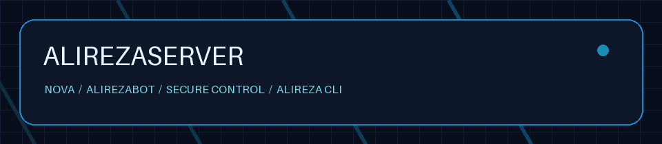

# alirezaserver 0.8.0-rc.11 — آپدیت محافظت‌شدهٔ نوا

مبنای این بسته، فایل کامل rc.10 پیوست‌شدهٔ شماست؛ نه مخزن قدیمی و نه alirezapanel. اصلاح SQL ربات و اصلاحات اتصال rc.9 حفظ شده‌اند. **۱۲۵۶ فایل اجرایی قبلی** شامل پروتکل‌ها، تولید کانفیگ، ربات، DNS، TLS و ظاهر بدون تغییر مانده‌اند؛ فقط چهار فایل ادغام/آپدیت قبلی تغییر کرده و سه فایل پشتیبان سازگاری/صف آپدیت اضافه شده است. فهرست قابل بررسی: [RC11-BASELINE](docs/RC11-BASELINE.json).

## انتشار سریع روی GitHub

ZIP بیرونی را Extract کنید. **همهٔ فایل‌ها و پوشه‌های داخل آن را در ریشهٔ مخزن** `alirezachatgpt97-coder/alirezaserver` قرار دهید. **فایل داخلی `source-code.zip` را بدون Extract آپلود کنید.** بسته برای آپلود با مرورگر، کمتر از ۱۰۰ فایل دارد. سورس کامل، تست‌ها و اجزای قبلی داخل همین فایل داخلی هستند؛ نصاب، کد اجرایی افزونه را درون خودش دارد.

## نصب یا ارتقا

پس از انتشار در شاخهٔ main:

```bash
curl -fL --connect-timeout 15 --max-time 180 https://raw.githubusercontent.com/alirezachatgpt97-coder/alirezaserver/main/install.sh -o install.sh && sudo bash install.sh
```

برای نصب موجود ابتدا از منوی `sudo alireza` پشتیبان بگیرید؛ سپس همین نصاب جدید را اجرا کنید. نیازی به نصب مجدد سیستم‌عامل، حذف حساب‌ها یا ساخت دوبارهٔ ربات نیست. نصب موجود نوا دوباره از پایه نصب نمی‌شود. قبل از انتشار فایل‌ها، دستور بالا همچنان نسخهٔ قبلی مخزن شما را می‌گیرد.

## آپدیت خودکار نوا

تایمر موجود هر شش ساعت با تأخیر تصادفی حداکثر ۲۰ دقیقه نسخهٔ رسمی را بررسی می‌کند؛ سرویس دائمی جدیدی اضافه نشده است. دکمهٔ اصلی آپدیت نوا نیز اکنون از همان مسیر محافظت‌شده استفاده می‌کند. برای اجرای فوری و مشاهدهٔ نتیجه:

```bash
sudo bash install.sh --update
sudo bash install.sh --update-status
```

- پشتیبانی بررسی‌شده: نوا **1.85.4 و 1.91.1** با commit و checksum رسمی ثبت‌شده در `addon/compat-profiles.json` داخل سورس. نصب تازه همچنان از پایهٔ مشخص 1.85.4 شروع می‌کند و تایمر، نسخهٔ رسمی سازگار را دریافت می‌کند.
- پیش از تعویض، checksum، قراردادهای ادغام، هویت مالک، مسیرهای API، ساختار UI و فضای پشتیبان بررسی می‌شوند.
- کد افزونه، برند، فرم دستی، بهینه‌سازی‌ها، AdGuard و دیتابیس ربات جدا از دایرکتوری کد نوا هستند و توسط آپدیتر نوا بازنویسی نمی‌شوند.
- snapshot شامل دیتابیس نوا، `/etc/nova` و گواهی‌های آن، مسیرهای تنظیمات Xray و sing-box از جمله **`/usr/local/etc/xray`** است. مالکیت و مجوز فایل‌ها حفظ می‌شوند. پس از شکست، snapshot برگردانده، دسترسی Xray تعمیر و سلامت پنل دوباره بررسی می‌شود. دو snapshot کامل آخر نگهداری می‌شوند.
- رد شدن قبلی یک نسخه بعد از اصلاح محافظ سازگاری، برای همیشه در cache باقی نمی‌ماند. نسخهٔ ناسازگار با پیام روشن متوقف می‌شود و نصب قبلی حفظ می‌شود.
- **تمام نسخه‌های آینده تضمین نشده‌اند.** اگر فایل‌های اتصال نوا تغییر ناسازگار کنند، آپدیت متوقف می‌شود تا نسخهٔ افزونه با آن بررسی شود؛ فایل یا تنظیمات شما برای عبور از خطا حذف نمی‌شود. خطای سلامتِ نصب فعلی نیز پیش از تعویض نسخه متوقف می‌شود.
- هنگام خود آپدیت، API/پنل کوتاه‌مدت متوقف می‌شود. کد فعلی آپدیتر برای مسیر موفق، Xray را عمداً restart نمی‌کند؛ اجرای نوا ممکن است طبق تنظیمات خودش runtime را بارگذاری کند. ادعای آپدیت بدون هیچ وقفه‌ای وجود ندارد.

## آزمون و محدودیت

نتایج فعلی و روش تکرار در [RC11-VALIDATION](docs/RC11-VALIDATION.md) است. تست HTTP با احراز هویت واقعی نوا، حفظ فایل‌ها، سازگاری نسخهٔ جدید، صف آپدیت و بازگشت شکست اجرا شده‌اند. انتقال واقعی محلی VLESS/TCP، VLESS/WS، VMess/WS و Trojan/TCP با TLS و رد شدن نام گواهی اشتباه نیز موفق بوده است.

**بدون VPS، همهٔ پروتکل‌ها روی شبکهٔ واقعی، صدور واقعی SSL، فیلترینگ ISP و بار همهٔ سرویس‌ها روی یک گیگ RAM تأیید نشده‌اند.** SSL و پینگ IP تضمین اتصال پروتکل نیستند. ربات و اصلاح SQL قبلی بدون تغییر حفظ شده‌اند؛ تست زندهٔ Telegram و MariaDB/PHP این نوبت اجرا نشده است. این خروجی نامزد انتشار rc.11 است، نه ادعای «بدون باگ» یا تضمین شبکهٔ شما.

---

## مستندات نسخه‌های قبلی — تاریخی

# alirezaserver 0.8.0-rc.10 — بستهٔ کامل با اصلاح SQL پلن ربات

این **پروژهٔ کامل** بر پایهٔ همان rc.9 پیوست‌شده ساخته شده است. تغییر اجرایی فقط در مهاجرت SQL پلن‌های Alirezabot و اجرای خودکار آن در نصب/ارتقا است. فایل‌های پروتکل‌ها، تولید کانفیگ، SSL، AdGuard، ظاهر و افکت‌های پنل نسبت به rc.9 **بایت‌به‌بایت حفظ شده‌اند**؛ گزارش در [docs/RC10-BASELINE.json](docs/RC10-BASELINE.json) و [docs/RC10-VALIDATION.md](docs/RC10-VALIDATION.md) است.

## چه چیزهایی روی GitHub قرار بگیرند؟

ZIP بیرونی را Extract کنید و **تمام محتویات آن را در ریشهٔ مخزن** `alirezachatgpt97-coder/alirezaserver` جایگزین کنید. فایل داخلی **`source-code.zip` را بدون Extract آپلود کنید**؛ سورس کامل ماژولار و تمام منابع قبلی در آن حفظ شده‌اند. تعداد فایل‌های آمادهٔ آپلود کمتر از ۱۰۰ و اندازهٔ تک‌تک فایل‌ها کمتر از ۲۵ مگابایت است.

## نصب و ارتقا

پس از انتشار فایل‌ها در شاخهٔ main:

```bash
curl -fL --connect-timeout 15 --max-time 180 https://raw.githubusercontent.com/alirezachatgpt97-coder/alirezaserver/main/install.sh -o install.sh && sudo bash install.sh
```

نصب تازه: همان مسیر قبلی را اجرا کنید و ربات را از پنل فعال کنید؛ اصلاح SQL در بستهٔ ربات وجود دارد و هنگام نصب اعمال و بررسی می‌شود.

ارتقای نصب موجود: از منوی `alireza` پشتیبان بگیرید و **همین install.sh جدید** را اجرا کنید. اگر ربات قبلاً نصب شده، نصاب خودکار قبل از تغییر جدول پلن‌ها پشتیبان خصوصی می‌گیرد، مهاجرت را اجرا می‌کند و نتیجه را بررسی می‌کند. **دیگر اجرای فایل تعمیر جداگانه لازم نیست.** نیازی به نصب مجدد VPS یا ساخت دوبارهٔ کاربران و پلن‌ها نیست.

اصلاحات: افزودن ستون مفقود `limitip` با مقدار اولیهٔ صفر؛ اصلاح ستون/پیش‌فرض مفقود `status_product`؛ تبدیل فقط وضعیت NULL به active در مسیر قدیمی دارای پیش‌فرض NULL. مقدار محدودیت و وضعیت‌های صریح مثل disable، قیمت‌ها، حساب‌ها و اطلاعات اتصال بازنویسی نمی‌شوند.

پشتیبان قبل از مهاجرت فقط مربوط به جدول product است و به‌صورت جریان در مسیر خصوصی `/var/lib/alirezaserver/backups/bot-plans-.../` ذخیره می‌شود؛ همهٔ پلن‌ها یکجا به حافظه بارگذاری نمی‌شوند. سرویس دائمی، نظرسنجی یا تغییر جلوه‌های بصری اضافه نشده است. این تست، تضمین اجرای تمام سرویس‌ها با هر بار کاربری روی ۱ گیگ RAM نیست.

این نسخه رفع باگ SQL بازتولیدشده است؛ ادعای بی‌باگ بودن کل پنل یا آزمایش روی VPS واقعی ندارد. نتایج rc.9 در بخش‌های بعد و گزارش‌های قبلی تاریخی‌اند؛ نتایج اجرای فعلی در RC10-VALIDATION.md مشخص‌اند.

---

## راهنمای rc.9 حفظ‌شده

# alirezaserver 0.8.0-rc.9 — اصلاح اتصال، TLS نصب اولیه و پیشرفت ربات

این نسخه بر اساس ZIP پیوست‌شدهٔ کاربر (rc.8) ساخته شده است. رابط اصلی نوا و AdGuard حذف یا بازطراحی نشده‌اند.

## انتشار با مرورگر GitHub

ZIP بیرونی را Extract کنید و **همهٔ محتویات آن** را در ریشهٔ مخزن `alirezachatgpt97-coder/alirezaserver` جایگزین کنید. فایل داخلی **`source-code.zip` را Extract نکنید**؛ سورس کامل ماژولار در همین فایل قرار دارد. نصب‌کننده فایل‌های اجرایی افزونه را درون خود دارد و برای نصب به Extract سورس نیاز ندارد.

## نصب و ارتقا

پس از انتشار فایل‌ها در شاخهٔ main:

```bash
curl -fL --connect-timeout 15 --max-time 180 https://raw.githubusercontent.com/alirezachatgpt97-coder/alirezaserver/main/install.sh -o install.sh && sudo bash install.sh
```

برای ارتقای نصب موجود، همین `install.sh` جدید را اجرا کنید. نصب‌کننده مسیر تعمیر/ارتقای نصب موجود را استفاده می‌کند؛ VPS را دوباره نصب نکنید. پیش از ارتقا از منوی `alireza` نسخهٔ پشتیبان بگیرید. حساب‌ها و تنظیمات موجود باقی می‌مانند. پس از ارتقا، اشتراک را در کلاینت به‌روز کنید؛ لینک ذخیره‌شدهٔ قدیمی خودبه‌خود عوض نمی‌شود.

## اصلاحات این نسخه

- ثبت دامنه و ایمیل سؤال اول پیش از دانلودها؛ انتظار برای آماده‌شدن واقعی API پس از ری‌استارت؛ بررسی مسیر واقعی HTTP-01 پیش از صدور گواهی. صدور واقعی همچنان به دسترسی CA و DNS/پورت 80 یا توکن معتبر DNS-01 وابسته است.
- جداسازی نام گواهی TLS از IP مقصد در خروجی‌های پیش‌فرض VLESS/VMess/Trojan. SNI، گواهی و مقصد اختصاصی شما و نودها حفظ می‌شوند؛ اعتبارسنجی TLS غیرفعال نمی‌شود.
- در صورت تأیید پروکسی‌بودن دامنه توسط داده‌های نوا، WS+TLS روی پورت‌های HTTPS سازگار، دامنه و Host/SNI هماهنگ دارد. TCP خام، Reality و UDP به‌طور اشتباه به پروکسی HTTP کلادفلر فرستاده نمی‌شوند.
- نصب ربات با پاسخ سریع HTTP 202، نوار ۸ مرحله‌ای واقعی، تشخیص تکمیل/خطا، بازیابی وضعیت پس از بستن صفحه و اطلاعات ورود یک‌بارمصرف رمز‌شده. ری‌استارت خود سرویس پنل می‌تواند نصب را قطع کند؛ وضعیت interrupted و تلاش مجدد تعمیر در نظر گرفته شده است.
- نظرسنجی پیشرفت فقط هنگام اجرای نصب انجام می‌شود؛ در صفحهٔ پنهان فاصله بیشتر است و پس از پایان متوقف می‌شود. پردازش دائمی جدیدی اضافه نشده است.

**SSL مساوی رفع محدودیت شبکه نیست.** پینگ ICMP موفق، TLS و احراز هویت پروکسی را اثبات نمی‌کند. انتقال واقعی دادهٔ چهار حالت Xray در محیط محلی آزمایش شده؛ اتصال از ISP شما، صدور واقعی CA و عبور واقعی Cloudflare در این محیط قابل تأیید نیست. گزارش آزمون‌ها: [docs/RC9-VALIDATION.md](docs/RC9-VALIDATION.md). ادعای بدون‌باگ یا پشتیبانی قطعی کل سرویس‌ها روی ۱ گیگ رم وجود ندارد.

---

<div align="center">



## راهنمای تکمیلی نسخهٔ پایه rc.8 (تاریخچه؛ تغییرات جاری در ابتدای این فایل)

**پنل نوا، مدیریت یکپارچه، Alirezabot و ابزار ترمینال `alireza`**

[نصب](#نصب) · [ارتقا](#ارتقا) · [ترمینال](#ترمینال) · [پورتها](#پورتها) · [آزمونها](docs/RC8-VALIDATION.md) · [منابع](SOURCES.md)

</div>

این بسته برای مخزن **[alirezachatgpt97-coder/alirezaserver](https://github.com/alirezachatgpt97-coder/alirezaserver)** است. با alirezapanel یا پروژهٔ تونل مستقل ارتباطی ندارد. رابط اصلی نوا و خود AdGuard بازطراحی نشده‌اند؛ فرم‌های دستی، میزبان‌ها، تونل، AI، نصب مقصد DNS و ربات موجود حفظ شده‌اند.

**وضعیت انتشار: نامزد آزمون rc.8.** کد، نصاب، آزمون‌ها و منابع قابل بررسی در بسته هستند. نصب کامل روی VPS، مرورگر واقعی و اجرای مجموع سرویس‌ها با یک گیگابایت RAM در این محیط تأیید نشده است. محدودیت منابع ترجیحی بعضی دارایی‌های کامپایل‌شدهٔ ربات را پیش از انتشار عمومی در [SOURCES.md](SOURCES.md) بخوانید.

## تغییرات rc.8: SSL از سؤال اول و اتصال خودکار ربات

- همان سؤال اول نوا: اگر دامنه دارید نامش را بدهید؛ اگر ندارید، برای IP عمومی گواهی معتبر درخواست می‌شود. انتخاب روش TLS جداگانه در پایان نصب حذف شد.
- درخواست گواهی بعد از آماده‌شدن خود نوا و دسترسی صحیح Xray اجرا می‌شود؛ مسیر مخفی، گواهی قبلی، snapshot و rollback حفظ می‌شوند.
- برای دامنهٔ Cloudflare، توکن از قبل متصل‌شده در نوا برای DNS-01 استفاده می‌شود؛ مسیر خودکار رکورد A/AAAA یا وضعیت proxy را عوض نمی‌کند. بدون توکن، HTTP-01 استفاده می‌شود.
- IP مبدأ مستقل برای کانفیگ‌های مستقیم حفظ می‌شود؛ تغییر دامنه نباید همهٔ پروتکل‌ها را به HTTP proxy کلادفلر بفرستد.
- بررسی نهایی فقط TLS را چک نمی‌کند: باید **همین نمونهٔ نوا** از آدرس عمومی با CA معتبر پاسخ بدهد. خطای WAF، DNS اشتباه و مبدأ دیگر موفقیت گزارش نمی‌شود.
- ربات با فعال‌سازی، اتصال محلی همین پنل، لینک اشتراک و انتخاب اینباند اولیه را می‌گیرد. حساب و کانفیگ از API محلی ساخته می‌شود؛ به بازکردن آدرس عمومی سرور توسط خودش وابسته نیست.
- لینک اشتراک پس از تغییر دامنه به‌روز می‌شود. لینک قدیمی پس از چرخش توکن، حذف یا غیرفعال‌کردن حساب معتبر نمی‌ماند؛ مسیر اشتراک فاکتور با شناسهٔ بلند نیز پشتیبانی می‌شود؛ شناسهٔ فاکتور کوتاه به‌عنوان مجوز عمومی باز نمی‌شود.
- تشخیص خواندنی و انگلیسی: `sudo alireza support`؛ UI اصلی، افکت‌ها، سرویس‌های دیگر و خود AdGuard تغییر نکرده‌اند.

**شرط Cloudflare:** برای نصب ساده، رکورد A/AAAA صحیح و **DNS only** و دسترسی عمومی TCP 80 داشته باشید؛ اگر proxy روشن است، به توکن DNS متصل‌شده یا عبور صحیح HTTP challenge نیاز است. برای پنل proxied، SSL/TLS را روی **Full (strict)** بگذارید. ثبت دامنه در Cloudflare به‌تنهایی اجازهٔ DNS-01 به نصاب نمی‌دهد.

**راهنمای کامل: [TLS و Cloudflare](docs/TLS.md).** فیلتر IP، اختلال ISP و ping واقعی همهٔ پروتکل‌ها بدون آزمون روی سرور و شبکهٔ کاربر تأیید نشده‌اند. صدور واقعی CA/Cloudflare در محیط توسعه انجام نشده است.

## امکانات حفظ‌شدهٔ rc.6

| بخش | تغییر واقعی |
|---|---|
| Xray / HTTPS | اصلاح مجوز config، گواهی و لاگ برای **User/Group فعلی systemd**؛ آماده‌سازی مجدد پیش از هر راه‌اندازی، حتی پس از بازنویسی اتمیک config توسط نوا |
| نصب Xray | خروجی زنده، timeout، دانلود محدود و بررسی hash در مسیر جایگزین؛ خطا به‌عنوان موفقیت گزارش نمی‌شود |
| پنل وب ربات | استفاده از `syslog` به‌جای `/proc/self/fd/2` در هر دو تنظیم PHP-FPM؛ تست config و انتظار برای سوکت واقعی |
| ظاهر ربات | انتخاب واقعی ۹ قالب، ذخیرهٔ سمت سرور برای هر مدیر، رنگ اختصاصی دکمه‌ها، پیش‌نمایش زنده و گردی کارت؛ پیش‌فرض Cyberpunk و افکت‌های موجود حفظ شده‌اند |
| ویرایش دکمه‌ها | اصلاح مسیر دریافت داده زیر مسیر مخفی پنل؛ ذخیره و بارگذاری مجدد صفحه‌کلید با نشست و CSRF آزمایش شده است |
| رمز ربات | بازنشانی مستقل از نصب مجدد، حفظ نام کاربری موجود، نمایش رمز تازه فقط در پاسخ همان عملیات، خروج نشست‌های PHP قبلی |
| مدیریت سرور | دستور `alireza`؛ آدرس پنل‌ها، رمز تازه، وضعیت، تعمیر، سرویس‌ها، پورت‌ها، لاگ و پشتیبان |
| ارتقا | به‌روزرسانی محدود فایل‌های رابط ربات با backup قبلی؛ داده‌های ربات، صف تلگرام و تنظیمات AdGuard بازنویسی نمی‌شوند |

## فایلهای ریشه GitHub

**ZIP را باز کنید و تمام محتوای آن را مستقیم در ریشهٔ همین مخزن جایگزین کنید.** پوشهٔ اضافی دور فایل‌ها نسازید؛ ZIP را به‌تنهایی به‌جای سورس در ریشه قرار ندهید.

```text
install.sh
setup.sh
README.md
CHANGELOG.md
SOURCES.md
LICENSE
SHA256SUMS
addon/
core/
docs/
tests/
tools/
```

`setup.sh` و `install.sh` باید با هم به‌روز شوند: setup هش installer را کنترل می‌کند. `core/alirezabot` سورس قابل ویرایش ربات و `addon/alirezabot-source.tar.b64` بستهٔ ساخته‌شدهٔ همان سورس است. فایل‌های نصب‌شده، دیتابیس، رمزها، گواهی‌های خصوصی و backup واقعی VPS را روی GitHub نگذارید.

## نصب

مسیر نصب فعلی Debian 12/13 یا Ubuntu 24.04 و amd64/arm64 را هدف می‌گیرد؛ معماری‌های دیگر تأیید نشده‌اند. root یا sudo و دسترسی به مخزن‌های سیستم، GitHub و منابع مشخص‌شده در [SOURCES](SOURCES.md) لازم است. این نصاب **آفلاین نیست**؛ فایل‌های ادغام جاسازی شده‌اند، ولی باینری نوا، Xray و وابستگی‌های سیستم دانلود می‌شوند.

پس از قرار دادن **همین نسخه** در GitHub، دستور تک‌خطی:

```bash
curl -fL --connect-timeout 15 --max-time 120 https://raw.githubusercontent.com/alirezachatgpt97-coder/alirezaserver/main/setup.sh -o /root/alirezaserver-setup.sh && sudo bash /root/alirezaserver-setup.sh
```

اجرای مستقیم از پوشهٔ ZIP استخراج‌شده، بدون انتظار برای انتشار GitHub:

```bash
sudo bash install.sh
```

در نصب، دامنه، مسیر مخفی و در صورت نیاز پورت اضافه انتخاب می‌شوند. در مرحلهٔ پایه گواهی موقت self-signed است؛ مرحلهٔ پایانی برای IP/دامنه گواهی معتبر درخواست می‌کند. شکست صدور معتبر، نصب کامل گزارش نمی‌شود؛ HTTPS موقت/قبلی و داده‌ها حفظ می‌شوند. شرط‌های شبکه و تمدید را در راهنمای TLS بخوانید. تا وقتی بررسی HTTPS انتهای نصب موفق نشده، نصب کامل محسوب نمی‌شود. نشانی نهایی را خود نصاب یا `sudo alireza panels` نشان می‌دهد.

نصب PHP/MariaDB و فعال‌سازی تلگرام **اختیاری** است و با انتخاب نصب در بخش ربات انجام می‌شود؛ نصب پایه به توکن تلگرام یا Gemini نیاز ندارد.

## ارتقا

قبل از ارتقا snapshot ماشین و پشتیبان خود نوا بگیرید؛ آرشیو افزونه جای backup کامل نوا یا مقصد DNS را نمی‌گیرد.

```bash
sudo python3 /opt/alirezaserver/backup.py
# وارد پوشهٔ نسخهٔ جدیدِ استخراج‌شده شوید:
sudo bash install.sh --repair
sudo bash install.sh --check
sudo alireza
```

نصب‌کننده فایل‌های جدید را نصب می‌کند، برای ربات مدیریت‌شده فایل‌های UI مشخص را با backup ارتقا می‌دهد، PHP-FPM قبلی را اصلاح می‌کند و دسترسی Xray را برای هویت واقعی آن آماده می‌کند. رمز ربات در ارتقا خودکار عوض نمی‌شود. نصب/ارتقای خود ربات از صفحهٔ آن، قیمت‌ها و حساب‌های دیتابیس را حفظ می‌کند؛ فایل‌های storage موجود نیز هنگام استخراج مجدد جایگزین نمی‌شوند.

backup رابط ربات در `/var/lib/alirezabot/ui-backup-*.tar.gz` و نسخهٔ تنظیم PHP پیش از تعمیر در `/opt/alirezabot/php-fpm.conf.before-rc6` نگهداری می‌شود. ثبت مجوزهای اولیهٔ Xray در `/var/lib/alirezaserver/xray-access-before.json` است. این‌ها خصوصی‌اند.

به‌روزرسانی رسمی نوا از guard موجود می‌گذرد؛ تغییر ناسازگار در قرارداد فایل‌های میزبان متوقف می‌شود. این سازوکار تضمین سازگاری با تمام نسخه‌های آینده نیست. `--rollback` ادغام را غیرفعال می‌کند و **بازیابی کامل دیتابیس یا downgrade نوا نیست**؛ جزئیات در [UPGRADE](docs/UPGRADE.md).

## ترمینال

بعد از نصب:

```bash
sudo alireza
```

منوی تعاملی بدون daemon اضافه اجرا می‌شود. می‌توان دستور مستقیم هم زد:

| دستور | عملکرد |
|---|---|
| `sudo alireza panels` | URL واقعی پنل اصلی و لینک‌های وابسته |
| `sudo alireza tls` | راه‌اندازی IP، دامنه یا Cloudflare DNS-01 |
| `sudo alireza tls-status` | وضعیت واقعی گواهی و job نوا |
| `sudo alireza network` | بررسی خواندنی DNS، TCP و HTTPS با CA |
| `sudo alireza status` | وضعیت سرویس‌های مشخص |
| `sudo alireza password panel` | رمز تازهٔ مالک نوا، با ابزار اصلی نوا و ورودی stdin |
| `sudo alireza password bot` | رمز تازهٔ مدیر اصلی ربات، بدون نصب مجدد |
| `sudo alireza openvpn` | انتخاب حساب و مشاهدهٔ مشخصات مجاز پس از تأیید؛ حساب قدیمیِ بدون رمز قابل بازیابی مشخص می‌شود |
| `sudo alireza ports` | سوکت‌های واقعی TCP/UDP سیستم |
| `sudo alireza doctor` | تشخیص و بررسی HTTP/HTTPS/DNS فعلی |
| `sudo alireza repair` | تعمیر دسترسی Xray و تنظیم وب ربات، راه‌اندازی مجدد Xray و بررسی سلامت |
| `sudo alireza restart panel` | راه‌اندازی مجدد نوا |
| `sudo alireza restart xray` | راه‌اندازی مجدد Xray؛ اتصال‌ها ممکن است قطع شوند |
| `sudo alireza restart bot` | راه‌اندازی مجدد سرویس‌های ربات |
| `sudo alireza logs xray` | ۶۰ خط اخیر Xray |
| `sudo alireza logs bot` | لاگ وب PHP ربات |
| `sudo alireza logs telegram` | لاگ poller تلگرام |
| `sudo alireza backup` | آرشیو افزونه و dump سازگار دیتابیس ربات در صورت نصب |
| `sudo alireza update` | تلاش مجدد به‌روزرسانی رسمی نوا با guard موجود |

`start`، `stop` و `restart` فقط مقصدهای `panel`، `xray`، `bot`، `telegram` و `dns` را قبول می‌کنند. توقف DNS یا Xray روی سرویس فعال اثر دارد؛ در منوی تعاملی راه‌اندازی مجدد تأیید می‌خواهد.

**رمز قبلیِ هش‌شده قابل خواندن نیست.** منو برای پنل اصلی و ربات رمز تازه می‌سازد یا با ورودی مخفی رمز دلخواه می‌گیرد؛ رمز داخل آرگومان process قرار نمی‌گیرد. نمایش رمز به ترمینال تعاملی محدود است. از ترمینال دارای ضبط خروجی برای نمایش رمز استفاده نکنید. AdGuardِ یکپارچه، AI و بخش‌های داخلی از ورود پنل اصلی استفاده می‌کنند؛ برای آن‌ها رمز ساختگی جدا نمایش داده نمی‌شود. کلید Gemini و توکن تلگرام در فهرست عمومی منو چاپ نمی‌شوند.

## ربات Alirezabot

۱. در پنل اصلی، بخش Alirezabot را باز کنید؛ توکن معتبر BotFather و شناسهٔ عددی مدیر را وارد کنید؛ آدرس همین پنل خودکار تنظیم می‌شود.
۲. نصب را انتخاب کنید. PHP-FPM اختصاصی، MariaDB و سرویس polling با اقدام شما فعال می‌شوند. سرویس‌های PHP دیگر موجود بی‌دلیل غیرفعال نمی‌شوند.
۳. نام کاربری و رمز تازه را همان بار ذخیره کنید؛ سپس «پنل کامل ربات» را باز کنید. اتصال محلی alirezaserver با driver سازگار تنظیم می‌شود؛ اتصال مدیریت‌شده با نام alirezaserver آماده است؛ لازم نیست بین driverهای پنل‌های دیگر حدس بزنید. محصول، قیمت و پرداخت را خودتان تعریف کنید.
۴. برای فراموشی رمز، دکمهٔ «بازنشانی مستقل رمز وب» یا `sudo alireza password bot` را اجرا کنید. این عملیات به توکن تازه یا نصب مجدد نیاز ندارد.
۵. در تنظیمات پنل مستقل، قالب و رنگ دکمه را انتخاب و **ذخیره ظاهر** را بزنید. قالب برای همان مدیر روی سرور ذخیره می‌شود؛ پاک‌شدن localStorage آن را از بین نمی‌برد. رنگ دکمه‌های وب تغییر می‌کند؛ رنگ دکمهٔ Telegram تابع قابلیت خود تلگرام است.
۶. ویرایشگر دکمه‌ها همان امکانات قبلی را دارد؛ چیدمان و متن‌های ربات از بخش‌های مربوط مدیریت می‌شوند. بعد از تغییر فایل‌های UI، یک بار refresh کامل مرورگر انجام دهید.

رابط مستقل عمدتاً فارسیِ upstream است؛ فرم‌های جدید برچسب فارسی/انگلیسی دارند، اما ادعای ترجمهٔ کامل تمام صفحات upstream به انگلیسی نداریم. خود ربات و فایل‌های آن با مجوز مستقل AGPL عرضه می‌شوند.

## اینباند، میزبان، تونل و DNS

- ساخت دستی در Inbounds انجام می‌شود؛ فرم‌های protocol-specific و presetهای اصلی حفظ شده‌اند. OpenVPN از همان بخش مدیریت می‌شود و پنل جداگانه‌ای برای آن لازم نیست. سرویس‌ها با عمل صریح فعال می‌شوند.
- میزبان‌ها از API واقعی نوا استفاده می‌کنند؛ کنترل هم‌زمانی مانع بازنویسی کور تغییر مدیر دیگر می‌شود.
- بخش تونل موجود و carrierهای آن حفظ شده‌اند؛ پورت و امکان transport به پشتیبانی واقعی backend بستگی دارد.
- **خود AdGuard دست‌نخورده است.** بررسی DNS فقط پرس‌وجوی واقعی خواندنی می‌فرستد؛ تنظیمات را برای پاس‌کردن تست عوض نمی‌کند.
- نصب alirezadns برای **سرور مقصد جداگانه** است؛ SSH، کلید و sudo با preflight بررسی می‌شوند. کلید میزبان نامنتظره رد می‌شود. نصب فقط با انتخاب کاربر انجام می‌شود و پورت‌های مقصد باید روی همان مقصد بررسی شوند.

## Gemini / AI

از بخش AI، مالک کلید شخصی را وارد می‌کند. نام مدل از API رسمی کشف می‌شود؛ نبود کلید، قطع شبکه، سهمیه و پاسخ نامعتبر پیام جدا دارند. درخواست‌ها سمت سرورند؛ تاریخچه بر اساس هویت جداست. هیچ مدل محلی نصب نمی‌شود و پاسخ مدل خودکار دستور اجرا نمی‌کند. دادهٔ حساس کاربران یا کلیدها خودکار برای مدل ارسال نمی‌شود. مشکل Gemini نباید مانع ورود پنل شود.

## پورتها

این جدول **پیش‌فرض‌ها و نقش‌ها** را نشان می‌دهد؛ مرجع قطعی سرور خودتان `sudo alireza ports`، تنظیم نوا و فایل‌های سرویس است. conflict ممکن است باعث انتخاب پورت جایگزین توسط نصب‌کنندهٔ پایه شود.

| پورت / پروتکل | محدودهٔ معمول | نقش و نکته |
|---|---|---|
| `443/TCP` | عمومی | ورودی TLS پنل و proxy، عموماً Xray؛ خاموش‌شدن Xray می‌تواند پنل HTTPS را نیز قطع کند |
| `80/TCP` | عمومی | HTTP عمومی به HTTPS هدایت می‌شود؛ مسیر محدود ACME برای صدور/تمدید HTTP-01 دامنه یا IP باز می‌ماند |
| پورت اضافهٔ پنل | انتخابی | فقط اگر خودتان تعیین کرده‌اید؛ الزام همیشگی نیست |
| `127.0.0.1:8088/TCP` | loopback | کنترل/API نوا؛ مستقیم عمومی نکنید، ممکن است در conflict عوض شود |
| `127.0.0.1:10085/TCP` | loopback | Xray API |
| `127.0.0.1:2087/TCP` | loopback | inbound داخلی VLESS-WS در پیکربندی پایه؛ وابسته به config واقعی |
| `127.0.0.1:10087/TCP` | loopback | کنترل sing-box در نصب دارای این سرویس |
| `53/UDP` و `53/TCP` | IP انتخابی + loopback | DNS AdGuard؛ دسترسی عمومی باید با نیاز و allowlist شما هماهنگ باشد |
| `127.0.0.1:18085/TCP` | loopback | مدیریت داخلی AdGuard، از پنل proxy می‌شود |
| `1194/UDP` | انتخابی | پیشنهاد اولیهٔ OpenVPN، تنها پس از ساخت سرور؛ TCP/پورت دیگر هم قابل تنظیم است |
| پورت‌های اینباندها | انتخابی | بر اساس پروتکل و node مقصد؛ همهٔ بازه‌ها را بی‌دلیل باز نکنید |
| پورت‌های تونل | انتخابی | طبق فرم و engine انتخاب‌شده؛ بعضی حالت‌ها UDP/TCP یا قابلیت کرنل لازم دارند |
| SSH مقصد DNS | مقصد، معمولاً `22/TCP` | اتصال خروجی از پنل به مقصد؛ پورت SSH خودتان قابل انتخاب است |
| PHP ربات | سوکت Unix | `/run/alirezabot/php.sock`؛ پورت HTTP/PHP عمومی اضافه ندارد |
| MariaDB ربات | اتصال محلی Unix | PHP ربات به DB محلی وصل می‌شود؛ برای ربات نیازی به بازکردن عمومی `3306` نیست؛ تنظیم سایر برنامه‌ها تغییر نمی‌کند |
| Gemini و Telegram | خروجی `443/TCP` | درخواست HTTPS؛ webhook عمومی جدید برای poller لازم نیست |

Tor، Psiphon، Mieru، MTProto، Hysteria2 و AmneziaWG در صورت استفاده پورت/سوکت خود را دارند؛ مقدار آن‌ها از تنظیم واقعی سرویس مشخص می‌شود. firewall و resolver سایر برنامه‌ها نباید دستی و کورکورانه بازنویسی شوند. این ادغام سازگاری با تمام پنل‌ها یا شبکه‌ها را تضمین نمی‌کند.

## منابع و سرور ضعیف

ابزار ترمینال فقط هنگام اجرا process دارد. AI مدل محلی ندارد. وب PHP ربات از pool اختصاصی `ondemand` با سه worker حداکثر، timeout بیکاری و بازیافت worker استفاده می‌کند؛ سقف memory هر worker با مصرف واقعی همان worker یکسان نیست. وضعیت‌ها cache/coalesce می‌شوند و polling رابط OpenVPN در صفحهٔ مخفی متوقف می‌شود. logrotate برای لاگ افزونه، Xray و ربات تعریف شده است؛ rotation زمان‌بندی‌شده سقف سخت دیسک نیست.

**۱ vCPU / ۱GiB هدف پایه است، نه نتیجهٔ benchmark کامل.** PHP، MariaDB، AdGuard، coreهای فعال و تعداد اتصال‌ها مصرف جدا دارند. نتیجهٔ آزمایش محدود HTTP/controller در [RC6-VALIDATION](docs/RC8-VALIDATION.md) گزارش می‌شود؛ آن را مصرف کل یا ظرفیت VPN حساب نکنید. قابلیت، پروتکل یا افکت برای این هدف حذف نشده است.

## عیبیابی

برای SSL، تمدید IP، Cloudflare و نیاز به VPN ابتدا [TLS.md](docs/TLS.md) و `sudo alireza support` را ببینید. SSL/TLS کلادفلر باید Full (strict) باشد؛ Flexible می‌تواند loop ایجاد کند.


<details>
<summary>نصب ناقص یا ECONNREFUSED روی 443</summary>

از همین پوشهٔ نسخهٔ جدید `sudo bash install.sh --repair` اجرا کنید. تشخیص خواندنی: `sudo alireza doctor`. گزارش خصوصی نصب در `/var/log/alirezaserver/` است. خطای permission denied در config، origin.pem/key یا access.log باید با هویت فعلی Xray اصلاح شود؛ `chmod 777` یا تغییر daemon به root راه‌حل این نسخه نیست.

فایل نصب در پوشهٔ فعلی لازم است؛ `bash install.sh` از پوشه‌ای که فایل ندارد اجرا نمی‌شود. با بازکردن ZIP و ورود به پوشهٔ آن شروع کنید. اگر مسیر سفارشی یا symlink رد شد، آن مورد بررسی انسانی می‌خواهد؛ نصاب آن را کور تغییر نمی‌دهد.
</details>

<details>
<summary>وب ربات باز نمی‌شود یا رمز ندارم</summary>

ابتدا نصب/ارتقای همین بسته را انجام دهید. `sudo alireza repair` تنظیم لاگ PHP مدیریت‌شده را اصلاح و config را تست می‌کند؛ `sudo alireza logs bot` علت بعدی را نشان می‌دهد. رمز را با `sudo alireza password bot` بازنشانی کنید. این فرمان فقط مدیر اصلی تنظیم‌شدهٔ ربات را هدف می‌گیرد و تنظیمات/صف/حساب‌ها را حذف نمی‌کند.
</details>

<details>
<summary>رنگ یا دکمه‌ها ذخیره نمی‌شوند</summary>

refresh کامل مرورگر، ورود مجدد و ذخیرهٔ واضح ظاهر را امتحان کنید. خطای ذخیره در همان فرم نمایش داده می‌شود؛ نتیجهٔ ناموفق موفق نشان داده نمی‌شود. مسیر ربات باید کامل زیر مسیر مخفی پنل باشد. cookie و CSRF باید معتبر باشند. قالب پیش‌فرض همچنان Cyberpunk است؛ ۸ قالب دیگر حالا با آن بازنویسی نمی‌شوند.
</details>

پیش از اشتراک لاگ، رمز، token، کلید خصوصی، URL مخفی و دادهٔ کاربران را حذف کنید. گزارش `--diagnose` عمداً لاگ خام و رمزها را چاپ نمی‌کند.

## ساخت و بررسی کد

```bash
python3 tools/package-bot.py
python3 tools/build.py
bash install.sh --self-test
python3 tools/package.py ../alirezaserver-0.8.0-rc.8.zip
```

`package-bot.py` سورس ربات را با gzip/tar قطعی بسته‌بندی و SHA را به‌روز می‌کند. `build.py` فایل‌های addon را در install جاسازی و hash راه‌انداز را همسان می‌کند. `package.py` تمام فایل‌های فهرست‌شده را hash و ZIP را دوباره کنترل می‌کند. ابزارهای آزمون رابط و runtimeهای PHP/MariaDB توسعه‌ای در سرور نصب نمی‌شوند؛ دستورهای آزمون و محدودیت‌ها در گزارش آمده‌اند.

## مجوز و منابع

مجوزها و انتساب‌های Nova، Hashem، Mirza/Alirezabot و وابستگی‌ها حفظ شده‌اند؛ نام تجاری جدید مجوز upstream را عوض نمی‌کند. [SOURCES.md](SOURCES.md)، [LICENSE](LICENSE)، فایل‌های `COPYING` و `NOTICE` را همراه کد نگه دارید. انتشار روی GitHub توسط این کار انجام نشده است.
