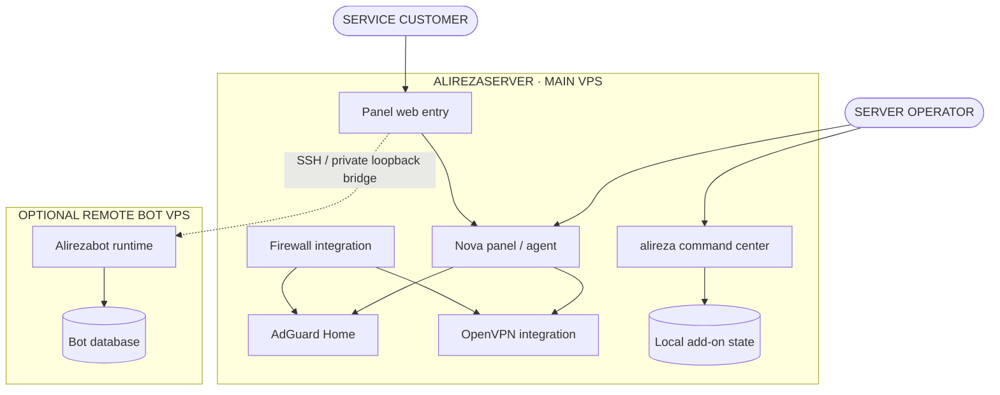
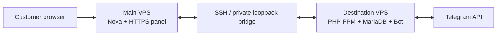

A practical control layer for a Nova-based server environment --- with
DNS, VPN, Telegram automation, service delivery, diagnostics and
recovery workflows.**

[🚀 Quick Install](#-quick-install) · [✨ Features](#-what-is-inside) ·
[🧭 Architecture](#-architecture) · [🖥️ Commands](#-command-center) ·
[🌐 Ports](#-ports--network-map) · [🛡️ Security](#-security) · [📚
Docs](#-documentation-map)

`<br/>`{=html}

``{=html}
:::

------------------------------------------------------------------------

::: {align="center"}
### ⚡ CONTROL THE STACK. DON'T FIGHT THE STACK. ⚡
:::

> \[!IMPORTANT\] **This README documents the existing project. It does
> not add Docker, change the installer, modify service defaults, or
> claim features that are not present in the repository.** The project
> is an online installer/integration stack. Docker deployment is not
> documented as a supported installation method in the current
> repository README or visible installer. Do not run this project inside
> Docker unless a future release explicitly supports that deployment
> model.

> \[!WARNING\] The install command downloads a script from the
> repository's moving `main` branch and executes it with root
> privileges. Inspect the script and verify the release before running
> it on a production server.

## 🧬 Project identity

  -------------------------------------------------------------------------------------------------------------------------------------
  Property                            Current repository information
  ----------------------------------- -------------------------------------------------------------------------------------------------
  Project                             **Alirezaserver**

  Repository                          [alirezachatgpt97-coder/alirezaserver](https://github.com/alirezachatgpt97-coder/alirezaserver)

  Package README label                `0.8.0-rc.17`

  Base panel described in package     Nova `1.94.3`
  notes                               

  License shown in repository         GPL-3.0

  Installer model                     Online installer

  Main management entry               `sudo alireza`

  Supported OS in visible installer   Ubuntu 24.04, Debian 12, Debian 13

  Supported architecture in visible   `amd64`, `arm64`
  installer                           

  Init system                         `systemd`
  -------------------------------------------------------------------------------------------------------------------------------------

### What is Alirezaserver?

Alirezaserver is a server-side integration and management project built
around a Nova panel environment. Its repository package notes describe a
combined ecosystem for managing panel services, DNS, OpenVPN, Telegram
bot workflows, service sales, destination-side DNS integration, backups,
diagnostics and update compatibility.

It is designed to make related operational tasks accessible through a
unified management experience while keeping upstream components
identifiable.

### The project in one picture



*Conceptual architecture only. The optional remote-bot topology is
described by the package notes; it is not enabled in every
installation.*

------------------------------------------------------------------------

## 🎬 Visual overview

::: {align="center"}
``{=html}

`<sub>`{=html}Animated decorative visual. It is not a live server-status
indicator.`</sub>`{=html}
:::

### System capabilities at a glance

  -----------------------------------------------------------------------
  ⚙️ Control plane        🌐 Network plane        🤖 Automation plane
  ----------------------- ----------------------- -----------------------
  Main CLI                Nova integration        Alirezabot

  Health checks           AdGuard DNS             Telegram workflows

  Backup / restore        OpenVPN                 Product delivery
  helpers                                         

  Update / rollback       TLS / HTTPS integration Remote bot host mode
  helpers                                         

  Logs / diagnostics      Firewall integration    Gemini API integration
  -----------------------------------------------------------------------

## ✨ What is inside?

### 1. Nova integration

The package notes identify Nova `1.94.3` as the reviewed base and
describe compatibility checks around selected API behavior, reseller
quotas and link generation.

-   Nova-based panel integration.
-   Nova agent service validation.
-   Compatibility checks for selected panel/API contracts.
-   Integration with supported service workflows.
-   Panel and service health inspection.
-   Controlled update path for the add-on integration.

**Important:** Nova is an upstream component. Its own release cycle, API
and license remain distinct from Alirezaserver.

### 2. Alirezabot

The package notes describe an Alirezabot workflow integrated with the
server and the panel's product ecosystem.

-   Bot installation on the main VPS.
-   Optional bot installation on a separate destination VPS.
-   SSH-based remote setup.
-   SSH host fingerprint verification.
-   Password or key-based authentication, as supported by the setup
    flow.
-   PHP-FPM and MariaDB on the destination in remote mode.
-   Bot web entry served through the main panel's HTTPS entry point.
-   Telegram service delivery and customer guidance.
-   Backup considerations for remote bot files and database.

### 3. Service catalog and sales workflow

The package notes list these service categories for the product
workflow:

  -----------------------------------------------------------------------
  Service category                    Role / notes
  ----------------------------------- -----------------------------------
  Nova inbounds                       Active and authorized inbounds from
                                      the managed Nova panel

  AmneziaWG                           Supported product category; must be
                                      configured

  MTProto                             Telegram proxy product category

  mieru                               Supported service category

  SOAR                                Supported service category

  Telegram Web                        Supported service category

  Smart DNS                           DNS-related product category; no
                                      universal NAT guarantee

  VIP                                 Product category whose actual
                                      entitlement depends on
                                      configuration

  OpenVPN                             VPN product; package notes describe
                                      owner-bot-only sales

  Destination `alirezadns`            DNS product on a registered
                                      destination server
  -----------------------------------------------------------------------

Documented workflow:

1.  Prepare and activate the service on the panel or destination.
2.  Open the web panel's product-management area.
3.  Select the managed panel `alirezaserver`.
4.  Choose the service categories and permissions.
5.  Configure price, volume and duration using the existing product
    form.
6.  Run a controlled purchase.
7.  Test renewal, suspension and customer delivery.
8.  Review the resulting account and logs.

The package notes describe compatibility checks before renewal balance
deduction. Changing an account's service type or destination during
renewal is not treated as a migration.

### 4. AdGuard Home and DNS

The visible installer downloads AdGuard Home `v0.107.79`, verifies its
checksum and configures DNS service integration.

-   DNS over UDP and TCP on port `53`.
-   Loopback and detected IPv4 bind addresses.
-   AdGuard administrative endpoint on `127.0.0.1:18085`.
-   Initial upstream DNS configuration includes `1.1.1.1` and `9.9.9.9`.
-   Initial rate-limit configuration is set in the installer.
-   Firewall integration for DNS traffic.
-   Access restriction support through AdGuard settings and the
    documented `DNS_ALLOWED_CIDRS` installer variable.

### 5. OpenVPN

The visible installer installs OpenVPN and checks TUN availability. The
integration code handles enabled OpenVPN server definitions and their
firewall rules.

The package notes describe account-related operations such as:

-   Creating and managing accounts.
-   Volume and expiration management.
-   Device limits.
-   Usage information and reset.
-   Client configuration delivery.
-   Account access and status workflows.

Exact UI options depend on the installed integration version and panel
configuration.

### 6. TLS and HTTPS

The package notes describe TLS/SSL and Cloudflare-related workflows. The
actual challenge type and domain settings depend on the server
configuration.

-   HTTPS panel front door.
-   Certificate status checks.
-   ACME-related setup.
-   HTTP-01 may require TCP `80`.
-   HTTPS normally uses TCP `443`.
-   DNS-based validation has different network requirements.

### 7. Destination `alirezadns`

The package notes describe a separate destination-side DNS product
integration.

-   Destination registration.
-   Destination API key configuration.
-   Main-to-destination API communication.
-   Account creation and renewal workflow.
-   Explicit Public API configuration at the destination.

**AdGuard Home and destination `alirezadns` are not the same product.**
Configuring AdGuard does not automatically configure a destination DNS
service.

### 8. Gemini API integration

The package notes identify a Gemini API assistant integration. This
requires an external API configuration and network access. It is not a
locally hosted Gemini model.

### 9. Backup, checks and update helpers

The visible installer exposes install-time options for checking, backup,
rollback, update and update status.

-   Local integration checks.
-   Add-on backup helper.
-   Add-on rollback helper.
-   Update retry helper.
-   Update status JSON output.
-   Installer and integration logs.
-   Compatibility verification for selected components.

------------------------------------------------------------------------

## 🚀 Quick install

### Official one-line installation command

**Copied from the current repository README without changing the
command:**

``` bash
curl -fL --connect-timeout 15 --max-time 180 https://raw.githubusercontent.com/alirezachatgpt97-coder/alirezaserver/main/install.sh -o install.sh && sudo bash install.sh
```

### Recommended: inspect before execution

``` bash
curl -fL --connect-timeout 15 --max-time 180 \
  https://raw.githubusercontent.com/alirezachatgpt97-coder/alirezaserver/main/install.sh \
  -o install.sh

less install.sh
sha256sum install.sh

# Execute only after reviewing the downloaded script.
sudo bash install.sh
```

### What the official command means

  -----------------------------------------------------------------------
  Part                                Explanation
  ----------------------------------- -----------------------------------
  `curl`                              Downloads the installer.

  `-f`                                Treats HTTP error responses as
                                      failures.

  `-L`                                Follows redirects.

  `--connect-timeout 15`              Connection timeout is 15 seconds.

  `--max-time 180`                    Maximum transfer time is 180
                                      seconds.

  Installer URL                       Downloads `install.sh` from the
                                      repository's `main` branch.

  `-o install.sh`                     Saves the file as `install.sh`.

  `&&`                                Runs the next command only if
                                      download succeeds.

  `sudo bash install.sh`              Runs the script with root
                                      privileges.
  -----------------------------------------------------------------------

> \[!CAUTION\] `main` is a moving branch. The same command can download
> different code at different times. For production use, inspect the
> downloaded script and use a reviewed release or commit-pinned source
> when the project publishes one.

### Installer prerequisites

  -----------------------------------------------------------------------
  Requirement                         Visible installer support
  ----------------------------------- -----------------------------------
  OS                                  Ubuntu 24.04, Debian 12, Debian 13

  CPU                                 `amd64`, `arm64`

  Init                                `systemd`

  Privileges                          Root

  Runtime check                       Node.js 24 or newer

  Python                              `python3`

  Network                             Outbound HTTPS to required sources

  VPN kernel feature                  `/dev/net/tun` for OpenVPN

  Fresh-install DNS ports             TCP/UDP `53` must be available

  Fresh-install AdGuard admin port    TCP `18085` must be available on
                                      loopback
  -----------------------------------------------------------------------

The package notes mention a 1 vCPU / 1 GB RAM target profile. This is
not a guarantee that every optional service or production workload fits
within that size.

------------------------------------------------------------------------

## 🧰 Installer command reference

The visible `install.sh` argument parser includes these options:

  Command                                  Purpose
  ---------------------------------------- --------------------------------------
  `sudo bash install.sh`                   Default install / repair-resume path
  `sudo bash install.sh --repair`          Explicit repair/resume path
  `sudo bash install.sh --help`            Print usage
  `sudo bash install.sh -h`                Short help
  `sudo bash install.sh --check`           Run local add-on checks
  `sudo bash install.sh --backup`          Run add-on backup helper
  `sudo bash install.sh --rollback`        Run add-on rollback helper
  `sudo bash install.sh --update`          Run update retry helper
  `sudo bash install.sh --update-status`   Print update status JSON

The package README also documents `sudo bash install.sh --diagnose`, but
that option is **not present in the visible installer's argument
parser**. Verify the exact release before using it.

### Help

``` bash
sudo bash install.sh --help
```

### Check

``` bash
sudo bash install.sh --check
```

The visible check path validates selected integration components,
systemd units, AdGuard status and DNS behavior.

### Backup

``` bash
sudo bash install.sh --backup
```

Treat backup archives as sensitive. Store a copy away from the VPS and
test restoration.

### Rollback

``` bash
sudo bash install.sh --rollback
```

This is the add-on rollback helper. It is not a VPS factory reset and is
not a universal rollback of every upstream service.

### Update

``` bash
sudo bash install.sh --update
```

### Update status

``` bash
sudo bash install.sh --update-status
```

### Restrict DNS clients during installation

The installer comments document this environment-variable pattern:

``` bash
DNS_ALLOWED_CIDRS="203.0.113.12/32,198.51.100.0/24" sudo -E bash install.sh
```

Replace documentation-only IP ranges with the actual client CIDRs you
intend to allow. The example addresses above are reserved for
documentation and are not real public client ranges.

------------------------------------------------------------------------

## 🖥️ Command center

### Main Alirezaserver commands documented in the repository README

  Command                        Documented role
  ------------------------------ -----------------------------
  `sudo alireza`                 Main interactive menu
  `sudo alireza panels`          Show panel addresses
  `sudo alireza status`          Service status
  `sudo alireza ports`           Port information
  `sudo alireza doctor`          Health checks
  `sudo alireza repair`          Repair supported components
  `sudo alireza support`         Prepare support information
  `sudo alireza tls`             TLS management
  `sudo alireza tls-status`      TLS status
  `sudo alireza network`         Network diagnostics
  `sudo alireza openvpn`         OpenVPN management
  `sudo alireza backup`          Backup workflow
  `sudo alireza update`          Update workflow
  `sudo alireza restart panel`   Restart panel component
  `sudo alireza restart xray`    Restart Xray
  `sudo alireza restart bot`     Restart bot component
  `sudo alireza logs xray`       Xray logs
  `sudo alireza logs bot`        Bot logs

> \[!NOTE\] These are command examples documented in the repository
> materials. The visible `install.sh` does not define the `alireza` CLI
> parser. Run `sudo alireza` on the installed release to confirm the
> exact commands available there. This README intentionally does not
> invent flags or subcommands.

### Standard Linux service commands

These are Linux/systemd commands, not custom Alirezaserver commands.

``` bash
# Inspect services
sudo systemctl status nova-agent.service
sudo systemctl status AdGuardHome.service
sudo systemctl status alireza-firewall.service
sudo systemctl status alireza-update.timer

# Inspect recent logs
sudo journalctl -u nova-agent.service -n 100 --no-pager
sudo journalctl -u AdGuardHome.service -n 100 --no-pager
sudo journalctl -u alireza-firewall.service -n 100 --no-pager

# Inspect listeners and routes
sudo ss -lntup
ip -br address
ip route

# Inspect firewall rules
sudo iptables -S
sudo iptables -t nat -S

# Inspect system resources
free -h
df -h
uptime
```

------------------------------------------------------------------------

## 🌐 Ports & network map

The following table separates documented ports from ports that depend on
the selected service configuration.

### Known ports

  --------------------------------------------------------------------------------------
               Port Protocol      Bind / exposure    Component     Purpose
  ----------------- ------------- ------------------ ------------- ---------------------
              `443` TCP           Public HTTPS front Nova / panel  Secure panel access
                                  door, if           front door    
                                  configured                       

               `80` TCP           Public only when   ACME HTTP-01  HTTP certificate
                                  required                         validation

               `53` UDP           Loopback +         AdGuard Home  DNS queries
                                  detected IPv4                    

               `53` TCP           Loopback +         AdGuard Home  TCP DNS queries
                                  detected IPv4                    

            `18085` TCP           `127.0.0.1` only   AdGuard Home  Private admin
                                                     admin/API     endpoint

             `8088` TCP           `127.0.0.1` in     Nova          Internal integration
                                  package port       integration   listener
                                  notes; verify live               
                                  config                           

            `10085` TCP           `127.0.0.1` in     Internal      Private integration
                                  package port       service       listener
                                  notes; verify live               
                                  config                           

       OpenVPN port UDP or TCP    Public when        OpenVPN       VPN client transport
                                  enabled                          

      Remote bridge TCP           Loopback/private   Remote bot    Private
              ports               SSH bridge         mode          main-to-destination
                                                                   communication
  --------------------------------------------------------------------------------------

### Public vs private

  -----------------------------------------------------------------------
  Exposure class          Ports                   Rule
  ----------------------- ----------------------- -----------------------
  Public when panel is    TCP `443`               Allow only if public
  enabled                                         panel access is
                                                  intended.

  Conditional public      TCP `80`                Open only for HTTP-01
                                                  certificate validation
                                                  when used.

  DNS client-facing       UDP/TCP `53`            Restrict to intended
                                                  clients and apply rate
                                                  limiting.

  Loopback only           TCP `18085`             Never expose AdGuard
                                                  administration
                                                  publicly.

  Internal integration    TCP `8088`, TCP `10085` Keep private; verify
                                                  actual listener
                                                  addresses.

  Service-selected        OpenVPN UDP/TCP port    Open only the exact
                                                  configured port and
                                                  protocol.

  Private bridge          Dynamically selected    Do not create public
                          loopback ports          firewall rules for the
                                                  bridge.
  -----------------------------------------------------------------------

### Inspect actual listening sockets

``` bash
sudo ss -lntup
sudo lsof -nP -i
```

### Inspect firewall state

``` bash
sudo iptables -S
sudo iptables -t nat -S
sudo iptables -L -n -v
```

### Firewall policy checklist

-   [ ] Allow TCP 443 only if the panel is meant to be public.
-   [ ] Allow TCP 80 only when HTTP-01 validation requires it.
-   [ ] Restrict UDP 53 to intended DNS clients.
-   [ ] Restrict TCP 53 to intended DNS clients.
-   [ ] Never expose TCP 18085 publicly.
-   [ ] Keep TCP 8088 and TCP 10085 private unless a verified deployment
    design requires otherwise.
-   [ ] Open only the configured OpenVPN port/protocol.
-   [ ] Restrict SSH to trusted administrator sources where practical.
-   [ ] Check the VPS provider firewall separately from the host
    firewall.

**A provider firewall and a Linux host firewall are two different
control layers.** Both must agree with the intended service exposure.

------------------------------------------------------------------------

## 🧭 DNS and AdGuard operations

### Installer defaults visible in the source

  -----------------------------------------------------------------------
  Setting                             Visible installer behavior
  ----------------------------------- -----------------------------------
  AdGuard version                     `v0.107.79`

  DNS port                            `53`

  DNS transports                      UDP and TCP

  DNS bind                            Loopback and detected IPv4

  Admin endpoint                      `127.0.0.1:18085`

  Initial upstreams                   `1.1.1.1`, `9.9.9.9`

  Initial rate limit                  `20` queries per second

  Client restrictions                 AdGuard Access settings /
                                      documented CIDR variable
  -----------------------------------------------------------------------

### Test DNS locally

``` bash
dig @127.0.0.1 example.com
dig @127.0.0.1 -p 53 example.com +tcp
```

### DNS troubleshooting

1.  Inspect `AdGuardHome.service`.
2.  Confirm UDP and TCP port 53 listeners.
3.  Confirm upstream DNS reachability.
4.  Check AdGuard Access settings.
5.  Check the host firewall.
6.  Check the provider firewall.
7.  Test from an authorized external client.
8.  Do not expose the admin endpoint to solve a DNS problem.

------------------------------------------------------------------------

## 🔐 OpenVPN operations

The visible installer installs OpenVPN, checks `/dev/net/tun`, and
integrates firewall handling for enabled server configurations.

### Firewall integration chains

  -----------------------------------------------------------------------
  Chain                   Table                   Role
  ----------------------- ----------------------- -----------------------
  `ALIREZA_IN`            `filter`                Inbound DNS and OpenVPN
                                                  traffic

  `ALIREZA_FWD`           `filter`                VPN forwarding

  `ALIREZA_NAT`           `nat`                   VPN client masquerading

  `ALIREZA_DNS`           `nat`                   DNS destination
                                                  translation for
                                                  configured VPN networks
  -----------------------------------------------------------------------

The visible firewall helper validates configured server IDs, private
IPv4 `/24` subnets, supported `udp`/`tcp` protocol values and ports in
the `1024–65535` range.

### OpenVPN operational checklist

-   [ ] `/dev/net/tun` exists.
-   [ ] The configured server is enabled.
-   [ ] The selected protocol matches the firewall rule.
-   [ ] The selected port matches the provider firewall.
-   [ ] The VPN subnet does not overlap existing routes.
-   [ ] IPv4 forwarding is enabled where required.
-   [ ] NAT/masquerade is configured as intended.
-   [ ] Client profiles and private keys are protected.
-   [ ] A real external client can connect and pass traffic.

------------------------------------------------------------------------

## 🤖 Remote Alirezabot mode

The package notes describe an optional topology where the bot runtime
and database live on a separate destination VPS.



### Documented setup outline

1.  Choose **Another server** in the bot setup flow.
2.  Enter destination SSH details.
3.  Verify the destination SSH host fingerprint against its console.
4.  Use the supported password or key authentication mode.
5.  Ensure the destination has the required privilege model.
6.  Let the setup flow install the bot runtime and database on the
    destination.
7.  Access the bot web entry through the main panel HTTPS route.
8.  Verify the bot state and Telegram behavior.

### Remote mode notes

-   The destination is expected to use Ubuntu 24.04 or Debian 12/13 with
    `systemd`.
-   The destination needs public IPv4 and outbound access to required
    repositories and Telegram.
-   The package notes describe private SSH/loopback communication and no
    additional public bridge port.
-   Installing a new remote bot is not the same as migrating an existing
    bot database.
-   Do not run two polling processes with the same bot token unless the
    application explicitly supports it.
-   A complete remote bot backup requires the destination to be
    reachable.

### Backup caution

The package notes describe the remote snapshot as
`remote-bot/alirezabot.tar.gz` inside the backup archive. Restoring only
the main panel files does not restore the remote bot database.

------------------------------------------------------------------------

## 🛒 Product delivery workflow

### Product setup

    Step Action
  ------ ---------------------------------------------------------
       1 Prepare the service on its actual panel or destination.
       2 Confirm service health and authorization.
       3 Open the web panel product-management area.
       4 Select managed panel `alirezaserver`.
       5 Select allowed service categories.
       6 Configure price, volume and duration.
       7 Run a controlled test purchase.
       8 Verify customer delivery instructions.
       9 Test renewal and suspension.
      10 Review logs and resulting account state.

### Important business rules described in package notes

-   Only prepared and authorized services should be sold.
-   OpenVPN and destination `alirezadns` sales are described as
    owner-bot-only in the referenced package notes.
-   Reseller permissions remain limited by the real Nova account
    permissions.
-   Renewal compatibility is checked before balance deduction in the
    main bot path.
-   Changing service type or destination during renewal is rejected
    rather than treated as migration.
-   Smart DNS is not a universal NAT traversal solution.
-   Destination DNS renewal follows the destination API's supported
    behavior.

------------------------------------------------------------------------

## 💾 Backup, restore and rollback

### Backup entry points

``` bash
# Main project menu
sudo alireza

# Documented CLI backup command
sudo alireza backup

# Add-on backup helper
sudo bash install.sh --backup
```

### Backup policy

-   Keep backups off the VPS.
-   Encrypt archives that contain secrets or customer information.
-   Keep version metadata with every backup.
-   Test restoration before relying on it.
-   Preserve remote bot database and files together.
-   Never publish private keys, bot tokens or raw database dumps.

### Add-on rollback

``` bash
sudo bash install.sh --rollback
```

This invokes the add-on rollback helper. It should not be interpreted as
a general operating-system rollback or a guaranteed rollback of
unrelated upstream components.

------------------------------------------------------------------------

## 🔄 Update and release discipline

### Update helpers

``` bash
sudo bash install.sh --update-status
sudo bash install.sh --update
```

### Recommended update sequence

1.  Read the matching release notes.
2.  Confirm package version and installer version.
3.  Back up the main panel and add-on data.
4.  Back up remote bot data if remote mode is enabled.
5.  Confirm disk space and outbound connectivity.
6.  Run the supported update workflow.
7.  Inspect update status.
8.  Run local checks.
9.  Verify Nova, AdGuard and firewall services.
10. Test DNS over UDP and TCP.
11. Test OpenVPN externally if enabled.
12. Test bot purchase/renewal flows if enabled.
13. Keep the backup until the new release is stable.

### Version labels are different layers

The repository README currently labels the package `0.8.0-rc.17`. The
visible installer source also contains an embedded add-on label `0.4.0`,
and pins upstream component revisions. These labels must not be
represented as one interchangeable version.

------------------------------------------------------------------------

## 🐳 Docker: deployment status

**Docker is not documented as a supported deployment method in the
current Alirezaserver repository README or the visible installer.**

That means this README intentionally does not provide a fabricated
`docker compose up` command, a made-up image name, or a Docker port map.

Why this matters:

-   The installer expects a Linux host with `systemd`.
-   It configures host services and firewall integration.
-   It checks host networking and TUN availability for OpenVPN.
-   It installs and manages components directly on the host.
-   Containerizing the whole stack would require a separately designed
    and tested deployment architecture.

If Docker support is added in a future release, it should include a
maintained `Dockerfile`, `compose.yaml`, persistent-volume strategy,
host-network/TUN design, capability requirements, health checks,
upgrade/rollback behavior and a verified port map. Until then, use the
documented host installation path.

------------------------------------------------------------------------

## 🛡️ Security hardening

### Host access

-   Use SSH keys where possible.
-   Restrict SSH access to trusted sources.
-   Keep provider console access available.
-   Use strong unique panel credentials.
-   Enable MFA where the upstream panel supports it.
-   Keep the OS and upstream components patched.

### Secrets that must stay private

-   Telegram bot tokens.
-   Gemini API keys.
-   SSH private keys and passwords.
-   Database credentials.
-   Panel credentials and session cookies.
-   TLS private keys.
-   OpenVPN client private keys.
-   Destination API keys.
-   Backup archives containing configuration or customer data.

### Network exposure

-   Keep AdGuard admin TCP `18085` loopback-only.
-   Keep Nova integration listeners private.
-   Do not expose undocumented ports.
-   Restrict DNS clients and monitor query behavior.
-   Open only the configured OpenVPN listener.
-   Review IPv4 and IPv6 exposure separately.
-   Audit provider and host firewalls independently.

### Supply-chain checks

The visible installer verifies checksums for selected downloads. A
checksum is meaningful only when the expected value is obtained from a
trusted, reviewed source. Review release files, upstream notices and
licenses before redistributing.

------------------------------------------------------------------------

## 🩺 Diagnostics

### Relevant systemd units

  Unit                         Purpose
  ---------------------------- ----------------------
  `nova-agent.service`         Nova agent
  `AdGuardHome.service`        AdGuard Home
  `alireza-firewall.service`   Firewall integration
  `alireza-update.timer`       Update-related timer

### Inspect status

``` bash
sudo systemctl status nova-agent.service
sudo systemctl status AdGuardHome.service
sudo systemctl status alireza-firewall.service
sudo systemctl status alireza-update.timer
```

### Inspect logs

``` bash
sudo journalctl -u nova-agent.service -n 100 --no-pager
sudo journalctl -u AdGuardHome.service -n 100 --no-pager
sudo journalctl -u alireza-firewall.service -n 100 --no-pager
```

### Installer logs

The visible installer writes timestamped logs under:

``` text
/var/log/alirezaserver/
```

Example filename pattern:

``` text
install-YYYYMMDDTHHMMSSZ.log
```

The visible installer creates the log directory with restrictive
permissions and uses mode `600` for the log file.

------------------------------------------------------------------------

## 🧯 Troubleshooting matrix

  -----------------------------------------------------------------------
  Symptom                             First checks
  ----------------------------------- -----------------------------------
  Root privilege error                Run with `sudo`; confirm the
                                      command is using the intended
                                      script.

  Unsupported OS                      Confirm Ubuntu 24.04 or Debian
                                      12/13.

  Unsupported architecture            Confirm `amd64` or `arm64`.

  TUN unavailable                     Inspect `/dev/net/tun`; ask
                                      provider to enable TUN if absent.

  Port 53 conflict                    Run `sudo ss -lntup \| grep ':53'`;
                                      identify the owner before changing
                                      it.

  Port 18085 conflict                 Run
                                      `sudo ss -lntp \| grep ':18085'`;
                                      do not expose admin UI publicly.

  AdGuard unhealthy                   Inspect systemd status, journal,
                                      config and port availability.

  DNS local works, remote fails       Check bind address, access policy,
                                      host firewall and provider
                                      firewall.

  Nova agent unhealthy                Inspect `nova-agent.service` and
                                      its journal; do not overwrite
                                      upstream files manually.

  OpenVPN clients fail                Check TUN, listener, protocol/port,
                                      forwarding, NAT, routes and
                                      provider firewall.

  Remote bot backup incomplete        Restore destination connectivity
                                      and repeat the appropriate backup
                                      workflow.

  Update status missing               Run the supported update/check flow
                                      for the installed release first.
  -----------------------------------------------------------------------

------------------------------------------------------------------------

## 📂 Repository map

The public repository currently exposes these top-level entries:

  Path                Purpose
  ------------------- ------------------------------
  `addon/`            Add-on implementation
  `assets/`           Project assets
  `docs/`             Documentation
  `tests/`            Tests
  `tools/`            Helper tools
  `CHANGELOG.md`      Release history
  `LICENSE`           License
  `README.md`         Main documentation
  `SHA256SUMS`        Checksums
  `SOURCES.md`        Upstream sources and notices
  `install.sh`        Installer
  `setup.sh`          Setup helper
  `source-code.zip`   Source archive

Do not extract the inner `source-code.zip` when publishing the outer
release bundle into the repository root unless the release instructions
explicitly say to do so.

------------------------------------------------------------------------

## 🧪 Verification checklist

### Before a production release

-   [ ] Clean install on Ubuntu 24.04.
-   [ ] Clean install on Debian 12.
-   [ ] Clean install on Debian 13.
-   [ ] Verify `amd64`.
-   [ ] Verify `arm64`.
-   [ ] Verify installer checksum flow.
-   [ ] Verify Nova agent status.
-   [ ] Verify AdGuard status.
-   [ ] Verify DNS UDP and TCP locally.
-   [ ] Verify DNS access policy remotely.
-   [ ] Verify AdGuard admin is not public.
-   [ ] Verify firewall chains and provider firewall.
-   [ ] Verify OpenVPN from an external client.
-   [ ] Verify backup and off-server copy.
-   [ ] Verify restore procedure.
-   [ ] Verify update status and rollback in a test VPS.
-   [ ] Verify remote bot backup if remote mode is used.
-   [ ] Verify bot delivery and renewal with a test account.
-   [ ] Redact secrets from all support artifacts.

### Known limits

-   The installer is online, not an offline package.
-   The visible installer supports only the OS/architecture matrix
    listed above.
-   OpenVPN requires TUN.
-   The visible installer configures AdGuard administration on loopback.
-   Direct IPv6 DNS listening is not preconfigured by the visible
    installer.
-   Remote bot migration is not the same as fresh remote installation.
-   Remote bot backup requires the destination to be reachable.
-   A 1 vCPU / 1 GB target is not a production capacity guarantee.
-   Full two-VPS live installation, real Telegram, ISP-path and
    long-duration one-gigabyte load certification are not claimed by the
    package notes.
-   Future upstream Nova compatibility is not guaranteed.
-   Docker deployment is not currently documented as supported.

------------------------------------------------------------------------

## 📚 Documentation map

  ---------------------------------------------------------------------------------------------------------------------------------
  Resource                                                                                      What to read
  --------------------------------------------------------------------------------------------- -----------------------------------
  [Repository](https://github.com/alirezachatgpt97-coder/alirezaserver)                         Source, releases and issues

  [Installer](https://github.com/alirezachatgpt97-coder/alirezaserver/blob/main/install.sh)     Actual install and option behavior

  [Changelog](https://github.com/alirezachatgpt97-coder/alirezaserver/blob/main/CHANGELOG.md)   Version history

  [Sources](https://github.com/alirezachatgpt97-coder/alirezaserver/blob/main/SOURCES.md)       Upstream components and notices

  [License](https://github.com/alirezachatgpt97-coder/alirezaserver/blob/main/LICENSE)          License terms

  [Issues](https://github.com/alirezachatgpt97-coder/alirezaserver/issues)                      Bug reports and questions
  ---------------------------------------------------------------------------------------------------------------------------------

## 🤝 Contributing

Contributions should improve security, reliability, maintainability and
documentation.

1.  Open an issue describing the change.
2.  Include the exact project version and OS.
3.  Provide minimal reproduction steps.
4.  Redact tokens, passwords, IPs and customer data.
5.  Keep changes focused.
6.  Preserve upstream notices.
7.  Add tests for behavior changes.
8.  Update documentation when commands, ports or defaults change.
9.  Verify installation and recovery behavior where relevant.
10. Submit a pull request with test evidence.

### Documentation rules

-   Mark commands as verified, documented or illustrative.
-   Never invent ports or CLI flags.
-   State bind address and protocol for each listener.
-   Separate public and loopback-only services.
-   Keep package, installer and upstream versions distinct.
-   Explain destructive actions before showing commands.
-   Do not label a feature as production-ready without test evidence.

------------------------------------------------------------------------

::: {align="center"}
``{=html}

`<br/>`{=html}

``{=html}

**ALIREZASERVER** · *One control layer. Multiple server workflows.*

[⬆ Back to top](#alirezaserver)
:::
