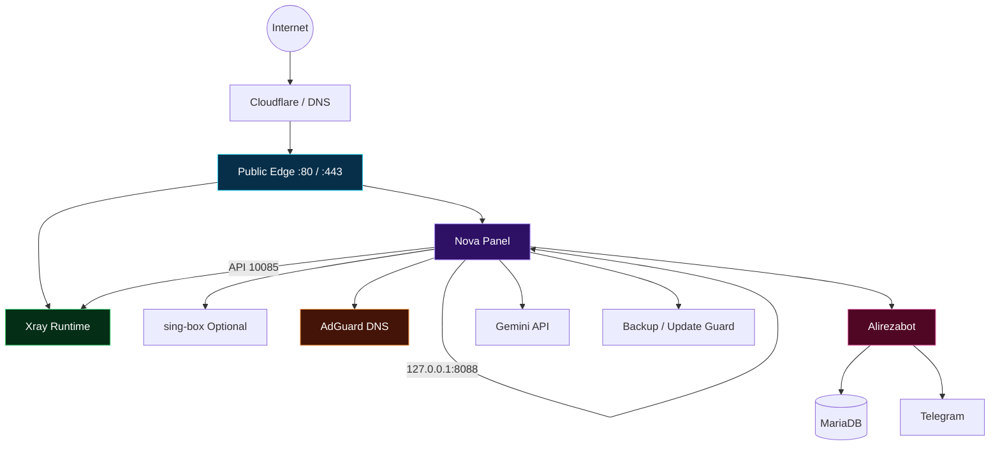
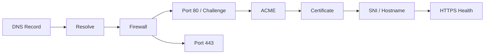
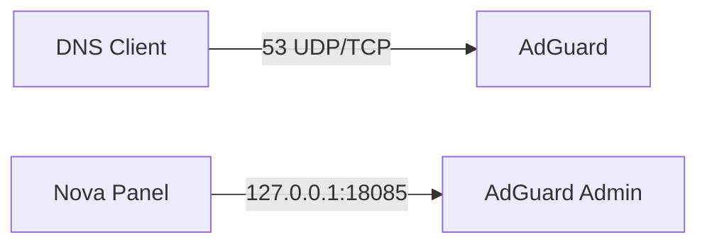
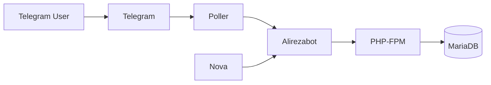
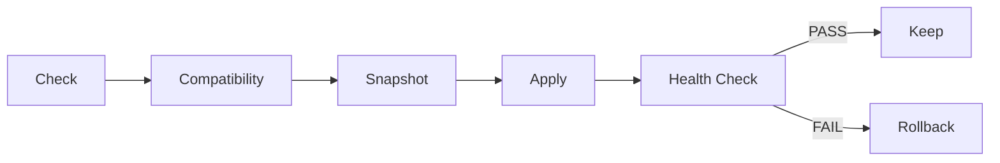

# alirezaserver 0.8.0-rc.13 — اصلاح آپدیت نوا و خطای ۲۶

**علت بازتولیدشده:** نسخهٔ قبلی تنها هش فایل‌های نوا 1.85.4 و 1.91.1 را می‌پذیرفت؛ نوا **1.92.1** در همین محافظ رد می‌شد. کد ۲۶ پیام کلی شکست بود و الزاماً علت اصلی را نشان نمی‌داد.

این نسخه روی آخرین بستهٔ rc.12 ساخته شده است؛ گزینهٔ خروجی تفکیک‌شدهٔ محصول ربات نیز حفظ شده، هرچند سورس موجود در GitHub هنگام بررسی هنوز rc.11 بود. تغییرات سفارشی README مخزن در ادامه حفظ شده‌اند. **۱۲۵۹ فایل اجرایی از جمله ربات، SSL، DNS، هسته و تولید کانفیگ، فرم‌های دستی و UI دست‌نخورده‌اند.** گزارش دقیق: [RC13-BASELINE](docs/RC13-BASELINE.json).

## نصب اصلاح و آپدیت فوری

ZIP بیرونی را Extract کنید؛ همهٔ محتویاتش را در ریشهٔ مخزن خودتان جایگزین کنید. **فایل داخلی `source-code.zip` را Extract نکنید.** سورس کامل و تمام گزارش‌ها داخل آن هستند. فایل‌های بیرونی برای آپلود با مرورگر کمتر از ۱۰۰ موردند؛ هر فایل کمتر از ۲۵ MiB است.

بعد از انتشار فایل‌های جدید در main، از `sudo alireza` پشتیبان بگیرید، سپس:

```bash
curl -fL --connect-timeout 15 --max-time 180 https://raw.githubusercontent.com/alirezachatgpt97-coder/alirezaserver/main/install.sh -o install.sh && sudo bash install.sh && sudo bash install.sh --update
```

اجرای `--update` روی نصاب قدیمی، کد جدید آپدیتر را نصب نمی‌کند؛ ابتدا همین نصاب جدید باید کامل اجرا شود. نیازی به نصب مجدد VPS، حذف کاربران، پلن‌ها، ربات یا دیتابیس نیست. نصب تازه از پایهٔ ثابت شروع می‌شود و دستور آخر نوا را تا نسخهٔ رسمی سازگار موجود ارتقا می‌دهد. تا قبل از آپلود این بسته روی GitHub، دستور بالا نسخهٔ قبلی مخزن را می‌گیرد.

## رفتار جدید آپدیت

- نوا **1.92.1** با commit `8c57ea6bfa4909bf1ae3b21a69bc6bbb390b7880` و SHA256 رسمی بررسی شد؛ نسخه‌های قبلی 1.85.4 و 1.91.1 همچنان شناخته می‌شوند.
- تغییر هش به‌تنهایی باعث رد شدن نسخهٔ آینده نمی‌شود. پس از دانلود HTTPS و بررسی checksum، نسخه در دیتابیس و مسیر تنظیمات موقت آزمایش می‌شود: syntax، قراردادهای رابط/توابع، ورود مالک، ساخت/ویرایش/حذف حساب ربات، خروجی کشور هر کاربر، اشتراک و تولید runtime config.
- فقط پس از موفقیت تمام بررسی‌ها، رسید محلی متصل به هش فایل‌ها و نسخهٔ کد ادغام صادر می‌شود. هنگام اجرا همان فایل‌ها بررسی می‌شوند؛ تغییر بعدی آن‌ها یا ناسازگاری کد ادغام به‌طور خاموش پذیرفته نمی‌شود. این رسید داخل کد نوا قرار می‌گیرد و کد اصلی آن را patch نمی‌کند.
- نسخهٔ ناسازگار پیش از تعویض متوقف می‌شود. پس از فعال‌سازی نیز سلامت واقعی ادغام بررسی می‌شود؛ snapshot و بازگشتِ داده/گواهی/config قبلی حفظ شده‌اند.
- خطاها اکنون `reason`، `failedStage` و پیام علت دارند. متن اصلی خطای JavaScript زیر خط minified یا stack طولانی گم نمی‌شود. شکست پاک‌سازی snapshot پس از یک آپدیت سالم هم دیگر به‌اشتباه شکست آپدیت اعلام نمی‌شود.
- تایمر شش‌ساعته و دکمهٔ موجود نوا باقی‌اند؛ سرویس دائمی جدیدی اضافه نشده است. پس از اصلاح کد محافظ، رد شدن cacheشدهٔ قبلی دوباره بررسی می‌شود.

```bash
sudo bash install.sh --update-status
sudo journalctl -u alireza-update.service -n 60 --no-pager
```

دستور اول وضعیت، مرحله و علت را نشان می‌دهد؛ دستور دوم برای خطای باقی‌مانده لاگ آپدیتر را نمایش می‌دهد. خطای شبکه/GitHub، فضای ناکافی و ناسازگاری واقعی پنهان یا موفقیت گزارش نمی‌شوند.

**تضمین تمام نسخه‌های ناشناختهٔ آینده ممکن نیست.** نسخه‌های آیندهٔ سازگار خودکار بررسی و نصب می‌شوند؛ تغییر شکستهٔ API، Node runtime یا UI می‌تواند نیازمند اصلاح ادغام باشد. حذف محافظ برای مجبورکردن نصب، داده و اتصال شما را به خطر می‌اندازد و انجام نشده است.

## نتیجهٔ بررسی

۶۱ تست Python و ۱۱۴ تست JavaScript موفق؛ یک تست هویت کاربر سیستم به علت نبود UID مناسب اجرا نشد. آزمون واقعی PHP/MariaDB محصول ربات، چهار انتقال محلی Xray، نسخهٔ شبیه‌سازی‌شدهٔ آینده با هش جدید، رد API خراب و رد فایل دستکاری‌شده گذشتند. نمونهٔ VPS/خطای نصب فعلی شما در دسترس نبود؛ اجرای کامل systemd، صدور SSL و اتصال اینترنت ایران در این نوبت تأیید نشده‌اند. گزارش و روش تکرار: [RC13-VALIDATION](docs/RC13-VALIDATION.md).

گزینهٔ محصول ربات rc.12 همچنان در **محصولات ← افزودن/ویرایش ← خروجی‌های تفکیک‌شدهٔ کشور** است و از خروجی‌های قبلاً فعال‌شدهٔ نوا استفاده می‌کند؛ حساب‌های قبلی بازنویسی نمی‌شوند. بهینه‌سازی‌ها و جلوه‌های اصلی حفظ شده‌اند؛ این آزمون‌ها تضمین اجرای کل سرویس‌ها با هر بار کاربری روی یک گیگ RAM نیستند.

---

## راهنمای سفارشی مخزن و تاریخچهٔ نسخه‌های قبلی

<div align="center">


# ⚡ ALIREZASERVER ⚡
### 🌌 Nova Server Control Stack — One Panel. One CLI. One Control Plane.


<br>


<br><br>

**🚀 نصب و مدیریت Nova، Xray، TLS، AdGuard، Alirezabot، OpenVPN، Backup، Update و Diagnostics از یک مرکز کنترل**

`Nova` • `Xray` • `sing-box` • `TLS` • `Cloudflare` • `AdGuard` • `Telegram` • `OpenVPN` • `Gemini` • `Backup` • `Repair`

<br>

[⚡ نصب سریع](#-نصب-تکخطی) ·
[✨ قابلیت‌ها](#-قابلیتها) ·
[🏗 معماری](#-معماری-سیستم) ·
[🔌 پورت‌ها](#-جدول-کامل-پورتها) ·
[🧰 CLI](#-مرجع-کامل-cli) ·
[🔐 TLS](#-tls--ssl--cloudflare) ·
[🤖 Bot](#-alirezabot) ·
[🩺 Troubleshooting](#-عیبیابی-و-diagnostics)

</div>

---

> [!IMPORTANT]
> این سند برای شاخهٔ `main` و خط انتشار `0.8.0-rc.11` تنظیم شده است. در صورت تفاوت README با وضعیت واقعی VPS، خروجی `sudo alireza ports`، `sudo alireza status` و کانفیگ همان سرور مرجع عملیاتی هستند.

> [!WARNING]
> پورت‌های داخلی مثل `127.0.0.1:8088`، `127.0.0.1:10085` و `127.0.0.1:18085` را صرفاً برای «راحتی» روی اینترنت منتشر نکنید.

---

# 🌌 alirezaserver چیست؟

**alirezaserver** یک Control Stack برای مدیریت سرویس‌های یک سرور Nova است. هدف پروژه این است که عملیات روزمرهٔ مدیر سرور—از نصب و TLS گرفته تا Xray، DNS، ربات، Backup، Update و Diagnostics—از یک مسیر مشخص قابل مدیریت باشد.

به‌جای اینکه برای هر خطا دنبال فایل systemd، مسیر certificate، پورت listener، تنظیم DNS، لاگ PHP یا config Xray بگردید، ابزار مدیریتی پروژه اطلاعات مهم را در یک CLI واحد جمع می‌کند:

```bash
sudo alireza
```

این پروژه قرار نیست پیچیدگی شبکه را مخفی کند؛ قرار است آن را **قابل مشاهده، قابل تشخیص و قابل مدیریت** کند.

---

# ⚡ نصب تک‌خطی

## 🚀 نصب اصلی

```bash
curl -fL --connect-timeout 15 --max-time 180 https://raw.githubusercontent.com/alirezachatgpt97-coder/alirezaserver/main/install.sh -o install.sh && sudo bash install.sh
```

### بعد از نصب

```bash
sudo alireza
```

### آدرس پنل‌ها

```bash
sudo alireza panels
```

### Health Check

```bash
sudo alireza doctor
sudo alireza status
sudo alireza ports
```

### وضعیت Update

```bash
sudo bash install.sh --update-status
```

### Update

```bash
sudo bash install.sh --update
```

---

# ✨ قابلیت‌ها

<table>
<tr>
<td width="33%" valign="top">

### 🧭 Control Center
- CLI یکپارچه
- Panel discovery
- Service status
- Restart
- Repair
- Support report
- Port inspection

</td>
<td width="33%" valign="top">

### ⚡ Network Core
- Nova
- Xray
- sing-box
- Inbounds
- Tunnels
- DNS
- Network checks

</td>
<td width="33%" valign="top">

### 🔐 Security
- TLS
- ACME
- Cloudflare
- Loopback isolation
- Update guard
- Backup
- Health checks

</td>
</tr>
<tr>
<td valign="top">

### 🤖 Automation
- Alirezabot
- Telegram Poller
- PHP-FPM
- MariaDB
- Password reset

</td>
<td valign="top">

### 🌐 Services
- AdGuard
- OpenVPN
- Gemini API
- HTTPS routing
- Internal APIs

</td>
<td valign="top">

### 🩺 Operations
- Logs
- Diagnostics
- Repair
- Backup
- Rollback path
- Validation assets

</td>
</tr>
</table>

---

# 🏗 معماری سیستم



### 🧠 فلسفهٔ معماری

```text
Public Internet
      │
      ├── :80  ─────────► HTTP / ACME
      ├── :443 ─────────► HTTPS / TLS / Proxy
      ├── :53  ─────────► DNS (Optional)
      └── Dynamic ──────► Selected Inbounds / VPN
                           │
                           ▼
                ┌──────────────────┐
                │    Nova Panel    │
                └────────┬─────────┘
                         │
          ┌──────────────┼──────────────┐
          ▼              ▼              ▼
      Xray API        AdGuard        Alirezabot
     127.0.0.1       127.0.0.1       Local stack
```

---

# 🖥️ تجربهٔ مدیریتی

```text
╔══════════════════════════════════════════════════════════╗
║                    ⚡ ALIREZASERVER                     ║
╠══════════════════════════════════════════════════════════╣
║  🧭 Panels       🔐 TLS          📊 Status              ║
║  🌐 Network      🔌 Ports        🩺 Doctor              ║
║  ⚡ Xray         🤖 Bot          🧹 AdGuard             ║
║  🔑 Passwords    🔐 OpenVPN      💾 Backup              ║
║  🔄 Update       🛠 Repair        📜 Logs                ║
╚══════════════════════════════════════════════════════════╝
```

هدف CLI این است که برای عملیات متداول، مدیر سرور مجبور به حفظ‌کردن مسیرهای داخلی پروژه نباشد.

---

# 🔌 جدول کامل پورت‌ها

| Port | Proto | Bind / Scope | Component | Public | Requirement | Security |
|---:|:---:|---|---|:---:|---|---|
| `80` | TCP | Public | HTTP / ACME | ✅ | TLS dependent | HTTP-01 / redirect |
| `443` | TCP | Public | HTTPS / Proxy | ✅ | معمولاً | ورودی اصلی TLS |
| `8088` | TCP | `127.0.0.1` | Nova API | ❌ | Internal | public نکنید |
| `10085` | TCP | `127.0.0.1` | Xray API | ❌ | Internal | control API |
| `2087` | TCP | `127.0.0.1` | VLESS-WS | ❌ | Config dependent | internal route |
| `10087` | TCP | `127.0.0.1` | sing-box | ❌ | Optional | local control |
| `53` | UDP | Selected IP | AdGuard DNS | ⚠️ | Optional | ACL مهم است |
| `53` | TCP | Selected IP | AdGuard DNS | ⚠️ | Optional | DNS TCP |
| `18085` | TCP | `127.0.0.1` | AdGuard Admin | ❌ | Internal | proxy via panel |
| `1194` | UDP | Selected | OpenVPN | ⚠️ | Optional | configurable |
| `22` | TCP | Destination | SSH | ⚠️ | Scenario dependent | ممکن است سفارشی باشد |
| `3306` | TCP | Local | MariaDB | ❌ | Bot optional | public نکنید |
| `443` | TCP | Outbound | Telegram | ↗ | Bot optional | HTTPS خروجی |
| `443` | TCP | Outbound | Gemini | ↗ | AI optional | HTTPS خروجی |
| Dynamic | TCP/UDP | Selected | Inbounds | ⚠️ | User config | config is source |
| Dynamic | TCP/UDP | Selected | Tunnels | ⚠️ | User config | engine dependent |

### 🔍 حقیقت را روی VPS ببینید

```bash
sudo alireza ports
sudo ss -lntup
sudo alireza status
```

> [!CAUTION]
> جدول بالا **لیست پورت‌هایی نیست که باید همگی در firewall باز شوند**. Loopbackها باید loopback باقی بمانند و پورت‌های Optional فقط وقتی لازم‌اند باز شوند.

---

# 🧰 مرجع کامل CLI

| Command | Function |
|---|---|
| `sudo alireza` | منوی اصلی |
| `sudo alireza panels` | آدرس پنل‌ها |
| `sudo alireza tls` | مدیریت TLS |
| `sudo alireza tls-status` | وضعیت certificate |
| `sudo alireza network` | DNS/TCP/HTTPS checks |
| `sudo alireza status` | وضعیت سرویس‌ها |
| `sudo alireza ports` | listeners و ports |
| `sudo alireza doctor` | health diagnostics |
| `sudo alireza repair` | repair |
| `sudo alireza support` | support report |
| `sudo alireza password panel` | reset رمز Nova |
| `sudo alireza password bot` | reset رمز Bot |
| `sudo alireza openvpn` | مدیریت OpenVPN |
| `sudo alireza restart panel` | restart panel |
| `sudo alireza restart xray` | restart Xray |
| `sudo alireza restart bot` | restart Bot |
| `sudo alireza logs xray` | Xray logs |
| `sudo alireza logs bot` | Bot web logs |
| `sudo alireza logs telegram` | Telegram poller logs |
| `sudo alireza backup` | backup |
| `sudo alireza update` | guarded update |

---

# 🔐 TLS / SSL / Cloudflare

TLS یک زنجیره است، نه یک دکمه:



### بررسی وضعیت

```bash
sudo alireza tls-status
sudo alireza network
sudo alireza doctor
```

### نکات Cloudflare

- DNS record باید به مقصد درست اشاره کند.
- HTTP-01 به دسترسی TCP/80 وابسته است.
- DNS-01 به credential معتبر نیاز دارد.
- حالت SSL/TLS سمت Cloudflare باید با origin هماهنگ باشد.
- certificate باید نام دامنهٔ مورد استفاده را پوشش دهد.
- موفق بودن ICMP/ping، سلامت HTTPS را اثبات نمی‌کند.

---

# ⚡ Xray

Xray یکی از runtimeهای اصلی است.

```bash
sudo alireza status
sudo alireza logs xray
sudo alireza restart xray
sudo alireza repair
```

### هنگام خطا چه چیزهایی بررسی شوند؟

1. syntax کانفیگ
2. مسیر config
3. User/Group سرویس systemd
4. permission فایل‌ها
5. certificate/key access
6. port conflict
7. log سرویس
8. وضعیت API داخلی

> [!WARNING]
> استفاده از `chmod 777` روی مسیرهای پروژه یک راه‌حل استاندارد نیست و می‌تواند امنیت سرور را ضعیف کند.

---

# 🧹 AdGuard / DNS



### نکات

- DNS عمومی بدون کنترل دسترسی می‌تواند مورد سوءاستفاده قرار گیرد.
- پورت مدیریت AdGuard داخلی است.
- UDP و TCP پورت 53 دو مسیر جدا هستند.
- conflict با resolver سیستم باید بررسی شود.

```bash
sudo alireza network
sudo alireza ports
```

---

# 🤖 Alirezabot



### مدیریت

```bash
sudo alireza logs bot
sudo alireza logs telegram
sudo alireza password bot
sudo alireza restart bot
```

### امنیت Bot

- Bot Token را در issue عمومی نگذارید.
- DB credential را منتشر نکنید.
- MariaDB را برای Bot روی اینترنت باز نکنید.
- اطلاعات login یک‌بارنمایش را امن نگهداری کنید.
- قبل از ارسال log، secretها را redact کنید.

---

# 🔐 OpenVPN

OpenVPN اختیاری است.

```bash
sudo alireza openvpn
sudo alireza ports
```

`1194/UDP` یک مقدار متداول/پیشنهادی است؛ مقدار واقعی سرور و firewall باید با config نهایی تطبیق داده شود.

---

# 🧠 Gemini / AI

اتصال AI به معنی نصب مدل محلی روی VPS نیست. درخواست‌ها از سمت سرور به API خارجی ارسال می‌شوند.

### قواعد مهم

- API key را عمومی نکنید.
- خطای AI نباید login پنل را مختل کند.
- خروجی مدل AI مجوز اجرای خودکار دستور سیستم نیست.
- دسترسی AI را از دسترسی مدیریتی سرور جدا نگه دارید.

---

# 💾 Backup

```bash
sudo alireza backup
```

یا:

```bash
sudo python3 /opt/alirezaserver/backup.py
```

### قبل از این کارها Backup بگیرید

- Upgrade
- Migration
- تغییر TLS
- تغییر دیتابیس
- تغییر ساختار Bot
- تغییرات بزرگ Xray
- تغییرات حساس شبکه

> Backup افزونه جای Snapshot کامل VPS را نمی‌گیرد.

---

# 🔄 Update Guard



### بررسی

```bash
sudo bash install.sh --update-status
```

### اجرا

```bash
sudo bash install.sh --update
```

یا:

```bash
sudo alireza update
```

هدف guard این است که «نسخه جدیدتر» به‌تنهایی به معنی «نسخه قابل نصب» تلقی نشود.

---

# 🛡️ امنیت

### 🔒 Network
- فقط پورت‌های لازم را باز کنید.
- APIهای loopback را public نکنید.
- DNS عمومی را بدون policy رها نکنید.
- DB را public نکنید.

### 🔑 Secrets
- Tokenها را commit نکنید.
- API key را در screenshot نگذارید.
- Private key را در support report عمومی قرار ندهید.
- Log را قبل از اشتراک‌گذاری بررسی کنید.

### 🧱 System
- از permissionهای حداقلی استفاده کنید.
- قبل از تغییر بزرگ Backup بگیرید.
- بعد از Update health check اجرا کنید.
- نسخه ناسازگار را force نکنید.

---

# 🩺 عیب‌یابی و Diagnostics

## 🚨 پنل باز نمی‌شود

```bash
sudo alireza status
sudo alireza ports
sudo alireza doctor
sudo alireza network
```

بررسی کنید:
- سرویس اجراست؟
- listener وجود دارد؟
- DNS درست است؟
- 443 reachable است؟
- certificate معتبر است؟
- reverse proxy پاسخ می‌دهد؟

## 🔐 TLS خطا دارد

```bash
sudo alireza tls-status
sudo alireza network
```

بررسی:
- DNS
- port 80
- port 443
- ACME challenge
- certificate hostname
- Cloudflare mode

## ⚡ Xray بالا نمی‌آید

```bash
sudo alireza logs xray
sudo alireza repair
```

بررسی:
- config
- permissions
- certificate
- port conflict
- service user

## 🤖 Bot جواب نمی‌دهد

```bash
sudo alireza logs bot
sudo alireza logs telegram
```

بررسی:
- PHP-FPM
- poller
- token
- DB
- outbound HTTPS

## 🧹 DNS مشکل دارد

```bash
sudo alireza network
sudo alireza ports
```

بررسی:
- UDP/53
- TCP/53
- bind address
- firewall
- resolver conflict

## 🛠 Repair

```bash
sudo bash install.sh --repair
sudo bash install.sh --check
sudo alireza repair
sudo alireza doctor
```

---

# 🧪 تست و Validation

خط انتشار rc.11 دارای فایل‌های validation و baseline در `docs/` است.

| Asset | Purpose |
|---|---|
| `docs/RC11-VALIDATION.md` | گزارش validation |
| `docs/RC11-BASELINE.json` | baseline |
| `docs/RC11-python-tests.txt` | Python tests |
| `docs/RC11-node-new-tests.txt` | Node tests |
| `docs/RC11-node-old-tests.txt` | compatibility |
| `docs/RC11-compat-new.txt` | compatibility result |
| `docs/RC11-compat-old.txt` | compatibility result |

---

# 🧬 Development / Build

```bash
python3 tools/package-bot.py
python3 tools/build.py
bash install.sh --self-test
python3 tools/package.py ../alirezaserver-package.zip
```

---

# 📚 مستندات داخل Repository

| موضوع | مسیر |
|---|---|
| Inbounds | `docs/INBOUNDS.md` |
| TLS | `docs/TLS.md` |
| Upgrade | `docs/UPGRADE.md` |
| RC11 Validation | `docs/RC11-VALIDATION.md` |
| RC11 Baseline | `docs/RC11-BASELINE.json` |
| Legacy 0.5 | `docs/LEGACY-0.5.md` |
| Sources | `SOURCES.md` |
| License | `LICENSE` |

---

# ❓ FAQ

<details>
<summary><b>🔌 آیا باید تمام پورت‌های جدول را باز کنم؟</b></summary>

خیر. جدول نقش پورت‌ها را توضیح می‌دهد. خروجی `sudo alireza ports` و کانفیگ واقعی سرور را بررسی کنید.

</details>

<details>
<summary><b>🔒 آیا 8088 و 10085 باید از اینترنت قابل دسترس باشند؟</b></summary>

خیر. این پورت‌ها در معماری مستندشده loopback هستند.

</details>

<details>
<summary><b>🤖 آیا نصب Alirezabot اجباری است؟</b></summary>

خیر. Bot و وابستگی‌های آن اختیاری‌اند.

</details>

<details>
<summary><b>🧠 آیا Gemini روی VPS مدل نصب می‌کند؟</b></summary>

خیر. اتصال به API خارجی است.

</details>

<details>
<summary><b>🌐 چرا ping کار می‌کند ولی پنل باز نمی‌شود؟</b></summary>

چون ICMP با TCP/443، TLS، SNI و HTTP یکسان نیست.

</details>

<details>
<summary><b>🛠 آیا برای permission از chmod 777 استفاده کنم؟</b></summary>

به‌صورت عمومی خیر. ابتدا User/Group سرویس و مسیر موردنیاز را مشخص کنید.

</details>

---

# 🎯 چک‌لیست بعد از نصب

```text
[ ] sudo alireza باز می‌شود
[ ] sudo alireza panels آدرس‌ها را نشان می‌دهد
[ ] sudo alireza status خطای critical ندارد
[ ] sudo alireza doctor وضعیت قابل قبول دارد
[ ] sudo alireza ports با انتظار شما هماهنگ است
[ ] HTTPS باز می‌شود
[ ] APIهای داخلی public نیستند
[ ] Backup تهیه شده
[ ] Secrets امن هستند
[ ] Firewall فقط پورت‌های لازم را باز کرده
```

---

<div align="center">


### ⚡ ONE SERVER • ONE CONTROL STACK • ONE COMMAND

```bash
sudo alireza
```


<br><br>

**Made for operators who want visibility, control and recoverability.**

⭐ Star • 🍴 Fork • 🐛 Report • 🚀 Deploy

</div>


# 📕 Operator Runbook — مرجع سنگین داخل همین README


<details>
<summary><strong>🌐 Network Runbook 01 — شبکه</strong></summary>

### قبل از تغییر
- وضعیت فعلی را ثبت کنید.
- آخرین تغییر را مشخص کنید.
- در عملیات حساس Backup تازه داشته باشید.

### بررسی‌ها
- **DNS resolution** — وضعیت واقعی را روی VPS بررسی کنید.
- **TCP reachability** — وضعیت واقعی را روی VPS بررسی کنید.
- **HTTPS health** — وضعیت واقعی را روی VPS بررسی کنید.
- **Firewall rules** — وضعیت واقعی را روی VPS بررسی کنید.
- **Bind address** — وضعیت واقعی را روی VPS بررسی کنید.
- **Port conflicts** — وضعیت واقعی را روی VPS بررسی کنید.

### دستورات پایه

```bash
sudo alireza status
sudo alireza ports
sudo alireza doctor
sudo alireza network
```

### بعد از اصلاح
- سرویس مرتبط را دوباره بررسی کنید.
- listenerها را با config مقایسه کنید.
- مسیر end-to-end را تست کنید.
- اگر secret در log دیده می‌شود، قبل از اشتراک‌گذاری آن را حذف کنید.

</details>


<details>
<summary><strong>🔐 TLS Runbook 02 — TLS</strong></summary>

### قبل از تغییر
- وضعیت فعلی را ثبت کنید.
- آخرین تغییر را مشخص کنید.
- در عملیات حساس Backup تازه داشته باشید.

### بررسی‌ها
- **Certificate hostname** — وضعیت واقعی را روی VPS بررسی کنید.
- **ACME challenge** — وضعیت واقعی را روی VPS بررسی کنید.
- **SNI** — وضعیت واقعی را روی VPS بررسی کنید.
- **Cloudflare mode** — وضعیت واقعی را روی VPS بررسی کنید.
- **Certificate expiry** — وضعیت واقعی را روی VPS بررسی کنید.
- **Private-key permissions** — وضعیت واقعی را روی VPS بررسی کنید.

### دستورات پایه

```bash
sudo alireza status
sudo alireza ports
sudo alireza doctor
sudo alireza network
```

### بعد از اصلاح
- سرویس مرتبط را دوباره بررسی کنید.
- listenerها را با config مقایسه کنید.
- مسیر end-to-end را تست کنید.
- اگر secret در log دیده می‌شود، قبل از اشتراک‌گذاری آن را حذف کنید.

</details>


<details>
<summary><strong>⚡ Xray Runbook 03 — Xray</strong></summary>

### قبل از تغییر
- وضعیت فعلی را ثبت کنید.
- آخرین تغییر را مشخص کنید.
- در عملیات حساس Backup تازه داشته باشید.

### بررسی‌ها
- **Service state** — وضعیت واقعی را روی VPS بررسی کنید.
- **Config syntax** — وضعیت واقعی را روی VPS بررسی کنید.
- **API listener** — وضعیت واقعی را روی VPS بررسی کنید.
- **Certificate access** — وضعیت واقعی را روی VPS بررسی کنید.
- **Runtime logs** — وضعیت واقعی را روی VPS بررسی کنید.
- **Inbound ports** — وضعیت واقعی را روی VPS بررسی کنید.

### دستورات پایه

```bash
sudo alireza status
sudo alireza ports
sudo alireza doctor
sudo alireza network
```

### بعد از اصلاح
- سرویس مرتبط را دوباره بررسی کنید.
- listenerها را با config مقایسه کنید.
- مسیر end-to-end را تست کنید.
- اگر secret در log دیده می‌شود، قبل از اشتراک‌گذاری آن را حذف کنید.

</details>


<details>
<summary><strong>🤖 Bot Runbook 04 — Alirezabot</strong></summary>

### قبل از تغییر
- وضعیت فعلی را ثبت کنید.
- آخرین تغییر را مشخص کنید.
- در عملیات حساس Backup تازه داشته باشید.

### بررسی‌ها
- **PHP-FPM** — وضعیت واقعی را روی VPS بررسی کنید.
- **MariaDB** — وضعیت واقعی را روی VPS بررسی کنید.
- **Telegram poller** — وضعیت واقعی را روی VPS بررسی کنید.
- **Bot token** — وضعیت واقعی را روی VPS بررسی کنید.
- **Web login** — وضعیت واقعی را روی VPS بررسی کنید.
- **Outbound HTTPS** — وضعیت واقعی را روی VPS بررسی کنید.

### دستورات پایه

```bash
sudo alireza status
sudo alireza ports
sudo alireza doctor
sudo alireza network
```

### بعد از اصلاح
- سرویس مرتبط را دوباره بررسی کنید.
- listenerها را با config مقایسه کنید.
- مسیر end-to-end را تست کنید.
- اگر secret در log دیده می‌شود، قبل از اشتراک‌گذاری آن را حذف کنید.

</details>


<details>
<summary><strong>🧹 DNS Runbook 05 — AdGuard</strong></summary>

### قبل از تغییر
- وضعیت فعلی را ثبت کنید.
- آخرین تغییر را مشخص کنید.
- در عملیات حساس Backup تازه داشته باشید.

### بررسی‌ها
- **UDP 53** — وضعیت واقعی را روی VPS بررسی کنید.
- **TCP 53** — وضعیت واقعی را روی VPS بررسی کنید.
- **Admin loopback** — وضعیت واقعی را روی VPS بررسی کنید.
- **Resolver conflict** — وضعیت واقعی را روی VPS بررسی کنید.
- **ACL** — وضعیت واقعی را روی VPS بررسی کنید.
- **Query health** — وضعیت واقعی را روی VPS بررسی کنید.

### دستورات پایه

```bash
sudo alireza status
sudo alireza ports
sudo alireza doctor
sudo alireza network
```

### بعد از اصلاح
- سرویس مرتبط را دوباره بررسی کنید.
- listenerها را با config مقایسه کنید.
- مسیر end-to-end را تست کنید.
- اگر secret در log دیده می‌شود، قبل از اشتراک‌گذاری آن را حذف کنید.

</details>


<details>
<summary><strong>💾 Backup Runbook 06 — Backup</strong></summary>

### قبل از تغییر
- وضعیت فعلی را ثبت کنید.
- آخرین تغییر را مشخص کنید.
- در عملیات حساس Backup تازه داشته باشید.

### بررسی‌ها
- **Fresh backup** — وضعیت واقعی را روی VPS بررسی کنید.
- **Restore plan** — وضعیت واقعی را روی VPS بررسی کنید.
- **Permissions** — وضعیت واقعی را روی VPS بررسی کنید.
- **Database data** — وضعیت واقعی را روی VPS بررسی کنید.
- **Config data** — وضعیت واقعی را روی VPS بررسی کنید.
- **Provider snapshot** — وضعیت واقعی را روی VPS بررسی کنید.

### دستورات پایه

```bash
sudo alireza status
sudo alireza ports
sudo alireza doctor
sudo alireza network
```

### بعد از اصلاح
- سرویس مرتبط را دوباره بررسی کنید.
- listenerها را با config مقایسه کنید.
- مسیر end-to-end را تست کنید.
- اگر secret در log دیده می‌شود، قبل از اشتراک‌گذاری آن را حذف کنید.

</details>


<details>
<summary><strong>🔄 Update Runbook 07 — Update</strong></summary>

### قبل از تغییر
- وضعیت فعلی را ثبت کنید.
- آخرین تغییر را مشخص کنید.
- در عملیات حساس Backup تازه داشته باشید.

### بررسی‌ها
- **Compatibility** — وضعیت واقعی را روی VPS بررسی کنید.
- **Preflight** — وضعیت واقعی را روی VPS بررسی کنید.
- **Snapshot** — وضعیت واقعی را روی VPS بررسی کنید.
- **Apply** — وضعیت واقعی را روی VPS بررسی کنید.
- **Health check** — وضعیت واقعی را روی VPS بررسی کنید.
- **Rollback** — وضعیت واقعی را روی VPS بررسی کنید.

### دستورات پایه

```bash
sudo alireza status
sudo alireza ports
sudo alireza doctor
sudo alireza network
```

### بعد از اصلاح
- سرویس مرتبط را دوباره بررسی کنید.
- listenerها را با config مقایسه کنید.
- مسیر end-to-end را تست کنید.
- اگر secret در log دیده می‌شود، قبل از اشتراک‌گذاری آن را حذف کنید.

</details>


<details>
<summary><strong>🛡 Security Runbook 08 — Security</strong></summary>

### قبل از تغییر
- وضعیت فعلی را ثبت کنید.
- آخرین تغییر را مشخص کنید.
- در عملیات حساس Backup تازه داشته باشید.

### بررسی‌ها
- **Secrets** — وضعیت واقعی را روی VPS بررسی کنید.
- **Least privilege** — وضعیت واقعی را روی VPS بررسی کنید.
- **Loopback** — وضعیت واقعی را روی VPS بررسی کنید.
- **Firewall** — وضعیت واقعی را روی VPS بررسی کنید.
- **Logs** — وضعیت واقعی را روی VPS بررسی کنید.
- **Patch state** — وضعیت واقعی را روی VPS بررسی کنید.

### دستورات پایه

```bash
sudo alireza status
sudo alireza ports
sudo alireza doctor
sudo alireza network
```

### بعد از اصلاح
- سرویس مرتبط را دوباره بررسی کنید.
- listenerها را با config مقایسه کنید.
- مسیر end-to-end را تست کنید.
- اگر secret در log دیده می‌شود، قبل از اشتراک‌گذاری آن را حذف کنید.

</details>


<details>
<summary><strong>🌐 Network Runbook 09 — شبکه</strong></summary>

### قبل از تغییر
- وضعیت فعلی را ثبت کنید.
- آخرین تغییر را مشخص کنید.
- در عملیات حساس Backup تازه داشته باشید.

### بررسی‌ها
- **DNS resolution** — وضعیت واقعی را روی VPS بررسی کنید.
- **TCP reachability** — وضعیت واقعی را روی VPS بررسی کنید.
- **HTTPS health** — وضعیت واقعی را روی VPS بررسی کنید.
- **Firewall rules** — وضعیت واقعی را روی VPS بررسی کنید.
- **Bind address** — وضعیت واقعی را روی VPS بررسی کنید.
- **Port conflicts** — وضعیت واقعی را روی VPS بررسی کنید.

### دستورات پایه

```bash
sudo alireza status
sudo alireza ports
sudo alireza doctor
sudo alireza network
```

### بعد از اصلاح
- سرویس مرتبط را دوباره بررسی کنید.
- listenerها را با config مقایسه کنید.
- مسیر end-to-end را تست کنید.
- اگر secret در log دیده می‌شود، قبل از اشتراک‌گذاری آن را حذف کنید.

</details>


<details>
<summary><strong>🔐 TLS Runbook 10 — TLS</strong></summary>

### قبل از تغییر
- وضعیت فعلی را ثبت کنید.
- آخرین تغییر را مشخص کنید.
- در عملیات حساس Backup تازه داشته باشید.

### بررسی‌ها
- **Certificate hostname** — وضعیت واقعی را روی VPS بررسی کنید.
- **ACME challenge** — وضعیت واقعی را روی VPS بررسی کنید.
- **SNI** — وضعیت واقعی را روی VPS بررسی کنید.
- **Cloudflare mode** — وضعیت واقعی را روی VPS بررسی کنید.
- **Certificate expiry** — وضعیت واقعی را روی VPS بررسی کنید.
- **Private-key permissions** — وضعیت واقعی را روی VPS بررسی کنید.

### دستورات پایه

```bash
sudo alireza status
sudo alireza ports
sudo alireza doctor
sudo alireza network
```

### بعد از اصلاح
- سرویس مرتبط را دوباره بررسی کنید.
- listenerها را با config مقایسه کنید.
- مسیر end-to-end را تست کنید.
- اگر secret در log دیده می‌شود، قبل از اشتراک‌گذاری آن را حذف کنید.

</details>


<details>
<summary><strong>⚡ Xray Runbook 11 — Xray</strong></summary>

### قبل از تغییر
- وضعیت فعلی را ثبت کنید.
- آخرین تغییر را مشخص کنید.
- در عملیات حساس Backup تازه داشته باشید.

### بررسی‌ها
- **Service state** — وضعیت واقعی را روی VPS بررسی کنید.
- **Config syntax** — وضعیت واقعی را روی VPS بررسی کنید.
- **API listener** — وضعیت واقعی را روی VPS بررسی کنید.
- **Certificate access** — وضعیت واقعی را روی VPS بررسی کنید.
- **Runtime logs** — وضعیت واقعی را روی VPS بررسی کنید.
- **Inbound ports** — وضعیت واقعی را روی VPS بررسی کنید.

### دستورات پایه

```bash
sudo alireza status
sudo alireza ports
sudo alireza doctor
sudo alireza network
```

### بعد از اصلاح
- سرویس مرتبط را دوباره بررسی کنید.
- listenerها را با config مقایسه کنید.
- مسیر end-to-end را تست کنید.
- اگر secret در log دیده می‌شود، قبل از اشتراک‌گذاری آن را حذف کنید.

</details>


<details>
<summary><strong>🤖 Bot Runbook 12 — Alirezabot</strong></summary>

### قبل از تغییر
- وضعیت فعلی را ثبت کنید.
- آخرین تغییر را مشخص کنید.
- در عملیات حساس Backup تازه داشته باشید.

### بررسی‌ها
- **PHP-FPM** — وضعیت واقعی را روی VPS بررسی کنید.
- **MariaDB** — وضعیت واقعی را روی VPS بررسی کنید.
- **Telegram poller** — وضعیت واقعی را روی VPS بررسی کنید.
- **Bot token** — وضعیت واقعی را روی VPS بررسی کنید.
- **Web login** — وضعیت واقعی را روی VPS بررسی کنید.
- **Outbound HTTPS** — وضعیت واقعی را روی VPS بررسی کنید.

### دستورات پایه

```bash
sudo alireza status
sudo alireza ports
sudo alireza doctor
sudo alireza network
```

### بعد از اصلاح
- سرویس مرتبط را دوباره بررسی کنید.
- listenerها را با config مقایسه کنید.
- مسیر end-to-end را تست کنید.
- اگر secret در log دیده می‌شود، قبل از اشتراک‌گذاری آن را حذف کنید.

</details>


<details>
<summary><strong>🧹 DNS Runbook 13 — AdGuard</strong></summary>

### قبل از تغییر
- وضعیت فعلی را ثبت کنید.
- آخرین تغییر را مشخص کنید.
- در عملیات حساس Backup تازه داشته باشید.

### بررسی‌ها
- **UDP 53** — وضعیت واقعی را روی VPS بررسی کنید.
- **TCP 53** — وضعیت واقعی را روی VPS بررسی کنید.
- **Admin loopback** — وضعیت واقعی را روی VPS بررسی کنید.
- **Resolver conflict** — وضعیت واقعی را روی VPS بررسی کنید.
- **ACL** — وضعیت واقعی را روی VPS بررسی کنید.
- **Query health** — وضعیت واقعی را روی VPS بررسی کنید.

### دستورات پایه

```bash
sudo alireza status
sudo alireza ports
sudo alireza doctor
sudo alireza network
```

### بعد از اصلاح
- سرویس مرتبط را دوباره بررسی کنید.
- listenerها را با config مقایسه کنید.
- مسیر end-to-end را تست کنید.
- اگر secret در log دیده می‌شود، قبل از اشتراک‌گذاری آن را حذف کنید.

</details>


<details>
<summary><strong>💾 Backup Runbook 14 — Backup</strong></summary>

### قبل از تغییر
- وضعیت فعلی را ثبت کنید.
- آخرین تغییر را مشخص کنید.
- در عملیات حساس Backup تازه داشته باشید.

### بررسی‌ها
- **Fresh backup** — وضعیت واقعی را روی VPS بررسی کنید.
- **Restore plan** — وضعیت واقعی را روی VPS بررسی کنید.
- **Permissions** — وضعیت واقعی را روی VPS بررسی کنید.
- **Database data** — وضعیت واقعی را روی VPS بررسی کنید.
- **Config data** — وضعیت واقعی را روی VPS بررسی کنید.
- **Provider snapshot** — وضعیت واقعی را روی VPS بررسی کنید.

### دستورات پایه

```bash
sudo alireza status
sudo alireza ports
sudo alireza doctor
sudo alireza network
```

### بعد از اصلاح
- سرویس مرتبط را دوباره بررسی کنید.
- listenerها را با config مقایسه کنید.
- مسیر end-to-end را تست کنید.
- اگر secret در log دیده می‌شود، قبل از اشتراک‌گذاری آن را حذف کنید.

</details>


<details>
<summary><strong>🔄 Update Runbook 15 — Update</strong></summary>

### قبل از تغییر
- وضعیت فعلی را ثبت کنید.
- آخرین تغییر را مشخص کنید.
- در عملیات حساس Backup تازه داشته باشید.

### بررسی‌ها
- **Compatibility** — وضعیت واقعی را روی VPS بررسی کنید.
- **Preflight** — وضعیت واقعی را روی VPS بررسی کنید.
- **Snapshot** — وضعیت واقعی را روی VPS بررسی کنید.
- **Apply** — وضعیت واقعی را روی VPS بررسی کنید.
- **Health check** — وضعیت واقعی را روی VPS بررسی کنید.
- **Rollback** — وضعیت واقعی را روی VPS بررسی کنید.

### دستورات پایه

```bash
sudo alireza status
sudo alireza ports
sudo alireza doctor
sudo alireza network
```

### بعد از اصلاح
- سرویس مرتبط را دوباره بررسی کنید.
- listenerها را با config مقایسه کنید.
- مسیر end-to-end را تست کنید.
- اگر secret در log دیده می‌شود، قبل از اشتراک‌گذاری آن را حذف کنید.

</details>


<details>
<summary><strong>🛡 Security Runbook 16 — Security</strong></summary>

### قبل از تغییر
- وضعیت فعلی را ثبت کنید.
- آخرین تغییر را مشخص کنید.
- در عملیات حساس Backup تازه داشته باشید.

### بررسی‌ها
- **Secrets** — وضعیت واقعی را روی VPS بررسی کنید.
- **Least privilege** — وضعیت واقعی را روی VPS بررسی کنید.
- **Loopback** — وضعیت واقعی را روی VPS بررسی کنید.
- **Firewall** — وضعیت واقعی را روی VPS بررسی کنید.
- **Logs** — وضعیت واقعی را روی VPS بررسی کنید.
- **Patch state** — وضعیت واقعی را روی VPS بررسی کنید.

### دستورات پایه

```bash
sudo alireza status
sudo alireza ports
sudo alireza doctor
sudo alireza network
```

### بعد از اصلاح
- سرویس مرتبط را دوباره بررسی کنید.
- listenerها را با config مقایسه کنید.
- مسیر end-to-end را تست کنید.
- اگر secret در log دیده می‌شود، قبل از اشتراک‌گذاری آن را حذف کنید.

</details>


<details>
<summary><strong>🌐 Network Runbook 17 — شبکه</strong></summary>

### قبل از تغییر
- وضعیت فعلی را ثبت کنید.
- آخرین تغییر را مشخص کنید.
- در عملیات حساس Backup تازه داشته باشید.

### بررسی‌ها
- **DNS resolution** — وضعیت واقعی را روی VPS بررسی کنید.
- **TCP reachability** — وضعیت واقعی را روی VPS بررسی کنید.
- **HTTPS health** — وضعیت واقعی را روی VPS بررسی کنید.
- **Firewall rules** — وضعیت واقعی را روی VPS بررسی کنید.
- **Bind address** — وضعیت واقعی را روی VPS بررسی کنید.
- **Port conflicts** — وضعیت واقعی را روی VPS بررسی کنید.

### دستورات پایه

```bash
sudo alireza status
sudo alireza ports
sudo alireza doctor
sudo alireza network
```

### بعد از اصلاح
- سرویس مرتبط را دوباره بررسی کنید.
- listenerها را با config مقایسه کنید.
- مسیر end-to-end را تست کنید.
- اگر secret در log دیده می‌شود، قبل از اشتراک‌گذاری آن را حذف کنید.

</details>


<details>
<summary><strong>🔐 TLS Runbook 18 — TLS</strong></summary>

### قبل از تغییر
- وضعیت فعلی را ثبت کنید.
- آخرین تغییر را مشخص کنید.
- در عملیات حساس Backup تازه داشته باشید.

### بررسی‌ها
- **Certificate hostname** — وضعیت واقعی را روی VPS بررسی کنید.
- **ACME challenge** — وضعیت واقعی را روی VPS بررسی کنید.
- **SNI** — وضعیت واقعی را روی VPS بررسی کنید.
- **Cloudflare mode** — وضعیت واقعی را روی VPS بررسی کنید.
- **Certificate expiry** — وضعیت واقعی را روی VPS بررسی کنید.
- **Private-key permissions** — وضعیت واقعی را روی VPS بررسی کنید.

### دستورات پایه

```bash
sudo alireza status
sudo alireza ports
sudo alireza doctor
sudo alireza network
```

### بعد از اصلاح
- سرویس مرتبط را دوباره بررسی کنید.
- listenerها را با config مقایسه کنید.
- مسیر end-to-end را تست کنید.
- اگر secret در log دیده می‌شود، قبل از اشتراک‌گذاری آن را حذف کنید.

</details>


<details>
<summary><strong>⚡ Xray Runbook 19 — Xray</strong></summary>

### قبل از تغییر
- وضعیت فعلی را ثبت کنید.
- آخرین تغییر را مشخص کنید.
- در عملیات حساس Backup تازه داشته باشید.

### بررسی‌ها
- **Service state** — وضعیت واقعی را روی VPS بررسی کنید.
- **Config syntax** — وضعیت واقعی را روی VPS بررسی کنید.
- **API listener** — وضعیت واقعی را روی VPS بررسی کنید.
- **Certificate access** — وضعیت واقعی را روی VPS بررسی کنید.
- **Runtime logs** — وضعیت واقعی را روی VPS بررسی کنید.
- **Inbound ports** — وضعیت واقعی را روی VPS بررسی کنید.

### دستورات پایه

```bash
sudo alireza status
sudo alireza ports
sudo alireza doctor
sudo alireza network
```

### بعد از اصلاح
- سرویس مرتبط را دوباره بررسی کنید.
- listenerها را با config مقایسه کنید.
- مسیر end-to-end را تست کنید.
- اگر secret در log دیده می‌شود، قبل از اشتراک‌گذاری آن را حذف کنید.

</details>


<details>
<summary><strong>🤖 Bot Runbook 20 — Alirezabot</strong></summary>

### قبل از تغییر
- وضعیت فعلی را ثبت کنید.
- آخرین تغییر را مشخص کنید.
- در عملیات حساس Backup تازه داشته باشید.

### بررسی‌ها
- **PHP-FPM** — وضعیت واقعی را روی VPS بررسی کنید.
- **MariaDB** — وضعیت واقعی را روی VPS بررسی کنید.
- **Telegram poller** — وضعیت واقعی را روی VPS بررسی کنید.
- **Bot token** — وضعیت واقعی را روی VPS بررسی کنید.
- **Web login** — وضعیت واقعی را روی VPS بررسی کنید.
- **Outbound HTTPS** — وضعیت واقعی را روی VPS بررسی کنید.

### دستورات پایه

```bash
sudo alireza status
sudo alireza ports
sudo alireza doctor
sudo alireza network
```

### بعد از اصلاح
- سرویس مرتبط را دوباره بررسی کنید.
- listenerها را با config مقایسه کنید.
- مسیر end-to-end را تست کنید.
- اگر secret در log دیده می‌شود، قبل از اشتراک‌گذاری آن را حذف کنید.

</details>


<details>
<summary><strong>🧹 DNS Runbook 21 — AdGuard</strong></summary>

### قبل از تغییر
- وضعیت فعلی را ثبت کنید.
- آخرین تغییر را مشخص کنید.
- در عملیات حساس Backup تازه داشته باشید.

### بررسی‌ها
- **UDP 53** — وضعیت واقعی را روی VPS بررسی کنید.
- **TCP 53** — وضعیت واقعی را روی VPS بررسی کنید.
- **Admin loopback** — وضعیت واقعی را روی VPS بررسی کنید.
- **Resolver conflict** — وضعیت واقعی را روی VPS بررسی کنید.
- **ACL** — وضعیت واقعی را روی VPS بررسی کنید.
- **Query health** — وضعیت واقعی را روی VPS بررسی کنید.

### دستورات پایه

```bash
sudo alireza status
sudo alireza ports
sudo alireza doctor
sudo alireza network
```

### بعد از اصلاح
- سرویس مرتبط را دوباره بررسی کنید.
- listenerها را با config مقایسه کنید.
- مسیر end-to-end را تست کنید.
- اگر secret در log دیده می‌شود، قبل از اشتراک‌گذاری آن را حذف کنید.

</details>


<details>
<summary><strong>💾 Backup Runbook 22 — Backup</strong></summary>

### قبل از تغییر
- وضعیت فعلی را ثبت کنید.
- آخرین تغییر را مشخص کنید.
- در عملیات حساس Backup تازه داشته باشید.

### بررسی‌ها
- **Fresh backup** — وضعیت واقعی را روی VPS بررسی کنید.
- **Restore plan** — وضعیت واقعی را روی VPS بررسی کنید.
- **Permissions** — وضعیت واقعی را روی VPS بررسی کنید.
- **Database data** — وضعیت واقعی را روی VPS بررسی کنید.
- **Config data** — وضعیت واقعی را روی VPS بررسی کنید.
- **Provider snapshot** — وضعیت واقعی را روی VPS بررسی کنید.

### دستورات پایه

```bash
sudo alireza status
sudo alireza ports
sudo alireza doctor
sudo alireza network
```

### بعد از اصلاح
- سرویس مرتبط را دوباره بررسی کنید.
- listenerها را با config مقایسه کنید.
- مسیر end-to-end را تست کنید.
- اگر secret در log دیده می‌شود، قبل از اشتراک‌گذاری آن را حذف کنید.

</details>


<details>
<summary><strong>🔄 Update Runbook 23 — Update</strong></summary>

### قبل از تغییر
- وضعیت فعلی را ثبت کنید.
- آخرین تغییر را مشخص کنید.
- در عملیات حساس Backup تازه داشته باشید.

### بررسی‌ها
- **Compatibility** — وضعیت واقعی را روی VPS بررسی کنید.
- **Preflight** — وضعیت واقعی را روی VPS بررسی کنید.
- **Snapshot** — وضعیت واقعی را روی VPS بررسی کنید.
- **Apply** — وضعیت واقعی را روی VPS بررسی کنید.
- **Health check** — وضعیت واقعی را روی VPS بررسی کنید.
- **Rollback** — وضعیت واقعی را روی VPS بررسی کنید.

### دستورات پایه

```bash
sudo alireza status
sudo alireza ports
sudo alireza doctor
sudo alireza network
```

### بعد از اصلاح
- سرویس مرتبط را دوباره بررسی کنید.
- listenerها را با config مقایسه کنید.
- مسیر end-to-end را تست کنید.
- اگر secret در log دیده می‌شود، قبل از اشتراک‌گذاری آن را حذف کنید.

</details>


<details>
<summary><strong>🛡 Security Runbook 24 — Security</strong></summary>

### قبل از تغییر
- وضعیت فعلی را ثبت کنید.
- آخرین تغییر را مشخص کنید.
- در عملیات حساس Backup تازه داشته باشید.

### بررسی‌ها
- **Secrets** — وضعیت واقعی را روی VPS بررسی کنید.
- **Least privilege** — وضعیت واقعی را روی VPS بررسی کنید.
- **Loopback** — وضعیت واقعی را روی VPS بررسی کنید.
- **Firewall** — وضعیت واقعی را روی VPS بررسی کنید.
- **Logs** — وضعیت واقعی را روی VPS بررسی کنید.
- **Patch state** — وضعیت واقعی را روی VPS بررسی کنید.

### دستورات پایه

```bash
sudo alireza status
sudo alireza ports
sudo alireza doctor
sudo alireza network
```

### بعد از اصلاح
- سرویس مرتبط را دوباره بررسی کنید.
- listenerها را با config مقایسه کنید.
- مسیر end-to-end را تست کنید.
- اگر secret در log دیده می‌شود، قبل از اشتراک‌گذاری آن را حذف کنید.

</details>


<details>
<summary><strong>🌐 Network Runbook 25 — شبکه</strong></summary>

### قبل از تغییر
- وضعیت فعلی را ثبت کنید.
- آخرین تغییر را مشخص کنید.
- در عملیات حساس Backup تازه داشته باشید.

### بررسی‌ها
- **DNS resolution** — وضعیت واقعی را روی VPS بررسی کنید.
- **TCP reachability** — وضعیت واقعی را روی VPS بررسی کنید.
- **HTTPS health** — وضعیت واقعی را روی VPS بررسی کنید.
- **Firewall rules** — وضعیت واقعی را روی VPS بررسی کنید.
- **Bind address** — وضعیت واقعی را روی VPS بررسی کنید.
- **Port conflicts** — وضعیت واقعی را روی VPS بررسی کنید.

### دستورات پایه

```bash
sudo alireza status
sudo alireza ports
sudo alireza doctor
sudo alireza network
```

### بعد از اصلاح
- سرویس مرتبط را دوباره بررسی کنید.
- listenerها را با config مقایسه کنید.
- مسیر end-to-end را تست کنید.
- اگر secret در log دیده می‌شود، قبل از اشتراک‌گذاری آن را حذف کنید.

</details>


<details>
<summary><strong>🔐 TLS Runbook 26 — TLS</strong></summary>

### قبل از تغییر
- وضعیت فعلی را ثبت کنید.
- آخرین تغییر را مشخص کنید.
- در عملیات حساس Backup تازه داشته باشید.

### بررسی‌ها
- **Certificate hostname** — وضعیت واقعی را روی VPS بررسی کنید.
- **ACME challenge** — وضعیت واقعی را روی VPS بررسی کنید.
- **SNI** — وضعیت واقعی را روی VPS بررسی کنید.
- **Cloudflare mode** — وضعیت واقعی را روی VPS بررسی کنید.
- **Certificate expiry** — وضعیت واقعی را روی VPS بررسی کنید.
- **Private-key permissions** — وضعیت واقعی را روی VPS بررسی کنید.

### دستورات پایه

```bash
sudo alireza status
sudo alireza ports
sudo alireza doctor
sudo alireza network
```

### بعد از اصلاح
- سرویس مرتبط را دوباره بررسی کنید.
- listenerها را با config مقایسه کنید.
- مسیر end-to-end را تست کنید.
- اگر secret در log دیده می‌شود، قبل از اشتراک‌گذاری آن را حذف کنید.

</details>


<details>
<summary><strong>⚡ Xray Runbook 27 — Xray</strong></summary>

### قبل از تغییر
- وضعیت فعلی را ثبت کنید.
- آخرین تغییر را مشخص کنید.
- در عملیات حساس Backup تازه داشته باشید.

### بررسی‌ها
- **Service state** — وضعیت واقعی را روی VPS بررسی کنید.
- **Config syntax** — وضعیت واقعی را روی VPS بررسی کنید.
- **API listener** — وضعیت واقعی را روی VPS بررسی کنید.
- **Certificate access** — وضعیت واقعی را روی VPS بررسی کنید.
- **Runtime logs** — وضعیت واقعی را روی VPS بررسی کنید.
- **Inbound ports** — وضعیت واقعی را روی VPS بررسی کنید.

### دستورات پایه

```bash
sudo alireza status
sudo alireza ports
sudo alireza doctor
sudo alireza network
```

### بعد از اصلاح
- سرویس مرتبط را دوباره بررسی کنید.
- listenerها را با config مقایسه کنید.
- مسیر end-to-end را تست کنید.
- اگر secret در log دیده می‌شود، قبل از اشتراک‌گذاری آن را حذف کنید.

</details>


<details>
<summary><strong>🤖 Bot Runbook 28 — Alirezabot</strong></summary>

### قبل از تغییر
- وضعیت فعلی را ثبت کنید.
- آخرین تغییر را مشخص کنید.
- در عملیات حساس Backup تازه داشته باشید.

### بررسی‌ها
- **PHP-FPM** — وضعیت واقعی را روی VPS بررسی کنید.
- **MariaDB** — وضعیت واقعی را روی VPS بررسی کنید.
- **Telegram poller** — وضعیت واقعی را روی VPS بررسی کنید.
- **Bot token** — وضعیت واقعی را روی VPS بررسی کنید.
- **Web login** — وضعیت واقعی را روی VPS بررسی کنید.
- **Outbound HTTPS** — وضعیت واقعی را روی VPS بررسی کنید.

### دستورات پایه

```bash
sudo alireza status
sudo alireza ports
sudo alireza doctor
sudo alireza network
```

### بعد از اصلاح
- سرویس مرتبط را دوباره بررسی کنید.
- listenerها را با config مقایسه کنید.
- مسیر end-to-end را تست کنید.
- اگر secret در log دیده می‌شود، قبل از اشتراک‌گذاری آن را حذف کنید.

</details>


<details>
<summary><strong>🧹 DNS Runbook 29 — AdGuard</strong></summary>

### قبل از تغییر
- وضعیت فعلی را ثبت کنید.
- آخرین تغییر را مشخص کنید.
- در عملیات حساس Backup تازه داشته باشید.

### بررسی‌ها
- **UDP 53** — وضعیت واقعی را روی VPS بررسی کنید.
- **TCP 53** — وضعیت واقعی را روی VPS بررسی کنید.
- **Admin loopback** — وضعیت واقعی را روی VPS بررسی کنید.
- **Resolver conflict** — وضعیت واقعی را روی VPS بررسی کنید.
- **ACL** — وضعیت واقعی را روی VPS بررسی کنید.
- **Query health** — وضعیت واقعی را روی VPS بررسی کنید.

### دستورات پایه

```bash
sudo alireza status
sudo alireza ports
sudo alireza doctor
sudo alireza network
```

### بعد از اصلاح
- سرویس مرتبط را دوباره بررسی کنید.
- listenerها را با config مقایسه کنید.
- مسیر end-to-end را تست کنید.
- اگر secret در log دیده می‌شود، قبل از اشتراک‌گذاری آن را حذف کنید.

</details>


<details>
<summary><strong>💾 Backup Runbook 30 — Backup</strong></summary>

### قبل از تغییر
- وضعیت فعلی را ثبت کنید.
- آخرین تغییر را مشخص کنید.
- در عملیات حساس Backup تازه داشته باشید.

### بررسی‌ها
- **Fresh backup** — وضعیت واقعی را روی VPS بررسی کنید.
- **Restore plan** — وضعیت واقعی را روی VPS بررسی کنید.
- **Permissions** — وضعیت واقعی را روی VPS بررسی کنید.
- **Database data** — وضعیت واقعی را روی VPS بررسی کنید.
- **Config data** — وضعیت واقعی را روی VPS بررسی کنید.
- **Provider snapshot** — وضعیت واقعی را روی VPS بررسی کنید.

### دستورات پایه

```bash
sudo alireza status
sudo alireza ports
sudo alireza doctor
sudo alireza network
```

### بعد از اصلاح
- سرویس مرتبط را دوباره بررسی کنید.
- listenerها را با config مقایسه کنید.
- مسیر end-to-end را تست کنید.
- اگر secret در log دیده می‌شود، قبل از اشتراک‌گذاری آن را حذف کنید.

</details>


<details>
<summary><strong>🔄 Update Runbook 31 — Update</strong></summary>

### قبل از تغییر
- وضعیت فعلی را ثبت کنید.
- آخرین تغییر را مشخص کنید.
- در عملیات حساس Backup تازه داشته باشید.

### بررسی‌ها
- **Compatibility** — وضعیت واقعی را روی VPS بررسی کنید.
- **Preflight** — وضعیت واقعی را روی VPS بررسی کنید.
- **Snapshot** — وضعیت واقعی را روی VPS بررسی کنید.
- **Apply** — وضعیت واقعی را روی VPS بررسی کنید.
- **Health check** — وضعیت واقعی را روی VPS بررسی کنید.
- **Rollback** — وضعیت واقعی را روی VPS بررسی کنید.

### دستورات پایه

```bash
sudo alireza status
sudo alireza ports
sudo alireza doctor
sudo alireza network
```

### بعد از اصلاح
- سرویس مرتبط را دوباره بررسی کنید.
- listenerها را با config مقایسه کنید.
- مسیر end-to-end را تست کنید.
- اگر secret در log دیده می‌شود، قبل از اشتراک‌گذاری آن را حذف کنید.

</details>


<details>
<summary><strong>🛡 Security Runbook 32 — Security</strong></summary>

### قبل از تغییر
- وضعیت فعلی را ثبت کنید.
- آخرین تغییر را مشخص کنید.
- در عملیات حساس Backup تازه داشته باشید.

### بررسی‌ها
- **Secrets** — وضعیت واقعی را روی VPS بررسی کنید.
- **Least privilege** — وضعیت واقعی را روی VPS بررسی کنید.
- **Loopback** — وضعیت واقعی را روی VPS بررسی کنید.
- **Firewall** — وضعیت واقعی را روی VPS بررسی کنید.
- **Logs** — وضعیت واقعی را روی VPS بررسی کنید.
- **Patch state** — وضعیت واقعی را روی VPS بررسی کنید.

### دستورات پایه

```bash
sudo alireza status
sudo alireza ports
sudo alireza doctor
sudo alireza network
```

### بعد از اصلاح
- سرویس مرتبط را دوباره بررسی کنید.
- listenerها را با config مقایسه کنید.
- مسیر end-to-end را تست کنید.
- اگر secret در log دیده می‌شود، قبل از اشتراک‌گذاری آن را حذف کنید.

</details>


<details>
<summary><strong>🌐 Network Runbook 33 — شبکه</strong></summary>

### قبل از تغییر
- وضعیت فعلی را ثبت کنید.
- آخرین تغییر را مشخص کنید.
- در عملیات حساس Backup تازه داشته باشید.

### بررسی‌ها
- **DNS resolution** — وضعیت واقعی را روی VPS بررسی کنید.
- **TCP reachability** — وضعیت واقعی را روی VPS بررسی کنید.
- **HTTPS health** — وضعیت واقعی را روی VPS بررسی کنید.
- **Firewall rules** — وضعیت واقعی را روی VPS بررسی کنید.
- **Bind address** — وضعیت واقعی را روی VPS بررسی کنید.
- **Port conflicts** — وضعیت واقعی را روی VPS بررسی کنید.

### دستورات پایه

```bash
sudo alireza status
sudo alireza ports
sudo alireza doctor
sudo alireza network
```

### بعد از اصلاح
- سرویس مرتبط را دوباره بررسی کنید.
- listenerها را با config مقایسه کنید.
- مسیر end-to-end را تست کنید.
- اگر secret در log دیده می‌شود، قبل از اشتراک‌گذاری آن را حذف کنید.

</details>


<details>
<summary><strong>🔐 TLS Runbook 34 — TLS</strong></summary>

### قبل از تغییر
- وضعیت فعلی را ثبت کنید.
- آخرین تغییر را مشخص کنید.
- در عملیات حساس Backup تازه داشته باشید.

### بررسی‌ها
- **Certificate hostname** — وضعیت واقعی را روی VPS بررسی کنید.
- **ACME challenge** — وضعیت واقعی را روی VPS بررسی کنید.
- **SNI** — وضعیت واقعی را روی VPS بررسی کنید.
- **Cloudflare mode** — وضعیت واقعی را روی VPS بررسی کنید.
- **Certificate expiry** — وضعیت واقعی را روی VPS بررسی کنید.
- **Private-key permissions** — وضعیت واقعی را روی VPS بررسی کنید.

### دستورات پایه

```bash
sudo alireza status
sudo alireza ports
sudo alireza doctor
sudo alireza network
```

### بعد از اصلاح
- سرویس مرتبط را دوباره بررسی کنید.
- listenerها را با config مقایسه کنید.
- مسیر end-to-end را تست کنید.
- اگر secret در log دیده می‌شود، قبل از اشتراک‌گذاری آن را حذف کنید.

</details>


<details>
<summary><strong>⚡ Xray Runbook 35 — Xray</strong></summary>

### قبل از تغییر
- وضعیت فعلی را ثبت کنید.
- آخرین تغییر را مشخص کنید.
- در عملیات حساس Backup تازه داشته باشید.

### بررسی‌ها
- **Service state** — وضعیت واقعی را روی VPS بررسی کنید.
- **Config syntax** — وضعیت واقعی را روی VPS بررسی کنید.
- **API listener** — وضعیت واقعی را روی VPS بررسی کنید.
- **Certificate access** — وضعیت واقعی را روی VPS بررسی کنید.
- **Runtime logs** — وضعیت واقعی را روی VPS بررسی کنید.
- **Inbound ports** — وضعیت واقعی را روی VPS بررسی کنید.

### دستورات پایه

```bash
sudo alireza status
sudo alireza ports
sudo alireza doctor
sudo alireza network
```

### بعد از اصلاح
- سرویس مرتبط را دوباره بررسی کنید.
- listenerها را با config مقایسه کنید.
- مسیر end-to-end را تست کنید.
- اگر secret در log دیده می‌شود، قبل از اشتراک‌گذاری آن را حذف کنید.

</details>


<details>
<summary><strong>🤖 Bot Runbook 36 — Alirezabot</strong></summary>

### قبل از تغییر
- وضعیت فعلی را ثبت کنید.
- آخرین تغییر را مشخص کنید.
- در عملیات حساس Backup تازه داشته باشید.

### بررسی‌ها
- **PHP-FPM** — وضعیت واقعی را روی VPS بررسی کنید.
- **MariaDB** — وضعیت واقعی را روی VPS بررسی کنید.
- **Telegram poller** — وضعیت واقعی را روی VPS بررسی کنید.
- **Bot token** — وضعیت واقعی را روی VPS بررسی کنید.
- **Web login** — وضعیت واقعی را روی VPS بررسی کنید.
- **Outbound HTTPS** — وضعیت واقعی را روی VPS بررسی کنید.

### دستورات پایه

```bash
sudo alireza status
sudo alireza ports
sudo alireza doctor
sudo alireza network
```

### بعد از اصلاح
- سرویس مرتبط را دوباره بررسی کنید.
- listenerها را با config مقایسه کنید.
- مسیر end-to-end را تست کنید.
- اگر secret در log دیده می‌شود، قبل از اشتراک‌گذاری آن را حذف کنید.

</details>


<details>
<summary><strong>🧹 DNS Runbook 37 — AdGuard</strong></summary>

### قبل از تغییر
- وضعیت فعلی را ثبت کنید.
- آخرین تغییر را مشخص کنید.
- در عملیات حساس Backup تازه داشته باشید.

### بررسی‌ها
- **UDP 53** — وضعیت واقعی را روی VPS بررسی کنید.
- **TCP 53** — وضعیت واقعی را روی VPS بررسی کنید.
- **Admin loopback** — وضعیت واقعی را روی VPS بررسی کنید.
- **Resolver conflict** — وضعیت واقعی را روی VPS بررسی کنید.
- **ACL** — وضعیت واقعی را روی VPS بررسی کنید.
- **Query health** — وضعیت واقعی را روی VPS بررسی کنید.

### دستورات پایه

```bash
sudo alireza status
sudo alireza ports
sudo alireza doctor
sudo alireza network
```

### بعد از اصلاح
- سرویس مرتبط را دوباره بررسی کنید.
- listenerها را با config مقایسه کنید.
- مسیر end-to-end را تست کنید.
- اگر secret در log دیده می‌شود، قبل از اشتراک‌گذاری آن را حذف کنید.

</details>


<details>
<summary><strong>💾 Backup Runbook 38 — Backup</strong></summary>

### قبل از تغییر
- وضعیت فعلی را ثبت کنید.
- آخرین تغییر را مشخص کنید.
- در عملیات حساس Backup تازه داشته باشید.

### بررسی‌ها
- **Fresh backup** — وضعیت واقعی را روی VPS بررسی کنید.
- **Restore plan** — وضعیت واقعی را روی VPS بررسی کنید.
- **Permissions** — وضعیت واقعی را روی VPS بررسی کنید.
- **Database data** — وضعیت واقعی را روی VPS بررسی کنید.
- **Config data** — وضعیت واقعی را روی VPS بررسی کنید.
- **Provider snapshot** — وضعیت واقعی را روی VPS بررسی کنید.

### دستورات پایه

```bash
sudo alireza status
sudo alireza ports
sudo alireza doctor
sudo alireza network
```

### بعد از اصلاح
- سرویس مرتبط را دوباره بررسی کنید.
- listenerها را با config مقایسه کنید.
- مسیر end-to-end را تست کنید.
- اگر secret در log دیده می‌شود، قبل از اشتراک‌گذاری آن را حذف کنید.

</details>


<details>
<summary><strong>🔄 Update Runbook 39 — Update</strong></summary>

### قبل از تغییر
- وضعیت فعلی را ثبت کنید.
- آخرین تغییر را مشخص کنید.
- در عملیات حساس Backup تازه داشته باشید.

### بررسی‌ها
- **Compatibility** — وضعیت واقعی را روی VPS بررسی کنید.
- **Preflight** — وضعیت واقعی را روی VPS بررسی کنید.
- **Snapshot** — وضعیت واقعی را روی VPS بررسی کنید.
- **Apply** — وضعیت واقعی را روی VPS بررسی کنید.
- **Health check** — وضعیت واقعی را روی VPS بررسی کنید.
- **Rollback** — وضعیت واقعی را روی VPS بررسی کنید.

### دستورات پایه

```bash
sudo alireza status
sudo alireza ports
sudo alireza doctor
sudo alireza network
```

### بعد از اصلاح
- سرویس مرتبط را دوباره بررسی کنید.
- listenerها را با config مقایسه کنید.
- مسیر end-to-end را تست کنید.
- اگر secret در log دیده می‌شود، قبل از اشتراک‌گذاری آن را حذف کنید.

</details>


<details>
<summary><strong>🛡 Security Runbook 40 — Security</strong></summary>

### قبل از تغییر
- وضعیت فعلی را ثبت کنید.
- آخرین تغییر را مشخص کنید.
- در عملیات حساس Backup تازه داشته باشید.

### بررسی‌ها
- **Secrets** — وضعیت واقعی را روی VPS بررسی کنید.
- **Least privilege** — وضعیت واقعی را روی VPS بررسی کنید.
- **Loopback** — وضعیت واقعی را روی VPS بررسی کنید.
- **Firewall** — وضعیت واقعی را روی VPS بررسی کنید.
- **Logs** — وضعیت واقعی را روی VPS بررسی کنید.
- **Patch state** — وضعیت واقعی را روی VPS بررسی کنید.

### دستورات پایه

```bash
sudo alireza status
sudo alireza ports
sudo alireza doctor
sudo alireza network
```

### بعد از اصلاح
- سرویس مرتبط را دوباره بررسی کنید.
- listenerها را با config مقایسه کنید.
- مسیر end-to-end را تست کنید.
- اگر secret در log دیده می‌شود، قبل از اشتراک‌گذاری آن را حذف کنید.

</details>


<details>
<summary><strong>🌐 Network Runbook 41 — شبکه</strong></summary>

### قبل از تغییر
- وضعیت فعلی را ثبت کنید.
- آخرین تغییر را مشخص کنید.
- در عملیات حساس Backup تازه داشته باشید.

### بررسی‌ها
- **DNS resolution** — وضعیت واقعی را روی VPS بررسی کنید.
- **TCP reachability** — وضعیت واقعی را روی VPS بررسی کنید.
- **HTTPS health** — وضعیت واقعی را روی VPS بررسی کنید.
- **Firewall rules** — وضعیت واقعی را روی VPS بررسی کنید.
- **Bind address** — وضعیت واقعی را روی VPS بررسی کنید.
- **Port conflicts** — وضعیت واقعی را روی VPS بررسی کنید.

### دستورات پایه

```bash
sudo alireza status
sudo alireza ports
sudo alireza doctor
sudo alireza network
```

### بعد از اصلاح
- سرویس مرتبط را دوباره بررسی کنید.
- listenerها را با config مقایسه کنید.
- مسیر end-to-end را تست کنید.
- اگر secret در log دیده می‌شود، قبل از اشتراک‌گذاری آن را حذف کنید.

</details>


<details>
<summary><strong>🔐 TLS Runbook 42 — TLS</strong></summary>

### قبل از تغییر
- وضعیت فعلی را ثبت کنید.
- آخرین تغییر را مشخص کنید.
- در عملیات حساس Backup تازه داشته باشید.

### بررسی‌ها
- **Certificate hostname** — وضعیت واقعی را روی VPS بررسی کنید.
- **ACME challenge** — وضعیت واقعی را روی VPS بررسی کنید.
- **SNI** — وضعیت واقعی را روی VPS بررسی کنید.
- **Cloudflare mode** — وضعیت واقعی را روی VPS بررسی کنید.
- **Certificate expiry** — وضعیت واقعی را روی VPS بررسی کنید.
- **Private-key permissions** — وضعیت واقعی را روی VPS بررسی کنید.

### دستورات پایه

```bash
sudo alireza status
sudo alireza ports
sudo alireza doctor
sudo alireza network
```

### بعد از اصلاح
- سرویس مرتبط را دوباره بررسی کنید.
- listenerها را با config مقایسه کنید.
- مسیر end-to-end را تست کنید.
- اگر secret در log دیده می‌شود، قبل از اشتراک‌گذاری آن را حذف کنید.

</details>


<details>
<summary><strong>⚡ Xray Runbook 43 — Xray</strong></summary>

### قبل از تغییر
- وضعیت فعلی را ثبت کنید.
- آخرین تغییر را مشخص کنید.
- در عملیات حساس Backup تازه داشته باشید.

### بررسی‌ها
- **Service state** — وضعیت واقعی را روی VPS بررسی کنید.
- **Config syntax** — وضعیت واقعی را روی VPS بررسی کنید.
- **API listener** — وضعیت واقعی را روی VPS بررسی کنید.
- **Certificate access** — وضعیت واقعی را روی VPS بررسی کنید.
- **Runtime logs** — وضعیت واقعی را روی VPS بررسی کنید.
- **Inbound ports** — وضعیت واقعی را روی VPS بررسی کنید.

### دستورات پایه

```bash
sudo alireza status
sudo alireza ports
sudo alireza doctor
sudo alireza network
```

### بعد از اصلاح
- سرویس مرتبط را دوباره بررسی کنید.
- listenerها را با config مقایسه کنید.
- مسیر end-to-end را تست کنید.
- اگر secret در log دیده می‌شود، قبل از اشتراک‌گذاری آن را حذف کنید.

</details>


<details>
<summary><strong>🤖 Bot Runbook 44 — Alirezabot</strong></summary>

### قبل از تغییر
- وضعیت فعلی را ثبت کنید.
- آخرین تغییر را مشخص کنید.
- در عملیات حساس Backup تازه داشته باشید.

### بررسی‌ها
- **PHP-FPM** — وضعیت واقعی را روی VPS بررسی کنید.
- **MariaDB** — وضعیت واقعی را روی VPS بررسی کنید.
- **Telegram poller** — وضعیت واقعی را روی VPS بررسی کنید.
- **Bot token** — وضعیت واقعی را روی VPS بررسی کنید.
- **Web login** — وضعیت واقعی را روی VPS بررسی کنید.
- **Outbound HTTPS** — وضعیت واقعی را روی VPS بررسی کنید.

### دستورات پایه

```bash
sudo alireza status
sudo alireza ports
sudo alireza doctor
sudo alireza network
```

### بعد از اصلاح
- سرویس مرتبط را دوباره بررسی کنید.
- listenerها را با config مقایسه کنید.
- مسیر end-to-end را تست کنید.
- اگر secret در log دیده می‌شود، قبل از اشتراک‌گذاری آن را حذف کنید.

</details>


<details>
<summary><strong>🧹 DNS Runbook 45 — AdGuard</strong></summary>

### قبل از تغییر
- وضعیت فعلی را ثبت کنید.
- آخرین تغییر را مشخص کنید.
- در عملیات حساس Backup تازه داشته باشید.

### بررسی‌ها
- **UDP 53** — وضعیت واقعی را روی VPS بررسی کنید.
- **TCP 53** — وضعیت واقعی را روی VPS بررسی کنید.
- **Admin loopback** — وضعیت واقعی را روی VPS بررسی کنید.
- **Resolver conflict** — وضعیت واقعی را روی VPS بررسی کنید.
- **ACL** — وضعیت واقعی را روی VPS بررسی کنید.
- **Query health** — وضعیت واقعی را روی VPS بررسی کنید.

### دستورات پایه

```bash
sudo alireza status
sudo alireza ports
sudo alireza doctor
sudo alireza network
```

### بعد از اصلاح
- سرویس مرتبط را دوباره بررسی کنید.
- listenerها را با config مقایسه کنید.
- مسیر end-to-end را تست کنید.
- اگر secret در log دیده می‌شود، قبل از اشتراک‌گذاری آن را حذف کنید.

</details>


<details>
<summary><strong>💾 Backup Runbook 46 — Backup</strong></summary>

### قبل از تغییر
- وضعیت فعلی را ثبت کنید.
- آخرین تغییر را مشخص کنید.
- در عملیات حساس Backup تازه داشته باشید.

### بررسی‌ها
- **Fresh backup** — وضعیت واقعی را روی VPS بررسی کنید.
- **Restore plan** — وضعیت واقعی را روی VPS بررسی کنید.
- **Permissions** — وضعیت واقعی را روی VPS بررسی کنید.
- **Database data** — وضعیت واقعی را روی VPS بررسی کنید.
- **Config data** — وضعیت واقعی را روی VPS بررسی کنید.
- **Provider snapshot** — وضعیت واقعی را روی VPS بررسی کنید.

### دستورات پایه

```bash
sudo alireza status
sudo alireza ports
sudo alireza doctor
sudo alireza network
```

### بعد از اصلاح
- سرویس مرتبط را دوباره بررسی کنید.
- listenerها را با config مقایسه کنید.
- مسیر end-to-end را تست کنید.
- اگر secret در log دیده می‌شود، قبل از اشتراک‌گذاری آن را حذف کنید.

</details>


<details>
<summary><strong>🔄 Update Runbook 47 — Update</strong></summary>

### قبل از تغییر
- وضعیت فعلی را ثبت کنید.
- آخرین تغییر را مشخص کنید.
- در عملیات حساس Backup تازه داشته باشید.

### بررسی‌ها
- **Compatibility** — وضعیت واقعی را روی VPS بررسی کنید.
- **Preflight** — وضعیت واقعی را روی VPS بررسی کنید.
- **Snapshot** — وضعیت واقعی را روی VPS بررسی کنید.
- **Apply** — وضعیت واقعی را روی VPS بررسی کنید.
- **Health check** — وضعیت واقعی را روی VPS بررسی کنید.
- **Rollback** — وضعیت واقعی را روی VPS بررسی کنید.

### دستورات پایه

```bash
sudo alireza status
sudo alireza ports
sudo alireza doctor
sudo alireza network
```

### بعد از اصلاح
- سرویس مرتبط را دوباره بررسی کنید.
- listenerها را با config مقایسه کنید.
- مسیر end-to-end را تست کنید.
- اگر secret در log دیده می‌شود، قبل از اشتراک‌گذاری آن را حذف کنید.

</details>


<details>
<summary><strong>🛡 Security Runbook 48 — Security</strong></summary>

### قبل از تغییر
- وضعیت فعلی را ثبت کنید.
- آخرین تغییر را مشخص کنید.
- در عملیات حساس Backup تازه داشته باشید.

### بررسی‌ها
- **Secrets** — وضعیت واقعی را روی VPS بررسی کنید.
- **Least privilege** — وضعیت واقعی را روی VPS بررسی کنید.
- **Loopback** — وضعیت واقعی را روی VPS بررسی کنید.
- **Firewall** — وضعیت واقعی را روی VPS بررسی کنید.
- **Logs** — وضعیت واقعی را روی VPS بررسی کنید.
- **Patch state** — وضعیت واقعی را روی VPS بررسی کنید.

### دستورات پایه

```bash
sudo alireza status
sudo alireza ports
sudo alireza doctor
sudo alireza network
```

### بعد از اصلاح
- سرویس مرتبط را دوباره بررسی کنید.
- listenerها را با config مقایسه کنید.
- مسیر end-to-end را تست کنید.
- اگر secret در log دیده می‌شود، قبل از اشتراک‌گذاری آن را حذف کنید.

</details>


<details>
<summary><strong>🌐 Network Runbook 49 — شبکه</strong></summary>

### قبل از تغییر
- وضعیت فعلی را ثبت کنید.
- آخرین تغییر را مشخص کنید.
- در عملیات حساس Backup تازه داشته باشید.

### بررسی‌ها
- **DNS resolution** — وضعیت واقعی را روی VPS بررسی کنید.
- **TCP reachability** — وضعیت واقعی را روی VPS بررسی کنید.
- **HTTPS health** — وضعیت واقعی را روی VPS بررسی کنید.
- **Firewall rules** — وضعیت واقعی را روی VPS بررسی کنید.
- **Bind address** — وضعیت واقعی را روی VPS بررسی کنید.
- **Port conflicts** — وضعیت واقعی را روی VPS بررسی کنید.

### دستورات پایه

```bash
sudo alireza status
sudo alireza ports
sudo alireza doctor
sudo alireza network
```

### بعد از اصلاح
- سرویس مرتبط را دوباره بررسی کنید.
- listenerها را با config مقایسه کنید.
- مسیر end-to-end را تست کنید.
- اگر secret در log دیده می‌شود، قبل از اشتراک‌گذاری آن را حذف کنید.

</details>


<details>
<summary><strong>🔐 TLS Runbook 50 — TLS</strong></summary>

### قبل از تغییر
- وضعیت فعلی را ثبت کنید.
- آخرین تغییر را مشخص کنید.
- در عملیات حساس Backup تازه داشته باشید.

### بررسی‌ها
- **Certificate hostname** — وضعیت واقعی را روی VPS بررسی کنید.
- **ACME challenge** — وضعیت واقعی را روی VPS بررسی کنید.
- **SNI** — وضعیت واقعی را روی VPS بررسی کنید.
- **Cloudflare mode** — وضعیت واقعی را روی VPS بررسی کنید.
- **Certificate expiry** — وضعیت واقعی را روی VPS بررسی کنید.
- **Private-key permissions** — وضعیت واقعی را روی VPS بررسی کنید.

### دستورات پایه

```bash
sudo alireza status
sudo alireza ports
sudo alireza doctor
sudo alireza network
```

### بعد از اصلاح
- سرویس مرتبط را دوباره بررسی کنید.
- listenerها را با config مقایسه کنید.
- مسیر end-to-end را تست کنید.
- اگر secret در log دیده می‌شود، قبل از اشتراک‌گذاری آن را حذف کنید.

</details>


<details>
<summary><strong>⚡ Xray Runbook 51 — Xray</strong></summary>

### قبل از تغییر
- وضعیت فعلی را ثبت کنید.
- آخرین تغییر را مشخص کنید.
- در عملیات حساس Backup تازه داشته باشید.

### بررسی‌ها
- **Service state** — وضعیت واقعی را روی VPS بررسی کنید.
- **Config syntax** — وضعیت واقعی را روی VPS بررسی کنید.
- **API listener** — وضعیت واقعی را روی VPS بررسی کنید.
- **Certificate access** — وضعیت واقعی را روی VPS بررسی کنید.
- **Runtime logs** — وضعیت واقعی را روی VPS بررسی کنید.
- **Inbound ports** — وضعیت واقعی را روی VPS بررسی کنید.

### دستورات پایه

```bash
sudo alireza status
sudo alireza ports
sudo alireza doctor
sudo alireza network
```

### بعد از اصلاح
- سرویس مرتبط را دوباره بررسی کنید.
- listenerها را با config مقایسه کنید.
- مسیر end-to-end را تست کنید.
- اگر secret در log دیده می‌شود، قبل از اشتراک‌گذاری آن را حذف کنید.

</details>


<details>
<summary><strong>🤖 Bot Runbook 52 — Alirezabot</strong></summary>

### قبل از تغییر
- وضعیت فعلی را ثبت کنید.
- آخرین تغییر را مشخص کنید.
- در عملیات حساس Backup تازه داشته باشید.

### بررسی‌ها
- **PHP-FPM** — وضعیت واقعی را روی VPS بررسی کنید.
- **MariaDB** — وضعیت واقعی را روی VPS بررسی کنید.
- **Telegram poller** — وضعیت واقعی را روی VPS بررسی کنید.
- **Bot token** — وضعیت واقعی را روی VPS بررسی کنید.
- **Web login** — وضعیت واقعی را روی VPS بررسی کنید.
- **Outbound HTTPS** — وضعیت واقعی را روی VPS بررسی کنید.

### دستورات پایه

```bash
sudo alireza status
sudo alireza ports
sudo alireza doctor
sudo alireza network
```

### بعد از اصلاح
- سرویس مرتبط را دوباره بررسی کنید.
- listenerها را با config مقایسه کنید.
- مسیر end-to-end را تست کنید.
- اگر secret در log دیده می‌شود، قبل از اشتراک‌گذاری آن را حذف کنید.

</details>


<details>
<summary><strong>🧹 DNS Runbook 53 — AdGuard</strong></summary>

### قبل از تغییر
- وضعیت فعلی را ثبت کنید.
- آخرین تغییر را مشخص کنید.
- در عملیات حساس Backup تازه داشته باشید.

### بررسی‌ها
- **UDP 53** — وضعیت واقعی را روی VPS بررسی کنید.
- **TCP 53** — وضعیت واقعی را روی VPS بررسی کنید.
- **Admin loopback** — وضعیت واقعی را روی VPS بررسی کنید.
- **Resolver conflict** — وضعیت واقعی را روی VPS بررسی کنید.
- **ACL** — وضعیت واقعی را روی VPS بررسی کنید.
- **Query health** — وضعیت واقعی را روی VPS بررسی کنید.

### دستورات پایه

```bash
sudo alireza status
sudo alireza ports
sudo alireza doctor
sudo alireza network
```

### بعد از اصلاح
- سرویس مرتبط را دوباره بررسی کنید.
- listenerها را با config مقایسه کنید.
- مسیر end-to-end را تست کنید.
- اگر secret در log دیده می‌شود، قبل از اشتراک‌گذاری آن را حذف کنید.

</details>


<details>
<summary><strong>💾 Backup Runbook 54 — Backup</strong></summary>

### قبل از تغییر
- وضعیت فعلی را ثبت کنید.
- آخرین تغییر را مشخص کنید.
- در عملیات حساس Backup تازه داشته باشید.

### بررسی‌ها
- **Fresh backup** — وضعیت واقعی را روی VPS بررسی کنید.
- **Restore plan** — وضعیت واقعی را روی VPS بررسی کنید.
- **Permissions** — وضعیت واقعی را روی VPS بررسی کنید.
- **Database data** — وضعیت واقعی را روی VPS بررسی کنید.
- **Config data** — وضعیت واقعی را روی VPS بررسی کنید.
- **Provider snapshot** — وضعیت واقعی را روی VPS بررسی کنید.

### دستورات پایه

```bash
sudo alireza status
sudo alireza ports
sudo alireza doctor
sudo alireza network
```

### بعد از اصلاح
- سرویس مرتبط را دوباره بررسی کنید.
- listenerها را با config مقایسه کنید.
- مسیر end-to-end را تست کنید.
- اگر secret در log دیده می‌شود، قبل از اشتراک‌گذاری آن را حذف کنید.

</details>


<details>
<summary><strong>🔄 Update Runbook 55 — Update</strong></summary>

### قبل از تغییر
- وضعیت فعلی را ثبت کنید.
- آخرین تغییر را مشخص کنید.
- در عملیات حساس Backup تازه داشته باشید.

### بررسی‌ها
- **Compatibility** — وضعیت واقعی را روی VPS بررسی کنید.
- **Preflight** — وضعیت واقعی را روی VPS بررسی کنید.
- **Snapshot** — وضعیت واقعی را روی VPS بررسی کنید.
- **Apply** — وضعیت واقعی را روی VPS بررسی کنید.
- **Health check** — وضعیت واقعی را روی VPS بررسی کنید.
- **Rollback** — وضعیت واقعی را روی VPS بررسی کنید.

### دستورات پایه

```bash
sudo alireza status
sudo alireza ports
sudo alireza doctor
sudo alireza network
```

### بعد از اصلاح
- سرویس مرتبط را دوباره بررسی کنید.
- listenerها را با config مقایسه کنید.
- مسیر end-to-end را تست کنید.
- اگر secret در log دیده می‌شود، قبل از اشتراک‌گذاری آن را حذف کنید.

</details>


<details>
<summary><strong>🛡 Security Runbook 56 — Security</strong></summary>

### قبل از تغییر
- وضعیت فعلی را ثبت کنید.
- آخرین تغییر را مشخص کنید.
- در عملیات حساس Backup تازه داشته باشید.

### بررسی‌ها
- **Secrets** — وضعیت واقعی را روی VPS بررسی کنید.
- **Least privilege** — وضعیت واقعی را روی VPS بررسی کنید.
- **Loopback** — وضعیت واقعی را روی VPS بررسی کنید.
- **Firewall** — وضعیت واقعی را روی VPS بررسی کنید.
- **Logs** — وضعیت واقعی را روی VPS بررسی کنید.
- **Patch state** — وضعیت واقعی را روی VPS بررسی کنید.

### دستورات پایه

```bash
sudo alireza status
sudo alireza ports
sudo alireza doctor
sudo alireza network
```

### بعد از اصلاح
- سرویس مرتبط را دوباره بررسی کنید.
- listenerها را با config مقایسه کنید.
- مسیر end-to-end را تست کنید.
- اگر secret در log دیده می‌شود، قبل از اشتراک‌گذاری آن را حذف کنید.

</details>


<details>
<summary><strong>🌐 Network Runbook 57 — شبکه</strong></summary>

### قبل از تغییر
- وضعیت فعلی را ثبت کنید.
- آخرین تغییر را مشخص کنید.
- در عملیات حساس Backup تازه داشته باشید.

### بررسی‌ها
- **DNS resolution** — وضعیت واقعی را روی VPS بررسی کنید.
- **TCP reachability** — وضعیت واقعی را روی VPS بررسی کنید.
- **HTTPS health** — وضعیت واقعی را روی VPS بررسی کنید.
- **Firewall rules** — وضعیت واقعی را روی VPS بررسی کنید.
- **Bind address** — وضعیت واقعی را روی VPS بررسی کنید.
- **Port conflicts** — وضعیت واقعی را روی VPS بررسی کنید.

### دستورات پایه

```bash
sudo alireza status
sudo alireza ports
sudo alireza doctor
sudo alireza network
```

### بعد از اصلاح
- سرویس مرتبط را دوباره بررسی کنید.
- listenerها را با config مقایسه کنید.
- مسیر end-to-end را تست کنید.
- اگر secret در log دیده می‌شود، قبل از اشتراک‌گذاری آن را حذف کنید.

</details>


<details>
<summary><strong>🔐 TLS Runbook 58 — TLS</strong></summary>

### قبل از تغییر
- وضعیت فعلی را ثبت کنید.
- آخرین تغییر را مشخص کنید.
- در عملیات حساس Backup تازه داشته باشید.

### بررسی‌ها
- **Certificate hostname** — وضعیت واقعی را روی VPS بررسی کنید.
- **ACME challenge** — وضعیت واقعی را روی VPS بررسی کنید.
- **SNI** — وضعیت واقعی را روی VPS بررسی کنید.
- **Cloudflare mode** — وضعیت واقعی را روی VPS بررسی کنید.
- **Certificate expiry** — وضعیت واقعی را روی VPS بررسی کنید.
- **Private-key permissions** — وضعیت واقعی را روی VPS بررسی کنید.

### دستورات پایه

```bash
sudo alireza status
sudo alireza ports
sudo alireza doctor
sudo alireza network
```

### بعد از اصلاح
- سرویس مرتبط را دوباره بررسی کنید.
- listenerها را با config مقایسه کنید.
- مسیر end-to-end را تست کنید.
- اگر secret در log دیده می‌شود، قبل از اشتراک‌گذاری آن را حذف کنید.

</details>


<details>
<summary><strong>⚡ Xray Runbook 59 — Xray</strong></summary>

### قبل از تغییر
- وضعیت فعلی را ثبت کنید.
- آخرین تغییر را مشخص کنید.
- در عملیات حساس Backup تازه داشته باشید.

### بررسی‌ها
- **Service state** — وضعیت واقعی را روی VPS بررسی کنید.
- **Config syntax** — وضعیت واقعی را روی VPS بررسی کنید.
- **API listener** — وضعیت واقعی را روی VPS بررسی کنید.
- **Certificate access** — وضعیت واقعی را روی VPS بررسی کنید.
- **Runtime logs** — وضعیت واقعی را روی VPS بررسی کنید.
- **Inbound ports** — وضعیت واقعی را روی VPS بررسی کنید.

### دستورات پایه

```bash
sudo alireza status
sudo alireza ports
sudo alireza doctor
sudo alireza network
```

### بعد از اصلاح
- سرویس مرتبط را دوباره بررسی کنید.
- listenerها را با config مقایسه کنید.
- مسیر end-to-end را تست کنید.
- اگر secret در log دیده می‌شود، قبل از اشتراک‌گذاری آن را حذف کنید.

</details>


<details>
<summary><strong>🤖 Bot Runbook 60 — Alirezabot</strong></summary>

### قبل از تغییر
- وضعیت فعلی را ثبت کنید.
- آخرین تغییر را مشخص کنید.
- در عملیات حساس Backup تازه داشته باشید.

### بررسی‌ها
- **PHP-FPM** — وضعیت واقعی را روی VPS بررسی کنید.
- **MariaDB** — وضعیت واقعی را روی VPS بررسی کنید.
- **Telegram poller** — وضعیت واقعی را روی VPS بررسی کنید.
- **Bot token** — وضعیت واقعی را روی VPS بررسی کنید.
- **Web login** — وضعیت واقعی را روی VPS بررسی کنید.
- **Outbound HTTPS** — وضعیت واقعی را روی VPS بررسی کنید.

### دستورات پایه

```bash
sudo alireza status
sudo alireza ports
sudo alireza doctor
sudo alireza network
```

### بعد از اصلاح
- سرویس مرتبط را دوباره بررسی کنید.
- listenerها را با config مقایسه کنید.
- مسیر end-to-end را تست کنید.
- اگر secret در log دیده می‌شود، قبل از اشتراک‌گذاری آن را حذف کنید.

</details>


<details>
<summary><strong>🧹 DNS Runbook 61 — AdGuard</strong></summary>

### قبل از تغییر
- وضعیت فعلی را ثبت کنید.
- آخرین تغییر را مشخص کنید.
- در عملیات حساس Backup تازه داشته باشید.

### بررسی‌ها
- **UDP 53** — وضعیت واقعی را روی VPS بررسی کنید.
- **TCP 53** — وضعیت واقعی را روی VPS بررسی کنید.
- **Admin loopback** — وضعیت واقعی را روی VPS بررسی کنید.
- **Resolver conflict** — وضعیت واقعی را روی VPS بررسی کنید.
- **ACL** — وضعیت واقعی را روی VPS بررسی کنید.
- **Query health** — وضعیت واقعی را روی VPS بررسی کنید.

### دستورات پایه

```bash
sudo alireza status
sudo alireza ports
sudo alireza doctor
sudo alireza network
```

### بعد از اصلاح
- سرویس مرتبط را دوباره بررسی کنید.
- listenerها را با config مقایسه کنید.
- مسیر end-to-end را تست کنید.
- اگر secret در log دیده می‌شود، قبل از اشتراک‌گذاری آن را حذف کنید.

</details>


<details>
<summary><strong>💾 Backup Runbook 62 — Backup</strong></summary>

### قبل از تغییر
- وضعیت فعلی را ثبت کنید.
- آخرین تغییر را مشخص کنید.
- در عملیات حساس Backup تازه داشته باشید.

### بررسی‌ها
- **Fresh backup** — وضعیت واقعی را روی VPS بررسی کنید.
- **Restore plan** — وضعیت واقعی را روی VPS بررسی کنید.
- **Permissions** — وضعیت واقعی را روی VPS بررسی کنید.
- **Database data** — وضعیت واقعی را روی VPS بررسی کنید.
- **Config data** — وضعیت واقعی را روی VPS بررسی کنید.
- **Provider snapshot** — وضعیت واقعی را روی VPS بررسی کنید.

### دستورات پایه

```bash
sudo alireza status
sudo alireza ports
sudo alireza doctor
sudo alireza network
```

### بعد از اصلاح
- سرویس مرتبط را دوباره بررسی کنید.
- listenerها را با config مقایسه کنید.
- مسیر end-to-end را تست کنید.
- اگر secret در log دیده می‌شود، قبل از اشتراک‌گذاری آن را حذف کنید.

</details>


<details>
<summary><strong>🔄 Update Runbook 63 — Update</strong></summary>

### قبل از تغییر
- وضعیت فعلی را ثبت کنید.
- آخرین تغییر را مشخص کنید.
- در عملیات حساس Backup تازه داشته باشید.

### بررسی‌ها
- **Compatibility** — وضعیت واقعی را روی VPS بررسی کنید.
- **Preflight** — وضعیت واقعی را روی VPS بررسی کنید.
- **Snapshot** — وضعیت واقعی را روی VPS بررسی کنید.
- **Apply** — وضعیت واقعی را روی VPS بررسی کنید.
- **Health check** — وضعیت واقعی را روی VPS بررسی کنید.
- **Rollback** — وضعیت واقعی را روی VPS بررسی کنید.

### دستورات پایه

```bash
sudo alireza status
sudo alireza ports
sudo alireza doctor
sudo alireza network
```

### بعد از اصلاح
- سرویس مرتبط را دوباره بررسی کنید.
- listenerها را با config مقایسه کنید.
- مسیر end-to-end را تست کنید.
- اگر secret در log دیده می‌شود، قبل از اشتراک‌گذاری آن را حذف کنید.

</details>


<details>
<summary><strong>🛡 Security Runbook 64 — Security</strong></summary>

### قبل از تغییر
- وضعیت فعلی را ثبت کنید.
- آخرین تغییر را مشخص کنید.
- در عملیات حساس Backup تازه داشته باشید.

### بررسی‌ها
- **Secrets** — وضعیت واقعی را روی VPS بررسی کنید.
- **Least privilege** — وضعیت واقعی را روی VPS بررسی کنید.
- **Loopback** — وضعیت واقعی را روی VPS بررسی کنید.
- **Firewall** — وضعیت واقعی را روی VPS بررسی کنید.
- **Logs** — وضعیت واقعی را روی VPS بررسی کنید.
- **Patch state** — وضعیت واقعی را روی VPS بررسی کنید.

### دستورات پایه

```bash
sudo alireza status
sudo alireza ports
sudo alireza doctor
sudo alireza network
```

### بعد از اصلاح
- سرویس مرتبط را دوباره بررسی کنید.
- listenerها را با config مقایسه کنید.
- مسیر end-to-end را تست کنید.
- اگر secret در log دیده می‌شود، قبل از اشتراک‌گذاری آن را حذف کنید.

</details>


---

# 🏁 پایان

این README عمداً همهٔ مسیرهای اصلی عملیات را در یک فایل جمع کرده است؛ در عین حال فایل‌های تخصصی داخل `docs/` همچنان برای validation و جزئیات توسعه نگهداری می‌شوند.

<div align="center">

### 🚀 INSTALL → 🔐 SECURE → 🩺 VERIFY → 💾 BACKUP → 🔄 UPDATE


</div>

